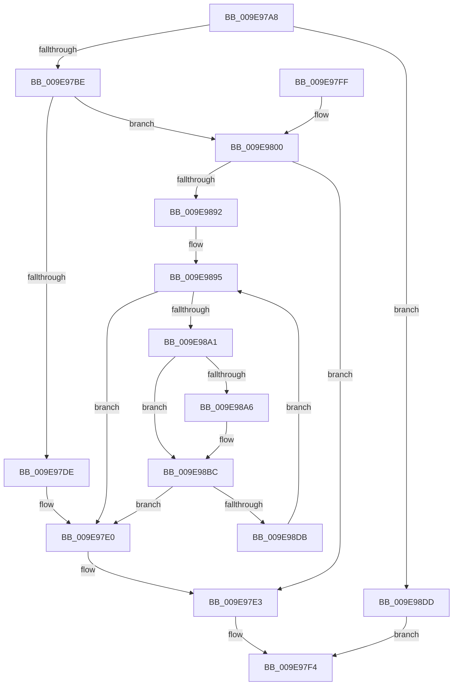

# PfCheckDeprioritizeImage

- RVA: `0x009E97A8`–`0x009E98E4` (길이 `316` bytes)
- VA: `0x00000001409E97A8`
- 실행 섹션: `PAGE`
- PDB 이름 있음: `예`; PDB Function 태그: `아니요`
- unwind 정보 RVA: `0x000A5144`
- 디코드: `86`개 명령, `316/316` bytes 표시
- 미해석 바이트: `0` (있으면 어셈블리에 `.byte`로 보존)

> 이 문서는 커널 이미지의 기계어와 PDB 기호를 분석해 생성했습니다. 4번과 5번은 함수 원형과 자료형을 바이너리 사용 방식에서 추정한 C 해석이며 원본 소스 복구 결과는 아닙니다.

## 1. Dependencies

- 직접 호출 지점: **2**; 고유 호출 대상: **2**
- 직접 호출자로 확인된 함수: **2**
- RIP 상대 이미지 참조: **4**

### Outgoing calls
- `0x009E97C5` → [FsRtlAcquirePushLockShared](../../text/48/FsRtlAcquirePushLockShared_function_0048B034.md) (function, `0x0048B034`)
- `0x009E97ED` → [PfLockSharedRelease](../../text/48/PfLockSharedRelease_function_0048DF24.md) (function, `0x0048DF24`)

### Direct callers
- [PfProcessCreateNotification](../95/PfProcessCreateNotification_function_0095EB98.md) at `0x0095EC21`
- [sub_009E9693](Unknown_function_009E9693.md) at `0x009E96C3`

### Static image references
- `0x009E97BE` → RVA `0x00E671C0` (`.data`; read)
- `0x009E97CA` → RVA `0x00E671B4` (`.data`; read)
- `0x009E9800` → RVA `0x00E671B0` (`.data`; read)
- `0x009E9807` → RVA `0x00E671A8` (`.data`; read)

## 2. Other-region calls and transfers

- 다른 실행 섹션으로 향하는 call: **2**
  - `0x009E97C5` → [FsRtlAcquirePushLockShared](../../text/48/FsRtlAcquirePushLockShared_function_0048B034.md) (`PAGE` → `.text`)
  - `0x009E97ED` → [PfLockSharedRelease](../../text/48/PfLockSharedRelease_function_0048DF24.md) (`PAGE` → `.text`)
- 별도 외부 분기/꼬리 이동을 확인하지 못했습니다.

## 3. Assembly (complete function range)

```asm
009E97A8  48 89 5C 24 08                  mov qword ptr [rsp + 8], rbx
009E97AD  57                              push rdi
009E97AE  48 83 EC 20                     sub rsp, 0x20
009E97B2  33 DB                           xor ebx, ebx
009E97B4  8B F9                           mov edi, ecx
009E97B6  85 C9                           test ecx, ecx
009E97B8  0F 84 1F 01 00 00               je 0x1409e98dd
009E97BE  48 8D 0D FB D9 47 00            lea rcx, [rip + 0x47d9fb]
009E97C5  E8 6A 18 AA FF                  call 0x14048b034
009E97CA  44 8B 05 E3 D9 47 00            mov r8d, dword ptr [rip + 0x47d9e3]
009E97D1  44 8B CF                        mov r9d, edi
009E97D4  48 89 7C 24 38                  mov qword ptr [rsp + 0x38], rdi
009E97D9  45 85 C0                        test r8d, r8d
009E97DC  75 22                           jne 0x1409e9800
009E97DE  8B C3                           mov eax, ebx
009E97E0  48 85 C0                        test rax, rax
009E97E3  48 8D 0D D6 D9 47 00            lea rcx, [rip + 0x47d9d6]
009E97EA  0F 95 C3                        setne bl
009E97ED  E8 32 47 AA FF                  call 0x14048df24
009E97F2  8B C3                           mov eax, ebx
009E97F4  48 8B 5C 24 30                  mov rbx, qword ptr [rsp + 0x30]
009E97F9  48 83 C4 20                     add rsp, 0x20
009E97FD  5F                              pop rdi
009E97FE  C3                              ret
009E97FF  CC                              int3
009E9800  44 8B 15 A9 D9 47 00            mov r10d, dword ptr [rip + 0x47d9a9]
009E9807  4C 8B 1D 9A D9 47 00            mov r11, qword ptr [rip + 0x47d99a]
009E980E  41 0F B6 C1                     movzx eax, r9b
009E9812  48 05 CB 5D B1 00               add rax, 0xb15dcb
009E9818  48 6B C8 25                     imul rcx, rax, 0x25
009E981C  0F B6 44 24 39                  movzx eax, byte ptr [rsp + 0x39]
009E9821  48 03 C8                        add rcx, rax
009E9824  0F B6 44 24 3A                  movzx eax, byte ptr [rsp + 0x3a]
009E9829  48 6B D1 25                     imul rdx, rcx, 0x25
009E982D  48 03 D0                        add rdx, rax
009E9830  0F B6 44 24 3B                  movzx eax, byte ptr [rsp + 0x3b]
009E9835  48 6B CA 25                     imul rcx, rdx, 0x25
009E9839  48 03 C8                        add rcx, rax
009E983C  0F B6 44 24 3C                  movzx eax, byte ptr [rsp + 0x3c]
009E9841  48 6B D1 25                     imul rdx, rcx, 0x25
009E9845  48 03 D0                        add rdx, rax
009E9848  0F B6 44 24 3D                  movzx eax, byte ptr [rsp + 0x3d]
009E984D  48 6B CA 25                     imul rcx, rdx, 0x25
009E9851  48 03 C8                        add rcx, rax
009E9854  0F B6 44 24 3E                  movzx eax, byte ptr [rsp + 0x3e]
009E9859  48 6B D1 25                     imul rdx, rcx, 0x25
009E985D  48 03 D0                        add rdx, rax
009E9860  0F B6 44 24 3F                  movzx eax, byte ptr [rsp + 0x3f]
009E9865  48 6B CA 25                     imul rcx, rdx, 0x25
009E9869  48 03 C8                        add rcx, rax
009E986C  41 8D 40 FF                     lea eax, [r8 - 1]
009E9870  8B D0                           mov edx, eax
009E9872  4C 8B C3                        mov r8, rbx
009E9875  8B F8                           mov edi, eax
009E9877  8B C1                           mov eax, ecx
009E9879  41 8B CA                        mov ecx, r10d
009E987C  48 23 D0                        and rdx, rax
009E987F  48 8B C2                        mov rax, rdx
009E9882  48 D3 E0                        shl rax, cl
009E9885  4A 8B 04 18                     mov rax, qword ptr [rax + r11]
009E9889  48 85 C0                        test rax, rax
009E988C  0F 84 51 FF FF FF               je 0x1409e97e3
009E9892  48 8B C8                        mov rcx, rax
009E9895  48 8B C1                        mov rax, rcx
009E9898  49 3B C9                        cmp rcx, r9
009E989B  0F 84 3F FF FF FF               je 0x1409e97e0
009E98A1  4D 85 C0                        test r8, r8
009E98A4  75 16                           jne 0x1409e98bc
009E98A6  B9 B1 79 37 9E                  mov ecx, 0x9e3779b1
009E98AB  49 8B C1                        mov rax, r9
009E98AE  48 0F AF C1                     imul rax, rcx
009E98B2  A8 01                           test al, 1
009E98B4  4C 8D 40 01                     lea r8, [rax + 1]
009E98B8  4C 0F 45 C0                     cmovne r8, rax
009E98BC  49 03 D0                        add rdx, r8
009E98BF  41 8B CA                        mov ecx, r10d
009E98C2  48 23 D7                        and rdx, rdi
009E98C5  48 8B C2                        mov rax, rdx
009E98C8  48 D3 E0                        shl rax, cl
009E98CB  4A 8B 04 18                     mov rax, qword ptr [rax + r11]
009E98CF  48 8B C8                        mov rcx, rax
009E98D2  48 85 C0                        test rax, rax
009E98D5  0F 84 05 FF FF FF               je 0x1409e97e0
009E98DB  EB B8                           jmp 0x1409e9895
009E98DD  33 C0                           xor eax, eax
009E98DF  E9 10 FF FF FF                  jmp 0x1409e97f4
```

## 4. C-style interpretation (structured pseudocode)

```c
__int64 __fastcall PfCheckDeprioritizeImage(int a1)
{
    __int64 result;
    __int64 v_rbx;
    __int64 v_rsp;
    unsigned __int64 v_stack_p10;
    unsigned __int8 v_stack_p39;
    unsigned __int8 v_stack_p3A;
    unsigned __int8 v_stack_p3B;
    unsigned __int8 v_stack_p3C;
    unsigned __int8 v_stack_p3D;
    unsigned __int8 v_stack_p3E;
    unsigned __int8 v_stack_p3F;
    unsigned __int64 v_stack_p8;

    v_stack_p8 = v_rbx;
    v_rsp = (v_rsp) - (32);
    v_rbx = 0;
    if (a1 == 0) goto loc_009E98DD;
    result = FsRtlAcquirePushLockShared(v_rip + 4708859, a2, a3, a4);
    v_stack_p10 = (unsigned int)(a1);
    if ((unsigned int)((unsigned int)(*(unsigned int *)(v_rip + 4708835))) != 0) goto loc_009E9800;
loc_009E97E0:
loc_009E97E3:
    v_rbx = (0 != 0) ? 1 : 0;
    result = PfLockSharedRelease(v_rip + 4708822, a2, (unsigned int)(*(unsigned int *)(v_rip + 4708835)), (unsigned int)((unsigned int)((unsigned int)(a1))));
loc_009E97F4:
    v_rsp = (v_rsp) + (32);
    return (unsigned int)((unsigned int)(v_rbx));
loc_009E9800:
    result = ((unsigned __int8)((unsigned int)((unsigned int)((unsigned int)(a1))))) + (0xB15DCBULL);
    a1 = (v_rip + 4708822) * (result);
    a1 = (a1) + (v_stack_p39);
    a2 = (a2) * (a1);
    a2 = (a2) + (v_stack_p3A);
    a1 = (a1) * (a2);
    a1 = (a1) + (v_stack_p3B);
    a2 = (a2) * (a1);
    a2 = (a2) + (v_stack_p3C);
    a1 = (a1) * (a2);
    a1 = (a1) + (v_stack_p3D);
    a2 = (a2) * (a1);
    a2 = (a2) + (v_stack_p3E);
    a1 = (a1) * (a2);
    a1 = (a1) + (v_stack_p3F);
    a2 = ((unsigned int)((unsigned int)((unsigned int)(*(unsigned int *)(v_rip + 4708835)) - 1))) & ((unsigned int)(a1));
    result = (a2) << ((unsigned __int8)((unsigned int)((unsigned int)((unsigned int)(*(unsigned int *)(v_rip + 4708777))))));
    if (*(unsigned __int64 *)(result + *(unsigned __int64 *)(v_rip + 4708762) * 1) == 0) goto loc_009E97E3;
loc_009E9895:
    if ((*(unsigned __int64 *)(result + *(unsigned __int64 *)(v_rip + 4708762) * 1)) == ((unsigned int)((unsigned int)((unsigned int)(a1))))) goto loc_009E97E0;
    result = *(unsigned __int64 *)(result + *(unsigned __int64 *)(v_rip + 4708762) * 1);
    if (v_stack_p8 == 0) {
        a1 = 0x9E3779B1ULL;
        result = (unsigned int)((unsigned int)((unsigned int)(a1)));
        result = (result) * (a1);
        a3 = result + 1;
        if ((((unsigned __int8)(result)) & (1)) != 0) { a3 = result; }
    }
    a2 = (a2) + (a3);
    a2 = (a2) & ((unsigned int)((unsigned int)((unsigned int)(*(unsigned int *)(v_rip + 4708835)) - 1)));
    result = (a2) << ((unsigned __int8)((unsigned int)((unsigned int)((unsigned int)(*(unsigned int *)(v_rip + 4708777))))));
    if (*(unsigned __int64 *)(result + *(unsigned __int64 *)(v_rip + 4708762) * 1) == 0) goto loc_009E97E0;
    goto loc_009E9895;
loc_009E98DD:
    result = 0;
    goto loc_009E97F4;
}
```

## 5. (Beta) C Style

```c
int64_t PfCheckDeprioritizeImage(int32_t Arg1)
{
    int64_t result;
    int64_t local_rbx;
    int64_t local_rsp;
    uint64_t v_stack_p10;
    uint8_t v_stack_p39;
    uint8_t v_stack_p3A;
    uint8_t v_stack_p3B;
    uint8_t v_stack_p3C;
    uint8_t v_stack_p3D;
    uint8_t v_stack_p3E;
    uint8_t v_stack_p3F;
    uint64_t v_stack_p8;

    v_stack_p8 = local_rbx;
    local_rsp = (local_rsp) - (32);
    local_rbx = 0;
    if (Arg1 == 0) goto loc_009E98DD;
    result = FsRtlAcquirePushLockShared(v_rip + 4708859, a2, a3, a4);
    v_stack_p10 = (uint32_t)(Arg1);
    if ((uint32_t)((uint32_t)(*(uint32_t *)(v_rip + 0x47D9E3))) != 0) goto loc_009E9800;
loc_009E97E0:
loc_009E97E3:
    local_rbx = (0 != 0) ? 1 : 0;
    result = PfLockSharedRelease(v_rip + 4708822, a2, (uint32_t)(*(uint32_t *)(v_rip + 0x47D9E3)), (uint32_t)((uint32_t)((uint32_t)(Arg1))));
loc_009E97F4:
    local_rsp = (local_rsp) + (32);
    return (uint32_t)((uint32_t)(local_rbx));
loc_009E9800:
    result = ((uint8_t)((uint32_t)((uint32_t)((uint32_t)(Arg1))))) + (0xB15DCBULL);
    Arg1 = (v_rip + 4708822) * (result);
    Arg1 = (Arg1) + (v_stack_p39);
    a2 = (a2) * (Arg1);
    a2 = (a2) + (v_stack_p3A);
    Arg1 = (Arg1) * (a2);
    Arg1 = (Arg1) + (v_stack_p3B);
    a2 = (a2) * (Arg1);
    a2 = (a2) + (v_stack_p3C);
    Arg1 = (Arg1) * (a2);
    Arg1 = (Arg1) + (v_stack_p3D);
    a2 = (a2) * (Arg1);
    a2 = (a2) + (v_stack_p3E);
    Arg1 = (Arg1) * (a2);
    Arg1 = (Arg1) + (v_stack_p3F);
    a2 = ((uint32_t)((uint32_t)((uint32_t)(*(uint32_t *)(v_rip + 0x47D9E3)) - 1))) & ((uint32_t)(Arg1));
    result = (a2) << ((uint8_t)((uint32_t)((uint32_t)((uint32_t)(*(uint32_t *)(v_rip + 0x47D9A9))))));
    if (*(uint64_t *)(result + *(uint64_t *)(v_rip + 0x47D99A) * 1) == 0) goto loc_009E97E3;
loc_009E9895:
    if ((*(uint64_t *)(result + *(uint64_t *)(v_rip + 0x47D99A) * 1)) == ((uint32_t)((uint32_t)((uint32_t)(Arg1))))) goto loc_009E97E0;
    result = *(uint64_t *)(result + *(uint64_t *)(v_rip + 0x47D99A) * 1);
    if (v_stack_p8 == 0) {
        Arg1 = 0x9E3779B1ULL;
        result = (uint32_t)((uint32_t)((uint32_t)(Arg1)));
        result = (result) * (Arg1);
        a3 = result + 1;
        if ((((uint8_t)(result)) & (1)) != 0) { a3 = result; }
    }
    a2 = (a2) + (a3);
    a2 = (a2) & ((uint32_t)((uint32_t)((uint32_t)(*(uint32_t *)(v_rip + 0x47D9E3)) - 1)));
    result = (a2) << ((uint8_t)((uint32_t)((uint32_t)((uint32_t)(*(uint32_t *)(v_rip + 0x47D9A9))))));
    if (*(uint64_t *)(result + *(uint64_t *)(v_rip + 0x47D99A) * 1) == 0) goto loc_009E97E0;
    goto loc_009E9895;
loc_009E98DD:
    result = 0;
    goto loc_009E97F4;
}
```

## 6. Execution-region graph

[열기: 2D/3D 그래프와 함수 탐색 컨트롤 패널](../../../control-panel.html?section=page&rva=0x009E97A8&view=graph)

- 2D 그래프는 위에서 아래로 흐르고, 3D 그래프는 빈 공간을 드래그해 회전합니다. Shift+드래그는 이동, 휠은 확대·축소, 함수 노드 선택은 대상 보고서 이동입니다.

### Static fallback


