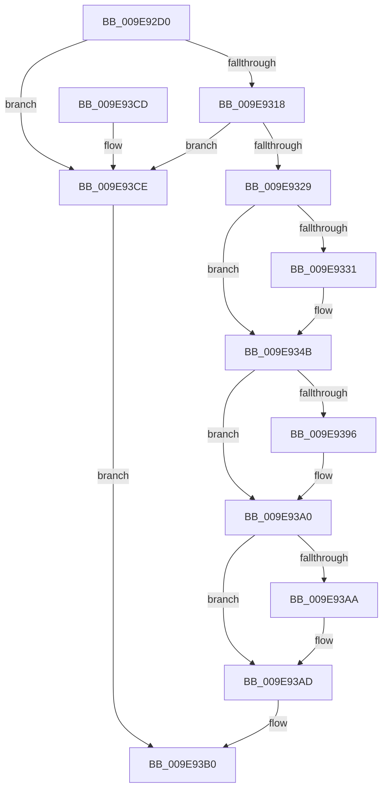

# PiAuVerifyAccessToObject

- RVA: `0x009E92D0`–`0x009E93D5` (길이 `261` bytes)
- VA: `0x00000001409E92D0`
- 실행 섹션: `PAGE`
- PDB 이름 있음: `예`; PDB Function 태그: `아니요`
- unwind 정보 RVA: `0x000A4F4C`
- 디코드: `67`개 명령, `261/261` bytes 표시
- 미해석 바이트: `0` (있으면 어셈블리에 `.byte`로 보존)

> 이 문서는 커널 이미지의 기계어와 PDB 기호를 분석해 생성했습니다. 4번과 5번은 함수 원형과 자료형을 바이너리 사용 방식에서 추정한 C 해석이며 원본 소스 복구 결과는 아닙니다.

## 1. Dependencies

- 직접 호출 지점: **3**; 고유 호출 대상: **3**
- 직접 호출자로 확인된 함수: **1**
- RIP 상대 이미지 참조: **0**

### Outgoing calls
- `0x009E9336` → [SeCaptureSubjectContext](../86/SeCaptureSubjectContext_function_0086B820.md) (function, `0x0086B820`)
- `0x009E938A` → [SeAccessCheck](../../text/3A/SeAccessCheck_function_003A6BC0.md) (function, `0x003A6BC0`)
- `0x009E939B` → [SeReleaseSubjectContext](../86/SeReleaseSubjectContext_function_0086B710.md) (function, `0x0086B710`)

### Direct callers
- [PiPnpRtlApplyMandatoryDeviceFilters](../8E/PiPnpRtlApplyMandatoryDeviceFilters_function_008E5E90.md) at `0x008E61F5`

### Static image references
- 디코드된 RIP-relative 메모리 참조가 없습니다.

## 2. Other-region calls and transfers

- 다른 실행 섹션으로 향하는 call: **1**
  - `0x009E938A` → [SeAccessCheck](../../text/3A/SeAccessCheck_function_003A6BC0.md) (`PAGE` → `.text`)
- 별도 외부 분기/꼬리 이동을 확인하지 못했습니다.

## 3. Assembly (complete function range)

```asm
009E92D0  48 8B C4                        mov rax, rsp
009E92D3  48 89 58 08                     mov qword ptr [rax + 8], rbx
009E92D7  48 89 68 18                     mov qword ptr [rax + 0x18], rbp
009E92DB  48 89 70 20                     mov qword ptr [rax + 0x20], rsi
009E92DF  57                              push rdi
009E92E0  41 56                           push r14
009E92E2  41 57                           push r15
009E92E4  48 81 EC 80 00 00 00            sub rsp, 0x80
009E92EB  45 33 FF                        xor r15d, r15d
009E92EE  0F 57 C0                        xorps xmm0, xmm0
009E92F1  44 89 78 B8                     mov dword ptr [rax - 0x48], r15d
009E92F5  49 8B F1                        mov rsi, r9
009E92F8  44 89 78 10                     mov dword ptr [rax + 0x10], r15d
009E92FC  49 8B E8                        mov rbp, r8
009E92FF  48 8B DA                        mov rbx, rdx
009E9302  44 8B F1                        mov r14d, ecx
009E9305  0F 11 40 C0                     movups xmmword ptr [rax - 0x40], xmm0
009E9309  0F 11 40 D0                     movups xmmword ptr [rax - 0x30], xmm0
009E930D  B0 01                           mov al, 1
009E930F  48 85 D2                        test rdx, rdx
009E9312  0F 84 B6 00 00 00               je 0x1409e93ce
009E9318  48 8B BC 24 C0 00 00 00         mov rdi, qword ptr [rsp + 0xc0]
009E9320  48 85 FF                        test rdi, rdi
009E9323  0F 84 A5 00 00 00               je 0x1409e93ce
009E9329  44 88 3F                        mov byte ptr [rdi], r15b
009E932C  4D 85 C9                        test r9, r9
009E932F  75 1A                           jne 0x1409e934b
009E9331  48 8D 4C 24 58                  lea rcx, [rsp + 0x58]
009E9336  E8 E5 24 E8 FF                  call 0x14086b820
009E933B  65 48 8B 04 25 88 01 00 00      mov rax, qword ptr gs:[0x188]
009E9344  0F B6 80 32 02 00 00            movzx eax, byte ptr [rax + 0x232]
009E934B  48 8D 8C 24 A8 00 00 00         lea rcx, [rsp + 0xa8]
009E9353  48 85 F6                        test rsi, rsi
009E9356  48 89 4C 24 48                  mov qword ptr [rsp + 0x48], rcx
009E935B  48 8D 54 24 58                  lea rdx, [rsp + 0x58]
009E9360  48 8D 4C 24 50                  lea rcx, [rsp + 0x50]
009E9365  48 0F 45 D6                     cmovne rdx, rsi
009E9369  48 89 4C 24 40                  mov qword ptr [rsp + 0x40], rcx
009E936E  45 8B CE                        mov r9d, r14d
009E9371  88 44 24 38                     mov byte ptr [rsp + 0x38], al
009E9375  45 33 C0                        xor r8d, r8d
009E9378  48 89 6C 24 30                  mov qword ptr [rsp + 0x30], rbp
009E937D  48 8B CB                        mov rcx, rbx
009E9380  4C 89 7C 24 28                  mov qword ptr [rsp + 0x28], r15
009E9385  44 89 7C 24 20                  mov dword ptr [rsp + 0x20], r15d
009E938A  E8 31 D8 9B FF                  call 0x1403a6bc0
009E938F  88 07                           mov byte ptr [rdi], al
009E9391  48 85 F6                        test rsi, rsi
009E9394  75 0A                           jne 0x1409e93a0
009E9396  48 8D 4C 24 58                  lea rcx, [rsp + 0x58]
009E939B  E8 70 23 E8 FF                  call 0x14086b710
009E93A0  44 39 BC 24 A8 00 00 00         cmp dword ptr [rsp + 0xa8], r15d
009E93A8  7D 03                           jge 0x1409e93ad
009E93AA  44 88 3F                        mov byte ptr [rdi], r15b
009E93AD  41 8B C7                        mov eax, r15d
009E93B0  4C 8D 9C 24 80 00 00 00         lea r11, [rsp + 0x80]
009E93B8  49 8B 5B 20                     mov rbx, qword ptr [r11 + 0x20]
009E93BC  49 8B 6B 30                     mov rbp, qword ptr [r11 + 0x30]
009E93C0  49 8B 73 38                     mov rsi, qword ptr [r11 + 0x38]
009E93C4  49 8B E3                        mov rsp, r11
009E93C7  41 5F                           pop r15
009E93C9  41 5E                           pop r14
009E93CB  5F                              pop rdi
009E93CC  C3                              ret
009E93CD  CC                              int3
009E93CE  B8 0D 00 00 C0                  mov eax, 0xc000000d
009E93D3  EB DB                           jmp 0x1409e93b0
```

## 4. C-style interpretation (structured pseudocode)

```c
__int64 __fastcall PiAuVerifyAccessToObject(int a1, __int64 a2, __int64 a3, __int64 a4, __int64 a5)
{
    __int64 result;
    __int64 v_r15;
    __int64 v_rsp;
    unsigned __int64 v_stack_m18;
    unsigned __int64 v_stack_m40;
    unsigned __int64 v_stack_m48;
    unsigned __int64 v_stack_m50;
    unsigned __int64 v_stack_m58;
    unsigned __int8 v_stack_m60;
    unsigned __int64 v_stack_m68;
    unsigned __int64 v_stack_m70;
    unsigned int v_stack_m78;
    unsigned __int64 v_stack_p10;

    *(unsigned __int64 *)(v_rsp + 8) = v_rbx;
    *(unsigned __int64 *)(v_rsp + 24) = v_rbp;
    *(unsigned __int64 *)(v_rsp + 32) = v_rsi;
    v_rsp = (v_rsp) - (128);
    v_r15 = 0;
    *(unsigned int *)(v_rsp - 72) = 0;
    *(unsigned int *)(v_rsp + 16) = 0;
    *(unsigned __int64 *)(v_rsp - 64) = v_xmm0;
    *(unsigned __int64 *)(v_rsp - 48) = v_xmm0;
    if (a2 == 0) goto loc_009E93CE;
    if (a5 == 0) goto loc_009E93CE;
    *(unsigned __int8 *)(a5) = 0;
    result = 1;
    if (a4 == 0) {
        a1 = v_stack_m40;
        result = SeCaptureSubjectContext(a1, a2, a3, a4);
        result = *(unsigned __int64 *)(gs_base + (0 + 392));
        result = *(unsigned __int8 *)(result + 562);
    }
    v_stack_m50 = v_stack_p10;
    a2 = v_stack_m40;
    if (a4 != 0) { a2 = a4; }
    v_stack_m58 = v_stack_m48;
    v_stack_m60 = (unsigned __int8)(result);
    a3 = 0;
    v_stack_m68 = 0;
    v_stack_m70 = 0;
    v_stack_m78 = 0;
    result = SeAccessCheck(a2, a2, a3, (unsigned int)((unsigned int)((unsigned int)(a1))));
    *(unsigned __int8 *)(a5) = (unsigned __int8)(result);
    if (a4 == 0) {
        a1 = v_stack_m40;
        result = SeReleaseSubjectContext(a1, a2, a3, (unsigned int)((unsigned int)((unsigned int)(a1))));
    }
    if (v_stack_p10 < 0) {
        *(unsigned __int8 *)(a5) = 0;
    }
loc_009E93B0:
    return 0;
loc_009E93CE:
    goto loc_009E93B0;
}
```

## 5. (Beta) C Style

```c
int64_t PiAuVerifyAccessToObject(int32_t Arg1, int64_t Arg2, int64_t Arg3, int64_t Arg4, int64_t Arg5)
{
    int64_t result;
    int64_t local_r15;
    int64_t local_rsp;
    uint64_t v_stack_m18;
    uint64_t v_stack_m40;
    uint64_t v_stack_m48;
    uint64_t v_stack_m50;
    uint64_t v_stack_m58;
    uint8_t v_stack_m60;
    uint64_t v_stack_m68;
    uint64_t v_stack_m70;
    uint32_t v_stack_m78;
    uint64_t v_stack_p10;

    *(uint64_t *)(local_rsp + 0x8) = local_rbx;
    *(uint64_t *)(local_rsp + 0x18) = local_rbp;
    *(uint64_t *)(local_rsp + 0x20) = local_rsi;
    local_rsp = (local_rsp) - (128);
    local_r15 = 0;
    *(uint32_t *)(local_rsp - 0x48) = 0;
    *(uint32_t *)(local_rsp + 0x10) = 0;
    *(uint64_t *)(local_rsp - 0x40) = v_xmm0;
    *(uint64_t *)(local_rsp - 0x30) = v_xmm0;
    if (Arg2 == 0) goto loc_009E93CE;
    if (Arg5 == 0) goto loc_009E93CE;
    *(uint8_t *)(Arg5) = 0;
    result = 1;
    if (Arg4 == 0) {
        Arg1 = v_stack_m40;
        result = SeCaptureSubjectContext(Arg1, Arg2, Arg3, Arg4);
        result = *(uint64_t *)(gs_base + (0 + 0x188));
        result = *(uint8_t *)(result + 0x232);
    }
    v_stack_m50 = v_stack_p10;
    Arg2 = v_stack_m40;
    if (Arg4 != 0) { Arg2 = Arg4; }
    v_stack_m58 = v_stack_m48;
    v_stack_m60 = (uint8_t)(result);
    Arg3 = 0;
    v_stack_m68 = 0;
    v_stack_m70 = 0;
    v_stack_m78 = 0;
    result = SeAccessCheck(Arg2, Arg2, Arg3, (uint32_t)((uint32_t)((uint32_t)(Arg1))));
    *(uint8_t *)(Arg5) = (uint8_t)(result);
    if (Arg4 == 0) {
        Arg1 = v_stack_m40;
        result = SeReleaseSubjectContext(Arg1, Arg2, Arg3, (uint32_t)((uint32_t)((uint32_t)(Arg1))));
    }
    if (v_stack_p10 < 0) {
        *(uint8_t *)(Arg5) = 0;
    }
loc_009E93B0:
    return 0;
loc_009E93CE:
    goto loc_009E93B0;
}
```

## 6. Execution-region graph

[열기: 2D/3D 그래프와 함수 탐색 컨트롤 패널](../../../control-panel.html?section=page&rva=0x009E92D0&view=graph)

- 2D 그래프는 위에서 아래로 흐르고, 3D 그래프는 빈 공간을 드래그해 회전합니다. Shift+드래그는 이동, 휠은 확대·축소, 함수 노드 선택은 대상 보고서 이동입니다.

### Static fallback


