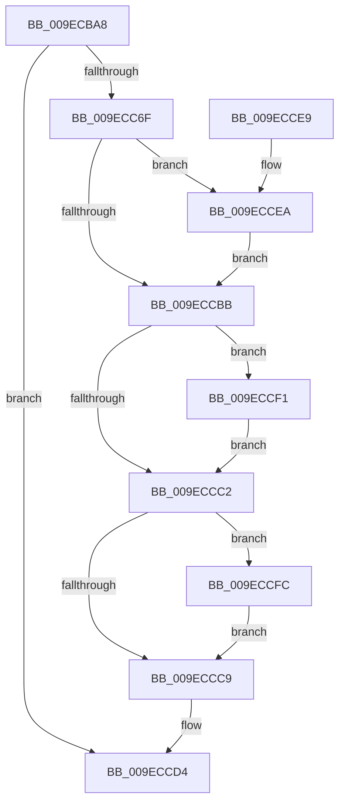

# PopInitSystemSleeperThread

- RVA: `0x009ECBA8`–`0x009ECD07` (길이 `351` bytes)
- VA: `0x00000001409ECBA8`
- 실행 섹션: `PAGE`
- PDB 이름 있음: `예`; PDB Function 태그: `아니요`
- unwind 정보 RVA: `0x000A5B44`
- 디코드: `91`개 명령, `351/351` bytes 표시
- 미해석 바이트: `0` (있으면 어셈블리에 `.byte`로 보존)

> 이 문서는 커널 이미지의 기계어와 PDB 기호를 분석해 생성했습니다. 4번과 5번은 함수 원형과 자료형을 바이너리 사용 방식에서 추정한 C 해석이며 원본 소스 복구 결과는 아닙니다.

## 1. Dependencies

- 직접 호출 지점: **12**; 고유 호출 대상: **9**
- 직접 호출자로 확인된 함수: **1**
- RIP 상대 이미지 참조: **1**

### Outgoing calls
- `0x009ECBF9` → [KeInitializeEvent](../../text/40/KeInitializeEvent_function_0040DD10.md) (function, `0x0040DD10`)
- `0x009ECC07` → [KeInitializeEvent](../../text/40/KeInitializeEvent_function_0040DD10.md) (function, `0x0040DD10`)
- `0x009ECC15` → [KeInitializeEvent](../../text/40/KeInitializeEvent_function_0040DD10.md) (function, `0x0040DD10`)
- `0x009ECC66` → [PsCreateSystemThreadEx](PsCreateSystemThreadEx_function_009ED120.md) (function, `0x009ED120`)
- `0x009ECC73` → [ZwClose](../../text/6A/ZwClose_function_006AD2B0.md) (function, `0x006AD2B0`)
- `0x009ECC80` → [PsLookupProcessByProcessId](../8A/PsLookupProcessByProcessId_function_008A2AA0.md) (function, `0x008A2AA0`)
- `0x009ECC8D` → [PsLookupThreadByThreadId](../86/PsLookupThreadByThreadId_function_00868300.md) (function, `0x00868300`)
- `0x009ECC9A` → [PopPushPowerStateTransitionRecord](../../pagelk/B7/PopPushPowerStateTransitionRecord_function_00B7CC90.md) (function, `0x00B7CC90`)
- `0x009ECCB2` → [KeWaitForSingleObject](../../text/20/KeWaitForSingleObject_function_0020E6B0.md) (function, `0x0020E6B0`)
- `0x009ECCEA` → [PoDelistPowerStateTransitionBlocker](../../pagelk/B7/PoDelistPowerStateTransitionBlocker_function_00B795D4.md) (function, `0x00B795D4`)
- `0x009ECCF5` → [ObfDereferenceObject](../../text/2F/ObfDereferenceObject_function_002F9350.md) (function, `0x002F9350`)
- `0x009ECD00` → [ObfDereferenceObject](../../text/2F/ObfDereferenceObject_function_002F9350.md) (function, `0x002F9350`)

### Direct callers
- [PopTransitionSystemPowerStateEx](../../pagelk/B7/PopTransitionSystemPowerStateEx_function_00B7E8C0.md) at `0x00B7F181`

### Static image references
- `0x009ECC20` → RVA `0x00B76970` (`PopTransitionToSleep`; read)

## 2. Other-region calls and transfers

- 다른 실행 섹션으로 향하는 call: **9**
  - `0x009ECBF9` → [KeInitializeEvent](../../text/40/KeInitializeEvent_function_0040DD10.md) (`PAGE` → `.text`)
  - `0x009ECC07` → [KeInitializeEvent](../../text/40/KeInitializeEvent_function_0040DD10.md) (`PAGE` → `.text`)
  - `0x009ECC15` → [KeInitializeEvent](../../text/40/KeInitializeEvent_function_0040DD10.md) (`PAGE` → `.text`)
  - `0x009ECC73` → [ZwClose](../../text/6A/ZwClose_function_006AD2B0.md) (`PAGE` → `.text`)
  - `0x009ECC9A` → [PopPushPowerStateTransitionRecord](../../pagelk/B7/PopPushPowerStateTransitionRecord_function_00B7CC90.md) (`PAGE` → `PAGELK`)
  - `0x009ECCB2` → [KeWaitForSingleObject](../../text/20/KeWaitForSingleObject_function_0020E6B0.md) (`PAGE` → `.text`)
  - `0x009ECCEA` → [PoDelistPowerStateTransitionBlocker](../../pagelk/B7/PoDelistPowerStateTransitionBlocker_function_00B795D4.md) (`PAGE` → `PAGELK`)
  - `0x009ECCF5` → [ObfDereferenceObject](../../text/2F/ObfDereferenceObject_function_002F9350.md) (`PAGE` → `.text`)
  - `0x009ECD00` → [ObfDereferenceObject](../../text/2F/ObfDereferenceObject_function_002F9350.md) (`PAGE` → `.text`)
- 별도 외부 분기/꼬리 이동을 확인하지 못했습니다.

## 3. Assembly (complete function range)

```asm
009ECBA8  48 89 5C 24 08                  mov qword ptr [rsp + 8], rbx
009ECBAD  55                              push rbp
009ECBAE  41 56                           push r14
009ECBB0  41 57                           push r15
009ECBB2  48 8D 6C 24 B9                  lea rbp, [rsp - 0x47]
009ECBB7  48 81 EC A0 00 00 00            sub rsp, 0xa0
009ECBBE  83 65 2B 00                     and dword ptr [rbp + 0x2b], 0
009ECBC2  4C 8B F2                        mov r14, rdx
009ECBC5  48 83 65 F7 00                  and qword ptr [rbp - 9], 0
009ECBCA  4D 8B F8                        mov r15, r8
009ECBCD  48 83 65 6F 00                  and qword ptr [rbp + 0x6f], 0
009ECBD2  45 33 C0                        xor r8d, r8d
009ECBD5  48 83 65 7F 00                  and qword ptr [rbp + 0x7f], 0
009ECBDA  0F 57 C0                        xorps xmm0, xmm0
009ECBDD  89 4A 48                        mov dword ptr [rdx + 0x48], ecx
009ECBE0  49 8B CE                        mov rcx, r14
009ECBE3  48 C7 45 0F 30 00 00 00         mov qword ptr [rbp + 0xf], 0x30
009ECBEB  83 65 13 00                     and dword ptr [rbp + 0x13], 0
009ECBEF  41 8D 58 01                     lea ebx, [r8 + 1]
009ECBF3  8B D3                           mov edx, ebx
009ECBF5  0F 11 45 FF                     movups xmmword ptr [rbp - 1], xmm0
009ECBF9  E8 12 11 A2 FF                  call 0x14040dd10
009ECBFE  49 8D 4E 18                     lea rcx, [r14 + 0x18]
009ECC02  45 33 C0                        xor r8d, r8d
009ECC05  8B D3                           mov edx, ebx
009ECC07  E8 04 11 A2 FF                  call 0x14040dd10
009ECC0C  49 8D 4E 30                     lea rcx, [r14 + 0x30]
009ECC10  45 33 C0                        xor r8d, r8d
009ECC13  8B D3                           mov edx, ebx
009ECC15  E8 F6 10 A2 FF                  call 0x14040dd10
009ECC1A  48 83 64 24 40 00               and qword ptr [rsp + 0x40], 0
009ECC20  48 8D 05 49 9D 18 00            lea rax, [rip + 0x189d49]
009ECC27  48 83 64 24 38 00               and qword ptr [rsp + 0x38], 0
009ECC2D  4C 8D 45 0F                     lea r8, [rbp + 0xf]
009ECC31  48 83 65 17 00                  and qword ptr [rbp + 0x17], 0
009ECC36  48 8D 4D F7                     lea rcx, [rbp - 9]
009ECC3A  48 83 65 1F 00                  and qword ptr [rbp + 0x1f], 0
009ECC3F  0F 57 C0                        xorps xmm0, xmm0
009ECC42  4C 89 74 24 30                  mov qword ptr [rsp + 0x30], r14
009ECC47  45 33 C9                        xor r9d, r9d
009ECC4A  48 89 44 24 28                  mov qword ptr [rsp + 0x28], rax
009ECC4F  33 D2                           xor edx, edx
009ECC51  48 8D 45 FF                     lea rax, [rbp - 1]
009ECC55  C7 45 27 00 02 00 00            mov dword ptr [rbp + 0x27], 0x200
009ECC5C  48 89 44 24 20                  mov qword ptr [rsp + 0x20], rax
009ECC61  F3 0F 7F 45 2F                  movdqu xmmword ptr [rbp + 0x2f], xmm0
009ECC66  E8 B5 04 00 00                  call 0x1409ed120
009ECC6B  85 C0                           test eax, eax
009ECC6D  78 65                           js 0x1409eccd4
009ECC6F  48 8B 4D F7                     mov rcx, qword ptr [rbp - 9]
009ECC73  E8 38 06 CC FF                  call 0x1406ad2b0
009ECC78  48 8B 4D FF                     mov rcx, qword ptr [rbp - 1]
009ECC7C  48 8D 55 6F                     lea rdx, [rbp + 0x6f]
009ECC80  E8 1B 5E EB FF                  call 0x1408a2aa0
009ECC85  48 8B 4D 07                     mov rcx, qword ptr [rbp + 7]
009ECC89  48 8D 55 7F                     lea rdx, [rbp + 0x7f]
009ECC8D  E8 6E B6 E7 FF                  call 0x140868300
009ECC92  48 8B 55 7F                     mov rdx, qword ptr [rbp + 0x7f]
009ECC96  48 8B 4D 6F                     mov rcx, qword ptr [rbp + 0x6f]
009ECC9A  E8 F1 FF 18 00                  call 0x140b7cc90
009ECC9F  48 83 64 24 20 00               and qword ptr [rsp + 0x20], 0
009ECCA5  45 33 C9                        xor r9d, r9d
009ECCA8  45 33 C0                        xor r8d, r8d
009ECCAB  33 D2                           xor edx, edx
009ECCAD  49 8B CE                        mov rcx, r14
009ECCB0  8B D8                           mov ebx, eax
009ECCB2  E8 F9 19 82 FF                  call 0x14020e6b0
009ECCB7  85 DB                           test ebx, ebx
009ECCB9  79 2F                           jns 0x1409eccea
009ECCBB  48 83 7D 6F 00                  cmp qword ptr [rbp + 0x6f], 0
009ECCC0  75 2F                           jne 0x1409eccf1
009ECCC2  48 83 7D 7F 00                  cmp qword ptr [rbp + 0x7f], 0
009ECCC7  75 33                           jne 0x1409eccfc
009ECCC9  0F 10 45 FF                     movups xmm0, xmmword ptr [rbp - 1]
009ECCCD  33 C0                           xor eax, eax
009ECCCF  F3 41 0F 7F 07                  movdqu xmmword ptr [r15], xmm0
009ECCD4  48 8B 9C 24 C0 00 00 00         mov rbx, qword ptr [rsp + 0xc0]
009ECCDC  48 81 C4 A0 00 00 00            add rsp, 0xa0
009ECCE3  41 5F                           pop r15
009ECCE5  41 5E                           pop r14
009ECCE7  5D                              pop rbp
009ECCE8  C3                              ret
009ECCE9  CC                              int3
009ECCEA  E8 E5 C8 18 00                  call 0x140b795d4
009ECCEF  EB CA                           jmp 0x1409eccbb
009ECCF1  48 8B 4D 6F                     mov rcx, qword ptr [rbp + 0x6f]
009ECCF5  E8 56 C6 90 FF                  call 0x1402f9350
009ECCFA  EB C6                           jmp 0x1409eccc2
009ECCFC  48 8B 4D 7F                     mov rcx, qword ptr [rbp + 0x7f]
009ECD00  E8 4B C6 90 FF                  call 0x1402f9350
009ECD05  EB C2                           jmp 0x1409eccc9
```

## 4. C-style interpretation (structured pseudocode)

```c
__int64 __fastcall PopInitSystemSleeperThread(int a1, __int64 a2, __int64 a3, int a4)
{
    __int64 result;
    __int64 v_rsp;
    unsigned __int64 v_stack_m30;
    unsigned int v_stack_m34;
    unsigned int v_stack_m38;
    unsigned __int64 v_stack_m40;
    unsigned __int64 v_stack_m48;
    unsigned int v_stack_m4C;
    unsigned __int64 v_stack_m50;
    unsigned __int64 v_stack_m58;
    unsigned __int64 v_stack_m5F;
    unsigned __int64 v_stack_m60;
    unsigned __int64 v_stack_m68;
    unsigned __int64 v_stack_m78;
    unsigned __int64 v_stack_m80;
    unsigned __int64 v_stack_m88;
    unsigned __int64 v_stack_m90;
    unsigned __int64 v_stack_m98;
    unsigned __int64 v_stack_p10;
    unsigned __int64 v_stack_p20;
    unsigned __int64 v_stack_p8;

    v_stack_p8 = v_rbx;
    v_rsp = (v_rsp) - (160);
    a3 = 0;
    *(unsigned int *)(a2 + 72) = a1;
    v_stack_m50 = 48;
    v_stack_m60 = v_xmm0;
    result = KeInitializeEvent(a2, (unsigned int)((unsigned int)(a3 + 1)), a3, a4);
    a3 = 0;
    result = KeInitializeEvent(a2 + 24, (unsigned int)((unsigned int)(a3 + 1)), a3, a4);
    a3 = 0;
    result = KeInitializeEvent(a2 + 48, (unsigned int)((unsigned int)(a3 + 1)), a3, a4);
    v_stack_m88 = a2;
    a4 = 0;
    v_stack_m90 = v_rip + 1613129;
    a2 = 0;
    v_stack_m38 = 512;
    v_stack_m98 = v_stack_m60;
    v_stack_m30 = v_xmm0;
    result = PsCreateSystemThreadEx(v_stack_m68, a2, v_stack_m50, a4);
    if (sign_flag) goto loc_009ECCD4;
    result = ZwClose(v_stack_m68, a2, v_stack_m50, a4);
    result = PsLookupProcessByProcessId(v_stack_m60, v_stack_p10, v_stack_m50, a4);
    result = PsLookupThreadByThreadId(v_stack_m58, v_stack_p20, v_stack_m50, a4);
    result = PopPushPowerStateTransitionRecord(v_stack_p10, v_stack_p20, v_stack_m50, a4);
    a4 = 0;
    a3 = 0;
    a2 = 0;
    result = KeWaitForSingleObject(0, a2, a3, a4);
    if (!sign_flag) goto loc_009ECCEA;
loc_009ECCBB:
    if (v_stack_p10 != 0) goto loc_009ECCF1;
loc_009ECCC2:
    if (v_stack_p20 != 0) goto loc_009ECCFC;
loc_009ECCC9:
    result = 0;
    *(unsigned __int64 *)(a3) = v_xmm0;
loc_009ECCD4:
    v_rsp = (v_rsp) + (160);
    return result;
loc_009ECCEA:
    result = PoDelistPowerStateTransitionBlocker(0, a2, a3, a4);
    goto loc_009ECCBB;
loc_009ECCF1:
    result = ObfDereferenceObject(v_stack_p10, a2, a3, a4);
    goto loc_009ECCC2;
loc_009ECCFC:
    result = ObfDereferenceObject(v_stack_p20, a2, a3, a4);
    goto loc_009ECCC9;
}
```

## 5. (Beta) C Style

```c
int64_t PopInitSystemSleeperThread(int32_t Arg1, void *Arg2, void *Arg3, int32_t Arg4)
{
    uint8_t *arg2 = (uint8_t *)Arg2;
    uint8_t *arg3 = (uint8_t *)Arg3;

    int64_t result;
    int64_t local_rsp;
    uint64_t v_stack_m30;
    uint32_t v_stack_m34;
    uint32_t v_stack_m38;
    uint64_t v_stack_m40;
    uint64_t v_stack_m48;
    uint32_t v_stack_m4C;
    uint64_t v_stack_m50;
    uint64_t v_stack_m58;
    uint64_t v_stack_m5F;
    uint64_t v_stack_m60;
    uint64_t v_stack_m68;
    uint64_t v_stack_m78;
    uint64_t v_stack_m80;
    uint64_t v_stack_m88;
    uint64_t v_stack_m90;
    uint64_t v_stack_m98;
    uint64_t v_stack_p10;
    uint64_t v_stack_p20;
    uint64_t v_stack_p8;

    v_stack_p8 = local_rbx;
    local_rsp = (local_rsp) - (160);
    Arg3 = 0;
    *(uint32_t *)(arg2 + 0x48) = Arg1;
    v_stack_m50 = 48;
    v_stack_m60 = v_xmm0;
    result = KeInitializeEvent(Arg2, (uint32_t)((uint32_t)(Arg3 + 1)), Arg3, Arg4);
    Arg3 = 0;
    result = KeInitializeEvent(Arg2 + 24, (uint32_t)((uint32_t)(Arg3 + 1)), Arg3, Arg4);
    Arg3 = 0;
    result = KeInitializeEvent(Arg2 + 48, (uint32_t)((uint32_t)(Arg3 + 1)), Arg3, Arg4);
    v_stack_m88 = Arg2;
    Arg4 = 0;
    v_stack_m90 = v_rip + 1613129;
    Arg2 = 0;
    v_stack_m38 = 512;
    v_stack_m98 = v_stack_m60;
    v_stack_m30 = v_xmm0;
    result = PsCreateSystemThreadEx(v_stack_m68, Arg2, v_stack_m50, Arg4);
    if (sign_flag) goto loc_009ECCD4;
    result = ZwClose(v_stack_m68, Arg2, v_stack_m50, Arg4);
    result = PsLookupProcessByProcessId(v_stack_m60, v_stack_p10, v_stack_m50, Arg4);
    result = PsLookupThreadByThreadId(v_stack_m58, v_stack_p20, v_stack_m50, Arg4);
    result = PopPushPowerStateTransitionRecord(v_stack_p10, v_stack_p20, v_stack_m50, Arg4);
    Arg4 = 0;
    Arg3 = 0;
    Arg2 = 0;
    result = KeWaitForSingleObject(0, Arg2, Arg3, Arg4);
    if (!sign_flag) goto loc_009ECCEA;
loc_009ECCBB:
    if (v_stack_p10 != 0) goto loc_009ECCF1;
loc_009ECCC2:
    if (v_stack_p20 != 0) goto loc_009ECCFC;
loc_009ECCC9:
    result = 0;
    *(uint64_t *)(arg3) = v_xmm0;
loc_009ECCD4:
    local_rsp = (local_rsp) + (160);
    return result;
loc_009ECCEA:
    result = PoDelistPowerStateTransitionBlocker(0, Arg2, Arg3, Arg4);
    goto loc_009ECCBB;
loc_009ECCF1:
    result = ObfDereferenceObject(v_stack_p10, Arg2, Arg3, Arg4);
    goto loc_009ECCC2;
loc_009ECCFC:
    result = ObfDereferenceObject(v_stack_p20, Arg2, Arg3, Arg4);
    goto loc_009ECCC9;
}
```

### 관측된 메모리 오프셋

구조체 형식이 확인되지 않은 접근은 인자 기준의 오프셋으로만 기록했습니다.

| 기준 인자 | 오프셋 표현 | 폭 (bit) | 접근 |
|---|---:|---:|---|
| `Arg2` | `+ 0x18` | `64` | `R` |
| `Arg2` | `+ 0x30` | `64` | `R` |
| `Arg2` | `+ 0x48` | `32` | `W` |
| `Arg3` | `+ 0x0` | `128` | `W` |

## 6. Execution-region graph

[열기: 2D/3D 그래프와 함수 탐색 컨트롤 패널](../../../control-panel.html?section=page&rva=0x009ECBA8&view=graph)

- 2D 그래프는 위에서 아래로 흐르고, 3D 그래프는 빈 공간을 드래그해 회전합니다. Shift+드래그는 이동, 휠은 확대·축소, 함수 노드 선택은 대상 보고서 이동입니다.

### Static fallback


