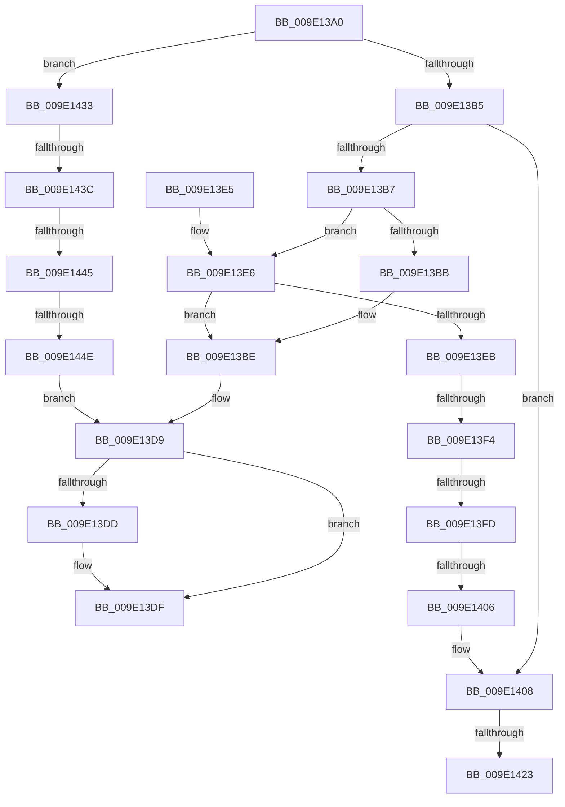

# PpmWmiDispatch

- RVA: `0x009E13A0`–`0x009E1469` (길이 `201` bytes)
- VA: `0x00000001409E13A0`
- 실행 섹션: `PAGE`
- PDB 이름 있음: `예`; PDB Function 태그: `예`
- unwind 정보 RVA: `0x000A3D0C`
- 디코드: `52`개 명령, `201/201` bytes 표시
- 미해석 바이트: `0` (있으면 어셈블리에 `.byte`로 보존)

> 이 문서는 커널 이미지의 기계어와 PDB 기호를 분석해 생성했습니다. 4번과 5번은 함수 원형과 자료형을 바이너리 사용 방식에서 추정한 C 해석이며 원본 소스 복구 결과는 아닙니다.

## 1. Dependencies

- 직접 호출 지점: **2**; 고유 호출 대상: **2**
- 직접 호출자로 확인된 함수: **1**
- RIP 상대 이미지 참조: **2**

### Outgoing calls
- `0x009E13D4` → [PpmWmiGetAllData](PpmWmiGetAllData_function_009E1470.md) (function, `0x009E1470`)
- `0x009E145F` → [PpmWmiRegisterInfo](../76/PpmWmiRegisterInfo_function_007686A4.md) (function, `0x007686A4`)

### Direct callers
- [WmipForwardWmiIrp](WmipForwardWmiIrp_function_009E0DB4.md) at `0x009E0E4E`

### Static image references
- `0x009E1410` → RVA `0x00024C78` (`.rdata`; read)
- `0x009E1423` → RVA `0x00024C80` (`.rdata`; read)

## 2. Other-region calls and transfers

- 다른 실행 섹션으로 향하는 call: **0**
- call이 아닌 외부 분기/꼬리 이동: **8**
  - `0x009E13EE` → [sub_00B30002 + 0x14D](../B3/Unknown_function_00B30002.md) (`tail-transfer`)
  - `0x009E13F7` → [sub_00B30002 + 0x14D](../B3/Unknown_function_00B30002.md) (`tail-transfer`)
  - `0x009E1400` → [sub_00B30002 + 0x14D](../B3/Unknown_function_00B30002.md) (`tail-transfer`)
  - `0x009E141D` → [sub_00B30002](../B3/Unknown_function_00B30002.md) (`tail-transfer`)
  - `0x009E142E` → [sub_00B30002](../B3/Unknown_function_00B30002.md) (`tail-transfer`)
  - `0x009E1436` → [sub_00B30002 + 0x14D](../B3/Unknown_function_00B30002.md) (`tail-transfer`)
  - `0x009E143F` → [sub_00B30002 + 0x14D](../B3/Unknown_function_00B30002.md) (`tail-transfer`)
  - `0x009E1448` → [sub_00B30002 + 0x14D](../B3/Unknown_function_00B30002.md) (`tail-transfer`)

## 3. Assembly (complete function range)

```asm
009E13A0  40 53                           push rbx
009E13A2  48 83 EC 30                     sub rsp, 0x30
009E13A6  4C 8B 5C 24 60                  mov r11, qword ptr [rsp + 0x60]
009E13AB  32 DB                           xor bl, bl
009E13AD  45 32 D2                        xor r10b, r10b
009E13B0  83 F9 05                        cmp ecx, 5
009E13B3  7F 7E                           jg 0x1409e1433
009E13B5  74 51                           je 0x1409e1408
009E13B7  85 C9                           test ecx, ecx
009E13B9  75 2B                           jne 0x1409e13e6
009E13BB  41 B2 01                        mov r10b, 1
009E13BE  48 8B 44 24 68                  mov rax, qword ptr [rsp + 0x68]
009E13C3  49 8D 8B 18 FF FF FF            lea rcx, [r11 - 0xe8]
009E13CA  44 88 54 24 28                  mov byte ptr [rsp + 0x28], r10b
009E13CF  48 89 44 24 20                  mov qword ptr [rsp + 0x20], rax
009E13D4  E8 97 00 00 00                  call 0x1409e1470
009E13D9  85 C0                           test eax, eax
009E13DB  78 02                           js 0x1409e13df
009E13DD  33 C0                           xor eax, eax
009E13DF  48 83 C4 30                     add rsp, 0x30
009E13E3  5B                              pop rbx
009E13E4  C3                              ret
009E13E5  CC                              int3
009E13E6  83 E9 01                        sub ecx, 1
009E13E9  74 D3                           je 0x1409e13be
009E13EB  83 E9 01                        sub ecx, 1
009E13EE  0F 84 5B ED 14 00               je 0x140b3014f
009E13F4  83 E9 01                        sub ecx, 1
009E13F7  0F 84 52 ED 14 00               je 0x140b3014f
009E13FD  83 F9 01                        cmp ecx, 1
009E1400  0F 85 49 ED 14 00               jne 0x140b3014f
009E1406  8A D9                           mov bl, cl
009E1408  48 8B 44 24 68                  mov rax, qword ptr [rsp + 0x68]
009E140D  83 20 00                        and dword ptr [rax], 0
009E1410  48 8B 0D 61 38 64 FF            mov rcx, qword ptr [rip - 0x9bc79f]
009E1417  48 8B 02                        mov rax, qword ptr [rdx]
009E141A  48 2B C8                        sub rcx, rax
009E141D  0F 85 DF EB 14 00               jne 0x140b30002
009E1423  48 8B 0D 56 38 64 FF            mov rcx, qword ptr [rip - 0x9bc7aa]
009E142A  48 2B 4A 08                     sub rcx, qword ptr [rdx + 8]
009E142E  E9 CF EB 14 00                  jmp 0x140b30002
009E1433  83 E9 06                        sub ecx, 6
009E1436  0F 84 13 ED 14 00               je 0x140b3014f
009E143C  83 E9 01                        sub ecx, 1
009E143F  0F 84 0A ED 14 00               je 0x140b3014f
009E1445  83 F9 01                        cmp ecx, 1
009E1448  0F 85 01 ED 14 00               jne 0x140b3014f
009E144E  48 8B 44 24 68                  mov rax, qword ptr [rsp + 0x68]
009E1453  41 8B 8B FC 76 FF FF            mov ecx, dword ptr [r11 - 0x8904]
009E145A  48 89 44 24 20                  mov qword ptr [rsp + 0x20], rax
009E145F  E8 40 72 D8 FF                  call 0x1407686a4
009E1464  E9 70 FF FF FF                  jmp 0x1409e13d9
```

## 4. C-style interpretation (structured pseudocode)

```c
__int64 __fastcall PpmWmiDispatch(int a1, __int64 a2, __int64 a3, __int64 a4, __int64 a5, __int64 a6)
{
    __int64 result;
    __int64 v_r10;
    __int64 v_rbx;
    __int64 v_rsp;
    unsigned __int8 v_stack_m10;
    unsigned __int64 v_stack_m18;
    unsigned __int64 v_stack_p20;

    v_rsp = (v_rsp) - (48);
    v_rbx = 0;
    v_r10 = 0;
    if (a1 > 5) goto loc_009E1433;
    if (a1 == 5) goto loc_009E1408;
    if (a1 != 0) goto loc_009E13E6;
loc_009E13BE:
    v_stack_m10 = 1;
    v_stack_m18 = a6;
    result = PpmWmiGetAllData(a5 - 232, a2, a3, a4);
loc_009E13D9:
    if (!(sign_flag)) {
        result = 0;
    }
    v_rsp = (v_rsp) + (48);
    return result;
loc_009E13E6:
    a1 = (unsigned int)((a5 - 232) - (1));
    if (condition_is_equal) goto loc_009E13BE;
    a1 = (unsigned int)((a1) - (1));
    a1 = (unsigned int)((a1) - (1));
loc_009E1408:
    a1 = (*(unsigned __int64 *)(v_rip - 10209183)) - (*(unsigned __int64 *)(a2));
    a1 = (*(unsigned __int64 *)(v_rip - 10209194)) - (*(unsigned __int64 *)(a2 + 8));
loc_009E1433:
    a1 = (unsigned int)((a1) - (6));
    a1 = (unsigned int)((a1) - (1));
    v_stack_p20 = a6;
    result = PpmWmiRegisterInfo((unsigned int)(*(unsigned int *)(a5 - 35076)), a2, a3, a4);
    goto loc_009E13D9;
}
```

## 5. (Beta) C Style

```c
int64_t PpmWmiDispatch(int32_t Arg1, void *Arg2, int64_t Arg3, int64_t Arg4, void *Arg5, void *Arg6)
{
    uint8_t *arg2 = (uint8_t *)Arg2;
    uint8_t *arg5 = (uint8_t *)Arg5;
    uint8_t *arg6 = (uint8_t *)Arg6;

    int64_t result;
    int64_t local_r10;
    int64_t local_rbx;
    int64_t local_rsp;
    uint8_t v_stack_m10;
    uint64_t v_stack_m18;
    uint64_t v_stack_p20;

    local_rsp = (local_rsp) - (48);
    local_rbx = 0;
    local_r10 = 0;
    if (Arg1 > 5) goto loc_009E1433;
    if (Arg1 == 5) goto loc_009E1408;
    if (Arg1 != 0) goto loc_009E13E6;
loc_009E13BE:
    v_stack_m10 = 1;
    v_stack_m18 = Arg6;
    result = PpmWmiGetAllData(Arg5 - 232, Arg2, Arg3, Arg4);
loc_009E13D9:
    if (!(sign_flag)) {
        result = 0;
    }
    local_rsp = (local_rsp) + (48);
    return result;
loc_009E13E6:
    Arg1 = (uint32_t)((Arg5 - 232) - (1));
    if (condition_is_equal) goto loc_009E13BE;
    Arg1 = (uint32_t)((Arg1) - (1));
    Arg1 = (uint32_t)((Arg1) - (1));
loc_009E1408:
    Arg1 = (*(uint64_t *)(v_rip - 0x9BC79F)) - (*(uint64_t *)(arg2));
    Arg1 = (*(uint64_t *)(v_rip - 0x9BC7AA)) - (*(uint64_t *)(arg2 + 0x8));
loc_009E1433:
    Arg1 = (uint32_t)((Arg1) - (6));
    Arg1 = (uint32_t)((Arg1) - (1));
    v_stack_p20 = Arg6;
    result = PpmWmiRegisterInfo((uint32_t)(*(uint32_t *)(arg5 - 0x8904)), Arg2, Arg3, Arg4);
    goto loc_009E13D9;
}
```

### 관측된 메모리 오프셋

구조체 형식이 확인되지 않은 접근은 인자 기준의 오프셋으로만 기록했습니다.

| 기준 인자 | 오프셋 표현 | 폭 (bit) | 접근 |
|---|---:|---:|---|
| `Arg2` | `+ 0x0` | `64` | `R` |
| `Arg2` | `+ 0x8` | `64` | `R` |
| `Arg5` | `- 0x8904` | `32` | `R` |
| `Arg5` | `- 0xE8` | `64` | `R` |
| `Arg6` | `+ 0x0` | `32` | `R/W` |

## 6. Execution-region graph

[열기: 2D/3D 그래프와 함수 탐색 컨트롤 패널](../../../control-panel.html?section=page&rva=0x009E13A0&view=graph)

- 2D 그래프는 위에서 아래로 흐르고, 3D 그래프는 빈 공간을 드래그해 회전합니다. Shift+드래그는 이동, 휠은 확대·축소, 함수 노드 선택은 대상 보고서 이동입니다.

### Static fallback


