# PpmWmiGetAllData

- RVA: `0x009E1470`–`0x009E1738` (길이 `712` bytes)
- VA: `0x00000001409E1470`
- 실행 섹션: `PAGE`
- PDB 이름 있음: `예`; PDB Function 태그: `예`
- unwind 정보 RVA: `0x000A3D28`
- 디코드: `182`개 명령, `712/712` bytes 표시
- 미해석 바이트: `0` (있으면 어셈블리에 `.byte`로 보존)

> 이 문서는 커널 이미지의 기계어와 PDB 기호를 분석해 생성했습니다. 4번과 5번은 함수 원형과 자료형을 바이너리 사용 방식에서 추정한 C 해석이며 원본 소스 복구 결과는 아닙니다.

## 1. Dependencies

- 직접 호출 지점: **4**; 고유 호출 대상: **4**
- 직접 호출자로 확인된 함수: **1**
- RIP 상대 이미지 참조: **7**

### Outgoing calls
- `0x009E14CB` → [PopAcquireRwLockShared](../../text/2D/PopAcquireRwLockShared_function_002D9A40.md) (function, `0x002D9A40`)
- `0x009E160B` → [memset](../../text/6C/memset_function_006C6C40.md) (function, `0x006C6C40`)
- `0x009E169E` → [PpmPerfGetCurrentState](../../text/44/PpmPerfGetCurrentState_function_00448C08.md) (function, `0x00448C08`)
- `0x009E172B` → [PopReleaseRwLock](../../text/2D/PopReleaseRwLock_function_002DFBBC.md) (function, `0x002DFBBC`)

### Direct callers
- [PpmWmiDispatch](PpmWmiDispatch_function_009E13A0.md) at `0x009E13D4`

### Static image references
- `0x009E148C` → RVA `0x00014610` (`.rdata`; read)
- `0x009E149C` → RVA `0x00014608` (`.rdata`; read)
- `0x009E14C1` → RVA `0x00F0CA70` (`.data`; read)
- `0x009E14E1` → RVA `0x000145F8` (`.rdata`; read)
- `0x009E14F7` → RVA `0x00014600` (`.rdata`; read)
- `0x009E1528` → RVA `0x000145E8` (`.rdata`; read)
- `0x009E1534` → RVA `0x000145F0` (`.rdata`; read)

## 2. Other-region calls and transfers

- 다른 실행 섹션으로 향하는 call: **4**
  - `0x009E14CB` → [PopAcquireRwLockShared](../../text/2D/PopAcquireRwLockShared_function_002D9A40.md) (`PAGE` → `.text`)
  - `0x009E160B` → [memset](../../text/6C/memset_function_006C6C40.md) (`PAGE` → `.text`)
  - `0x009E169E` → [PpmPerfGetCurrentState](../../text/44/PpmPerfGetCurrentState_function_00448C08.md) (`PAGE` → `.text`)
  - `0x009E172B` → [PopReleaseRwLock](../../text/2D/PopReleaseRwLock_function_002DFBBC.md) (`PAGE` → `.text`)
- call이 아닌 외부 분기/꼬리 이동: **2**
  - `0x009E1630` → [sub_00B30162](../B3/Unknown_function_00B30162.md) (`tail-transfer`)
  - `0x009E171F` → [sub_00B30162 + 0x5C](../B3/Unknown_function_00B30162.md) (`tail-transfer`)

## 3. Assembly (complete function range)

```asm
009E1470  48 89 5C 24 08                  mov qword ptr [rsp + 8], rbx
009E1475  48 89 6C 24 10                  mov qword ptr [rsp + 0x10], rbp
009E147A  48 89 74 24 18                  mov qword ptr [rsp + 0x18], rsi
009E147F  57                              push rdi
009E1480  41 54                           push r12
009E1482  41 55                           push r13
009E1484  41 56                           push r14
009E1486  41 57                           push r15
009E1488  48 83 EC 30                     sub rsp, 0x30
009E148C  4C 8B 15 7D 31 63 FF            mov r10, qword ptr [rip - 0x9cce83]
009E1493  48 8B FA                        mov rdi, rdx
009E1496  49 8B F1                        mov rsi, r9
009E1499  41 8B D8                        mov ebx, r8d
009E149C  4C 8B 0D 65 31 63 FF            mov r9, qword ptr [rip - 0x9cce9b]
009E14A3  4C 8B F9                        mov r15, rcx
009E14A6  49 8B D1                        mov rdx, r9
009E14A9  48 2B 17                        sub rdx, qword ptr [rdi]
009E14AC  75 07                           jne 0x1409e14b5
009E14AE  49 8B D2                        mov rdx, r10
009E14B1  48 2B 57 08                     sub rdx, qword ptr [rdi + 8]
009E14B5  45 33 DB                        xor r11d, r11d
009E14B8  48 85 D2                        test rdx, rdx
009E14BB  0F 85 01 01 00 00               jne 0x1409e15c2
009E14C1  48 8D 0D A8 B5 52 00            lea rcx, [rip + 0x52b5a8]
009E14C8  41 B4 01                        mov r12b, 1
009E14CB  E8 70 85 8F FF                  call 0x1402d9a40
009E14D0  4C 8B 15 39 31 63 FF            mov r10, qword ptr [rip - 0x9ccec7]
009E14D7  45 33 DB                        xor r11d, r11d
009E14DA  4C 8B 0D 27 31 63 FF            mov r9, qword ptr [rip - 0x9cced9]
009E14E1  48 8B 0D 10 31 63 FF            mov rcx, qword ptr [rip - 0x9ccef0]
009E14E8  48 8B 07                        mov rax, qword ptr [rdi]
009E14EB  4D 8B B7 70 01 00 00            mov r14, qword ptr [r15 + 0x170]
009E14F2  48 2B C8                        sub rcx, rax
009E14F5  75 0B                           jne 0x1409e1502
009E14F7  48 8B 0D 02 31 63 FF            mov rcx, qword ptr [rip - 0x9ccefe]
009E14FE  48 2B 4F 08                     sub rcx, qword ptr [rdi + 8]
009E1502  48 85 C9                        test rcx, rcx
009E1505  75 0C                           jne 0x1409e1513
009E1507  4D 85 F6                        test r14, r14
009E150A  74 07                           je 0x1409e1513
009E150C  B9 50 00 00 00                  mov ecx, 0x50
009E1511  EB 3F                           jmp 0x1409e1552
009E1513  4C 2B C8                        sub r9, rax
009E1516  75 07                           jne 0x1409e151f
009E1518  4D 8B CA                        mov r9, r10
009E151B  4C 2B 4F 08                     sub r9, qword ptr [rdi + 8]
009E151F  4D 85 C9                        test r9, r9
009E1522  0F 84 95 01 00 00               je 0x1409e16bd
009E1528  48 8B 0D B9 30 63 FF            mov rcx, qword ptr [rip - 0x9ccf47]
009E152F  48 2B C8                        sub rcx, rax
009E1532  75 0B                           jne 0x1409e153f
009E1534  48 8B 0D B5 30 63 FF            mov rcx, qword ptr [rip - 0x9ccf4b]
009E153B  48 2B 4F 08                     sub rcx, qword ptr [rdi + 8]
009E153F  48 85 C9                        test rcx, rcx
009E1542  0F 85 82 00 00 00               jne 0x1409e15ca
009E1548  4D 85 F6                        test r14, r14
009E154B  74 7D                           je 0x1409e15ca
009E154D  B9 0C 00 00 00                  mov ecx, 0xc
009E1552  44 8A 84 24 88 00 00 00         mov r8b, byte ptr [rsp + 0x88]
009E155A  41 8A C0                        mov al, r8b
009E155D  F6 D8                           neg al
009E155F  1B D2                           sbb edx, edx
009E1561  83 E2 08                        and edx, 8
009E1564  83 C2 40                        add edx, 0x40
009E1567  8D 2C 0A                        lea ebp, [rdx + rcx]
009E156A  3B DD                           cmp ebx, ebp
009E156C  73 66                           jae 0x1409e15d4
009E156E  83 FB 38                        cmp ebx, 0x38
009E1571  0F 82 3C 01 00 00               jb 0x1409e16b3
009E1577  89 6E 30                        mov dword ptr [rsi + 0x30], ebp
009E157A  BD 38 00 00 00                  mov ebp, 0x38
009E157F  C7 46 2C 20 00 00 00            mov dword ptr [rsi + 0x2c], 0x20
009E1586  41 8B DB                        mov ebx, r11d
009E1589  45 84 E4                        test r12b, r12b
009E158C  0F 85 92 01 00 00               jne 0x1409e1724
009E1592  48 8B 8C 24 80 00 00 00         mov rcx, qword ptr [rsp + 0x80]
009E159A  85 DB                           test ebx, ebx
009E159C  8B C3                           mov eax, ebx
009E159E  41 0F 48 EB                     cmovs ebp, r11d
009E15A2  89 29                           mov dword ptr [rcx], ebp
009E15A4  48 8B 5C 24 60                  mov rbx, qword ptr [rsp + 0x60]
009E15A9  48 8B 6C 24 68                  mov rbp, qword ptr [rsp + 0x68]
009E15AE  48 8B 74 24 70                  mov rsi, qword ptr [rsp + 0x70]
009E15B3  48 83 C4 30                     add rsp, 0x30
009E15B7  41 5F                           pop r15
009E15B9  41 5E                           pop r14
009E15BB  41 5D                           pop r13
009E15BD  41 5C                           pop r12
009E15BF  5F                              pop rdi
009E15C0  C3                              ret
009E15C1  CC                              int3
009E15C2  45 8A E3                        mov r12b, r11b
009E15C5  E9 17 FF FF FF                  jmp 0x1409e14e1
009E15CA  BB 10 00 00 C0                  mov ebx, 0xc0000010
009E15CF  41 8B EB                        mov ebp, r11d
009E15D2  EB B5                           jmp 0x1409e1589
009E15D4  8B DA                           mov ebx, edx
009E15D6  48 03 DE                        add rbx, rsi
009E15D9  89 2E                           mov dword ptr [rsi], ebp
009E15DB  45 84 C0                        test r8b, r8b
009E15DE  0F 84 C7 00 00 00               je 0x1409e16ab
009E15E4  48 A1 14 00 00 00 80 F7 FF FF   movabs rax, qword ptr [0xfffff78000000014]
009E15EE  83 4E 2C 10                     or dword ptr [rsi + 0x2c], 0x10
009E15F2  48 89 46 10                     mov qword ptr [rsi + 0x10], rax
009E15F6  C7 46 34 01 00 00 00            mov dword ptr [rsi + 0x34], 1
009E15FD  89 56 30                        mov dword ptr [rsi + 0x30], edx
009E1600  89 4E 3C                        mov dword ptr [rsi + 0x3c], ecx
009E1603  33 D2                           xor edx, edx
009E1605  44 8B C1                        mov r8d, ecx
009E1608  48 8B CB                        mov rcx, rbx
009E160B  E8 30 56 CE FF                  call 0x1406c6c40
009E1610  48 8B 0D E1 2F 63 FF            mov rcx, qword ptr [rip - 0x9cd01f]
009E1617  48 8B 07                        mov rax, qword ptr [rdi]
009E161A  48 2B C8                        sub rcx, rax
009E161D  75 0B                           jne 0x1409e162a
009E161F  48 8B 0D DA 2F 63 FF            mov rcx, qword ptr [rip - 0x9cd026]
009E1626  48 2B 4F 08                     sub rcx, qword ptr [rdi + 8]
009E162A  45 33 DB                        xor r11d, r11d
009E162D  48 85 C9                        test rcx, rcx
009E1630  0F 84 2C EB 14 00               je 0x140b30162
009E1636  48 8B 0D CB 2F 63 FF            mov rcx, qword ptr [rip - 0x9cd035]
009E163D  48 2B C8                        sub rcx, rax
009E1640  75 0B                           jne 0x1409e164d
009E1642  48 8B 0D C7 2F 63 FF            mov rcx, qword ptr [rip - 0x9cd039]
009E1649  48 2B 4F 08                     sub rcx, qword ptr [rdi + 8]
009E164D  48 85 C9                        test rcx, rcx
009E1650  0F 84 81 00 00 00               je 0x1409e16d7
009E1656  48 8B 0D 8B 2F 63 FF            mov rcx, qword ptr [rip - 0x9cd075]
009E165D  48 2B 0F                        sub rcx, qword ptr [rdi]
009E1660  75 0B                           jne 0x1409e166d
009E1662  48 8B 0D 87 2F 63 FF            mov rcx, qword ptr [rip - 0x9cd079]
009E1669  48 2B 4F 08                     sub rcx, qword ptr [rdi + 8]
009E166D  48 85 C9                        test rcx, rcx
009E1670  0F 85 10 FF FF FF               jne 0x1409e1586
009E1676  4D 85 F6                        test r14, r14
009E1679  0F 84 07 FF FF FF               je 0x1409e1586
009E167F  48 8D 43 04                     lea rax, [rbx + 4]
009E1683  4C 89 5C 24 28                  mov qword ptr [rsp + 0x28], r11
009E1688  4C 8D 4B 08                     lea r9, [rbx + 8]
009E168C  48 89 44 24 20                  mov qword ptr [rsp + 0x20], rax
009E1691  45 33 C0                        xor r8d, r8d
009E1694  49 8D 8F C0 77 FF FF            lea rcx, [r15 - 0x8840]
009E169B  48 8B D3                        mov rdx, rbx
009E169E  E8 65 75 A6 FF                  call 0x140448c08
009E16A3  45 33 DB                        xor r11d, r11d
009E16A6  E9 DB FE FF FF                  jmp 0x1409e1586
009E16AB  89 56 38                        mov dword ptr [rsi + 0x38], edx
009E16AE  E9 4D FF FF FF                  jmp 0x1409e1600
009E16B3  BB 23 00 00 C0                  mov ebx, 0xc0000023
009E16B8  E9 CC FE FF FF                  jmp 0x1409e1589
009E16BD  49 8B 0F                        mov rcx, qword ptr [r15]
009E16C0  48 85 C9                        test rcx, rcx
009E16C3  0F 84 5F FE FF FF               je 0x1409e1528
009E16C9  8B 49 28                        mov ecx, dword ptr [rcx + 0x28]
009E16CC  C1 E1 05                        shl ecx, 5
009E16CF  83 C1 38                        add ecx, 0x38
009E16D2  E9 7B FE FF FF                  jmp 0x1409e1552
009E16D7  49 8B 07                        mov rax, qword ptr [r15]
009E16DA  48 85 C0                        test rax, rax
009E16DD  0F 84 73 FF FF FF               je 0x1409e1656
009E16E3  8B 40 28                        mov eax, dword ptr [rax + 0x28]
009E16E6  89 43 04                        mov dword ptr [rbx + 4], eax
009E16E9  49 8B 07                        mov rax, qword ptr [r15]
009E16EC  8B 48 18                        mov ecx, dword ptr [rax + 0x18]
009E16EF  89 4B 08                        mov dword ptr [rbx + 8], ecx
009E16F2  49 8B 07                        mov rax, qword ptr [r15]
009E16F5  8B 48 20                        mov ecx, dword ptr [rax + 0x20]
009E16F8  89 4B 0C                        mov dword ptr [rbx + 0xc], ecx
009E16FB  49 8B 87 88 78 FF FF            mov rax, qword ptr [r15 - 0x8778]
009E1702  48 89 43 10                     mov qword ptr [rbx + 0x10], rax
009E1706  4D 8B 0F                        mov r9, qword ptr [r15]
009E1709  41 8B 41 28                     mov eax, dword ptr [r9 + 0x28]
009E170D  85 C0                           test eax, eax
009E170F  0F 84 71 FE FF FF               je 0x1409e1586
009E1715  4D 8B C3                        mov r8, r11
009E1718  48 83 C3 20                     add rbx, 0x20
009E171C  44 8B D0                        mov r10d, eax
009E171F  E9 9A EA 14 00                  jmp 0x140b301be
009E1724  48 8D 0D 45 B3 52 00            lea rcx, [rip + 0x52b345]
009E172B  E8 8C E4 8F FF                  call 0x1402dfbbc
009E1730  45 33 DB                        xor r11d, r11d
009E1733  E9 5A FE FF FF                  jmp 0x1409e1592
```

## 4. C-style interpretation (structured pseudocode)

```c
__int64 __fastcall PpmWmiGetAllData(__int64 a1, __int64 a2, int a3, __int64 a4, __int64 a5, unsigned __int8 a6)
{
    __int64 result;
    __int64 v_r11;
    __int64 v_rbp;
    __int64 v_rbx;
    __int64 v_rsp;
    unsigned __int64 v_stack_p10;
    unsigned __int64 v_stack_p18;
    unsigned __int64 v_stack_p20;
    unsigned __int64 v_stack_p28;
    unsigned __int64 v_stack_p8;

    v_stack_p8 = v_rbx;
    v_stack_p10 = v_rbp;
    v_stack_p18 = v_rsi;
    v_rsp = (v_rsp) - (48);
    a2 = (*(unsigned __int64 *)(v_rip - 10276507)) - (*(unsigned __int64 *)(a2));
    if (!(condition_is_not_equal)) {
        a2 = *(unsigned __int64 *)(v_rip - 10276483);
        a2 = (a2) - (*(unsigned __int64 *)(a2 + 8));
    }
    v_r11 = 0;
    if (a2 != 0) goto loc_009E15C2;
    result = PopAcquireRwLockShared(v_rip + 5420456, a2, a3, *(unsigned __int64 *)(v_rip - 10276507));
    v_r11 = 0;
loc_009E14E1:
    a1 = (*(unsigned __int64 *)(v_rip - 10276592)) - (*(unsigned __int64 *)(a2));
    if (!(condition_is_not_equal)) {
        a1 = *(unsigned __int64 *)(v_rip - 10276606);
        a1 = (a1) - (*(unsigned __int64 *)(a2 + 8));
    }
    if (a1 != 0) goto loc_009E1513;
    if (*(unsigned __int64 *)(a1 + 368) == 0) goto loc_009E1513;
    goto loc_009E1552;
loc_009E1513:
    a4 = (*(unsigned __int64 *)(v_rip - 10276569)) - (*(unsigned __int64 *)(a2));
    if (!(condition_is_not_equal)) {
        a4 = *(unsigned __int64 *)(v_rip - 10276551);
        a4 = (a4) - (*(unsigned __int64 *)(a2 + 8));
    }
    if (a4 == 0) goto loc_009E16BD;
loc_009E1528:
    a1 = (*(unsigned __int64 *)(v_rip - 10276679)) - (*(unsigned __int64 *)(a2));
    if (!(condition_is_not_equal)) {
        a1 = *(unsigned __int64 *)(v_rip - 10276683);
        a1 = (a1) - (*(unsigned __int64 *)(a2 + 8));
    }
    if (a1 != 0) goto loc_009E15CA;
    if (*(unsigned __int64 *)(a1 + 368) == 0) goto loc_009E15CA;
loc_009E1552:
    result = (unsigned __int8)(-(a6));
    a2 = (unsigned int)((a2) & (8));
    a2 = (unsigned int)((a2) + (64));
    if (((unsigned int)((unsigned int)(a3))) >= ((unsigned int)(a2 + 12 * 1))) goto loc_009E15D4;
    if (((unsigned int)((unsigned int)(a3))) < 56) goto loc_009E16B3;
    *(unsigned int *)(a4 + 48) = (unsigned int)(a2 + 12 * 1);
    *(unsigned int *)(a4 + 44) = 32;
loc_009E1586:
loc_009E1589:
    if (1 != 0) goto loc_009E1724;
loc_009E1592:
    v_rbp = 56;
    if (sign_flag) { v_rbp = 0; }
    *(unsigned int *)(a5) = (unsigned int)(v_rbp);
    v_rsp = (v_rsp) + (48);
    return 0;
loc_009E15C2:
    goto loc_009E14E1;
loc_009E15CA:
    goto loc_009E1589;
loc_009E15D4:
    v_rbx = ((unsigned int)((unsigned int)(a2))) + (v_stack_p18);
    *(unsigned int *)(v_stack_p18) = 0;
    if (a6 == 0) goto loc_009E16AB;
    *(unsigned __int64 *)(v_stack_p18 + 16) = 0;
    *(unsigned int *)(v_stack_p18 + 52) = 1;
    *(unsigned int *)(v_stack_p18 + 48) = (unsigned int)(a2);
loc_009E1600:
    *(unsigned int *)(v_stack_p18 + 60) = (unsigned int)(a5);
    a2 = 0;
    result = memset(v_rbx, a2, (unsigned int)((unsigned int)(a5)), a4);
    a1 = (*(unsigned __int64 *)(v_rip - 10276895)) - (*(unsigned __int64 *)(a2));
    if (!(condition_is_not_equal)) {
        a1 = *(unsigned __int64 *)(v_rip - 10276902);
        a1 = (a1) - (*(unsigned __int64 *)(a2 + 8));
    }
    v_r11 = 0;
    a1 = (*(unsigned __int64 *)(v_rip - 10276917)) - (*(unsigned __int64 *)(a2));
    if (!(condition_is_not_equal)) {
        a1 = *(unsigned __int64 *)(v_rip - 10276921);
        a1 = (a1) - (*(unsigned __int64 *)(a2 + 8));
    }
    if (a1 == 0) goto loc_009E16D7;
loc_009E1656:
    a1 = (*(unsigned __int64 *)(v_rip - 10276981)) - (*(unsigned __int64 *)(a2));
    if (!(condition_is_not_equal)) {
        a1 = *(unsigned __int64 *)(v_rip - 10276985);
        a1 = (a1) - (*(unsigned __int64 *)(a2 + 8));
    }
    if (a1 != 0) goto loc_009E1586;
    if (*(unsigned __int64 *)(a1 + 368) == 0) goto loc_009E1586;
    v_stack_p28 = 0;
    v_stack_p20 = v_rbx + 4;
    a3 = 0;
    result = PpmPerfGetCurrentState(a1 - 34880, v_rbx, a3, v_rbx + 8);
    v_r11 = 0;
    goto loc_009E1586;
loc_009E16AB:
    *(unsigned int *)(v_stack_p18 + 56) = (unsigned int)(v_rbx);
    goto loc_009E1600;
loc_009E16B3:
    goto loc_009E1589;
loc_009E16BD:
    if (*(unsigned __int64 *)(a1) == 0) goto loc_009E1528;
    a1 = (unsigned int)(((unsigned int)(*(unsigned int *)(*(unsigned __int64 *)(a1) + 40))) << (5));
    a1 = (unsigned int)((a1) + (56));
    goto loc_009E1552;
loc_009E16D7:
    if (*(unsigned __int64 *)(a1) == 0) goto loc_009E1656;
    *(unsigned int *)((unsigned int)(0xC0000023ULL) + 4) = (unsigned int)((unsigned int)(*(unsigned int *)(*(unsigned __int64 *)(a1) + 40)));
    *(unsigned int *)((unsigned int)(0xC0000023ULL) + 8) = (unsigned int)((unsigned int)(*(unsigned int *)(*(unsigned __int64 *)(a1) + 24)));
    *(unsigned int *)((unsigned int)(0xC0000023ULL) + 12) = (unsigned int)((unsigned int)(*(unsigned int *)(*(unsigned __int64 *)(a1) + 32)));
    *(unsigned __int64 *)((unsigned int)(0xC0000023ULL) + 16) = *(unsigned __int64 *)(a1 - 34680);
    if ((unsigned int)((unsigned int)(*(unsigned int *)(*(unsigned __int64 *)(a1) + 40))) == 0) goto loc_009E1586;
    v_rbx = ((unsigned int)(0xC0000023ULL)) + (32);
loc_009E1724:
    result = PopReleaseRwLock(v_rip + 5419845, v_rbx, 0, *(unsigned __int64 *)(a1));
    v_r11 = 0;
    goto loc_009E1592;
}
```

## 5. (Beta) C Style

```c
int64_t PpmWmiGetAllData(void *Arg1, void *Arg2, int32_t Arg3, void *Arg4, void *Arg5, uint8_t Arg6)
{
    uint8_t *arg1 = (uint8_t *)Arg1;
    uint8_t *arg2 = (uint8_t *)Arg2;
    uint8_t *arg4 = (uint8_t *)Arg4;
    uint8_t *arg5 = (uint8_t *)Arg5;

    int64_t result;
    int64_t local_r11;
    int64_t local_rbp;
    int64_t local_rbx;
    int64_t local_rsp;
    uint64_t v_stack_p10;
    uint64_t v_stack_p18;
    uint64_t v_stack_p20;
    uint64_t v_stack_p28;
    uint64_t v_stack_p8;

    v_stack_p8 = local_rbx;
    v_stack_p10 = local_rbp;
    v_stack_p18 = local_rsi;
    local_rsp = (local_rsp) - (48);
    Arg2 = (*(uint64_t *)(v_rip - 0x9CCE9B)) - (*(uint64_t *)(arg2));
    if (!(condition_is_not_equal)) {
        Arg2 = *(uint64_t *)(v_rip - 0x9CCE83);
        Arg2 = (Arg2) - (*(uint64_t *)(arg2 + 0x8));
    }
    local_r11 = 0;
    if (Arg2 != NULL) goto loc_009E15C2;
    result = PopAcquireRwLockShared(v_rip + 5420456, Arg2, Arg3, *(uint64_t *)(v_rip - 0x9CCE9B));
    local_r11 = 0;
loc_009E14E1:
    Arg1 = (*(uint64_t *)(v_rip - 0x9CCEF0)) - (*(uint64_t *)(arg2));
    if (!(condition_is_not_equal)) {
        Arg1 = *(uint64_t *)(v_rip - 0x9CCEFE);
        Arg1 = (Arg1) - (*(uint64_t *)(arg2 + 0x8));
    }
    if (Arg1 != NULL) goto loc_009E1513;
    if (*(uint64_t *)(arg1 + 0x170) == 0) goto loc_009E1513;
    goto loc_009E1552;
loc_009E1513:
    Arg4 = (*(uint64_t *)(v_rip - 0x9CCED9)) - (*(uint64_t *)(arg2));
    if (!(condition_is_not_equal)) {
        Arg4 = *(uint64_t *)(v_rip - 0x9CCEC7);
        Arg4 = (Arg4) - (*(uint64_t *)(arg2 + 0x8));
    }
    if (Arg4 == NULL) goto loc_009E16BD;
loc_009E1528:
    Arg1 = (*(uint64_t *)(v_rip - 0x9CCF47)) - (*(uint64_t *)(arg2));
    if (!(condition_is_not_equal)) {
        Arg1 = *(uint64_t *)(v_rip - 0x9CCF4B);
        Arg1 = (Arg1) - (*(uint64_t *)(arg2 + 0x8));
    }
    if (Arg1 != NULL) goto loc_009E15CA;
    if (*(uint64_t *)(arg1 + 0x170) == 0) goto loc_009E15CA;
loc_009E1552:
    result = (uint8_t)(-(Arg6));
    Arg2 = (uint32_t)((Arg2) & (8));
    Arg2 = (uint32_t)((Arg2) + (64));
    if (((uint32_t)((uint32_t)(Arg3))) >= ((uint32_t)(Arg2 + 12 * 1))) goto loc_009E15D4;
    if (((uint32_t)((uint32_t)(Arg3))) < 56) goto loc_009E16B3;
    *(uint32_t *)(arg4 + 0x30) = (uint32_t)(Arg2 + 12 * 1);
    *(uint32_t *)(arg4 + 0x2C) = 32;
loc_009E1586:
loc_009E1589:
    if (1 != 0) goto loc_009E1724;
loc_009E1592:
    local_rbp = 56;
    if (sign_flag) { local_rbp = 0; }
    *(uint32_t *)(arg5) = (uint32_t)(local_rbp);
    local_rsp = (local_rsp) + (48);
    return 0;
loc_009E15C2:
    goto loc_009E14E1;
loc_009E15CA:
    goto loc_009E1589;
loc_009E15D4:
    local_rbx = ((uint32_t)((uint32_t)(Arg2))) + (v_stack_p18);
    *(uint32_t *)(v_stack_p18) = 0;
    if (Arg6 == 0) goto loc_009E16AB;
    *(uint64_t *)(v_stack_p18 + 0x10) = 0;
    *(uint32_t *)(v_stack_p18 + 0x34) = 1;
    *(uint32_t *)(v_stack_p18 + 0x30) = (uint32_t)(Arg2);
loc_009E1600:
    *(uint32_t *)(v_stack_p18 + 0x3C) = (uint32_t)(Arg5);
    Arg2 = 0;
    result = memset(local_rbx, Arg2, (uint32_t)((uint32_t)(Arg5)), Arg4);
    Arg1 = (*(uint64_t *)(v_rip - 0x9CD01F)) - (*(uint64_t *)(arg2));
    if (!(condition_is_not_equal)) {
        Arg1 = *(uint64_t *)(v_rip - 0x9CD026);
        Arg1 = (Arg1) - (*(uint64_t *)(arg2 + 0x8));
    }
    local_r11 = 0;
    Arg1 = (*(uint64_t *)(v_rip - 0x9CD035)) - (*(uint64_t *)(arg2));
    if (!(condition_is_not_equal)) {
        Arg1 = *(uint64_t *)(v_rip - 0x9CD039);
        Arg1 = (Arg1) - (*(uint64_t *)(arg2 + 0x8));
    }
    if (Arg1 == NULL) goto loc_009E16D7;
loc_009E1656:
    Arg1 = (*(uint64_t *)(v_rip - 0x9CD075)) - (*(uint64_t *)(arg2));
    if (!(condition_is_not_equal)) {
        Arg1 = *(uint64_t *)(v_rip - 0x9CD079);
        Arg1 = (Arg1) - (*(uint64_t *)(arg2 + 0x8));
    }
    if (Arg1 != NULL) goto loc_009E1586;
    if (*(uint64_t *)(arg1 + 0x170) == 0) goto loc_009E1586;
    v_stack_p28 = 0;
    v_stack_p20 = local_rbx + 4;
    Arg3 = 0;
    result = PpmPerfGetCurrentState(Arg1 - 34880, local_rbx, Arg3, local_rbx + 8);
    local_r11 = 0;
    goto loc_009E1586;
loc_009E16AB:
    *(uint32_t *)(v_stack_p18 + 0x38) = (uint32_t)(local_rbx);
    goto loc_009E1600;
loc_009E16B3:
    goto loc_009E1589;
loc_009E16BD:
    if (*(uint64_t *)(arg1) == 0) goto loc_009E1528;
    Arg1 = (uint32_t)(((uint32_t)(*(uint32_t *)(*(uint64_t *)(arg1) + 0x28))) << (5));
    Arg1 = (uint32_t)((Arg1) + (56));
    goto loc_009E1552;
loc_009E16D7:
    if (*(uint64_t *)(arg1) == 0) goto loc_009E1656;
    *(uint32_t *)((uint32_t)(0xC0000023ULL) + 0x4) = (uint32_t)((uint32_t)(*(uint32_t *)(*(uint64_t *)(arg1) + 0x28)));
    *(uint32_t *)((uint32_t)(0xC0000023ULL) + 0x8) = (uint32_t)((uint32_t)(*(uint32_t *)(*(uint64_t *)(arg1) + 0x18)));
    *(uint32_t *)((uint32_t)(0xC0000023ULL) + 0xC) = (uint32_t)((uint32_t)(*(uint32_t *)(*(uint64_t *)(arg1) + 0x20)));
    *(uint64_t *)((uint32_t)(0xC0000023ULL) + 0x10) = *(uint64_t *)(arg1 - 0x8778);
    if ((uint32_t)((uint32_t)(*(uint32_t *)(*(uint64_t *)(arg1) + 0x28))) == 0) goto loc_009E1586;
    local_rbx = ((uint32_t)(0xC0000023ULL)) + (32);
loc_009E1724:
    result = PopReleaseRwLock(v_rip + 5419845, local_rbx, 0, *(uint64_t *)(arg1));
    local_r11 = 0;
    goto loc_009E1592;
}
```

### 관측된 메모리 오프셋

구조체 형식이 확인되지 않은 접근은 인자 기준의 오프셋으로만 기록했습니다.

| 기준 인자 | 오프셋 표현 | 폭 (bit) | 접근 |
|---|---:|---:|---|
| `Arg1` | `- 0x8840` | `64` | `R` |
| `Arg1` | `- 0x8778` | `64` | `R` |
| `Arg1` | `+ 0x0` | `64` | `R` |
| `Arg1` | `+ 0x170` | `64` | `R` |
| `Arg2` | `+ 0x0` | `64` | `R` |
| `Arg2` | `+ 0x8` | `64` | `R` |
| `Arg4` | `+ 0x0` | `32` | `W` |
| `Arg4` | `+ 0x10` | `64` | `W` |
| `Arg4` | `+ 0x2C` | `32` | `R/W` |
| `Arg4` | `+ 0x2C` | `32` | `W` |
| `Arg4` | `+ 0x30` | `32` | `W` |
| `Arg4` | `+ 0x34` | `32` | `W` |
| `Arg4` | `+ 0x38` | `32` | `W` |
| `Arg4` | `+ 0x3C` | `32` | `W` |
| `Arg5` | `+ 0x0` | `32` | `W` |

## 6. Execution-region graph

[열기: 2D/3D 그래프와 함수 탐색 컨트롤 패널](../../../control-panel.html?section=page&rva=0x009E1470&view=graph)

- 2D 그래프는 위에서 아래로 흐르고, 3D 그래프는 빈 공간을 드래그해 회전합니다. Shift+드래그는 이동, 휠은 확대·축소, 함수 노드 선택은 대상 보고서 이동입니다.

### Static fallback

```mermaid
flowchart TD
  bb_009E1470[BB_009E1470]
  bb_009E14AE[BB_009E14AE]
  bb_009E14B5[BB_009E14B5]
  bb_009E14C1[BB_009E14C1]
  bb_009E14E1[BB_009E14E1]
  bb_009E14F7[BB_009E14F7]
  bb_009E1502[BB_009E1502]
  bb_009E1507[BB_009E1507]
  bb_009E150C[BB_009E150C]
  bb_009E1513[BB_009E1513]
  bb_009E1518[BB_009E1518]
  bb_009E151F[BB_009E151F]
  bb_009E1528[BB_009E1528]
  bb_009E1534[BB_009E1534]
  bb_009E153F[BB_009E153F]
  bb_009E1548[BB_009E1548]
  bb_009E154D[BB_009E154D]
  bb_009E1552[BB_009E1552]
  bb_009E156E[BB_009E156E]
  bb_009E1577[BB_009E1577]
  bb_009E1586[BB_009E1586]
  bb_009E1589[BB_009E1589]
  bb_009E1592[BB_009E1592]
  bb_009E15C1[BB_009E15C1]
  bb_009E15C2[BB_009E15C2]
  bb_009E15CA[BB_009E15CA]
  bb_009E15D4[BB_009E15D4]
  bb_009E15E4[BB_009E15E4]
  bb_009E1600[BB_009E1600]
  bb_009E161F[BB_009E161F]
  bb_009E162A[BB_009E162A]
  bb_009E1636[BB_009E1636]
  bb_009E1642[BB_009E1642]
  bb_009E164D[BB_009E164D]
  bb_009E1656[BB_009E1656]
  bb_009E1662[BB_009E1662]
  bb_009E166D[BB_009E166D]
  bb_009E1676[BB_009E1676]
  bb_009E167F[BB_009E167F]
  bb_009E16AB[BB_009E16AB]
  bb_009E16B3[BB_009E16B3]
  bb_009E16BD[BB_009E16BD]
  bb_009E16C9[BB_009E16C9]
  bb_009E16D7[BB_009E16D7]
  bb_009E16E3[BB_009E16E3]
  bb_009E1715[BB_009E1715]
  bb_009E1724[BB_009E1724]
  bb_009E1470 -->|branch| bb_009E14B5
  bb_009E1470 -->|fallthrough| bb_009E14AE
  bb_009E14AE -->|flow| bb_009E14B5
  bb_009E14B5 -->|branch| bb_009E15C2
  bb_009E14B5 -->|fallthrough| bb_009E14C1
  bb_009E14C1 -->|flow| bb_009E14E1
  bb_009E14E1 -->|branch| bb_009E1502
  bb_009E14E1 -->|fallthrough| bb_009E14F7
  bb_009E14F7 -->|flow| bb_009E1502
  bb_009E1502 -->|branch| bb_009E1513
  bb_009E1502 -->|fallthrough| bb_009E1507
  bb_009E1507 -->|branch| bb_009E1513
  bb_009E1507 -->|fallthrough| bb_009E150C
  bb_009E150C -->|branch| bb_009E1552
  bb_009E1513 -->|branch| bb_009E151F
  bb_009E1513 -->|fallthrough| bb_009E1518
  bb_009E1518 -->|flow| bb_009E151F
  bb_009E151F -->|branch| bb_009E16BD
  bb_009E151F -->|fallthrough| bb_009E1528
  bb_009E1528 -->|branch| bb_009E153F
  bb_009E1528 -->|fallthrough| bb_009E1534
  bb_009E1534 -->|flow| bb_009E153F
  bb_009E153F -->|branch| bb_009E15CA
  bb_009E153F -->|fallthrough| bb_009E1548
  bb_009E1548 -->|branch| bb_009E15CA
  bb_009E1548 -->|fallthrough| bb_009E154D
  bb_009E154D -->|flow| bb_009E1552
  bb_009E1552 -->|branch| bb_009E15D4
  bb_009E1552 -->|fallthrough| bb_009E156E
  bb_009E156E -->|branch| bb_009E16B3
  bb_009E156E -->|fallthrough| bb_009E1577
  bb_009E1577 -->|flow| bb_009E1586
  bb_009E1586 -->|flow| bb_009E1589
  bb_009E1589 -->|branch| bb_009E1724
  bb_009E1589 -->|fallthrough| bb_009E1592
  bb_009E15C1 -->|flow| bb_009E15C2
  bb_009E15C2 -->|branch| bb_009E14E1
  bb_009E15CA -->|branch| bb_009E1589
  bb_009E15D4 -->|branch| bb_009E16AB
  bb_009E15D4 -->|fallthrough| bb_009E15E4
  bb_009E15E4 -->|flow| bb_009E1600
  bb_009E1600 -->|branch| bb_009E162A
  bb_009E1600 -->|fallthrough| bb_009E161F
  bb_009E161F -->|flow| bb_009E162A
  bb_009E162A -->|fallthrough| bb_009E1636
  bb_009E1636 -->|branch| bb_009E164D
  bb_009E1636 -->|fallthrough| bb_009E1642
  bb_009E1642 -->|flow| bb_009E164D
  bb_009E164D -->|branch| bb_009E16D7
  bb_009E164D -->|fallthrough| bb_009E1656
  bb_009E1656 -->|branch| bb_009E166D
  bb_009E1656 -->|fallthrough| bb_009E1662
  bb_009E1662 -->|flow| bb_009E166D
  bb_009E166D -->|branch| bb_009E1586
  bb_009E166D -->|fallthrough| bb_009E1676
  bb_009E1676 -->|branch| bb_009E1586
  bb_009E1676 -->|fallthrough| bb_009E167F
  bb_009E167F -->|branch| bb_009E1586
  bb_009E16AB -->|branch| bb_009E1600
  bb_009E16B3 -->|branch| bb_009E1589
  bb_009E16BD -->|branch| bb_009E1528
  bb_009E16BD -->|fallthrough| bb_009E16C9
  bb_009E16C9 -->|branch| bb_009E1552
  bb_009E16D7 -->|branch| bb_009E1656
  bb_009E16D7 -->|fallthrough| bb_009E16E3
  bb_009E16E3 -->|branch| bb_009E1586
  bb_009E16E3 -->|fallthrough| bb_009E1715
  bb_009E1724 -->|branch| bb_009E1592
```


