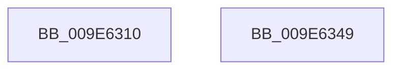

# PsCaptureUserProcessParameters

- RVA: `0x009E6310`–`0x009E634A` (길이 `58` bytes)
- VA: `0x00000001409E6310`
- 실행 섹션: `PAGE`
- PDB 이름 있음: `예`; PDB Function 태그: `아니요`
- unwind 정보 RVA: `0x0006E5F8`
- 디코드: `17`개 명령, `58/58` bytes 표시
- 미해석 바이트: `0` (있으면 어셈블리에 `.byte`로 보존)

> 이 문서는 커널 이미지의 기계어와 PDB 기호를 분석해 생성했습니다. 4번과 5번은 함수 원형과 자료형을 바이너리 사용 방식에서 추정한 C 해석이며 원본 소스 복구 결과는 아닙니다.

## 1. Dependencies

- 직접 호출 지점: **2**; 고유 호출 대상: **2**
- 직접 호출자로 확인된 함수: **0**
- RIP 상대 이미지 참조: **0**

### Outgoing calls
- `0x009E6320` → [PsGetCurrentServerSilo](../../text/22/PsGetCurrentServerSilo_function_00225710.md) (function, `0x00225710`)
- `0x009E6339` → [PspCaptureUserProcessParameters](PspCaptureUserProcessParameters_function_009E63C0.md) (function, `0x009E63C0`)

### Direct callers
- 이 함수 시작 RVA로 연결되는 직접 call은 확인되지 않았습니다. 간접 호출은 완전히 역산할 수 없습니다.

### Static image references
- 디코드된 RIP-relative 메모리 참조가 없습니다.

## 2. Other-region calls and transfers

- 다른 실행 섹션으로 향하는 call: **1**
  - `0x009E6320` → [PsGetCurrentServerSilo](../../text/22/PsGetCurrentServerSilo_function_00225710.md) (`PAGE` → `.text`)
- 별도 외부 분기/꼬리 이동을 확인하지 못했습니다.

## 3. Assembly (complete function range)

```asm
009E6310  48 89 5C 24 08                  mov qword ptr [rsp + 8], rbx
009E6315  57                              push rdi
009E6316  48 83 EC 30                     sub rsp, 0x30
009E631A  48 8B DA                        mov rbx, rdx
009E631D  48 8B F9                        mov rdi, rcx
009E6320  E8 EB F3 83 FF                  call 0x140225710
009E6325  41 B9 03 00 00 00               mov r9d, 3
009E632B  48 89 44 24 20                  mov qword ptr [rsp + 0x20], rax
009E6330  45 33 C0                        xor r8d, r8d
009E6333  48 8B D3                        mov rdx, rbx
009E6336  48 8B CF                        mov rcx, rdi
009E6339  E8 82 00 00 00                  call 0x1409e63c0
009E633E  48 8B 5C 24 40                  mov rbx, qword ptr [rsp + 0x40]
009E6343  48 83 C4 30                     add rsp, 0x30
009E6347  5F                              pop rdi
009E6348  C3                              ret
009E6349  CC                              int3
```

## 4. C-style interpretation (structured pseudocode)

```c
__int64 __fastcall PsCaptureUserProcessParameters(__int64 a1, __int64 a2, int a3)
{
    __int64 result;
    __int64 v_rsp;
    unsigned __int64 v_stack_m18;
    unsigned __int64 v_stack_p8;

    v_stack_p8 = v_rbx;
    v_rsp = (v_rsp) - (48);
    result = PsGetCurrentServerSilo(a1, a2, a3, a4);
    v_stack_m18 = result;
    a3 = 0;
    result = PspCaptureUserProcessParameters(a1, a2, a3, 3);
    v_rsp = (v_rsp) + (48);
    return result;
}
```

## 5. (Beta) C Style

```c
int64_t PsCaptureUserProcessParameters(int64_t Arg1, int64_t Arg2, int32_t Arg3)
{
    int64_t result;
    int64_t local_rsp;
    uint64_t v_stack_m18;
    uint64_t v_stack_p8;

    v_stack_p8 = local_rbx;
    local_rsp = (local_rsp) - (48);
    result = PsGetCurrentServerSilo(Arg1, Arg2, Arg3, a4);
    v_stack_m18 = result;
    Arg3 = 0;
    result = PspCaptureUserProcessParameters(Arg1, Arg2, Arg3, 3);
    local_rsp = (local_rsp) + (48);
    return result;
}
```

## 6. Execution-region graph

[열기: 2D/3D 그래프와 함수 탐색 컨트롤 패널](../../../control-panel.html?section=page&rva=0x009E6310&view=graph)

- 2D 그래프는 위에서 아래로 흐르고, 3D 그래프는 빈 공간을 드래그해 회전합니다. Shift+드래그는 이동, 휠은 확대·축소, 함수 노드 선택은 대상 보고서 이동입니다.

### Static fallback


