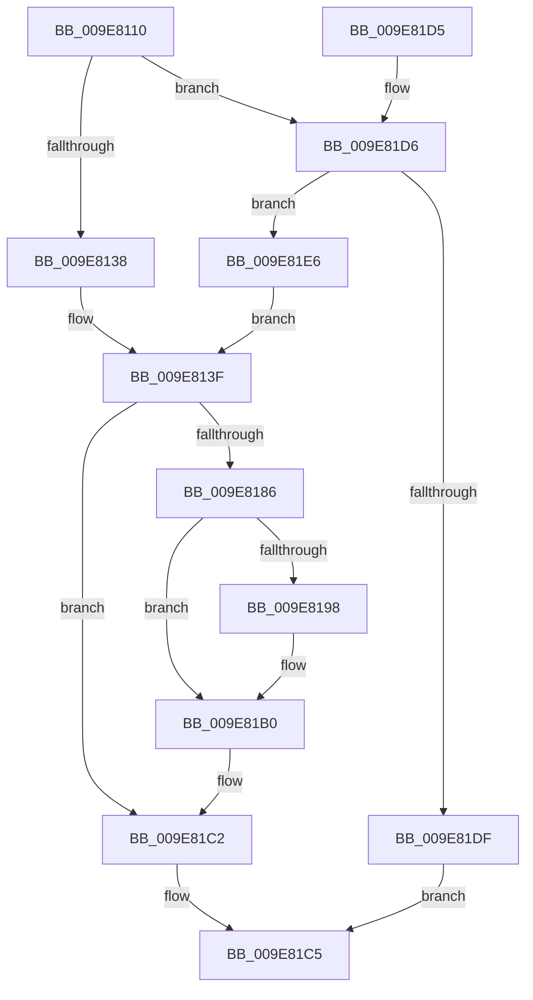

# PsCreateSiloContext

- RVA: `0x009E8110`–`0x009E81F2` (길이 `226` bytes)
- VA: `0x00000001409E8110`
- 실행 섹션: `PAGE`
- PDB 이름 있음: `예`; PDB Function 태그: `아니요`
- unwind 정보 RVA: `0x000A4CDC`
- 디코드: `56`개 명령, `226/226` bytes 표시
- 미해석 바이트: `0` (있으면 어셈블리에 `.byte`로 보존)

> 이 문서는 커널 이미지의 기계어와 PDB 기호를 분석해 생성했습니다. 4번과 5번은 함수 원형과 자료형을 바이너리 사용 방식에서 추정한 C 해석이며 원본 소스 복구 결과는 아닙니다.

## 1. Dependencies

- 직접 호출 지점: **1**; 고유 호출 대상: **1**
- 직접 호출자로 확인된 함수: **3**
- RIP 상대 이미지 참조: **3**

### Outgoing calls
- `0x009E817A` → [ObCreateObjectEx](../89/ObCreateObjectEx_function_0089B1E0.md) (function, `0x0089B1E0`)

### Direct callers
- [PspAssignSiloSystemRootPath](../77/PspAssignSiloSystemRootPath_function_0077F720.md) at `0x0077F79A`
- [ObCreateSiloRootDirectory](../83/ObCreateSiloRootDirectory_function_0083CA34.md) at `0x0083CC20`
- [CmpAllocateSiloContext](CmpAllocateSiloContext_function_009E80A4.md) at `0x009E80CD`

### Static image references
- `0x009E8138` → RVA `0x00FD9DC0` (`PAGEDATA`; read)
- `0x009E819B` → RVA `0x00F0FF80` (`.data`; read)
- `0x009E81E6` → RVA `0x00FD9E90` (`PAGEDATA`; read)

## 2. Other-region calls and transfers

- 다른 실행 섹션으로 향하는 call: **0**
- 별도 외부 분기/꼬리 이동을 확인하지 못했습니다.

## 3. Assembly (complete function range)

```asm
009E8110  48 89 5C 24 08                  mov qword ptr [rsp + 8], rbx
009E8115  48 89 74 24 10                  mov qword ptr [rsp + 0x10], rsi
009E811A  57                              push rdi
009E811B  48 83 EC 60                     sub rsp, 0x60
009E811F  33 DB                           xor ebx, ebx
009E8121  49 8B F9                        mov rdi, r9
009E8124  48 89 5C 24 50                  mov qword ptr [rsp + 0x50], rbx
009E8129  8B C2                           mov eax, edx
009E812B  48 8B F1                        mov rsi, rcx
009E812E  41 83 F8 01                     cmp r8d, 1
009E8132  0F 85 9E 00 00 00               jne 0x1409e81d6
009E8138  48 8B 15 81 1C 5F 00            mov rdx, qword ptr [rip + 0x5f1c81]
009E813F  48 8D 8C 24 80 00 00 00         lea rcx, [rsp + 0x80]
009E8147  66 89 9C 24 80 00 00 00         mov word ptr [rsp + 0x80], bx
009E814F  48 89 4C 24 48                  mov qword ptr [rsp + 0x48], rcx
009E8154  45 33 C9                        xor r9d, r9d
009E8157  48 8D 4C 24 50                  lea rcx, [rsp + 0x50]
009E815C  C6 84 24 81 00 00 00 01         mov byte ptr [rsp + 0x81], 1
009E8164  48 89 4C 24 40                  mov qword ptr [rsp + 0x40], rcx
009E8169  45 33 C0                        xor r8d, r8d
009E816C  89 5C 24 38                     mov dword ptr [rsp + 0x38], ebx
009E8170  33 C9                           xor ecx, ecx
009E8172  89 5C 24 30                     mov dword ptr [rsp + 0x30], ebx
009E8176  89 44 24 28                     mov dword ptr [rsp + 0x28], eax
009E817A  E8 61 30 EB FF                  call 0x14089b1e0
009E817F  44 8B C8                        mov r9d, eax
009E8182  85 C0                           test eax, eax
009E8184  78 3C                           js 0x1409e81c2
009E8186  4C 8B 44 24 50                  mov r8, qword ptr [rsp + 0x50]
009E818B  49 8D 50 D0                     lea rdx, [r8 - 0x30]
009E818F  0F B6 4A 1A                     movzx ecx, byte ptr [rdx + 0x1a]
009E8193  F6 C1 40                        test cl, 0x40
009E8196  74 18                           je 0x1409e81b0
009E8198  83 E1 7F                        and ecx, 0x7f
009E819B  48 8D 05 DE 7D 52 00            lea rax, [rip + 0x527dde]
009E81A2  0F B6 0C 01                     movzx ecx, byte ptr [rcx + rax]
009E81A6  48 2B D1                        sub rdx, rcx
009E81A9  48 8B 1A                        mov rbx, qword ptr [rdx]
009E81AC  48 83 C3 20                     add rbx, 0x20
009E81B0  48 8B 84 24 90 00 00 00         mov rax, qword ptr [rsp + 0x90]
009E81B8  48 89 33                        mov qword ptr [rbx], rsi
009E81BB  48 89 7B 08                     mov qword ptr [rbx + 8], rdi
009E81BF  4C 89 00                        mov qword ptr [rax], r8
009E81C2  41 8B C1                        mov eax, r9d
009E81C5  48 8B 5C 24 70                  mov rbx, qword ptr [rsp + 0x70]
009E81CA  48 8B 74 24 78                  mov rsi, qword ptr [rsp + 0x78]
009E81CF  48 83 C4 60                     add rsp, 0x60
009E81D3  5F                              pop rdi
009E81D4  C3                              ret
009E81D5  CC                              int3
009E81D6  41 81 F8 00 02 00 00            cmp r8d, 0x200
009E81DD  74 07                           je 0x1409e81e6
009E81DF  B8 0D 00 00 C0                  mov eax, 0xc000000d
009E81E4  EB DF                           jmp 0x1409e81c5
009E81E6  48 8B 15 A3 1C 5F 00            mov rdx, qword ptr [rip + 0x5f1ca3]
009E81ED  E9 4D FF FF FF                  jmp 0x1409e813f
```

## 4. C-style interpretation (structured pseudocode)

```c
__int64 __fastcall PsCreateSiloContext(__int64 a1, int a2, int a3, __int64 a4, __int64 a5)
{
    __int64 result;
    __int64 v_rbx;
    __int64 v_rsp;
    unsigned __int64 v_stack_m18;
    unsigned __int64 v_stack_m20;
    unsigned __int64 v_stack_m28;
    unsigned int v_stack_m30;
    unsigned int v_stack_m38;
    unsigned int v_stack_m40;
    unsigned __int64 v_stack_p10;
    unsigned __int64 v_stack_p18;
    unsigned __int8 v_stack_p19;
    unsigned __int64 v_stack_p8;

    v_stack_p8 = v_rbx;
    v_stack_p10 = v_rsi;
    v_rsp = (v_rsp) - (96);
    v_rbx = 0;
    v_stack_m18 = 0;
    if (a3 != 1) goto loc_009E81D6;
loc_009E813F:
    v_stack_p18 = 0;
    v_stack_m20 = v_stack_p18;
    a4 = 0;
    v_stack_p19 = 1;
    v_stack_m28 = v_stack_m18;
    a3 = 0;
    v_stack_m30 = 0;
    a1 = 0;
    v_stack_m38 = 0;
    v_stack_m40 = (unsigned int)((unsigned int)(a2));
    result = ObCreateObjectEx(a1, *(unsigned __int64 *)(v_rip + 6233217), a3, a4);
    if (sign_flag) goto loc_009E81C2;
    if ((((unsigned __int8)(*(unsigned __int8 *)(v_stack_m18 - 48 + 26))) & (64)) != 0) {
        a1 = (unsigned int)((*(unsigned __int8 *)(v_stack_m18 - 48 + 26)) & (127));
        result = v_rip + 5406174;
        a1 = *(unsigned __int8 *)(a1 + result * 1);
        a2 = (v_stack_m18 - 48) - (a1);
        v_rbx = *(unsigned __int64 *)(a2);
        v_rbx = (v_rbx) + (32);
    }
    *(unsigned __int64 *)(v_rbx) = a1;
    *(unsigned __int64 *)(v_rbx + 8) = 0;
    *(unsigned __int64 *)(a5) = v_stack_m18;
loc_009E81C2:
loc_009E81C5:
    v_rsp = (v_rsp) + (96);
    return (unsigned int)((unsigned int)((unsigned int)((unsigned int)(result))));
loc_009E81D6:
    if (((unsigned int)(v_stack_m18)) == 512) goto loc_009E81E6;
    goto loc_009E81C5;
loc_009E81E6:
    goto loc_009E813F;
}
```

## 5. (Beta) C Style

```c
int64_t PsCreateSiloContext(int64_t Arg1, int32_t Arg2, int32_t Arg3, int64_t Arg4, void *Arg5)
{
    uint8_t *arg5 = (uint8_t *)Arg5;

    int64_t result;
    int64_t local_rbx;
    int64_t local_rsp;
    uint64_t v_stack_m18;
    uint64_t v_stack_m20;
    uint64_t v_stack_m28;
    uint32_t v_stack_m30;
    uint32_t v_stack_m38;
    uint32_t v_stack_m40;
    uint64_t v_stack_p10;
    uint64_t v_stack_p18;
    uint8_t v_stack_p19;
    uint64_t v_stack_p8;

    v_stack_p8 = local_rbx;
    v_stack_p10 = local_rsi;
    local_rsp = (local_rsp) - (96);
    local_rbx = 0;
    v_stack_m18 = 0;
    if (Arg3 != 1) goto loc_009E81D6;
loc_009E813F:
    v_stack_p18 = 0;
    v_stack_m20 = v_stack_p18;
    Arg4 = 0;
    v_stack_p19 = 1;
    v_stack_m28 = v_stack_m18;
    Arg3 = 0;
    v_stack_m30 = 0;
    Arg1 = 0;
    v_stack_m38 = 0;
    v_stack_m40 = (uint32_t)((uint32_t)(Arg2));
    result = ObCreateObjectEx(Arg1, *(uint64_t *)(v_rip + 0x5F1C81), Arg3, Arg4);
    if (sign_flag) goto loc_009E81C2;
    if ((((uint8_t)(*(uint8_t *)(v_stack_m18 - 0x30 + 0x1A))) & (64)) != 0) {
        Arg1 = (uint32_t)((*(uint8_t *)(v_stack_m18 - 0x30 + 0x1A)) & (127));
        result = v_rip + 5406174;
        Arg1 = *(uint8_t *)(Arg1 + result * 1);
        Arg2 = (v_stack_m18 - 48) - (Arg1);
        local_rbx = *(uint64_t *)(Arg2);
        local_rbx = (local_rbx) + (32);
    }
    *(uint64_t *)(local_rbx) = Arg1;
    *(uint64_t *)(local_rbx + 0x8) = 0;
    *(uint64_t *)(arg5) = v_stack_m18;
loc_009E81C2:
loc_009E81C5:
    local_rsp = (local_rsp) + (96);
    return (uint32_t)((uint32_t)((uint32_t)((uint32_t)(result))));
loc_009E81D6:
    if (((uint32_t)(v_stack_m18)) == 512) goto loc_009E81E6;
    goto loc_009E81C5;
loc_009E81E6:
    goto loc_009E813F;
}
```

### 관측된 메모리 오프셋

구조체 형식이 확인되지 않은 접근은 인자 기준의 오프셋으로만 기록했습니다.

| 기준 인자 | 오프셋 표현 | 폭 (bit) | 접근 |
|---|---:|---:|---|
| `Arg5` | `+ 0x0` | `64` | `W` |

## 6. Execution-region graph

[열기: 2D/3D 그래프와 함수 탐색 컨트롤 패널](../../../control-panel.html?section=page&rva=0x009E8110&view=graph)

- 2D 그래프는 위에서 아래로 흐르고, 3D 그래프는 빈 공간을 드래그해 회전합니다. Shift+드래그는 이동, 휠은 확대·축소, 함수 노드 선택은 대상 보고서 이동입니다.

### Static fallback


