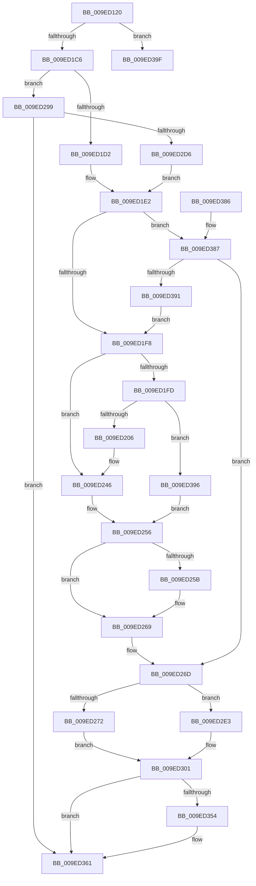

# PsCreateSystemThreadEx

- RVA: `0x009ED120`–`0x009ED3C1` (길이 `673` bytes)
- VA: `0x00000001409ED120`
- 실행 섹션: `PAGE`
- PDB 이름 있음: `예`; PDB Function 태그: `아니요`
- unwind 정보 RVA: `0x000A5BC4`
- 디코드: `169`개 명령, `673/673` bytes 표시
- 미해석 바이트: `0` (있으면 어셈블리에 `.byte`로 보존)

> 이 문서는 커널 이미지의 기계어와 PDB 기호를 분석해 생성했습니다. 4번과 5번은 함수 원형과 자료형을 바이너리 사용 방식에서 추정한 C 해석이며 원본 소스 복구 결과는 아닙니다.

## 1. Dependencies

- 직접 호출 지점: **7**; 고유 호출 대상: **7**
- 직접 호출자로 확인된 함수: **23**
- RIP 상대 이미지 참조: **5**

### Outgoing calls
- `0x009ED195` → [memset](../../text/6C/memset_function_006C6C40.md) (function, `0x006C6C40`)
- `0x009ED216` → [KeQueryActiveGroupCount](../../text/48/KeQueryActiveGroupCount_function_0048C600.md) (function, `0x0048C600`)
- `0x009ED2C4` → [ObpReferenceObjectByHandleWithTag](../86/ObpReferenceObjectByHandleWithTag_function_00869650.md) (function, `0x00869650`)
- `0x009ED348` → [PspCreateThread](PspCreateThread_function_009EF034.md) (function, `0x009EF034`)
- `0x009ED35C` → [ObfDereferenceObjectWithTag](../../text/2F/ObfDereferenceObjectWithTag_function_002F78E0.md) (function, `0x002F78E0`)
- `0x009ED36D` → [_security_check_cookie](../../text/6A/_security_check_cookie_function_006AC640.md) (function, `0x006AC640`)
- `0x009ED3BB` → [KeBugCheckEx](../../text/4F/KeBugCheckEx_function_004FD660.md) (function, `0x004FD660`)

### Direct callers
- [SmKmStoreHelperStart](../../text/3B/SmKmStoreHelperStart_function_003B1ACC.md) at `0x003B1B0C`
- [SMKM_STORE&lt;SM_TRAITS&gt;::SmStWorkerThreadStartThread](../../text/3B/SMKM_STORE_SM_TRAITS_SmStWorkerThreadStartThread_function_003B200C.md) at `0x003B20AD`
- [SMKM_STORE_MGR&lt;SM_TRAITS&gt;::SmCompressCtxCreateThread](../../text/3B/SMKM_STORE_MGR_SM_TRAITS_SmCompressCtxCreateThread_function_003B2400.md) at `0x003B2522`
- [MiInsertNewZeroThread](../../text/69/MiInsertNewZeroThread_function_00696140.md) at `0x00696281`
- [ExpWatchProductTypeWork](../6F/ExpWatchProductTypeWork_function_006FFCA0.md) at `0x00700312`
- [IopCreatePassiveInterruptRealtimeThreads](../72/IopCreatePassiveInterruptRealtimeThreads_function_0072BA98.md) at `0x0072BB2F`
- [KiStartDpcThread](../74/KiStartDpcThread_function_00745628.md) at `0x00745696`
- [PfTStart](../75/PfTStart_function_007517AC.md) at `0x00751919`
- [PopFxCreateStaticWorkPoolThread](../75/PopFxCreateStaticWorkPoolThread_function_00758D50.md) at `0x00758DBE`
- [EtwpCovSampCaptureContextStart](../7C/EtwpCovSampCaptureContextStart_function_007C14AC.md) at `0x007C16E6`
- [ExpWatchLicenseInfoWork](../7C/ExpWatchLicenseInfoWork_function_007C6DB0.md) at `0x007C7222`
- [NtMapCMFModule](../7D/NtMapCMFModule_function_007D4310.md) at `0x007D4A0E`
- [CmpCreateRegistryThread](../7E/CmpCreateRegistryThread_function_007E80D0.md) at `0x007E8124`
- [MiInitializePartitionThreads](../7F/MiInitializePartitionThreads_function_007FDD1C.md) at `0x007FDDDC`
- [MiInsertPageFileInList](../7F/MiInsertPageFileInList_function_007FFF80.md) at `0x00800157`
- [MmStoreRegister](../80/MmStoreRegister_function_0080E6D8.md) at `0x0080E7AB`
- [MiCreatePerNodeZeroingConductor](../81/MiCreatePerNodeZeroingConductor_function_00810480.md) at `0x00810565`
- [NtGetMUIRegistryInfo](NtGetMUIRegistryInfo_function_009EC780.md) at `0x009ECA5C`
- [PopInitSystemSleeperThread](PopInitSystemSleeperThread_function_009ECBA8.md) at `0x009ECC66`
- [IoCreateSystemThread](IoCreateSystemThread_function_009ECD10.md) at `0x009ECDC4`
- [IopStartApcHardError](IopStartApcHardError_function_009ECE30.md) at `0x009ECE6A`
- [ExpNodeCreateSystemThread](ExpNodeCreateSystemThread_function_009ECFF0.md) at `0x009ED098`
- [PsCreateSystemThread](PsCreateSystemThread_function_009ED0D0.md) at `0x009ED105`

### Static image references
- `0x009ED13C` → RVA `0x00E0A740` (`.data`; read)
- `0x009ED1D2` → RVA `0x00FC6EA0` (`ALMOSTRO`; read)
- `0x009ED209` → RVA `0x00FD9FE8` (`PAGEDATA`; read/write)
- `0x009ED228` → RVA `0x00FC7128` (`ALMOSTRO`; read)
- `0x009ED299` → RVA `0x00FC6A98` (`ALMOSTRO`; read)

## 2. Other-region calls and transfers

- 다른 실행 섹션으로 향하는 call: **5**
  - `0x009ED195` → [memset](../../text/6C/memset_function_006C6C40.md) (`PAGE` → `.text`)
  - `0x009ED216` → [KeQueryActiveGroupCount](../../text/48/KeQueryActiveGroupCount_function_0048C600.md) (`PAGE` → `.text`)
  - `0x009ED35C` → [ObfDereferenceObjectWithTag](../../text/2F/ObfDereferenceObjectWithTag_function_002F78E0.md) (`PAGE` → `.text`)
  - `0x009ED36D` → [_security_check_cookie](../../text/6A/_security_check_cookie_function_006AC640.md) (`PAGE` → `.text`)
  - `0x009ED3BB` → [KeBugCheckEx](../../text/4F/KeBugCheckEx_function_004FD660.md) (`PAGE` → `.text`)
- 별도 외부 분기/꼬리 이동을 확인하지 못했습니다.

## 3. Assembly (complete function range)

```asm
009ED120  40 55                           push rbp
009ED122  53                              push rbx
009ED123  56                              push rsi
009ED124  57                              push rdi
009ED125  41 54                           push r12
009ED127  41 55                           push r13
009ED129  41 56                           push r14
009ED12B  41 57                           push r15
009ED12D  48 8D AC 24 B8 FD FF FF         lea rbp, [rsp - 0x248]
009ED135  48 81 EC 48 03 00 00            sub rsp, 0x348
009ED13C  48 8B 05 FD D5 41 00            mov rax, qword ptr [rip + 0x41d5fd]
009ED143  48 33 C4                        xor rax, rsp
009ED146  48 89 85 38 02 00 00            mov qword ptr [rbp + 0x238], rax
009ED14D  48 8B 85 B0 02 00 00            mov rax, qword ptr [rbp + 0x2b0]
009ED154  4D 8B F0                        mov r14, r8
009ED157  4C 8B BD C8 02 00 00            mov r15, qword ptr [rbp + 0x2c8]
009ED15E  4C 8B E9                        mov r13, rcx
009ED161  48 8B B5 D0 02 00 00            mov rsi, qword ptr [rbp + 0x2d0]
009ED168  48 8D 4D D8                     lea rcx, [rbp - 0x28]
009ED16C  48 89 45 C0                     mov qword ptr [rbp - 0x40], rax
009ED170  41 B8 60 02 00 00               mov r8d, 0x260
009ED176  48 8B 85 B8 02 00 00            mov rax, qword ptr [rbp + 0x2b8]
009ED17D  49 8B D9                        mov rbx, r9
009ED180  48 89 45 B8                     mov qword ptr [rbp - 0x48], rax
009ED184  48 8B 85 C0 02 00 00            mov rax, qword ptr [rbp + 0x2c0]
009ED18B  89 54 24 78                     mov dword ptr [rsp + 0x78], edx
009ED18F  33 D2                           xor edx, edx
009ED191  48 89 45 B0                     mov qword ptr [rbp - 0x50], rax
009ED195  E8 A6 9A CD FF                  call 0x1406c6c40
009ED19A  33 C0                           xor eax, eax
009ED19C  0F 57 C0                        xorps xmm0, xmm0
009ED19F  45 33 C9                        xor r9d, r9d
009ED1A2  48 89 45 A0                     mov qword ptr [rbp - 0x60], rax
009ED1A6  4C 89 4C 24 70                  mov qword ptr [rsp + 0x70], r9
009ED1AB  0F 11 45 80                     movups xmmword ptr [rbp - 0x80], xmm0
009ED1AF  89 45 A8                        mov dword ptr [rbp - 0x58], eax
009ED1B2  0F 11 45 90                     movups xmmword ptr [rbp - 0x70], xmm0
009ED1B6  0F 11 45 C8                     movups xmmword ptr [rbp - 0x38], xmm0
009ED1BA  44 0F 20 C0                     mov rax, cr8
009ED1BE  3C 01                           cmp al, 1
009ED1C0  0F 87 D9 01 00 00               ja 0x1409ed39f
009ED1C6  45 8A E1                        mov r12b, r9b
009ED1C9  48 85 DB                        test rbx, rbx
009ED1CC  0F 85 C7 00 00 00               jne 0x1409ed299
009ED1D2  48 8B 05 C7 9C 5D 00            mov rax, qword ptr [rip + 0x5d9cc7]
009ED1D9  48 8B 58 78                     mov rbx, qword ptr [rax + 0x78]
009ED1DD  48 89 5C 24 70                  mov qword ptr [rsp + 0x70], rbx
009ED1E2  8B 83 FC 05 00 00               mov eax, dword ptr [rbx + 0x5fc]
009ED1E8  BF 00 10 00 00                  mov edi, 0x1000
009ED1ED  49 8B C9                        mov rcx, r9
009ED1F0  85 C7                           test edi, eax
009ED1F2  0F 84 8F 01 00 00               je 0x1409ed387
009ED1F8  4D 85 FF                        test r15, r15
009ED1FB  75 49                           jne 0x1409ed246
009ED1FD  48 85 F6                        test rsi, rsi
009ED200  0F 85 90 01 00 00               jne 0x1409ed396
009ED206  8D 46 01                        lea eax, [rsi + 1]
009ED209  F0 0F C1 05 D7 CD 5E 00         lock xadd dword ptr [rip + 0x5ecdd7], eax
009ED211  FF C0                           inc eax
009ED213  0F B7 D8                        movzx ebx, ax
009ED216  E8 E5 F3 A9 FF                  call 0x14048c600
009ED21B  0F B7 C8                        movzx ecx, ax
009ED21E  4C 8D 7D C8                     lea r15, [rbp - 0x38]
009ED222  8B C3                           mov eax, ebx
009ED224  33 D2                           xor edx, edx
009ED226  F7 F1                           div ecx
009ED228  48 8D 0D F9 9E 5D 00            lea rcx, [rip + 0x5d9ef9]
009ED22F  45 33 C9                        xor r9d, r9d
009ED232  0F B7 C2                        movzx eax, dx
009ED235  66 89 55 D0                     mov word ptr [rbp - 0x30], dx
009ED239  48 8B 04 C1                     mov rax, qword ptr [rcx + rax*8]
009ED23D  48 8B 5C 24 70                  mov rbx, qword ptr [rsp + 0x70]
009ED242  48 89 45 C8                     mov qword ptr [rbp - 0x38], rax
009ED246  41 0F 10 07                     movups xmm0, xmmword ptr [r15]
009ED24A  48 89 7D E0                     mov qword ptr [rbp - 0x20], rdi
009ED24E  F3 0F 7F 85 18 01 00 00         movdqu xmmword ptr [rbp + 0x118], xmm0
009ED256  48 85 F6                        test rsi, rsi
009ED259  74 0E                           je 0x1409ed269
009ED25B  8B 06                           mov eax, dword ptr [rsi]
009ED25D  48 0F BA EF 0E                  bts rdi, 0xe
009ED262  48 89 7D E0                     mov qword ptr [rbp - 0x20], rdi
009ED266  89 45 EC                        mov dword ptr [rbp - 0x14], eax
009ED269  48 8D 4D D8                     lea rcx, [rbp - 0x28]
009ED26D  4D 85 F6                        test r14, r14
009ED270  74 71                           je 0x1409ed2e3
009ED272  41 0F 10 06                     movups xmm0, xmmword ptr [r14]
009ED276  41 8B 46 18                     mov eax, dword ptr [r14 + 0x18]
009ED27A  41 0F 10 4E 10                  movups xmm1, xmmword ptr [r14 + 0x10]
009ED27F  0F BA E8 09                     bts eax, 9
009ED283  0F 11 45 80                     movups xmmword ptr [rbp - 0x80], xmm0
009ED287  41 0F 10 46 20                  movups xmm0, xmmword ptr [r14 + 0x20]
009ED28C  0F 11 4D 90                     movups xmmword ptr [rbp - 0x70], xmm1
009ED290  89 45 98                        mov dword ptr [rbp - 0x68], eax
009ED293  0F 11 45 A0                     movups xmmword ptr [rbp - 0x60], xmm0
009ED297  EB 68                           jmp 0x1409ed301
009ED299  4C 8B 05 F8 97 5D 00            mov r8, qword ptr [rip + 0x5d97f8]
009ED2A0  48 8D 44 24 70                  lea rax, [rsp + 0x70]
009ED2A5  4C 89 4C 24 38                  mov qword ptr [rsp + 0x38], r9
009ED2AA  BA 02 00 00 00                  mov edx, 2
009ED2AF  4C 89 4C 24 30                  mov qword ptr [rsp + 0x30], r9
009ED2B4  48 8B CB                        mov rcx, rbx
009ED2B7  48 89 44 24 28                  mov qword ptr [rsp + 0x28], rax
009ED2BC  C7 44 24 20 50 73 43 72         mov dword ptr [rsp + 0x20], 0x72437350
009ED2C4  E8 87 C3 E7 FF                  call 0x140869650
009ED2C9  45 33 C9                        xor r9d, r9d
009ED2CC  8B F8                           mov edi, eax
009ED2CE  85 C0                           test eax, eax
009ED2D0  0F 88 8B 00 00 00               js 0x1409ed361
009ED2D6  48 8B 5C 24 70                  mov rbx, qword ptr [rsp + 0x70]
009ED2DB  41 B4 01                        mov r12b, 1
009ED2DE  E9 FF FE FF FF                  jmp 0x1409ed1e2
009ED2E3  0F 57 C0                        xorps xmm0, xmm0
009ED2E6  C7 45 80 30 00 00 00            mov dword ptr [rbp - 0x80], 0x30
009ED2ED  F3 0F 7F 45 A0                  movdqu xmmword ptr [rbp - 0x60], xmm0
009ED2F2  4C 89 4D 88                     mov qword ptr [rbp - 0x78], r9
009ED2F6  C7 45 98 00 02 00 00            mov dword ptr [rbp - 0x68], 0x200
009ED2FD  4C 89 4D 90                     mov qword ptr [rbp - 0x70], r9
009ED301  48 8B 45 B0                     mov rax, qword ptr [rbp - 0x50]
009ED305  4C 8D 45 80                     lea r8, [rbp - 0x80]
009ED309  8B 54 24 78                     mov edx, dword ptr [rsp + 0x78]
009ED30D  4C 89 4C 24 60                  mov qword ptr [rsp + 0x60], r9
009ED312  48 89 44 24 58                  mov qword ptr [rsp + 0x58], rax
009ED317  48 8B 45 B8                     mov rax, qword ptr [rbp - 0x48]
009ED31B  48 89 44 24 50                  mov qword ptr [rsp + 0x50], rax
009ED320  48 8B 45 C0                     mov rax, qword ptr [rbp - 0x40]
009ED324  44 89 4C 24 48                  mov dword ptr [rsp + 0x48], r9d
009ED329  4C 89 4C 24 40                  mov qword ptr [rsp + 0x40], r9
009ED32E  4C 89 4C 24 38                  mov qword ptr [rsp + 0x38], r9
009ED333  45 33 C9                        xor r9d, r9d
009ED336  48 89 44 24 30                  mov qword ptr [rsp + 0x30], rax
009ED33B  48 89 4C 24 28                  mov qword ptr [rsp + 0x28], rcx
009ED340  49 8B CD                        mov rcx, r13
009ED343  48 89 5C 24 20                  mov qword ptr [rsp + 0x20], rbx
009ED348  E8 E7 1C 00 00                  call 0x1409ef034
009ED34D  8B F8                           mov edi, eax
009ED34F  45 84 E4                        test r12b, r12b
009ED352  74 0D                           je 0x1409ed361
009ED354  BA 50 73 43 72                  mov edx, 0x72437350
009ED359  48 8B CB                        mov rcx, rbx
009ED35C  E8 7F A5 90 FF                  call 0x1402f78e0
009ED361  8B C7                           mov eax, edi
009ED363  48 8B 8D 38 02 00 00            mov rcx, qword ptr [rbp + 0x238]
009ED36A  48 33 CC                        xor rcx, rsp
009ED36D  E8 CE F2 CB FF                  call 0x1406ac640
009ED372  48 81 C4 48 03 00 00            add rsp, 0x348
009ED379  41 5F                           pop r15
009ED37B  41 5E                           pop r14
009ED37D  41 5D                           pop r13
009ED37F  41 5C                           pop r12
009ED381  5F                              pop rdi
009ED382  5E                              pop rsi
009ED383  5B                              pop rbx
009ED384  5D                              pop rbp
009ED385  C3                              ret
009ED386  CC                              int3
009ED387  0F BA E0 1E                     bt eax, 0x1e
009ED38B  0F 83 DC FE FF FF               jae 0x1409ed26d
009ED391  E9 62 FE FF FF                  jmp 0x1409ed1f8
009ED396  48 8B 7D E0                     mov rdi, qword ptr [rbp - 0x20]
009ED39A  E9 B7 FE FF FF                  jmp 0x1409ed256
009ED39F  44 0F 20 C0                     mov rax, cr8
009ED3A3  0F B6 D0                        movzx edx, al
009ED3A6  45 33 C0                        xor r8d, r8d
009ED3A9  48 C1 E2 10                     shl rdx, 0x10
009ED3AD  B9 C8 00 00 00                  mov ecx, 0xc8
009ED3B2  48 83 CA 04                     or rdx, 4
009ED3B6  4C 89 4C 24 20                  mov qword ptr [rsp + 0x20], r9
009ED3BB  E8 A0 02 B1 FF                  call 0x1404fd660
009ED3C0  CC                              int3
```

## 4. C-style interpretation (structured pseudocode)

```c
__int64 __fastcall PsCreateSystemThreadEx(__int64 a1, int a2, __int64 a3, __int64 a4, __int64 a5, __int64 a6, __int64 a7, __int64 a8, __int64 a9)
{
    __int64 result;
    __int64 v_rsp;
    unsigned __int64 v_stack_m170;
    unsigned __int64 v_stack_m288;
    unsigned int v_stack_m29C;
    unsigned __int64 v_stack_m2A8;
    unsigned __int64 v_stack_m2B0;
    unsigned __int16 v_stack_m2B8;
    unsigned __int64 v_stack_m2C0;
    unsigned __int64 v_stack_m2C8;
    unsigned __int64 v_stack_m2D0;
    unsigned __int64 v_stack_m2D8;
    unsigned int v_stack_m2E0;
    unsigned __int64 v_stack_m2E8;
    unsigned int v_stack_m2F0;
    unsigned __int64 v_stack_m2F8;
    unsigned __int64 v_stack_m300;
    unsigned __int64 v_stack_m308;
    unsigned int v_stack_m310;
    unsigned __int64 v_stack_m318;
    unsigned __int64 v_stack_m328;
    unsigned __int64 v_stack_m330;
    unsigned __int64 v_stack_m338;
    unsigned int v_stack_m340;
    unsigned __int64 v_stack_m348;
    unsigned __int64 v_stack_m350;
    unsigned __int64 v_stack_m358;
    unsigned __int64 v_stack_m360;
    unsigned int v_stack_m368;
    unsigned __int64 v_stack_m50;
    unsigned __int64 v_stack_p20;

    v_rsp = (v_rsp) - (840);
    result = (*(unsigned __int64 *)(v_rip + 4314621)) ^ (v_rsp);
    v_stack_m50 = result;
    v_stack_m2C8 = a5;
    v_stack_m2D0 = a6;
    v_stack_m310 = a2;
    a2 = 0;
    v_stack_m2D8 = a7;
    result = memset(v_stack_m2B0, a2, 608, a4);
    result = 0;
    a4 = 0;
    v_stack_m2E8 = 0;
    v_stack_m318 = 0;
    v_stack_m308 = v_xmm0;
    v_stack_m2E0 = 0;
    v_stack_m2F8 = v_xmm0;
    v_stack_m2C0 = v_xmm0;
    if (((unsigned __int8)(v_cr8)) > 1) goto loc_009ED39F;
    if (0 != 0) goto loc_009ED299;
    v_stack_m318 = *(unsigned __int64 *)(*(unsigned __int64 *)(v_rip + 6134983) + 120);
loc_009ED1E2:
    if ((((unsigned int)((unsigned int)(0x1000ULL))) & ((unsigned int)((unsigned int)(*(unsigned int *)(*(unsigned __int64 *)(*(unsigned __int64 *)(v_rip + 6134983) + 120) + 1532))))) == 0) goto loc_009ED387;
loc_009ED1F8:
    if (a8 != 0) goto loc_009ED246;
    if (a9 != 0) goto loc_009ED396;
    result = (unsigned int)((a9 + 1) + 1);
    result = KeQueryActiveGroupCount(0, a2, 608, a4);
    a2 = 0;
    a4 = 0;
    v_stack_m2B8 = 0;
    v_stack_m2C0 = *(unsigned __int64 *)(v_rip + 6135545 + 0 * 8);
loc_009ED246:
    v_stack_m2A8 = (unsigned int)(0x1000ULL);
    v_stack_m170 = v_xmm0;
loc_009ED256:
    result = *(unsigned __int64 *)(v_rip + 6135545 + 0 * 8);
    if (a9 != 0) {
        result = *(unsigned int *)(a9);
        v_stack_m2A8 = (unsigned int)(0x1000ULL);
        v_stack_m29C = (unsigned int)(result);
    }
loc_009ED26D:
    if (a3 == 0) goto loc_009ED2E3;
    v_stack_m308 = v_xmm0;
    v_stack_m2F8 = v_xmm1;
    v_stack_m2F0 = (unsigned int)((unsigned int)(*(unsigned int *)(a3 + 24)));
    v_stack_m2E8 = v_xmm0;
    goto loc_009ED301;
loc_009ED299:
    v_stack_m350 = 0;
    v_stack_m358 = 0;
    v_stack_m360 = v_stack_m318;
    v_stack_m368 = 0x72437350ULL;
    result = ObpReferenceObjectByHandleWithTag(v_stack_m318, 2, *(unsigned __int64 *)(v_rip + 6133752), a4);
    a4 = 0;
    if (sign_flag) goto loc_009ED361;
    goto loc_009ED1E2;
loc_009ED2E3:
    v_stack_m308 = 48;
    v_stack_m2E8 = v_xmm0;
    v_stack_m300 = 0;
    v_stack_m2F0 = 512;
    v_stack_m2F8 = 0;
loc_009ED301:
    v_stack_m328 = 0;
    v_stack_m330 = v_stack_m2D8;
    v_stack_m338 = v_stack_m2D0;
    v_stack_m340 = 0;
    v_stack_m348 = 0;
    v_stack_m350 = 0;
    a4 = 0;
    v_stack_m358 = v_stack_m2C8;
    v_stack_m360 = v_stack_m318;
    v_stack_m368 = v_stack_m318;
    result = PspCreateThread(a1, (unsigned int)(v_stack_m310), v_stack_m308, a4);
    if (1 != 0) {
        a2 = 0x72437350ULL;
        a1 = v_stack_m318;
        result = ObfDereferenceObjectWithTag(a1, a2, v_stack_m308, a4);
    }
    a1 = (v_stack_m50) ^ (v_rsp);
    result = _security_check_cookie(a1, a2, v_stack_m308, a4);
    v_rsp = (v_rsp) + (840);
    return result;
loc_009ED387:
    if (condition_is_above_or_equal) goto loc_009ED26D;
    goto loc_009ED1F8;
loc_009ED396:
    goto loc_009ED256;
loc_009ED39F:
    a3 = 0;
    a2 = ((unsigned __int8)(v_cr8)) << (16);
    a2 = (a2) | (4);
    v_stack_p20 = 0;
    result = KeBugCheckEx(200, a2, a3, a4);
    return result;
}
```

## 5. (Beta) C Style

```c
int64_t PsCreateSystemThreadEx(int64_t Arg1, int32_t Arg2, int64_t Arg3, int64_t Arg4, int64_t Arg5, int64_t Arg6, int64_t Arg7, int64_t Arg8, int64_t Arg9)
{
    int64_t result;
    int64_t local_rsp;
    uint64_t v_stack_m170;
    uint64_t v_stack_m288;
    uint32_t v_stack_m29C;
    uint64_t v_stack_m2A8;
    uint64_t v_stack_m2B0;
    uint16_t v_stack_m2B8;
    uint64_t v_stack_m2C0;
    uint64_t v_stack_m2C8;
    uint64_t v_stack_m2D0;
    uint64_t v_stack_m2D8;
    uint32_t v_stack_m2E0;
    uint64_t v_stack_m2E8;
    uint32_t v_stack_m2F0;
    uint64_t v_stack_m2F8;
    uint64_t v_stack_m300;
    uint64_t v_stack_m308;
    uint32_t v_stack_m310;
    uint64_t v_stack_m318;
    uint64_t v_stack_m328;
    uint64_t v_stack_m330;
    uint64_t v_stack_m338;
    uint32_t v_stack_m340;
    uint64_t v_stack_m348;
    uint64_t v_stack_m350;
    uint64_t v_stack_m358;
    uint64_t v_stack_m360;
    uint32_t v_stack_m368;
    uint64_t v_stack_m50;
    uint64_t v_stack_p20;

    local_rsp = (local_rsp) - (840);
    result = (*(uint64_t *)(v_rip + 0x41D5FD)) ^ (local_rsp);
    v_stack_m50 = result;
    v_stack_m2C8 = Arg5;
    v_stack_m2D0 = Arg6;
    v_stack_m310 = Arg2;
    Arg2 = 0;
    v_stack_m2D8 = Arg7;
    result = memset(v_stack_m2B0, Arg2, 608, Arg4);
    result = 0;
    Arg4 = 0;
    v_stack_m2E8 = 0;
    v_stack_m318 = 0;
    v_stack_m308 = v_xmm0;
    v_stack_m2E0 = 0;
    v_stack_m2F8 = v_xmm0;
    v_stack_m2C0 = v_xmm0;
    if (((uint8_t)(v_cr8)) > 1) goto loc_009ED39F;
    if (0 != 0) goto loc_009ED299;
    v_stack_m318 = *(uint64_t *)(*(uint64_t *)(v_rip + 0x5D9CC7) + 0x78);
loc_009ED1E2:
    if ((((uint32_t)((uint32_t)(0x1000ULL))) & ((uint32_t)((uint32_t)(*(uint32_t *)(*(uint64_t *)(*(uint64_t *)(v_rip + 0x5D9CC7) + 0x78) + 0x5FC))))) == 0) goto loc_009ED387;
loc_009ED1F8:
    if (Arg8 != 0) goto loc_009ED246;
    if (Arg9 != 0) goto loc_009ED396;
    result = (uint32_t)((Arg9 + 1) + 1);
    result = KeQueryActiveGroupCount(0, Arg2, 608, Arg4);
    Arg2 = 0;
    Arg4 = 0;
    v_stack_m2B8 = 0;
    v_stack_m2C0 = *(uint64_t *)(v_rip + 0x5D9EF9 + 0x0 * 8);
loc_009ED246:
    v_stack_m2A8 = (uint32_t)(0x1000ULL);
    v_stack_m170 = v_xmm0;
loc_009ED256:
    result = *(uint64_t *)(v_rip + 0x5D9EF9 + 0x0 * 8);
    if (Arg9 != 0) {
        result = *(uint32_t *)(Arg9);
        v_stack_m2A8 = (uint32_t)(0x1000ULL);
        v_stack_m29C = (uint32_t)(result);
    }
loc_009ED26D:
    if (Arg3 == 0) goto loc_009ED2E3;
    v_stack_m308 = v_xmm0;
    v_stack_m2F8 = v_xmm1;
    v_stack_m2F0 = (uint32_t)((uint32_t)(*(uint32_t *)(Arg3 + 0x18)));
    v_stack_m2E8 = v_xmm0;
    goto loc_009ED301;
loc_009ED299:
    v_stack_m350 = 0;
    v_stack_m358 = 0;
    v_stack_m360 = v_stack_m318;
    v_stack_m368 = 0x72437350ULL;
    result = ObpReferenceObjectByHandleWithTag(v_stack_m318, 2, *(uint64_t *)(v_rip + 0x5D97F8), Arg4);
    Arg4 = 0;
    if (sign_flag) goto loc_009ED361;
    goto loc_009ED1E2;
loc_009ED2E3:
    v_stack_m308 = 48;
    v_stack_m2E8 = v_xmm0;
    v_stack_m300 = 0;
    v_stack_m2F0 = 512;
    v_stack_m2F8 = 0;
loc_009ED301:
    v_stack_m328 = 0;
    v_stack_m330 = v_stack_m2D8;
    v_stack_m338 = v_stack_m2D0;
    v_stack_m340 = 0;
    v_stack_m348 = 0;
    v_stack_m350 = 0;
    Arg4 = 0;
    v_stack_m358 = v_stack_m2C8;
    v_stack_m360 = v_stack_m318;
    v_stack_m368 = v_stack_m318;
    result = PspCreateThread(Arg1, (uint32_t)(v_stack_m310), v_stack_m308, Arg4);
    if (1 != 0) {
        Arg2 = 0x72437350ULL;
        Arg1 = v_stack_m318;
        result = ObfDereferenceObjectWithTag(Arg1, Arg2, v_stack_m308, Arg4);
    }
    Arg1 = (v_stack_m50) ^ (local_rsp);
    result = _security_check_cookie(Arg1, Arg2, v_stack_m308, Arg4);
    local_rsp = (local_rsp) + (840);
    return result;
loc_009ED387:
    if (condition_is_above_or_equal) goto loc_009ED26D;
    goto loc_009ED1F8;
loc_009ED396:
    goto loc_009ED256;
loc_009ED39F:
    Arg3 = 0;
    Arg2 = ((uint8_t)(v_cr8)) << (16);
    Arg2 = (Arg2) | (4);
    v_stack_p20 = 0;
    result = KeBugCheckEx(200, Arg2, Arg3, Arg4);
    return result;
}
```

## 6. Execution-region graph

[열기: 2D/3D 그래프와 함수 탐색 컨트롤 패널](../../../control-panel.html?section=page&rva=0x009ED120&view=graph)

- 2D 그래프는 위에서 아래로 흐르고, 3D 그래프는 빈 공간을 드래그해 회전합니다. Shift+드래그는 이동, 휠은 확대·축소, 함수 노드 선택은 대상 보고서 이동입니다.

### Static fallback


