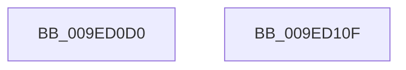

# PsCreateSystemThread

- RVA: `0x009ED0D0`–`0x009ED110` (길이 `64` bytes)
- VA: `0x00000001409ED0D0`
- 실행 섹션: `PAGE`
- PDB 이름 있음: `예`; PDB Function 태그: `아니요`
- unwind 정보 RVA: `0x0005CC98`
- 디코드: `14`개 명령, `64/64` bytes 표시
- 미해석 바이트: `0` (있으면 어셈블리에 `.byte`로 보존)

> 이 문서는 커널 이미지의 기계어와 PDB 기호를 분석해 생성했습니다. 4번과 5번은 함수 원형과 자료형을 바이너리 사용 방식에서 추정한 C 해석이며 원본 소스 복구 결과는 아닙니다.

## 1. Dependencies

- 직접 호출 지점: **1**; 고유 호출 대상: **1**
- 직접 호출자로 확인된 함수: **19**
- RIP 상대 이미지 참조: **0**

### Outgoing calls
- `0x009ED105` → [PsCreateSystemThreadEx](PsCreateSystemThreadEx_function_009ED120.md) (function, `0x009ED120`)

### Direct callers
- [CcInitializePrivateVolumeCacheMap](../../text/3C/CcInitializePrivateVolumeCacheMap_function_003CE088.md) at `0x003CE5A3`
- [CcInitializeAsyncReadForNodeHelper](../../text/49/CcInitializeAsyncReadForNodeHelper_function_00498CD0.md) at `0x004990A9`
- [PopCreatePowerThread](../../text/4A/PopCreatePowerThread_function_004A17D8.md) at `0x004A1839`
- [EtwpStartLoggerThread](../../text/4B/EtwpStartLoggerThread_function_004B25C4.md) at `0x004B2637`
- [DisplayBootBitmap](../../text/53/DisplayBootBitmap_function_0053B87C.md) at `0x0053B9E6`
- [CcInitializePartition](../../text/57/CcInitializePartition_function_0057E4D8.md) at `0x0057E9B2`
- [KcsanInitSystem](../../text/5A/KcsanInitSystem_function_005AF2A0.md) at `0x005AF327`
- [DifPsCreateSystemThreadWrapper](../../text/63/DifPsCreateSystemThreadWrapper_function_0063A8F0.md) at `0x0063AA18`
- [ExRegisterBootDevice](../../text/65/ExRegisterBootDevice_function_00657B90.md) at `0x00657C22`
- [sub_00B80E6E](../../pagelk/B8/Unknown_function_00B80E6E.md) at `0x00B80FB1`
- [VfPendingInitPhase1](../../pagevrfy/BA/VfPendingInitPhase1_function_00BA1AA4.md) at `0x00BA1B44`
- [VfPoolInitPhase1](../../pagevrfy/BA/VfPoolInitPhase1_function_00BAA3E0.md) at `0x00BAA480`
- [FsRtlInitializeWorkerThread](../../init/C2/FsRtlInitializeWorkerThread_function_00C29624.md) at `0x00C296A7`
- [sub_00C36AE9](../../init/C3/Unknown_function_00C36AE9.md) at `0x00C36BC3`
- [PopDirectedDripsInitializePhase3](../../init/C3/PopDirectedDripsInitializePhase3_function_00C3E594.md) at `0x00C3E624`
- [ExpWorkerFactoryInitialization](../../init/C5/ExpWorkerFactoryInitialization_function_00C54250.md) at `0x00C54409`
- [MiInitSystem](../../init/C5/MiInitSystem_function_00C5E6C0.md) at `0x00C5ECB5`
- [SeRmInitPhase1](../../init/C7/SeRmInitPhase1_function_00C70B2C.md) at `0x00C70BDB`
- [PspInitPhase0](../../init/C7/PspInitPhase0_function_00C77E2C.md) at `0x00C789E9`

### Static image references
- 디코드된 RIP-relative 메모리 참조가 없습니다.

## 2. Other-region calls and transfers

- 다른 실행 섹션으로 향하는 call: **0**
- 별도 외부 분기/꼬리 이동을 확인하지 못했습니다.

## 3. Assembly (complete function range)

```asm
009ED0D0  4C 8B DC                        mov r11, rsp
009ED0D3  48 83 EC 58                     sub rsp, 0x58
009ED0D7  49 83 63 E8 00                  and qword ptr [r11 - 0x18], 0
009ED0DC  49 83 63 E0 00                  and qword ptr [r11 - 0x20], 0
009ED0E1  48 8B 84 24 90 00 00 00         mov rax, qword ptr [rsp + 0x90]
009ED0E9  49 89 43 D8                     mov qword ptr [r11 - 0x28], rax
009ED0ED  48 8B 84 24 88 00 00 00         mov rax, qword ptr [rsp + 0x88]
009ED0F5  49 89 43 D0                     mov qword ptr [r11 - 0x30], rax
009ED0F9  48 8B 84 24 80 00 00 00         mov rax, qword ptr [rsp + 0x80]
009ED101  49 89 43 C8                     mov qword ptr [r11 - 0x38], rax
009ED105  E8 16 00 00 00                  call 0x1409ed120
009ED10A  48 83 C4 58                     add rsp, 0x58
009ED10E  C3                              ret
009ED10F  CC                              int3
```

## 4. C-style interpretation (structured pseudocode)

```c
__int64 __fastcall PsCreateSystemThread(__int64 a1, __int64 a2, __int64 a3, __int64 a4, __int64 a5, __int64 a6, __int64 a7)
{
    __int64 result;
    __int64 v_rsp;

    v_rsp = (v_rsp) - (88);
    *(unsigned __int64 *)(v_rsp - 40) = a7;
    *(unsigned __int64 *)(v_rsp - 48) = a6;
    *(unsigned __int64 *)(v_rsp - 56) = a5;
    result = PsCreateSystemThreadEx(a1, a2, a3, a4);
    v_rsp = (v_rsp) + (88);
    return result;
}
```

## 5. (Beta) C Style

```c
int64_t PsCreateSystemThread(int64_t Arg1, int64_t Arg2, int64_t Arg3, int64_t Arg4, int64_t Arg5, int64_t Arg6, int64_t Arg7)
{
    int64_t result;
    int64_t local_rsp;

    local_rsp = (local_rsp) - (88);
    *(uint64_t *)(local_rsp - 0x28) = Arg7;
    *(uint64_t *)(local_rsp - 0x30) = Arg6;
    *(uint64_t *)(local_rsp - 0x38) = Arg5;
    result = PsCreateSystemThreadEx(Arg1, Arg2, Arg3, Arg4);
    local_rsp = (local_rsp) + (88);
    return result;
}
```

## 6. Execution-region graph

[열기: 2D/3D 그래프와 함수 탐색 컨트롤 패널](../../../control-panel.html?section=page&rva=0x009ED0D0&view=graph)

- 2D 그래프는 위에서 아래로 흐르고, 3D 그래프는 빈 공간을 드래그해 회전합니다. Shift+드래그는 이동, 휠은 확대·축소, 함수 노드 선택은 대상 보고서 이동입니다.

### Static fallback


