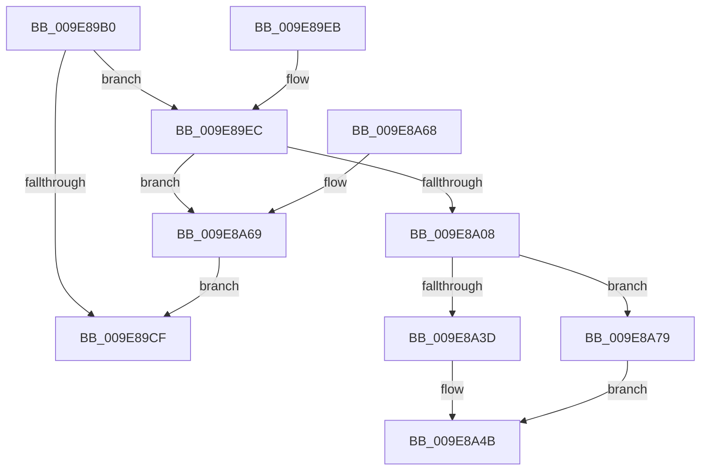

# PsDisableImpersonation

- RVA: `0x009E89B0`–`0x009E8A97` (길이 `231` bytes)
- VA: `0x00000001409E89B0`
- 실행 섹션: `PAGE`
- PDB 이름 있음: `예`; PDB Function 태그: `아니요`
- unwind 정보 RVA: `0x000A4DA4`
- 디코드: `62`개 명령, `231/231` bytes 표시
- 미해석 바이트: `0` (있으면 어셈블리에 `.byte`로 보존)

> 이 문서는 커널 이미지의 기계어와 PDB 기호를 분석해 생성했습니다. 4번과 5번은 함수 원형과 자료형을 바이너리 사용 방식에서 추정한 C 해석이며 원본 소스 복구 결과는 아닙니다.

## 1. Dependencies

- 직접 호출 지점: **4**; 고유 호출 대상: **3**
- 직접 호출자로 확인된 함수: **3**
- RIP 상대 이미지 참조: **0**

### Outgoing calls
- `0x009E89F8` → [PspLockThreadSecurityExclusive](../../text/4E/PspLockThreadSecurityExclusive_function_004E96E0.md) (function, `0x004E96E0`)
- `0x009E8A51` → [PspUnlockThreadSecurityExclusive](../../text/4E/PspUnlockThreadSecurityExclusive_function_004E97C0.md) (function, `0x004E97C0`)
- `0x009E8A6F` → [PspUnlockThreadSecurityExclusive](../../text/4E/PspUnlockThreadSecurityExclusive_function_004E97C0.md) (function, `0x004E97C0`)
- `0x009E8A90` → [ObfDereferenceObject](../../text/2F/ObfDereferenceObject_function_002F9350.md) (function, `0x002F9350`)

### Direct callers
- [CmpAddRemoveContainerToCLFSLog](../7F/CmpAddRemoveContainerToCLFSLog_function_007F69FC.md) at `0x007F6B59`
- [CmpStartCLFSLog](../7F/CmpStartCLFSLog_function_007F7228.md) at `0x007F7349`
- [NtCreateUserProcess](../AE/NtCreateUserProcess_function_00AEA680.md) at `0x00AEAE38`

### Static image references
- 디코드된 RIP-relative 메모리 참조가 없습니다.

## 2. Other-region calls and transfers

- 다른 실행 섹션으로 향하는 call: **4**
  - `0x009E89F8` → [PspLockThreadSecurityExclusive](../../text/4E/PspLockThreadSecurityExclusive_function_004E96E0.md) (`PAGE` → `.text`)
  - `0x009E8A51` → [PspUnlockThreadSecurityExclusive](../../text/4E/PspUnlockThreadSecurityExclusive_function_004E97C0.md) (`PAGE` → `.text`)
  - `0x009E8A6F` → [PspUnlockThreadSecurityExclusive](../../text/4E/PspUnlockThreadSecurityExclusive_function_004E97C0.md) (`PAGE` → `.text`)
  - `0x009E8A90` → [ObfDereferenceObject](../../text/2F/ObfDereferenceObject_function_002F9350.md) (`PAGE` → `.text`)
- 별도 외부 분기/꼬리 이동을 확인하지 못했습니다.

## 3. Assembly (complete function range)

```asm
009E89B0  48 89 5C 24 08                  mov qword ptr [rsp + 8], rbx
009E89B5  48 89 74 24 10                  mov qword ptr [rsp + 0x10], rsi
009E89BA  57                              push rdi
009E89BB  48 83 EC 20                     sub rsp, 0x20
009E89BF  8B 81 A0 05 00 00               mov eax, dword ptr [rcx + 0x5a0]
009E89C5  48 8B DA                        mov rbx, rdx
009E89C8  48 8B F9                        mov rdi, rcx
009E89CB  A8 08                           test al, 8
009E89CD  75 1D                           jne 0x1409e89ec
009E89CF  33 C0                           xor eax, eax
009E89D1  89 43 0C                        mov dword ptr [rbx + 0xc], eax
009E89D4  66 89 43 08                     mov word ptr [rbx + 8], ax
009E89D8  48 89 03                        mov qword ptr [rbx], rax
009E89DB  48 8B 5C 24 30                  mov rbx, qword ptr [rsp + 0x30]
009E89E0  48 8B 74 24 38                  mov rsi, qword ptr [rsp + 0x38]
009E89E5  48 83 C4 20                     add rsp, 0x20
009E89E9  5F                              pop rdi
009E89EA  C3                              ret
009E89EB  CC                              int3
009E89EC  65 48 8B 34 25 88 01 00 00      mov rsi, qword ptr gs:[0x188]
009E89F5  48 8B D6                        mov rdx, rsi
009E89F8  E8 E3 0C B0 FF                  call 0x1404e96e0
009E89FD  F0 0F BA B7 A0 05 00 00 03      lock btr dword ptr [rdi + 0x5a0], 3
009E8A06  73 61                           jae 0x1409e8a69
009E8A08  8B 87 38 05 00 00               mov eax, dword ptr [rdi + 0x538]
009E8A0E  83 E0 03                        and eax, 3
009E8A11  89 43 0C                        mov dword ptr [rbx + 0xc], eax
009E8A14  0F B6 87 38 05 00 00            movzx eax, byte ptr [rdi + 0x538]
009E8A1B  C0 E8 02                        shr al, 2
009E8A1E  24 01                           and al, 1
009E8A20  88 43 09                        mov byte ptr [rbx + 9], al
009E8A23  8B 87 A0 05 00 00               mov eax, dword ptr [rdi + 0x5a0]
009E8A29  C1 E8 08                        shr eax, 8
009E8A2C  24 01                           and al, 1
009E8A2E  88 43 08                        mov byte ptr [rbx + 8], al
009E8A31  48 8B 87 48 06 00 00            mov rax, qword ptr [rdi + 0x648]
009E8A38  48 85 C0                        test rax, rax
009E8A3B  75 3C                           jne 0x1409e8a79
009E8A3D  48 8B 87 38 05 00 00            mov rax, qword ptr [rdi + 0x538]
009E8A44  48 83 E0 F8                     and rax, 0xfffffffffffffff8
009E8A48  48 89 03                        mov qword ptr [rbx], rax
009E8A4B  48 8B D6                        mov rdx, rsi
009E8A4E  48 8B CF                        mov rcx, rdi
009E8A51  E8 6A 0D B0 FF                  call 0x1404e97c0
009E8A56  48 8B 5C 24 30                  mov rbx, qword ptr [rsp + 0x30]
009E8A5B  B0 01                           mov al, 1
009E8A5D  48 8B 74 24 38                  mov rsi, qword ptr [rsp + 0x38]
009E8A62  48 83 C4 20                     add rsp, 0x20
009E8A66  5F                              pop rdi
009E8A67  C3                              ret
009E8A68  CC                              int3
009E8A69  48 8B D6                        mov rdx, rsi
009E8A6C  48 8B CF                        mov rcx, rdi
009E8A6F  E8 4C 0D B0 FF                  call 0x1404e97c0
009E8A74  E9 56 FF FF FF                  jmp 0x1409e89cf
009E8A79  48 89 03                        mov qword ptr [rbx], rax
009E8A7C  33 C0                           xor eax, eax
009E8A7E  48 8B 8F 38 05 00 00            mov rcx, qword ptr [rdi + 0x538]
009E8A85  48 83 E1 F8                     and rcx, 0xfffffffffffffff8
009E8A89  48 89 87 48 06 00 00            mov qword ptr [rdi + 0x648], rax
009E8A90  E8 BB 08 91 FF                  call 0x1402f9350
009E8A95  EB B4                           jmp 0x1409e8a4b
```

## 4. C-style interpretation (structured pseudocode)

```c
__int64 __fastcall PsDisableImpersonation(__int64 a1, __int64 a2)
{
    __int64 result;
    __int64 v_rsp;
    unsigned __int64 v_stack_p10;
    unsigned __int64 v_stack_p30;
    unsigned __int64 v_stack_p38;
    unsigned __int64 v_stack_p8;

    v_stack_p8 = v_rbx;
    v_stack_p10 = v_rsi;
    v_rsp = (v_rsp) - (32);
    if ((((unsigned __int8)((unsigned int)(*(unsigned int *)(a1 + 1440)))) & (8)) != 0) goto loc_009E89EC;
loc_009E89CF:
    result = 0;
    *(unsigned int *)(a2 + 12) = 0;
    *(unsigned __int16 *)(a2 + 8) = 0;
    *(unsigned __int64 *)(a2) = 0;
    v_rsp = (v_rsp) + (32);
    return result;
loc_009E89EC:
    result = PspLockThreadSecurityExclusive(a1, *(unsigned __int64 *)(gs_base + (0 + 392)), a3, a4);
    if (condition_is_above_or_equal) goto loc_009E8A69;
    result = (unsigned int)(((unsigned int)(*(unsigned int *)(a1 + 1336))) & (3));
    *(unsigned int *)(v_stack_p8 + 12) = (unsigned int)(result);
    result = (unsigned __int8)((*(unsigned __int8 *)(a1 + 1336)) >> (2));
    result = (unsigned __int8)((result) & (1));
    *(unsigned __int8 *)(v_stack_p8 + 9) = (unsigned __int8)(result);
    result = (unsigned int)(((unsigned int)(*(unsigned int *)(a1 + 1440))) >> (8));
    result = (unsigned __int8)((result) & (1));
    *(unsigned __int8 *)(v_stack_p8 + 8) = (unsigned __int8)(result);
    if (*(unsigned __int64 *)(a1 + 1608) != 0) goto loc_009E8A79;
    result = (*(unsigned __int64 *)(a1 + 1336)) & (-8);
    *(unsigned __int64 *)(v_stack_p8) = result;
loc_009E8A4B:
    result = PspUnlockThreadSecurityExclusive(a1, *(unsigned __int64 *)(gs_base + (0 + 392)), a3, a4);
    v_rsp = (v_rsp) + (32);
    return 1;
loc_009E8A69:
    result = PspUnlockThreadSecurityExclusive(a1, v_stack_p38, a3, a4);
    goto loc_009E89CF;
loc_009E8A79:
    *(unsigned __int64 *)(v_stack_p30) = result;
    result = 0;
    a1 = (*(unsigned __int64 *)(a1 + 1336)) & (-8);
    *(unsigned __int64 *)(a1 + 1608) = 0;
    result = ObfDereferenceObject(a1, v_stack_p38, a3, a4);
    goto loc_009E8A4B;
}
```

## 5. (Beta) C Style

```c
int64_t PsDisableImpersonation(void *Arg1, void *Arg2)
{
    uint8_t *arg1 = (uint8_t *)Arg1;
    uint8_t *arg2 = (uint8_t *)Arg2;

    int64_t result;
    int64_t local_rsp;
    uint64_t v_stack_p10;
    uint64_t v_stack_p30;
    uint64_t v_stack_p38;
    uint64_t v_stack_p8;

    v_stack_p8 = local_rbx;
    v_stack_p10 = local_rsi;
    local_rsp = (local_rsp) - (32);
    if ((((uint8_t)((uint32_t)(*(uint32_t *)(arg1 + 0x5A0)))) & (8)) != 0) goto loc_009E89EC;
loc_009E89CF:
    result = 0;
    *(uint32_t *)(arg2 + 0xC) = 0;
    *(uint16_t *)(arg2 + 0x8) = 0;
    *(uint64_t *)(arg2) = 0;
    local_rsp = (local_rsp) + (32);
    return result;
loc_009E89EC:
    result = PspLockThreadSecurityExclusive(Arg1, *(uint64_t *)(gs_base + (0 + 0x188)), a3, a4);
    if (condition_is_above_or_equal) goto loc_009E8A69;
    result = (uint32_t)(((uint32_t)(*(uint32_t *)(arg1 + 0x538))) & (3));
    *(uint32_t *)(v_stack_p8 + 0xC) = (uint32_t)(result);
    result = (uint8_t)((*(uint8_t *)(arg1 + 0x538)) >> (2));
    result = (uint8_t)((result) & (1));
    *(uint8_t *)(v_stack_p8 + 0x9) = (uint8_t)(result);
    result = (uint32_t)(((uint32_t)(*(uint32_t *)(arg1 + 0x5A0))) >> (8));
    result = (uint8_t)((result) & (1));
    *(uint8_t *)(v_stack_p8 + 0x8) = (uint8_t)(result);
    if (*(uint64_t *)(arg1 + 0x648) != 0) goto loc_009E8A79;
    result = (*(uint64_t *)(arg1 + 0x538)) & (-8);
    *(uint64_t *)(v_stack_p8) = result;
loc_009E8A4B:
    result = PspUnlockThreadSecurityExclusive(Arg1, *(uint64_t *)(gs_base + (0 + 0x188)), a3, a4);
    local_rsp = (local_rsp) + (32);
    return 1;
loc_009E8A69:
    result = PspUnlockThreadSecurityExclusive(Arg1, v_stack_p38, a3, a4);
    goto loc_009E89CF;
loc_009E8A79:
    *(uint64_t *)(v_stack_p30) = result;
    result = 0;
    Arg1 = (*(uint64_t *)(arg1 + 0x538)) & (-8);
    *(uint64_t *)(arg1 + 0x648) = 0;
    result = ObfDereferenceObject(Arg1, v_stack_p38, a3, a4);
    goto loc_009E8A4B;
}
```

### 관측된 메모리 오프셋

구조체 형식이 확인되지 않은 접근은 인자 기준의 오프셋으로만 기록했습니다.

| 기준 인자 | 오프셋 표현 | 폭 (bit) | 접근 |
|---|---:|---:|---|
| `Arg1` | `+ 0x538` | `8` | `R` |
| `Arg1` | `+ 0x538` | `32` | `R` |
| `Arg1` | `+ 0x538` | `64` | `R` |
| `Arg1` | `+ 0x5A0` | `32` | `R` |
| `Arg1` | `+ 0x5A0` | `32` | `R/W` |
| `Arg1` | `+ 0x648` | `64` | `R` |
| `Arg1` | `+ 0x648` | `64` | `W` |
| `Arg2` | `+ 0x0` | `64` | `W` |
| `Arg2` | `+ 0x8` | `8` | `W` |
| `Arg2` | `+ 0x8` | `16` | `W` |
| `Arg2` | `+ 0x9` | `8` | `W` |
| `Arg2` | `+ 0xC` | `32` | `W` |

## 6. Execution-region graph

[열기: 2D/3D 그래프와 함수 탐색 컨트롤 패널](../../../control-panel.html?section=page&rva=0x009E89B0&view=graph)

- 2D 그래프는 위에서 아래로 흐르고, 3D 그래프는 빈 공간을 드래그해 회전합니다. Shift+드래그는 이동, 휠은 확대·축소, 함수 노드 선택은 대상 보고서 이동입니다.

### Static fallback


