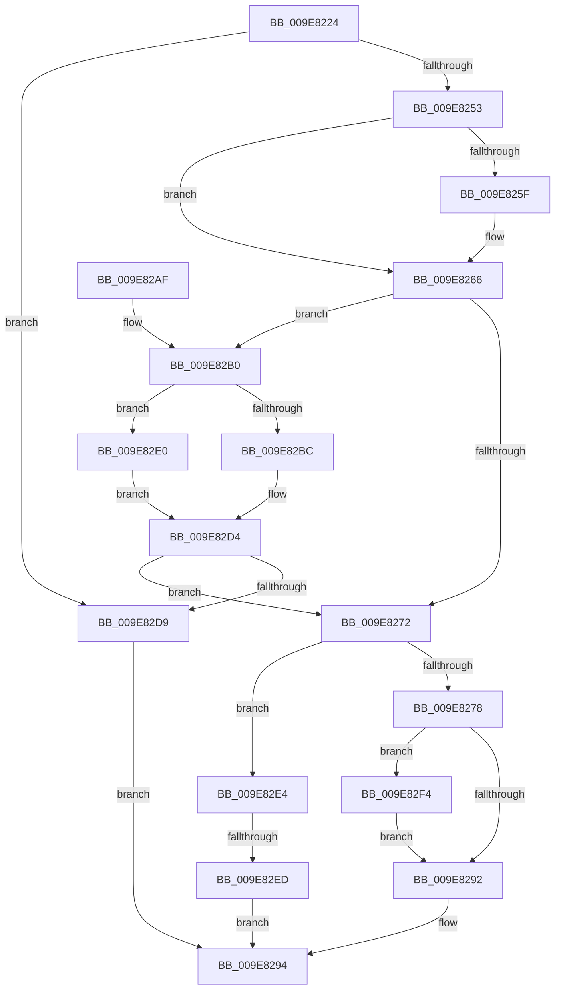

# PsInsertPermanentSiloContextEx

- RVA: `0x009E8224`–`0x009E8301` (길이 `221` bytes)
- VA: `0x00000001409E8224`
- 실행 섹션: `PAGE`
- PDB 이름 있음: `예`; PDB Function 태그: `예`
- unwind 정보 RVA: `0x000A4CF0`
- 디코드: `64`개 명령, `221/221` bytes 표시
- 미해석 바이트: `0` (있으면 어셈블리에 `.byte`로 보존)

> 이 문서는 커널 이미지의 기계어와 PDB 기호를 분석해 생성했습니다. 4번과 5번은 함수 원형과 자료형을 바이너리 사용 방식에서 추정한 C 해석이며 원본 소스 복구 결과는 아닙니다.

## 1. Dependencies

- 직접 호출 지점: **3**; 고유 호출 대상: **3**
- 직접 호출자로 확인된 함수: **3**
- RIP 상대 이미지 참조: **2**

### Outgoing calls
- `0x009E8269` → [PspIsSiloContext](PspIsSiloContext_function_009E8308.md) (function, `0x009E8308`)
- `0x009E8286` → [PspStorageInsertObject](PspStorageInsertObject_function_009E8420.md) (function, `0x009E8420`)
- `0x009E82FA` → [PspUnlockJob](../91/PspUnlockJob_function_00919E00.md) (function, `0x00919E00`)

### Direct callers
- [ObCreateSiloRootDirectory](../83/ObCreateSiloRootDirectory_function_0083CA34.md) at `0x0083CC70`
- [PsInsertPermanentSiloContext](PsInsertPermanentSiloContext_function_009E7DC0.md) at `0x009E7DC7`
- [CmpAttachContextToSilo](CmpAttachContextToSilo_function_009E81F8.md) at `0x009E8208`

### Static image references
- `0x009E8253` → RVA `0x00FCFE30` (`CACHEALI`; read)
- `0x009E82BF` → RVA `0x00F0FF80` (`.data`; read)

## 2. Other-region calls and transfers

- 다른 실행 섹션으로 향하는 call: **0**
- call이 아닌 외부 분기/꼬리 이동: **1**
  - `0x009E82E7` → [sub_00B307F0](../B3/Unknown_function_00B307F0.md) (`tail-transfer`)

## 3. Assembly (complete function range)

```asm
009E8224  48 8B C4                        mov rax, rsp
009E8227  48 89 58 08                     mov qword ptr [rax + 8], rbx
009E822B  48 89 68 10                     mov qword ptr [rax + 0x10], rbp
009E822F  48 89 70 18                     mov qword ptr [rax + 0x18], rsi
009E8233  48 89 78 20                     mov qword ptr [rax + 0x20], rdi
009E8237  41 56                           push r14
009E8239  48 83 EC 20                     sub rsp, 0x20
009E823D  49 8B F0                        mov rsi, r8
009E8240  44 8B F2                        mov r14d, edx
009E8243  48 8B D9                        mov rbx, rcx
009E8246  41 F7 C1 FE FF FF FF            test r9d, 0xfffffffe
009E824D  0F 85 86 00 00 00               jne 0x1409e82d9
009E8253  48 8B 2D D6 7B 5E 00            mov rbp, qword ptr [rip + 0x5e7bd6]
009E825A  48 85 C9                        test rcx, rcx
009E825D  74 07                           je 0x1409e8266
009E825F  48 8B A9 00 06 00 00            mov rbp, qword ptr [rcx + 0x600]
009E8266  48 8B CE                        mov rcx, rsi
009E8269  E8 9A 00 00 00                  call 0x1409e8308
009E826E  84 C0                           test al, al
009E8270  75 3E                           jne 0x1409e82b0
009E8272  41 F6 C1 01                     test r9b, 1
009E8276  75 6C                           jne 0x1409e82e4
009E8278  33 FF                           xor edi, edi
009E827A  4C 8B CE                        mov r9, rsi
009E827D  41 B0 01                        mov r8b, 1
009E8280  41 8B D6                        mov edx, r14d
009E8283  48 8B CD                        mov rcx, rbp
009E8286  E8 95 01 00 00                  call 0x1409e8420
009E828B  8B F0                           mov esi, eax
009E828D  48 85 FF                        test rdi, rdi
009E8290  75 62                           jne 0x1409e82f4
009E8292  8B C6                           mov eax, esi
009E8294  48 8B 5C 24 30                  mov rbx, qword ptr [rsp + 0x30]
009E8299  48 8B 6C 24 38                  mov rbp, qword ptr [rsp + 0x38]
009E829E  48 8B 74 24 40                  mov rsi, qword ptr [rsp + 0x40]
009E82A3  48 8B 7C 24 48                  mov rdi, qword ptr [rsp + 0x48]
009E82A8  48 83 C4 20                     add rsp, 0x20
009E82AC  41 5E                           pop r14
009E82AE  C3                              ret
009E82AF  CC                              int3
009E82B0  49 8D 48 D0                     lea rcx, [r8 - 0x30]
009E82B4  0F B6 41 1A                     movzx eax, byte ptr [rcx + 0x1a]
009E82B8  A8 40                           test al, 0x40
009E82BA  74 24                           je 0x1409e82e0
009E82BC  83 E0 7F                        and eax, 0x7f
009E82BF  48 8D 15 BA 7C 52 00            lea rdx, [rip + 0x527cba]
009E82C6  0F B6 04 10                     movzx eax, byte ptr [rax + rdx]
009E82CA  48 2B C8                        sub rcx, rax
009E82CD  48 8B 01                        mov rax, qword ptr [rcx]
009E82D0  48 83 C0 20                     add rax, 0x20
009E82D4  48 39 18                        cmp qword ptr [rax], rbx
009E82D7  74 99                           je 0x1409e8272
009E82D9  B8 0D 00 00 C0                  mov eax, 0xc000000d
009E82DE  EB B4                           jmp 0x1409e8294
009E82E0  33 C0                           xor eax, eax
009E82E2  EB F0                           jmp 0x1409e82d4
009E82E4  48 85 DB                        test rbx, rbx
009E82E7  0F 85 03 85 14 00               jne 0x140b307f0
009E82ED  B8 30 00 00 C0                  mov eax, 0xc0000030
009E82F2  EB A0                           jmp 0x1409e8294
009E82F4  48 8B D7                        mov rdx, rdi
009E82F7  48 8B CB                        mov rcx, rbx
009E82FA  E8 01 1B F3 FF                  call 0x140919e00
009E82FF  EB 91                           jmp 0x1409e8292
```

## 4. C-style interpretation (structured pseudocode)

```c
__int64 __fastcall PsInsertPermanentSiloContextEx(__int64 a1, int a2, __int64 a3, int a4)
{
    __int64 result;
    __int64 v_rbp;
    __int64 v_rdi;
    __int64 v_rsp;
    unsigned __int64 v_stack_p10;
    unsigned __int64 v_stack_p18;
    unsigned __int64 v_stack_p20;
    unsigned __int64 v_stack_p8;

    *(unsigned __int64 *)(v_rsp + 8) = v_rbx;
    *(unsigned __int64 *)(v_rsp + 16) = v_rbp;
    *(unsigned __int64 *)(v_rsp + 24) = v_rsi;
    *(unsigned __int64 *)(v_rsp + 32) = v_rdi;
    v_rsp = (v_rsp) - (32);
    if (((a4) & (0xFFFFFFFEULL)) != 0) goto loc_009E82D9;
    v_rbp = *(unsigned __int64 *)(v_rip + 6192086);
    if (a1 != 0) {
        v_rbp = *(unsigned __int64 *)(a1 + 1536);
    }
    result = PspIsSiloContext(a3, a2, a3, a4);
    if ((unsigned __int8)(result) != 0) goto loc_009E82B0;
loc_009E8272:
    if ((((unsigned __int8)(a4)) & (1)) != 0) goto loc_009E82E4;
    v_rdi = 0;
    result = PspStorageInsertObject(v_rbp, (unsigned int)((unsigned int)((unsigned int)(a2))), 1, a3);
    if (0 != 0) goto loc_009E82F4;
loc_009E8292:
loc_009E8294:
    v_rsp = (v_rsp) + (32);
    return (unsigned int)((unsigned int)((unsigned int)((unsigned int)(result))));
loc_009E82B0:
    if ((((unsigned __int8)(*(unsigned __int8 *)(1 - 48 + 26))) & (64)) == 0) goto loc_009E82E0;
    result = (unsigned int)((*(unsigned __int8 *)(1 - 48 + 26)) & (127));
    a1 = (1 - 48) - (*(unsigned __int8 *)(result + v_rip + 5405882 * 1));
    result = (*(unsigned __int64 *)(a1)) + (32);
loc_009E82D4:
    if ((*(unsigned __int64 *)(result)) == v_stack_p8) goto loc_009E8272;
loc_009E82D9:
    goto loc_009E8294;
loc_009E82E0:
    result = 0;
    goto loc_009E82D4;
loc_009E82E4:
    goto loc_009E8294;
loc_009E82F4:
    result = PspUnlockJob(v_stack_p8, v_stack_p20, 1, a3);
    goto loc_009E8292;
}
```

## 5. (Beta) C Style

```c
int64_t PsInsertPermanentSiloContextEx(int64_t Arg1, int32_t Arg2, int64_t Arg3, int32_t Arg4)
{
    int64_t result;
    int64_t local_rbp;
    int64_t local_rdi;
    int64_t local_rsp;
    uint64_t v_stack_p10;
    uint64_t v_stack_p18;
    uint64_t v_stack_p20;
    uint64_t v_stack_p8;

    *(uint64_t *)(local_rsp + 0x8) = local_rbx;
    *(uint64_t *)(local_rsp + 0x10) = local_rbp;
    *(uint64_t *)(local_rsp + 0x18) = local_rsi;
    *(uint64_t *)(local_rsp + 0x20) = local_rdi;
    local_rsp = (local_rsp) - (32);
    if (((Arg4) & (0xFFFFFFFEULL)) != 0) goto loc_009E82D9;
    local_rbp = *(uint64_t *)(v_rip + 0x5E7BD6);
    if (Arg1 != 0) {
        local_rbp = *(uint64_t *)(Arg1 + 0x600);
    }
    result = PspIsSiloContext(Arg3, Arg2, Arg3, Arg4);
    if ((uint8_t)(result) != 0) goto loc_009E82B0;
loc_009E8272:
    if ((((uint8_t)(Arg4)) & (1)) != 0) goto loc_009E82E4;
    local_rdi = 0;
    result = PspStorageInsertObject(local_rbp, (uint32_t)((uint32_t)((uint32_t)(Arg2))), 1, Arg3);
    if (0 != 0) goto loc_009E82F4;
loc_009E8292:
loc_009E8294:
    local_rsp = (local_rsp) + (32);
    return (uint32_t)((uint32_t)((uint32_t)((uint32_t)(result))));
loc_009E82B0:
    if ((((uint8_t)(*(uint8_t *)(1 - 0x30 + 0x1A))) & (64)) == 0) goto loc_009E82E0;
    result = (uint32_t)((*(uint8_t *)(1 - 0x30 + 0x1A)) & (127));
    Arg1 = (1 - 48) - (*(uint8_t *)(result + v_rip + 0x527CBA * 1));
    result = (*(uint64_t *)(Arg1)) + (32);
loc_009E82D4:
    if ((*(uint64_t *)(result)) == v_stack_p8) goto loc_009E8272;
loc_009E82D9:
    goto loc_009E8294;
loc_009E82E0:
    result = 0;
    goto loc_009E82D4;
loc_009E82E4:
    goto loc_009E8294;
loc_009E82F4:
    result = PspUnlockJob(v_stack_p8, v_stack_p20, 1, Arg3);
    goto loc_009E8292;
}
```

## 6. Execution-region graph

[열기: 2D/3D 그래프와 함수 탐색 컨트롤 패널](../../../control-panel.html?section=page&rva=0x009E8224&view=graph)

- 2D 그래프는 위에서 아래로 흐르고, 3D 그래프는 빈 공간을 드래그해 회전합니다. Shift+드래그는 이동, 휠은 확대·축소, 함수 노드 선택은 대상 보고서 이동입니다.

### Static fallback


