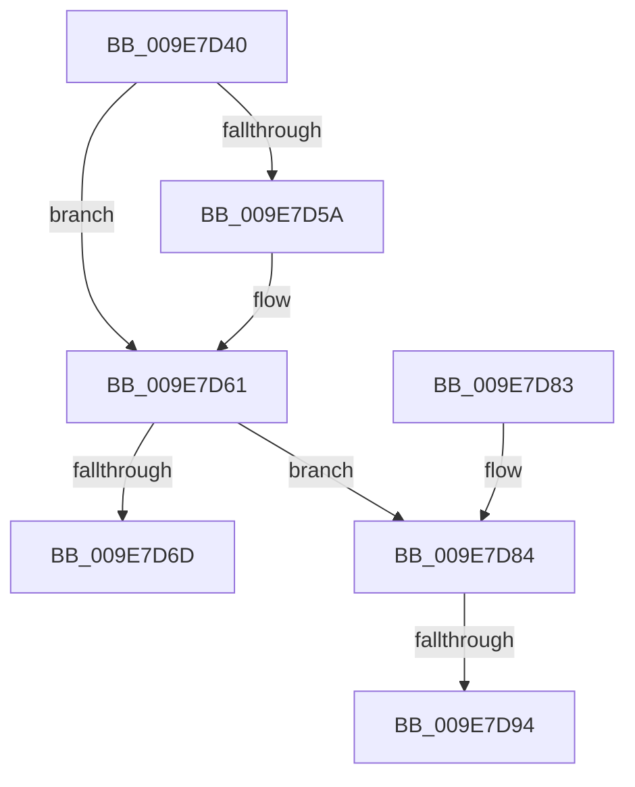

# PsInsertSiloContext

- RVA: `0x009E7D40`–`0x009E7DB1` (길이 `113` bytes)
- VA: `0x00000001409E7D40`
- 실행 섹션: `PAGE`
- PDB 이름 있음: `예`; PDB Function 태그: `예`
- unwind 정보 RVA: `0x000783B4`
- 디코드: `33`개 명령, `113/113` bytes 표시
- 미해석 바이트: `0` (있으면 어셈블리에 `.byte`로 보존)

> 이 문서는 커널 이미지의 기계어와 PDB 기호를 분석해 생성했습니다. 4번과 5번은 함수 원형과 자료형을 바이너리 사용 방식에서 추정한 C 해석이며 원본 소스 복구 결과는 아닙니다.

## 1. Dependencies

- 직접 호출 지점: **2**; 고유 호출 대상: **2**
- 직접 호출자로 확인된 함수: **3**
- RIP 상대 이미지 참조: **2**

### Outgoing calls
- `0x009E7D64` → [PspIsSiloContext](PspIsSiloContext_function_009E8308.md) (function, `0x009E8308`)
- `0x009E7D78` → [PspStorageInsertObject](PspStorageInsertObject_function_009E8420.md) (function, `0x009E8420`)

### Direct callers
- [PspAssignSiloSystemRootPath](../77/PspAssignSiloSystemRootPath_function_0077F720.md) at `0x0077F7D6`
- [ObCreateSiloRootDirectory](../83/ObCreateSiloRootDirectory_function_0083CA34.md) at `0x0083CC4F`
- [sub_00B24EA0](../B2/Unknown_function_00B24EA0.md) at `0x00B24EE0`

### Static image references
- `0x009E7D46` → RVA `0x00FCFE30` (`CACHEALI`; read)
- `0x009E7D97` → RVA `0x00F0FF80` (`.data`; read)

## 2. Other-region calls and transfers

- 다른 실행 섹션으로 향하는 call: **0**
- call이 아닌 외부 분기/꼬리 이동: **2**
  - `0x009E7D8E` → [sub_00B3072A](../B3/Unknown_function_00B3072A.md) (`tail-transfer`)
  - `0x009E7DAC` → [sub_00B3072A](../B3/Unknown_function_00B3072A.md) (`tail-transfer`)

## 3. Assembly (complete function range)

```asm
009E7D40  40 53                           push rbx
009E7D42  48 83 EC 20                     sub rsp, 0x20
009E7D46  4C 8B 1D E3 80 5E 00            mov r11, qword ptr [rip + 0x5e80e3]
009E7D4D  45 33 C9                        xor r9d, r9d
009E7D50  8B DA                           mov ebx, edx
009E7D52  4C 8B D1                        mov r10, rcx
009E7D55  48 85 C9                        test rcx, rcx
009E7D58  74 07                           je 0x1409e7d61
009E7D5A  4C 8B 99 00 06 00 00            mov r11, qword ptr [rcx + 0x600]
009E7D61  49 8B C8                        mov rcx, r8
009E7D64  E8 9F 05 00 00                  call 0x1409e8308
009E7D69  84 C0                           test al, al
009E7D6B  75 17                           jne 0x1409e7d84
009E7D6D  4D 8B C8                        mov r9, r8
009E7D70  8B D3                           mov edx, ebx
009E7D72  45 33 C0                        xor r8d, r8d
009E7D75  49 8B CB                        mov rcx, r11
009E7D78  E8 A3 06 00 00                  call 0x1409e8420
009E7D7D  48 83 C4 20                     add rsp, 0x20
009E7D81  5B                              pop rbx
009E7D82  C3                              ret
009E7D83  CC                              int3
009E7D84  49 8D 48 D0                     lea rcx, [r8 - 0x30]
009E7D88  0F B6 41 1A                     movzx eax, byte ptr [rcx + 0x1a]
009E7D8C  A8 40                           test al, 0x40
009E7D8E  0F 84 96 89 14 00               je 0x140b3072a
009E7D94  83 E0 7F                        and eax, 0x7f
009E7D97  48 8D 15 E2 81 52 00            lea rdx, [rip + 0x5281e2]
009E7D9E  0F B6 04 10                     movzx eax, byte ptr [rax + rdx]
009E7DA2  48 2B C8                        sub rcx, rax
009E7DA5  4C 8B 09                        mov r9, qword ptr [rcx]
009E7DA8  49 83 C1 20                     add r9, 0x20
009E7DAC  E9 79 89 14 00                  jmp 0x140b3072a
```

## 4. C-style interpretation (structured pseudocode)

```c
__int64 __fastcall PsInsertSiloContext(__int64 a1, int a2, __int64 a3, int a4)
{
    __int64 result;
    __int64 v_r11;
    __int64 v_rsp;

    v_rsp = (v_rsp) - (32);
    a4 = 0;
    v_r11 = *(unsigned __int64 *)(v_rip + 6193379);
    if (a1 != 0) {
        v_r11 = *(unsigned __int64 *)(a1 + 1536);
    }
    result = PspIsSiloContext(a3, a2, a3, a4);
    if ((unsigned __int8)(result) != 0) goto loc_009E7D84;
    a3 = 0;
    result = PspStorageInsertObject(v_r11, (unsigned int)((unsigned int)((unsigned int)(a2))), a3, a3);
    v_rsp = (v_rsp) + (32);
    return result;
loc_009E7D84:
    result = (unsigned int)((*(unsigned __int8 *)(a3 - 48 + 26)) & (127));
    a1 = (a3 - 48) - (*(unsigned __int8 *)(result + v_rip + 5407202 * 1));
    a4 = (*(unsigned __int64 *)(a1)) + (32);
}
```

## 5. (Beta) C Style

```c
int64_t PsInsertSiloContext(int64_t Arg1, int32_t Arg2, int64_t Arg3, int32_t Arg4)
{
    int64_t result;
    int64_t local_r11;
    int64_t local_rsp;

    local_rsp = (local_rsp) - (32);
    Arg4 = 0;
    local_r11 = *(uint64_t *)(v_rip + 0x5E80E3);
    if (Arg1 != 0) {
        local_r11 = *(uint64_t *)(Arg1 + 0x600);
    }
    result = PspIsSiloContext(Arg3, Arg2, Arg3, Arg4);
    if ((uint8_t)(result) != 0) goto loc_009E7D84;
    Arg3 = 0;
    result = PspStorageInsertObject(local_r11, (uint32_t)((uint32_t)((uint32_t)(Arg2))), Arg3, Arg3);
    local_rsp = (local_rsp) + (32);
    return result;
loc_009E7D84:
    result = (uint32_t)((*(uint8_t *)(Arg3 - 0x30 + 0x1A)) & (127));
    Arg1 = (Arg3 - 48) - (*(uint8_t *)(result + v_rip + 0x5281E2 * 1));
    Arg4 = (*(uint64_t *)(Arg1)) + (32);
}
```

## 6. Execution-region graph

[열기: 2D/3D 그래프와 함수 탐색 컨트롤 패널](../../../control-panel.html?section=page&rva=0x009E7D40&view=graph)

- 2D 그래프는 위에서 아래로 흐르고, 3D 그래프는 빈 공간을 드래그해 회전합니다. Shift+드래그는 이동, 휠은 확대·축소, 함수 노드 선택은 대상 보고서 이동입니다.

### Static fallback


