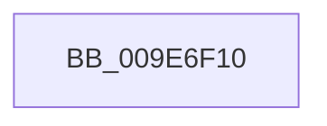

# PsRestoreImpersonation

- RVA: `0x009E6F10`–`0x009E6F2D` (길이 `29` bytes)
- VA: `0x00000001409E6F10`
- 실행 섹션: `PAGE`
- PDB 이름 있음: `예`; PDB Function 태그: `예`
- unwind 정보 RVA: `0x000A4928`
- 디코드: `10`개 명령, `29/29` bytes 표시
- 미해석 바이트: `0` (있으면 어셈블리에 `.byte`로 보존)

> 이 문서는 커널 이미지의 기계어와 PDB 기호를 분석해 생성했습니다. 4번과 5번은 함수 원형과 자료형을 바이너리 사용 방식에서 추정한 C 해석이며 원본 소스 복구 결과는 아닙니다.

## 1. Dependencies

- 직접 호출 지점: **0**; 고유 호출 대상: **0**
- 직접 호출자로 확인된 함수: **3**
- RIP 상대 이미지 참조: **0**

### Outgoing calls
- 직접 디코드된 call 명령이 없습니다.

### Direct callers
- [CmpAddRemoveContainerToCLFSLog](../7F/CmpAddRemoveContainerToCLFSLog_function_007F69FC.md) at `0x007F6BA6`
- [CmpStartCLFSLog](../7F/CmpStartCLFSLog_function_007F7228.md) at `0x007F74CC`
- [NtCreateUserProcess](../AE/NtCreateUserProcess_function_00AEA680.md) at `0x00AEAE6C`
- [NtCreateUserProcess](../AE/NtCreateUserProcess_function_00AEA680.md) at `0x00AEAE8B`

### Static image references
- 디코드된 RIP-relative 메모리 참조가 없습니다.

## 2. Other-region calls and transfers

- 다른 실행 섹션으로 향하는 call: **0**
- 별도 외부 분기/꼬리 이동을 확인하지 못했습니다.

## 3. Assembly (complete function range)

```asm
009E6F10  40 53                           push rbx
009E6F12  55                              push rbp
009E6F13  56                              push rsi
009E6F14  41 55                           push r13
009E6F16  41 57                           push r15
009E6F18  48 83 EC 20                     sub rsp, 0x20
009E6F1C  65 4C 8B 3C 25 88 01 00 00      mov r15, qword ptr gs:[0x188]
009E6F25  33 ED                           xor ebp, ebp
009E6F27  48 8B 1A                        mov rbx, qword ptr [rdx]
009E6F2A  45 32 ED                        xor r13b, r13b
```

## 4. C-style interpretation (structured pseudocode)

```c
void __fastcall PsRestoreImpersonation(__int64 a1, __int64 a2)
{
    __int64 v_r13;
    __int64 v_rbp;
    __int64 v_rsp;

    v_rsp = (v_rsp) - (32);
    v_rbp = 0;
    v_r13 = 0;
    return;
}
```

## 5. (Beta) C Style

```c
void PsRestoreImpersonation(int64_t Arg1, void *Arg2)
{
    uint8_t *arg2 = (uint8_t *)Arg2;

    int64_t local_r13;
    int64_t local_rbp;
    int64_t local_rsp;

    local_rsp = (local_rsp) - (32);
    local_rbp = 0;
    local_r13 = 0;
    return;
}
```

### 관측된 메모리 오프셋

구조체 형식이 확인되지 않은 접근은 인자 기준의 오프셋으로만 기록했습니다.

| 기준 인자 | 오프셋 표현 | 폭 (bit) | 접근 |
|---|---:|---:|---|
| `Arg2` | `+ 0x0` | `64` | `R` |

## 6. Execution-region graph

[열기: 2D/3D 그래프와 함수 탐색 컨트롤 패널](../../../control-panel.html?section=page&rva=0x009E6F10&view=graph)

- 2D 그래프는 위에서 아래로 흐르고, 3D 그래프는 빈 공간을 드래그해 회전합니다. Shift+드래그는 이동, 휠은 확대·축소, 함수 노드 선택은 대상 보고서 이동입니다.

### Static fallback


