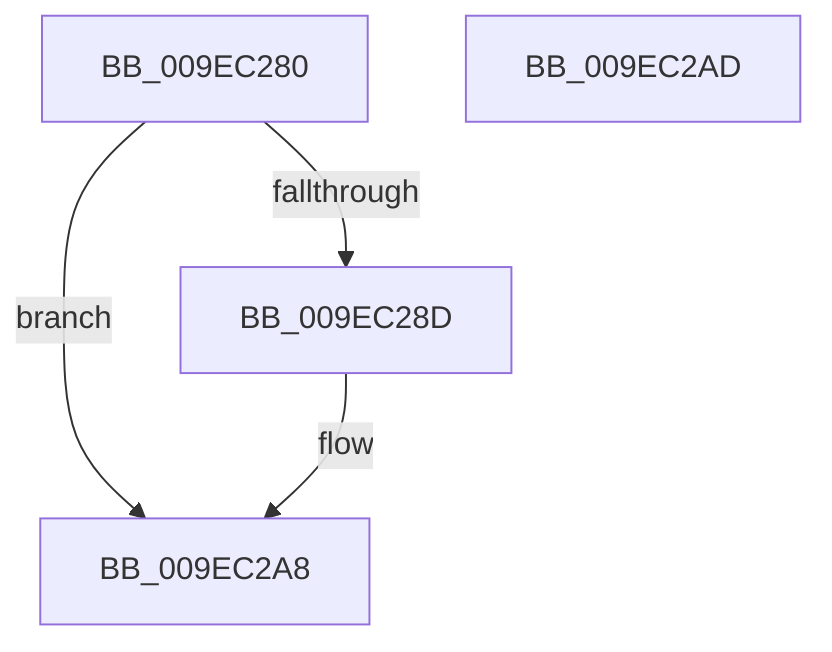

# PsReturnProcessPageFileQuota

- RVA: `0x009EC280`–`0x009EC2AE` (길이 `46` bytes)
- VA: `0x00000001409EC280`
- 실행 섹션: `PAGE`
- PDB 이름 있음: `예`; PDB Function 태그: `아니요`
- unwind 정보 RVA: `0x0005C788`
- 디코드: `12`개 명령, `46/46` bytes 표시
- 미해석 바이트: `0` (있으면 어셈블리에 `.byte`로 보존)

> 이 문서는 커널 이미지의 기계어와 PDB 기호를 분석해 생성했습니다. 4번과 5번은 함수 원형과 자료형을 바이너리 사용 방식에서 추정한 C 해석이며 원본 소스 복구 결과는 아닙니다.

## 1. Dependencies

- 직접 호출 지점: **1**; 고유 호출 대상: **1**
- 직접 호출자로 확인된 함수: **2**
- RIP 상대 이미지 참조: **1**

### Outgoing calls
- `0x009EC2A3` → [PspReturnQuota](../../text/39/PspReturnQuota_function_00390C40.md) (function, `0x00390C40`)

### Direct callers
- [MiReturnFullProcessCharges](../../text/2C/MiReturnFullProcessCharges_function_002C2E70.md) at `0x002C2EB5`
- [MiChargeFullProcessCommitment](../88/MiChargeFullProcessCommitment_function_00887630.md) at `0x008876FF`

### Static image references
- `0x009EC284` → RVA `0x00FC6AB0` (`ALMOSTRO`; read)

## 2. Other-region calls and transfers

- 다른 실행 섹션으로 향하는 call: **1**
  - `0x009EC2A3` → [PspReturnQuota](../../text/39/PspReturnQuota_function_00390C40.md) (`PAGE` → `.text`)
- 별도 외부 분기/꼬리 이동을 확인하지 못했습니다.

## 3. Assembly (complete function range)

```asm
009EC280  48 83 EC 28                     sub rsp, 0x28
009EC284  48 3B 0D 25 A8 5D 00            cmp rcx, qword ptr [rip + 0x5da825]
009EC28B  74 1B                           je 0x1409ec2a8
009EC28D  48 8B 81 F8 02 00 00            mov rax, qword ptr [rcx + 0x2f8]
009EC294  4C 8B CA                        mov r9, rdx
009EC297  48 8B D1                        mov rdx, rcx
009EC29A  41 B8 02 00 00 00               mov r8d, 2
009EC2A0  48 8B C8                        mov rcx, rax
009EC2A3  E8 98 49 9A FF                  call 0x140390c40
009EC2A8  48 83 C4 28                     add rsp, 0x28
009EC2AC  C3                              ret
009EC2AD  CC                              int3
```

## 4. C-style interpretation (structured pseudocode)

```c
__int64 __fastcall PsReturnProcessPageFileQuota(__int64 a1, __int64 a2)
{
    __int64 result;
    __int64 v_rsp;

    v_rsp = (v_rsp) - (40);
    if (a1 != (*(unsigned __int64 *)(v_rip + 6137893))) {
        result = *(unsigned __int64 *)(a1 + 760);
        a4 = a2;
        a2 = a1;
        a3 = 2;
        a1 = result;
        result = PspReturnQuota(a1, a2, a3, a4);
    }
    v_rsp = (v_rsp) + (40);
    return result;
}
```

## 5. (Beta) C Style

```c
int64_t PsReturnProcessPageFileQuota(int64_t Arg1, int64_t Arg2)
{
    int64_t result;
    int64_t local_rsp;

    local_rsp = (local_rsp) - (40);
    if (Arg1 != (*(uint64_t *)(v_rip + 0x5DA825))) {
        result = *(uint64_t *)(Arg1 + 0x2F8);
        a4 = Arg2;
        Arg2 = Arg1;
        a3 = 2;
        Arg1 = result;
        result = PspReturnQuota(Arg1, Arg2, a3, a4);
    }
    local_rsp = (local_rsp) + (40);
    return result;
}
```

## 6. Execution-region graph

[열기: 2D/3D 그래프와 함수 탐색 컨트롤 패널](../../../control-panel.html?section=page&rva=0x009EC280&view=graph)

- 2D 그래프는 위에서 아래로 흐르고, 3D 그래프는 빈 공간을 드래그해 회전합니다. Shift+드래그는 이동, 휠은 확대·축소, 함수 노드 선택은 대상 보고서 이동입니다.

### Static fallback


