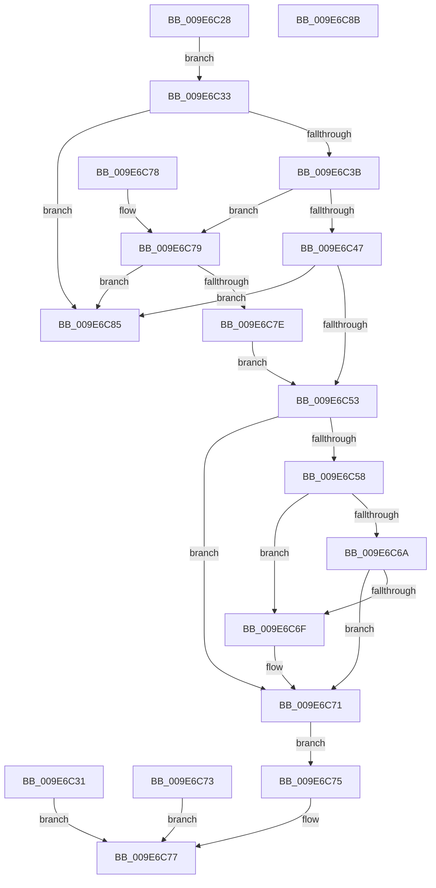

# PspCaptureAndValidateUnicodeString

- RVA: `0x009E6C28`–`0x009E6C8C` (길이 `100` bytes)
- VA: `0x00000001409E6C28`
- 실행 섹션: `PAGE`
- PDB 이름 있음: `예`; PDB Function 태그: `아니요`
- unwind 정보 RVA: `0x000A4750`
- 디코드: `36`개 명령, `100/100` bytes 표시
- 미해석 바이트: `0` (있으면 어셈블리에 `.byte`로 보존)

> 이 문서는 커널 이미지의 기계어와 PDB 기호를 분석해 생성했습니다. 4번과 5번은 함수 원형과 자료형을 바이너리 사용 방식에서 추정한 C 해석이며 원본 소스 복구 결과는 아닙니다.

## 1. Dependencies

- 직접 호출 지점: **0**; 고유 호출 대상: **0**
- 직접 호출자로 확인된 함수: **1**
- RIP 상대 이미지 참조: **0**

### Outgoing calls
- 직접 디코드된 call 명령이 없습니다.

### Direct callers
- [PspCaptureUserProcessParameters](PspCaptureUserProcessParameters_function_009E63C0.md) at `0x009E6557`
- [PspCaptureUserProcessParameters](PspCaptureUserProcessParameters_function_009E63C0.md) at `0x009E6570`
- [PspCaptureUserProcessParameters](PspCaptureUserProcessParameters_function_009E63C0.md) at `0x009E6589`
- [PspCaptureUserProcessParameters](PspCaptureUserProcessParameters_function_009E63C0.md) at `0x009E65A5`
- [PspCaptureUserProcessParameters](PspCaptureUserProcessParameters_function_009E63C0.md) at `0x009E65C1`
- [PspCaptureUserProcessParameters](PspCaptureUserProcessParameters_function_009E63C0.md) at `0x009E65DD`
- [PspCaptureUserProcessParameters](PspCaptureUserProcessParameters_function_009E63C0.md) at `0x009E6603`
- [PspCaptureUserProcessParameters](PspCaptureUserProcessParameters_function_009E63C0.md) at `0x009E69D6`

### Static image references
- 디코드된 RIP-relative 메모리 참조가 없습니다.

## 2. Other-region calls and transfers

- 다른 실행 섹션으로 향하는 call: **0**
- 별도 외부 분기/꼬리 이동을 확인하지 못했습니다.

## 3. Assembly (complete function range)

```asm
009E6C28  0F 10 01                        movups xmm0, xmmword ptr [rcx]
009E6C2B  F3 0F 7F 02                     movdqu xmmword ptr [rdx], xmm0
009E6C2F  EB 02                           jmp 0x1409e6c33
009E6C31  EB 44                           jmp 0x1409e6c77
009E6C33  0F B7 0A                        movzx ecx, word ptr [rdx]
009E6C36  F6 C1 01                        test cl, 1
009E6C39  75 4A                           jne 0x1409e6c85
009E6C3B  4C 8B 42 08                     mov r8, qword ptr [rdx + 8]
009E6C3F  45 33 C9                        xor r9d, r9d
009E6C42  4D 85 C0                        test r8, r8
009E6C45  74 32                           je 0x1409e6c79
009E6C47  8D 41 02                        lea eax, [rcx + 2]
009E6C4A  66 89 42 02                     mov word ptr [rdx + 2], ax
009E6C4E  66 3B C1                        cmp ax, cx
009E6C51  72 32                           jb 0x1409e6c85
009E6C53  66 85 C9                        test cx, cx
009E6C56  74 19                           je 0x1409e6c71
009E6C58  49 03 C8                        add rcx, r8
009E6C5B  48 B8 00 00 FF FF FF 7F 00 00   movabs rax, 0x7fffffff0000
009E6C65  48 3B C8                        cmp rcx, rax
009E6C68  77 05                           ja 0x1409e6c6f
009E6C6A  49 3B C8                        cmp rcx, r8
009E6C6D  73 02                           jae 0x1409e6c71
009E6C6F  8A 00                           mov al, byte ptr [rax]
009E6C71  EB 02                           jmp 0x1409e6c75
009E6C73  EB 02                           jmp 0x1409e6c77
009E6C75  33 C0                           xor eax, eax
009E6C77  C3                              ret
009E6C78  CC                              int3
009E6C79  66 85 C9                        test cx, cx
009E6C7C  75 07                           jne 0x1409e6c85
009E6C7E  66 44 89 4A 02                  mov word ptr [rdx + 2], r9w
009E6C83  EB CE                           jmp 0x1409e6c53
009E6C85  B8 0D 00 00 C0                  mov eax, 0xc000000d
009E6C8A  C3                              ret
009E6C8B  CC                              int3
```

## 4. C-style interpretation (structured pseudocode)

```c
__int64 __fastcall PspCaptureAndValidateUnicodeString(__int64 a1, __int64 a2, __int64 a3, int a4)
{
    __int64 result;

    *(unsigned __int64 *)(a2) = v_xmm0;
    goto loc_009E6C33;
loc_009E6C33:
    if ((((unsigned __int8)(*(unsigned __int16 *)(a2))) & (1)) != 0) goto loc_009E6C85;
    a4 = 0;
    if (*(unsigned __int64 *)(a2 + 8) == 0) goto loc_009E6C79;
    *(unsigned __int16 *)(a2 + 2) = (unsigned __int16)(*(unsigned __int16 *)(a2) + 2);
    if (((unsigned __int16)(*(unsigned __int16 *)(a2) + 2)) < ((unsigned __int16)(*(unsigned __int16 *)(a2)))) goto loc_009E6C85;
loc_009E6C53:
    if ((unsigned __int16)(*(unsigned __int16 *)(a2)) == 0) goto loc_009E6C71;
    a1 = (*(unsigned __int16 *)(a2)) + (*(unsigned __int64 *)(a2 + 8));
    if (a1 > (*(unsigned __int16 *)(a2) + 2)) goto loc_009E6C6F;
    result = *(unsigned __int16 *)(a2) + 2;
    if (a1 < (*(unsigned __int64 *)(a2 + 8))) {
        result = *(unsigned __int8 *)(*(unsigned __int16 *)(a2) + 2);
    }
    goto loc_009E6C75;
loc_009E6C75:
    result = 0;
loc_009E6C77:
    return result;
loc_009E6C79:
    if ((unsigned __int16)(a1) != 0) goto loc_009E6C85;
    *(unsigned __int16 *)(a2 + 2) = 0;
    goto loc_009E6C53;
loc_009E6C85:
    return (unsigned int)(0xC000000DULL);
}
```

## 5. (Beta) C Style

```c
int64_t PspCaptureAndValidateUnicodeString(void *Arg1, void *Arg2, int64_t Arg3, int32_t Arg4)
{
    uint8_t *arg1 = (uint8_t *)Arg1;
    uint8_t *arg2 = (uint8_t *)Arg2;

    int64_t result;

    *(uint64_t *)(arg2) = v_xmm0;
    goto loc_009E6C33;
loc_009E6C33:
    if ((((uint8_t)(*(uint16_t *)(arg2))) & (1)) != 0) goto loc_009E6C85;
    Arg4 = 0;
    if (*(uint64_t *)(arg2 + 0x8) == 0) goto loc_009E6C79;
    *(uint16_t *)(arg2 + 0x2) = (uint16_t)(*(uint16_t *)(arg2) + 2);
    if (((uint16_t)(*(uint16_t *)(arg2) + 2)) < ((uint16_t)(*(uint16_t *)(arg2)))) goto loc_009E6C85;
loc_009E6C53:
    if ((uint16_t)(*(uint16_t *)(arg2)) == 0) goto loc_009E6C71;
    Arg1 = (*(uint16_t *)(arg2)) + (*(uint64_t *)(arg2 + 0x8));
    if (Arg1 > (*(uint16_t *)(arg2) + 2)) goto loc_009E6C6F;
    result = *(uint16_t *)(arg2) + 2;
    if (Arg1 < (*(uint64_t *)(arg2 + 0x8))) {
        result = *(uint8_t *)(*(uint16_t *)(arg2) + 0x2);
    }
    goto loc_009E6C75;
loc_009E6C75:
    result = 0;
loc_009E6C77:
    return result;
loc_009E6C79:
    if ((uint16_t)(Arg1) != 0) goto loc_009E6C85;
    *(uint16_t *)(arg2 + 0x2) = 0;
    goto loc_009E6C53;
loc_009E6C85:
    return (uint32_t)(0xC000000DULL);
}
```

### 관측된 메모리 오프셋

구조체 형식이 확인되지 않은 접근은 인자 기준의 오프셋으로만 기록했습니다.

| 기준 인자 | 오프셋 표현 | 폭 (bit) | 접근 |
|---|---:|---:|---|
| `Arg1` | `+ 0x0` | `128` | `R` |
| `Arg2` | `+ 0x0` | `16` | `R` |
| `Arg2` | `+ 0x0` | `128` | `W` |
| `Arg2` | `+ 0x2` | `16` | `W` |
| `Arg2` | `+ 0x8` | `64` | `R` |

## 6. Execution-region graph

[열기: 2D/3D 그래프와 함수 탐색 컨트롤 패널](../../../control-panel.html?section=page&rva=0x009E6C28&view=graph)

- 2D 그래프는 위에서 아래로 흐르고, 3D 그래프는 빈 공간을 드래그해 회전합니다. Shift+드래그는 이동, 휠은 확대·축소, 함수 노드 선택은 대상 보고서 이동입니다.

### Static fallback


