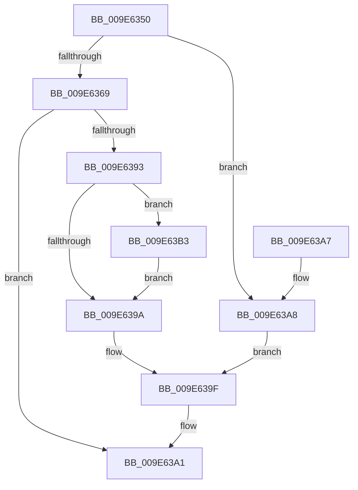

# PspCaptureProcessParameters

- RVA: `0x009E6350`–`0x009E63B9` (길이 `105` bytes)
- VA: `0x00000001409E6350`
- 실행 섹션: `PAGE`
- PDB 이름 있음: `예`; PDB Function 태그: `아니요`
- unwind 정보 RVA: `0x000A46AC`
- 디코드: `33`개 명령, `105/105` bytes 표시
- 미해석 바이트: `0` (있으면 어셈블리에 `.byte`로 보존)

> 이 문서는 커널 이미지의 기계어와 PDB 기호를 분석해 생성했습니다. 4번과 5번은 함수 원형과 자료형을 바이너리 사용 방식에서 추정한 C 해석이며 원본 소스 복구 결과는 아닙니다.

## 1. Dependencies

- 직접 호출 지점: **1**; 고유 호출 대상: **1**
- 직접 호출자로 확인된 함수: **1**
- RIP 상대 이미지 참조: **0**

### Outgoing calls
- `0x009E638A` → [PspCaptureUserProcessParameters](PspCaptureUserProcessParameters_function_009E63C0.md) (function, `0x009E63C0`)

### Direct callers
- [NtCreateUserProcess](../AE/NtCreateUserProcess_function_00AEA680.md) at `0x00AEB0D6`

### Static image references
- 디코드된 RIP-relative 메모리 참조가 없습니다.

## 2. Other-region calls and transfers

- 다른 실행 섹션으로 향하는 call: **0**
- 별도 외부 분기/꼬리 이동을 확인하지 못했습니다.

## 3. Assembly (complete function range)

```asm
009E6350  40 53                           push rbx
009E6352  48 83 EC 30                     sub rsp, 0x30
009E6356  41 0F B6 40 10                  movzx eax, byte ptr [r8 + 0x10]
009E635B  49 8B D8                        mov rbx, r8
009E635E  4D 8D 90 D8 00 00 00            lea r10, [r8 + 0xd8]
009E6365  84 C9                           test cl, cl
009E6367  74 3F                           je 0x1409e63a8
009E6369  44 8B C8                        mov r9d, eax
009E636C  49 8B CA                        mov rcx, r10
009E636F  49 8B 80 A8 01 00 00            mov rax, qword ptr [r8 + 0x1a8]
009E6376  4D 8B 80 D8 01 00 00            mov r8, qword ptr [r8 + 0x1d8]
009E637D  41 C1 E9 03                     shr r9d, 3
009E6381  41 83 E1 01                     and r9d, 1
009E6385  48 89 44 24 20                  mov qword ptr [rsp + 0x20], rax
009E638A  E8 31 00 00 00                  call 0x1409e63c0
009E638F  85 C0                           test eax, eax
009E6391  78 0E                           js 0x1409e63a1
009E6393  8A 43 10                        mov al, byte ptr [rbx + 0x10]
009E6396  A8 08                           test al, 8
009E6398  75 19                           jne 0x1409e63b3
009E639A  0C 04                           or al, 4
009E639C  88 43 10                        mov byte ptr [rbx + 0x10], al
009E639F  33 C0                           xor eax, eax
009E63A1  48 83 C4 30                     add rsp, 0x30
009E63A5  5B                              pop rbx
009E63A6  C3                              ret
009E63A7  CC                              int3
009E63A8  24 FB                           and al, 0xfb
009E63AA  49 89 12                        mov qword ptr [r10], rdx
009E63AD  41 88 40 10                     mov byte ptr [r8 + 0x10], al
009E63B1  EB EC                           jmp 0x1409e639f
009E63B3  80 63 11 F3                     and byte ptr [rbx + 0x11], 0xf3
009E63B7  EB E1                           jmp 0x1409e639a
```

## 4. C-style interpretation (structured pseudocode)

```c
__int64 __fastcall PspCaptureProcessParameters(unsigned __int8 a1, __int64 a2, __int64 a3)
{
    __int64 result;
    __int64 v_rsp;
    unsigned __int64 v_stack_m18;

    v_rsp = (v_rsp) - (48);
    if (a1 == 0) goto loc_009E63A8;
    a4 = (unsigned int)(((unsigned int)((unsigned int)(*(unsigned __int8 *)(a3 + 16)))) >> (3));
    a4 = (unsigned int)((a4) & (1));
    v_stack_m18 = *(unsigned __int64 *)(a3 + 424);
    result = PspCaptureUserProcessParameters(a3 + 216, a2, *(unsigned __int64 *)(a3 + 472), a4);
    if (sign_flag) goto loc_009E63A1;
    if ((((unsigned __int8)(*(unsigned __int8 *)(a3 + 16))) & (8)) != 0) goto loc_009E63B3;
loc_009E639A:
    result = (unsigned __int8)((*(unsigned __int8 *)(a3 + 16)) | (4));
    *(unsigned __int8 *)(a3 + 16) = (unsigned __int8)(result);
loc_009E639F:
    result = 0;
loc_009E63A1:
    v_rsp = (v_rsp) + (48);
    return result;
loc_009E63A8:
    result = (unsigned __int8)((result) & (251));
    *(unsigned __int64 *)(a3 + 216) = a2;
    *(unsigned __int8 *)(*(unsigned __int64 *)(a3 + 472) + 16) = (unsigned __int8)(result);
    goto loc_009E639F;
loc_009E63B3:
    goto loc_009E639A;
}
```

## 5. (Beta) C Style

```c
int64_t PspCaptureProcessParameters(uint8_t Arg1, int64_t Arg2, void *Arg3)
{
    uint8_t *arg3 = (uint8_t *)Arg3;

    int64_t result;
    int64_t local_rsp;
    uint64_t v_stack_m18;

    local_rsp = (local_rsp) - (48);
    if (Arg1 == 0) goto loc_009E63A8;
    a4 = (uint32_t)(((uint32_t)((uint32_t)(*(uint8_t *)(arg3 + 0x10)))) >> (3));
    a4 = (uint32_t)((a4) & (1));
    v_stack_m18 = *(uint64_t *)(arg3 + 0x1A8);
    result = PspCaptureUserProcessParameters(Arg3 + 216, Arg2, *(uint64_t *)(arg3 + 0x1D8), a4);
    if (sign_flag) goto loc_009E63A1;
    if ((((uint8_t)(*(uint8_t *)(arg3 + 0x10))) & (8)) != 0) goto loc_009E63B3;
loc_009E639A:
    result = (uint8_t)((*(uint8_t *)(arg3 + 0x10)) | (4));
    *(uint8_t *)(arg3 + 0x10) = (uint8_t)(result);
loc_009E639F:
    result = 0;
loc_009E63A1:
    local_rsp = (local_rsp) + (48);
    return result;
loc_009E63A8:
    result = (uint8_t)((result) & (251));
    *(uint64_t *)(arg3 + 0xD8) = Arg2;
    *(uint8_t *)(*(uint64_t *)(arg3 + 0x1D8) + 0x10) = (uint8_t)(result);
    goto loc_009E639F;
loc_009E63B3:
    goto loc_009E639A;
}
```

### 관측된 메모리 오프셋

구조체 형식이 확인되지 않은 접근은 인자 기준의 오프셋으로만 기록했습니다.

| 기준 인자 | 오프셋 표현 | 폭 (bit) | 접근 |
|---|---:|---:|---|
| `Arg3` | `+ 0x0` | `64` | `W` |
| `Arg3` | `+ 0x10` | `8` | `R` |
| `Arg3` | `+ 0x10` | `8` | `W` |
| `Arg3` | `+ 0x11` | `8` | `R/W` |
| `Arg3` | `+ 0xD8` | `64` | `R` |
| `Arg3` | `+ 0x1A8` | `64` | `R` |
| `Arg3` | `+ 0x1D8` | `64` | `R` |

## 6. Execution-region graph

[열기: 2D/3D 그래프와 함수 탐색 컨트롤 패널](../../../control-panel.html?section=page&rva=0x009E6350&view=graph)

- 2D 그래프는 위에서 아래로 흐르고, 3D 그래프는 빈 공간을 드래그해 회전합니다. Shift+드래그는 이동, 휠은 확대·축소, 함수 노드 선택은 대상 보고서 이동입니다.

### Static fallback


