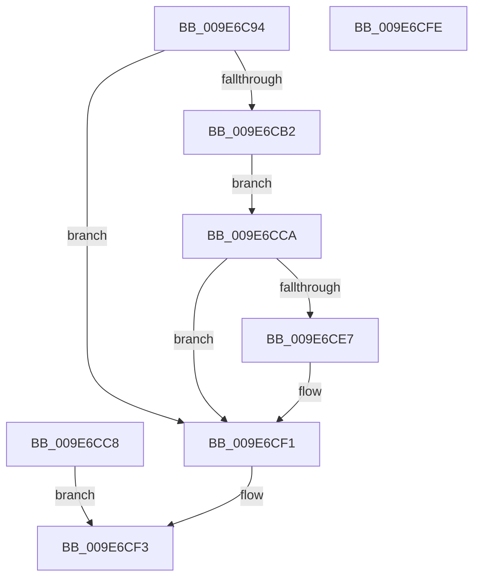

# PspCopyUnicodeString

- RVA: `0x009E6C94`–`0x009E6CFF` (길이 `107` bytes)
- VA: `0x00000001409E6C94`
- 실행 섹션: `PAGE`
- PDB 이름 있음: `예`; PDB Function 태그: `아니요`
- unwind 정보 RVA: `0x000A477C`
- 디코드: `34`개 명령, `107/107` bytes 표시
- 미해석 바이트: `0` (있으면 어셈블리에 `.byte`로 보존)

> 이 문서는 커널 이미지의 기계어와 PDB 기호를 분석해 생성했습니다. 4번과 5번은 함수 원형과 자료형을 바이너리 사용 방식에서 추정한 C 해석이며 원본 소스 복구 결과는 아닙니다.

## 1. Dependencies

- 직접 호출 지점: **2**; 고유 호출 대상: **2**
- 직접 호출자로 확인된 함수: **1**
- RIP 상대 이미지 참조: **0**

### Outgoing calls
- `0x009E6CC1` → [memcpy](../../text/6C/memcpy_function_006C6840.md) (function, `0x006C6840`)
- `0x009E6CDA` → [memset](../../text/6C/memset_function_006C6C40.md) (function, `0x006C6C40`)

### Direct callers
- [PspCaptureUserProcessParameters](PspCaptureUserProcessParameters_function_009E63C0.md) at `0x009E67FB`
- [PspCaptureUserProcessParameters](PspCaptureUserProcessParameters_function_009E63C0.md) at `0x009E6818`
- [PspCaptureUserProcessParameters](PspCaptureUserProcessParameters_function_009E63C0.md) at `0x009E6835`
- [PspCaptureUserProcessParameters](PspCaptureUserProcessParameters_function_009E63C0.md) at `0x009E6856`
- [PspCaptureUserProcessParameters](PspCaptureUserProcessParameters_function_009E63C0.md) at `0x009E687A`
- [PspCaptureUserProcessParameters](PspCaptureUserProcessParameters_function_009E63C0.md) at `0x009E689E`
- [PspCaptureUserProcessParameters](PspCaptureUserProcessParameters_function_009E63C0.md) at `0x009E68C2`
- [PspCaptureUserProcessParameters](PspCaptureUserProcessParameters_function_009E63C0.md) at `0x009E68E3`
- [PspCaptureUserProcessParameters](PspCaptureUserProcessParameters_function_009E63C0.md) at `0x009E6C04`

### Static image references
- 디코드된 RIP-relative 메모리 참조가 없습니다.

## 2. Other-region calls and transfers

- 다른 실행 섹션으로 향하는 call: **2**
  - `0x009E6CC1` → [memcpy](../../text/6C/memcpy_function_006C6840.md) (`PAGE` → `.text`)
  - `0x009E6CDA` → [memset](../../text/6C/memset_function_006C6C40.md) (`PAGE` → `.text`)
- 별도 외부 분기/꼬리 이동을 확인하지 못했습니다.

## 3. Assembly (complete function range)

```asm
009E6C94  48 89 5C 24 08                  mov qword ptr [rsp + 8], rbx
009E6C99  57                              push rdi
009E6C9A  48 83 EC 20                     sub rsp, 0x20
009E6C9E  49 8B F8                        mov rdi, r8
009E6CA1  48 8B D9                        mov rbx, rcx
009E6CA4  0F 10 01                        movups xmm0, xmmword ptr [rcx]
009E6CA7  F3 0F 7F 02                     movdqu xmmword ptr [rdx], xmm0
009E6CAB  48 83 79 08 00                  cmp qword ptr [rcx + 8], 0
009E6CB0  74 3F                           je 0x1409e6cf1
009E6CB2  49 8B 08                        mov rcx, qword ptr [r8]
009E6CB5  48 89 4A 08                     mov qword ptr [rdx + 8], rcx
009E6CB9  44 0F B7 03                     movzx r8d, word ptr [rbx]
009E6CBD  48 8B 53 08                     mov rdx, qword ptr [rbx + 8]
009E6CC1  E8 7A FB CD FF                  call 0x1406c6840
009E6CC6  EB 02                           jmp 0x1409e6cca
009E6CC8  EB 29                           jmp 0x1409e6cf3
009E6CCA  0F B7 0B                        movzx ecx, word ptr [rbx]
009E6CCD  44 0F B7 43 02                  movzx r8d, word ptr [rbx + 2]
009E6CD2  4C 2B C1                        sub r8, rcx
009E6CD5  48 03 0F                        add rcx, qword ptr [rdi]
009E6CD8  33 D2                           xor edx, edx
009E6CDA  E8 61 FF CD FF                  call 0x1406c6c40
009E6CDF  48 8B 0F                        mov rcx, qword ptr [rdi]
009E6CE2  48 85 C9                        test rcx, rcx
009E6CE5  74 0A                           je 0x1409e6cf1
009E6CE7  0F B7 43 02                     movzx eax, word ptr [rbx + 2]
009E6CEB  48 03 C1                        add rax, rcx
009E6CEE  48 89 07                        mov qword ptr [rdi], rax
009E6CF1  33 C0                           xor eax, eax
009E6CF3  48 8B 5C 24 30                  mov rbx, qword ptr [rsp + 0x30]
009E6CF8  48 83 C4 20                     add rsp, 0x20
009E6CFC  5F                              pop rdi
009E6CFD  C3                              ret
009E6CFE  CC                              int3
```

## 4. C-style interpretation (structured pseudocode)

```c
__int64 __fastcall PspCopyUnicodeString(__int64 a1, __int64 a2, __int64 a3)
{
    __int64 result;
    __int64 v_rsp;
    unsigned __int64 v_stack_p8;

    v_stack_p8 = v_rbx;
    v_rsp = (v_rsp) - (32);
    *(unsigned __int64 *)(a2) = v_xmm0;
    if ((*(unsigned __int64 *)(a1 + 8)) == 0) goto loc_009E6CF1;
    *(unsigned __int64 *)(a2 + 8) = *(unsigned __int64 *)(a3);
    result = memcpy(*(unsigned __int64 *)(a3), *(unsigned __int64 *)(a1 + 8), *(unsigned __int16 *)(a1), a4);
    goto loc_009E6CCA;
loc_009E6CCA:
    a3 = (*(unsigned __int16 *)(a1 + 2)) - (*(unsigned __int16 *)(a1));
    a1 = (*(unsigned __int16 *)(a1)) + (*(unsigned __int64 *)(a3));
    a2 = 0;
    result = memset(a1, a2, a3, a4);
    if (*(unsigned __int64 *)(a3) != 0) {
        result = *(unsigned __int16 *)(a1 + 2);
        result = (result) + (*(unsigned __int64 *)(a3));
        *(unsigned __int64 *)(a3) = result;
    }
    result = 0;
loc_009E6CF3:
    v_rsp = (v_rsp) + (32);
    return result;
}
```

## 5. (Beta) C Style

```c
int64_t PspCopyUnicodeString(void *Arg1, void *Arg2, void *Arg3)
{
    uint8_t *arg1 = (uint8_t *)Arg1;
    uint8_t *arg2 = (uint8_t *)Arg2;
    uint8_t *arg3 = (uint8_t *)Arg3;

    int64_t result;
    int64_t local_rsp;
    uint64_t v_stack_p8;

    v_stack_p8 = local_rbx;
    local_rsp = (local_rsp) - (32);
    *(uint64_t *)(arg2) = v_xmm0;
    if ((*(uint64_t *)(arg1 + 0x8)) == 0) goto loc_009E6CF1;
    *(uint64_t *)(arg2 + 0x8) = *(uint64_t *)(arg3);
    result = memcpy(*(uint64_t *)(arg3), *(uint64_t *)(arg1 + 0x8), *(uint16_t *)(arg1), a4);
    goto loc_009E6CCA;
loc_009E6CCA:
    Arg3 = (*(uint16_t *)(arg1 + 0x2)) - (*(uint16_t *)(arg1));
    Arg1 = (*(uint16_t *)(arg1)) + (*(uint64_t *)(arg3));
    Arg2 = 0;
    result = memset(Arg1, Arg2, Arg3, a4);
    if (*(uint64_t *)(arg3) != 0) {
        result = *(uint16_t *)(arg1 + 0x2);
        result = (result) + (*(uint64_t *)(arg3));
        *(uint64_t *)(arg3) = result;
    }
    result = 0;
loc_009E6CF3:
    local_rsp = (local_rsp) + (32);
    return result;
}
```

### 관측된 메모리 오프셋

구조체 형식이 확인되지 않은 접근은 인자 기준의 오프셋으로만 기록했습니다.

| 기준 인자 | 오프셋 표현 | 폭 (bit) | 접근 |
|---|---:|---:|---|
| `Arg1` | `+ 0x0` | `16` | `R` |
| `Arg1` | `+ 0x0` | `128` | `R` |
| `Arg1` | `+ 0x2` | `16` | `R` |
| `Arg1` | `+ 0x8` | `64` | `R` |
| `Arg2` | `+ 0x0` | `128` | `W` |
| `Arg2` | `+ 0x8` | `64` | `W` |
| `Arg3` | `+ 0x0` | `64` | `R` |
| `Arg3` | `+ 0x0` | `64` | `W` |

## 6. Execution-region graph

[열기: 2D/3D 그래프와 함수 탐색 컨트롤 패널](../../../control-panel.html?section=page&rva=0x009E6C94&view=graph)

- 2D 그래프는 위에서 아래로 흐르고, 3D 그래프는 빈 공간을 드래그해 회전합니다. Shift+드래그는 이동, 휠은 확대·축소, 함수 노드 선택은 대상 보고서 이동입니다.

### Static fallback


