# PspCreateThread

- RVA: `0x009EF034`–`0x009EF4BD` (길이 `1,161` bytes)
- VA: `0x00000001409EF034`
- 실행 섹션: `PAGE`
- PDB 이름 있음: `예`; PDB Function 태그: `예`
- unwind 정보 RVA: `0x000A5C7C`
- 디코드: `272`개 명령, `1,161/1,161` bytes 표시
- 미해석 바이트: `0` (있으면 어셈블리에 `.byte`로 보존)

> 이 문서는 커널 이미지의 기계어와 PDB 기호를 분석해 생성했습니다. 4번과 5번은 함수 원형과 자료형을 바이너리 사용 방식에서 추정한 C 해석이며 원본 소스 복구 결과는 아닙니다.

## 1. Dependencies

- 직접 호출 지점: **18**; 고유 호출 대상: **12**
- 직접 호출자로 확인된 함수: **3**
- RIP 상대 이미지 참조: **2**

### Outgoing calls
- `0x009EF0CB` → [memset](../../text/6C/memset_function_006C6C40.md) (function, `0x006C6C40`)
- `0x009EF136` → [ObpReferenceObjectByHandleWithTag](../86/ObpReferenceObjectByHandleWithTag_function_00869650.md) (function, `0x00869650`)
- `0x009EF238` → [ExAcquireRundownProtection](../../text/21/ExAcquireRundownProtection_function_00216620.md) (function, `0x00216620`)
- `0x009EF24D` → [ObfReferenceObjectWithTag](../../text/21/ObfReferenceObjectWithTag_function_00210710.md) (function, `0x00210710`)
- `0x009EF2B2` → [PspAllocateThread](PspAllocateThread_function_009EF72C.md) (function, `0x009EF72C`)
- `0x009EF2C9` → [ObfDereferenceObjectWithTag](../../text/2F/ObfDereferenceObjectWithTag_function_002F78E0.md) (function, `0x002F78E0`)
- `0x009EF319` → [PspInsertThread](../9F/PspInsertThread_function_009F0314.md) (function, `0x009F0314`)
- `0x009EF323` → [ExReleaseRundownProtection](../../text/34/ExReleaseRundownProtection_function_00349E80.md) (function, `0x00349E80`)
- `0x009EF32B` → [KiLeaveCriticalRegionUnsafe](../../text/25/KiLeaveCriticalRegionUnsafe_function_0025F010.md) (function, `0x0025F010`)
- `0x009EF335` → [ObfDereferenceObject](../../text/2F/ObfDereferenceObject_function_002F9350.md) (function, `0x002F9350`)
- `0x009EF346` → [_security_check_cookie](../../text/6A/_security_check_cookie_function_006AC640.md) (function, `0x006AC640`)
- `0x009EF361` → [KiLeaveCriticalRegionUnsafe](../../text/25/KiLeaveCriticalRegionUnsafe_function_0025F010.md) (function, `0x0025F010`)
- `0x009EF373` → [ObfDereferenceObjectWithTag](../../text/2F/ObfDereferenceObjectWithTag_function_002F78E0.md) (function, `0x002F78E0`)
- `0x009EF37D` → [PspIsProcessReadyForRemoteThread](../../text/48/PspIsProcessReadyForRemoteThread_function_00486494.md) (function, `0x00486494`)
- `0x009EF3B4` → [ObfReferenceObjectWithTag](../../text/21/ObfReferenceObjectWithTag_function_00210710.md) (function, `0x00210710`)
- `0x009EF3C6` → [ObfDereferenceObjectWithTag](../../text/2F/ObfDereferenceObjectWithTag_function_002F78E0.md) (function, `0x002F78E0`)
- `0x009EF46F` → [ExReleaseRundownProtection](../../text/34/ExReleaseRundownProtection_function_00349E80.md) (function, `0x00349E80`)
- `0x009EF477` → [KiLeaveCriticalRegionUnsafe](../../text/25/KiLeaveCriticalRegionUnsafe_function_0025F010.md) (function, `0x0025F010`)

### Direct callers
- [NtCreateThread](../78/NtCreateThread_function_00780B40.md) at `0x00780E78`
- [PsCreateSystemThreadEx](PsCreateSystemThreadEx_function_009ED120.md) at `0x009ED348`
- [NtCreateThreadEx](NtCreateThreadEx_function_009ED3D0.md) at `0x009ED69D`

### Static image references
- `0x009EF04E` → RVA `0x00E0A740` (`.data`; read)
- `0x009EF109` → RVA `0x00FC6A98` (`ALMOSTRO`; read)

## 2. Other-region calls and transfers

- 다른 실행 섹션으로 향하는 call: **15**
  - `0x009EF0CB` → [memset](../../text/6C/memset_function_006C6C40.md) (`PAGE` → `.text`)
  - `0x009EF238` → [ExAcquireRundownProtection](../../text/21/ExAcquireRundownProtection_function_00216620.md) (`PAGE` → `.text`)
  - `0x009EF24D` → [ObfReferenceObjectWithTag](../../text/21/ObfReferenceObjectWithTag_function_00210710.md) (`PAGE` → `.text`)
  - `0x009EF2C9` → [ObfDereferenceObjectWithTag](../../text/2F/ObfDereferenceObjectWithTag_function_002F78E0.md) (`PAGE` → `.text`)
  - `0x009EF323` → [ExReleaseRundownProtection](../../text/34/ExReleaseRundownProtection_function_00349E80.md) (`PAGE` → `.text`)
  - `0x009EF32B` → [KiLeaveCriticalRegionUnsafe](../../text/25/KiLeaveCriticalRegionUnsafe_function_0025F010.md) (`PAGE` → `.text`)
  - `0x009EF335` → [ObfDereferenceObject](../../text/2F/ObfDereferenceObject_function_002F9350.md) (`PAGE` → `.text`)
  - `0x009EF346` → [_security_check_cookie](../../text/6A/_security_check_cookie_function_006AC640.md) (`PAGE` → `.text`)
  - `0x009EF361` → [KiLeaveCriticalRegionUnsafe](../../text/25/KiLeaveCriticalRegionUnsafe_function_0025F010.md) (`PAGE` → `.text`)
  - `0x009EF373` → [ObfDereferenceObjectWithTag](../../text/2F/ObfDereferenceObjectWithTag_function_002F78E0.md) (`PAGE` → `.text`)
  - `0x009EF37D` → [PspIsProcessReadyForRemoteThread](../../text/48/PspIsProcessReadyForRemoteThread_function_00486494.md) (`PAGE` → `.text`)
  - `0x009EF3B4` → [ObfReferenceObjectWithTag](../../text/21/ObfReferenceObjectWithTag_function_00210710.md) (`PAGE` → `.text`)
  - `0x009EF3C6` → [ObfDereferenceObjectWithTag](../../text/2F/ObfDereferenceObjectWithTag_function_002F78E0.md) (`PAGE` → `.text`)
  - `0x009EF46F` → [ExReleaseRundownProtection](../../text/34/ExReleaseRundownProtection_function_00349E80.md) (`PAGE` → `.text`)
  - `0x009EF477` → [KiLeaveCriticalRegionUnsafe](../../text/25/KiLeaveCriticalRegionUnsafe_function_0025F010.md) (`PAGE` → `.text`)
- call이 아닌 외부 분기/꼬리 이동: **4**
  - `0x009EF42C` → [sub_00B30BAA](../B3/Unknown_function_00B30BAA.md) (`tail-transfer`)
  - `0x009EF43B` → [sub_00B30BAA](../B3/Unknown_function_00B30BAA.md) (`tail-transfer`)
  - `0x009EF449` → [sub_00B30BAA](../B3/Unknown_function_00B30BAA.md) (`tail-transfer`)
  - `0x009EF45D` → [sub_00B30BAA](../B3/Unknown_function_00B30BAA.md) (`tail-transfer`)

## 3. Assembly (complete function range)

```asm
009EF034  40 55                           push rbp
009EF036  53                              push rbx
009EF037  56                              push rsi
009EF038  57                              push rdi
009EF039  41 54                           push r12
009EF03B  41 55                           push r13
009EF03D  41 57                           push r15
009EF03F  48 8D AC 24 90 FE FF FF         lea rbp, [rsp - 0x170]
009EF047  48 81 EC 70 02 00 00            sub rsp, 0x270
009EF04E  48 8B 05 EB B6 41 00            mov rax, qword ptr [rip + 0x41b6eb]
009EF055  48 33 C4                        xor rax, rsp
009EF058  48 89 85 60 01 00 00            mov qword ptr [rbp + 0x160], rax
009EF05F  48 8B 85 D8 01 00 00            mov rax, qword ptr [rbp + 0x1d8]
009EF066  49 8B D9                        mov rbx, r9
009EF069  48 8B BD D0 01 00 00            mov rdi, qword ptr [rbp + 0x1d0]
009EF070  4C 8B A5 E8 01 00 00            mov r12, qword ptr [rbp + 0x1e8]
009EF077  48 89 45 80                     mov qword ptr [rbp - 0x80], rax
009EF07B  48 8B 85 E0 01 00 00            mov rax, qword ptr [rbp + 0x1e0]
009EF082  48 89 45 A8                     mov qword ptr [rbp - 0x58], rax
009EF086  48 8B 85 F0 01 00 00            mov rax, qword ptr [rbp + 0x1f0]
009EF08D  48 89 45 98                     mov qword ptr [rbp - 0x68], rax
009EF091  48 8B 85 00 02 00 00            mov rax, qword ptr [rbp + 0x200]
009EF098  48 89 44 24 68                  mov qword ptr [rsp + 0x68], rax
009EF09D  48 8B 85 08 02 00 00            mov rax, qword ptr [rbp + 0x208]
009EF0A4  48 89 45 88                     mov qword ptr [rbp - 0x78], rax
009EF0A8  48 8B 85 10 02 00 00            mov rax, qword ptr [rbp + 0x210]
009EF0AF  4C 89 45 A0                     mov qword ptr [rbp - 0x60], r8
009EF0B3  41 B8 90 01 00 00               mov r8d, 0x190
009EF0B9  89 54 24 64                     mov dword ptr [rsp + 0x64], edx
009EF0BD  33 D2                           xor edx, edx
009EF0BF  48 89 4D B0                     mov qword ptr [rbp - 0x50], rcx
009EF0C3  48 8D 4D D0                     lea rcx, [rbp - 0x30]
009EF0C7  48 89 45 90                     mov qword ptr [rbp - 0x70], rax
009EF0CB  E8 70 7B CD FF                  call 0x1406c6c40
009EF0D0  33 C9                           xor ecx, ecx
009EF0D2  0F 57 C0                        xorps xmm0, xmm0
009EF0D5  F3 0F 7F 45 C0                  movdqu xmmword ptr [rbp - 0x40], xmm0
009EF0DA  65 4C 8B 3C 25 88 01 00 00      mov r15, qword ptr gs:[0x188]
009EF0E3  48 89 4C 24 78                  mov qword ptr [rsp + 0x78], rcx
009EF0E8  49 8B B7 B8 00 00 00            mov rsi, qword ptr [r15 + 0xb8]
009EF0EF  48 89 4C 24 70                  mov qword ptr [rsp + 0x70], rcx
009EF0F4  48 85 DB                        test rbx, rbx
009EF0F7  0F 84 AA 02 00 00               je 0x1409ef3a7
009EF0FD  65 48 8B 04 25 88 01 00 00      mov rax, qword ptr gs:[0x188]
009EF106  8D 51 02                        lea edx, [rcx + 2]
009EF109  4C 8B 05 88 79 5D 00            mov r8, qword ptr [rip + 0x5d7988]
009EF110  48 89 4C 24 38                  mov qword ptr [rsp + 0x38], rcx
009EF115  48 89 4C 24 30                  mov qword ptr [rsp + 0x30], rcx
009EF11A  48 8B CB                        mov rcx, rbx
009EF11D  44 8A 88 32 02 00 00            mov r9b, byte ptr [rax + 0x232]
009EF124  48 8D 44 24 78                  lea rax, [rsp + 0x78]
009EF129  48 89 44 24 28                  mov qword ptr [rsp + 0x28], rax
009EF12E  C7 44 24 20 50 73 43 72         mov dword ptr [rsp + 0x20], 0x72437350
009EF136  E8 15 A5 E7 FF                  call 0x140869650
009EF13B  8B D8                           mov ebx, eax
009EF13D  85 C0                           test eax, eax
009EF13F  0F 88 F5 01 00 00               js 0x1409ef33a
009EF145  48 8B 7C 24 78                  mov rdi, qword ptr [rsp + 0x78]
009EF14A  8A 9F 70 01 00 00               mov bl, byte ptr [rdi + 0x170]
009EF150  41 B8 01 00 00 00               mov r8d, 1
009EF156  41 22 D8                        and bl, r8b
009EF159  4D 85 E4                        test r12, r12
009EF15C  0F 84 94 02 00 00               je 0x1409ef3f6
009EF162  45 8A AF 32 02 00 00            mov r13b, byte ptr [r15 + 0x232]
009EF169  48 3B FE                        cmp rdi, rsi
009EF16C  0F 85 08 02 00 00               jne 0x1409ef37a
009EF172  48 8B 54 24 68                  mov rdx, qword ptr [rsp + 0x68]
009EF177  48 85 D2                        test rdx, rdx
009EF17A  74 17                           je 0x1409ef193
009EF17C  4D 85 E4                        test r12, r12
009EF17F  74 12                           je 0x1409ef193
009EF181  8A C3                           mov al, bl
009EF183  F6 D8                           neg al
009EF185  48 1B C9                        sbb rcx, rcx
009EF188  48 23 CA                        and rcx, rdx
009EF18B  48 8B D1                        mov rdx, rcx
009EF18E  48 89 4C 24 68                  mov qword ptr [rsp + 0x68], rcx
009EF193  48 83 7D 80 00                  cmp qword ptr [rbp - 0x80], 0
009EF198  0F 84 7C 02 00 00               je 0x1409ef41a
009EF19E  45 84 ED                        test r13b, r13b
009EF1A1  74 19                           je 0x1409ef1bc
009EF1A3  8B 87 FC 05 00 00               mov eax, dword ptr [rdi + 0x5fc]
009EF1A9  0F BA E0 0C                     bt eax, 0xc
009EF1AD  0F 82 0B 02 00 00               jb 0x1409ef3be
009EF1B3  41 84 C0                        test r8b, al
009EF1B6  0F 85 4A 02 00 00               jne 0x1409ef406
009EF1BC  8B 87 FC 05 00 00               mov eax, dword ptr [rdi + 0x5fc]
009EF1C2  41 84 C0                        test r8b, al
009EF1C5  0F 85 0A 02 00 00               jne 0x1409ef3d5
009EF1CB  8B 95 F8 01 00 00               mov edx, dword ptr [rbp + 0x1f8]
009EF1D1  33 C0                           xor eax, eax
009EF1D3  33 C9                           xor ecx, ecx
009EF1D5  89 44 24 60                     mov dword ptr [rsp + 0x60], eax
009EF1D9  41 84 D0                        test r8b, dl
009EF1DC  74 0A                           je 0x1409ef1e8
009EF1DE  41 8B C0                        mov eax, r8d
009EF1E1  41 8B C8                        mov ecx, r8d
009EF1E4  89 44 24 60                     mov dword ptr [rsp + 0x60], eax
009EF1E8  F6 C2 02                        test dl, 2
009EF1EB  0F 85 90 02 00 00               jne 0x1409ef481
009EF1F1  F6 C2 04                        test dl, 4
009EF1F4  0F 85 97 02 00 00               jne 0x1409ef491
009EF1FA  F6 C2 10                        test dl, 0x10
009EF1FD  74 0C                           je 0x1409ef20b
009EF1FF  8B C1                           mov eax, ecx
009EF201  0F BA E8 07                     bts eax, 7
009EF205  89 44 24 60                     mov dword ptr [rsp + 0x60], eax
009EF209  8B C8                           mov ecx, eax
009EF20B  F6 C2 20                        test dl, 0x20
009EF20E  0F 85 8D 02 00 00               jne 0x1409ef4a1
009EF214  F6 C2 40                        test dl, 0x40
009EF217  0F 85 93 02 00 00               jne 0x1409ef4b0
009EF21D  84 DB                           test bl, bl
009EF21F  0F 85 70 01 00 00               jne 0x1409ef395
009EF225  66 41 FF 8F E4 01 00 00         dec word ptr [r15 + 0x1e4]
009EF22D  48 8D B7 E8 01 00 00            lea rsi, [rdi + 0x1e8]
009EF234  48 8B CE                        mov rcx, rsi
009EF237  90                              nop
009EF238  E8 E3 73 82 FF                  call 0x140216620
009EF23D  84 C0                           test al, al
009EF23F  0F 84 19 01 00 00               je 0x1409ef35e
009EF245  BA 50 73 43 72                  mov edx, 0x72437350
009EF24A  48 8B CF                        mov rcx, rdi
009EF24D  E8 BE 14 82 FF                  call 0x140210710
009EF252  48 8B 45 98                     mov rax, qword ptr [rbp - 0x68]
009EF256  45 8A C5                        mov r8b, r13b
009EF259  48 8B 55 A0                     mov rdx, qword ptr [rbp - 0x60]
009EF25D  48 8B CF                        mov rcx, rdi
009EF260  48 89 45 B8                     mov qword ptr [rbp - 0x48], rax
009EF264  48 8D 45 D0                     lea rax, [rbp - 0x30]
009EF268  48 89 44 24 58                  mov qword ptr [rsp + 0x58], rax
009EF26D  48 8B 45 90                     mov rax, qword ptr [rbp - 0x70]
009EF271  48 89 44 24 50                  mov qword ptr [rsp + 0x50], rax
009EF276  48 8D 44 24 70                  lea rax, [rsp + 0x70]
009EF27B  48 89 44 24 48                  mov qword ptr [rsp + 0x48], rax
009EF280  48 8D 44 24 60                  lea rax, [rsp + 0x60]
009EF285  48 89 44 24 40                  mov qword ptr [rsp + 0x40], rax
009EF28A  48 8B 45 88                     mov rax, qword ptr [rbp - 0x78]
009EF28E  48 89 44 24 38                  mov qword ptr [rsp + 0x38], rax
009EF293  48 8B 44 24 68                  mov rax, qword ptr [rsp + 0x68]
009EF298  48 89 44 24 30                  mov qword ptr [rsp + 0x30], rax
009EF29D  48 8D 45 B8                     lea rax, [rbp - 0x48]
009EF2A1  48 89 44 24 28                  mov qword ptr [rsp + 0x28], rax
009EF2A6  4C 89 64 24 20                  mov qword ptr [rsp + 0x20], r12
009EF2AB  4C 8B 65 80                     mov r12, qword ptr [rbp - 0x80]
009EF2AF  4D 8B CC                        mov r9, r12
009EF2B2  E8 75 04 00 00                  call 0x1409ef72c
009EF2B7  8B D8                           mov ebx, eax
009EF2B9  85 C0                           test eax, eax
009EF2BB  0F 88 AB 01 00 00               js 0x1409ef46c
009EF2C1  BA 50 73 43 72                  mov edx, 0x72437350
009EF2C6  48 8B CF                        mov rcx, rdi
009EF2C9  E8 12 86 90 FF                  call 0x1402f78e0
009EF2CE  48 8B 45 A8                     mov rax, qword ptr [rbp - 0x58]
009EF2D2  4C 8D 4C 24 60                  lea r9, [rsp + 0x60]
009EF2D7  4C 8B 45 98                     mov r8, qword ptr [rbp - 0x68]
009EF2DB  48 8B D7                        mov rdx, rdi
009EF2DE  48 8B 4C 24 70                  mov rcx, qword ptr [rsp + 0x70]
009EF2E3  48 89 44 24 50                  mov qword ptr [rsp + 0x50], rax
009EF2E8  48 8B 45 B0                     mov rax, qword ptr [rbp - 0x50]
009EF2EC  48 89 44 24 48                  mov qword ptr [rsp + 0x48], rax
009EF2F1  48 8D 45 D0                     lea rax, [rbp - 0x30]
009EF2F5  48 89 44 24 40                  mov qword ptr [rsp + 0x40], rax
009EF2FA  48 8B 45 88                     mov rax, qword ptr [rbp - 0x78]
009EF2FE  48 89 44 24 38                  mov qword ptr [rsp + 0x38], rax
009EF303  48 8B 45 90                     mov rax, qword ptr [rbp - 0x70]
009EF307  4C 89 64 24 30                  mov qword ptr [rsp + 0x30], r12
009EF30C  48 89 44 24 28                  mov qword ptr [rsp + 0x28], rax
009EF311  8B 44 24 64                     mov eax, dword ptr [rsp + 0x64]
009EF315  89 44 24 20                     mov dword ptr [rsp + 0x20], eax
009EF319  E8 F6 0F 00 00                  call 0x1409f0314
009EF31E  48 8B CE                        mov rcx, rsi
009EF321  8B D8                           mov ebx, eax
009EF323  E8 58 AB 95 FF                  call 0x140349e80
009EF328  49 8B CF                        mov rcx, r15
009EF32B  E8 E0 FC 86 FF                  call 0x14025f010
009EF330  48 8B 4C 24 70                  mov rcx, qword ptr [rsp + 0x70]
009EF335  E8 16 A0 90 FF                  call 0x1402f9350
009EF33A  8B C3                           mov eax, ebx
009EF33C  48 8B 8D 60 01 00 00            mov rcx, qword ptr [rbp + 0x160]
009EF343  48 33 CC                        xor rcx, rsp
009EF346  E8 F5 D2 CB FF                  call 0x1406ac640
009EF34B  48 81 C4 70 02 00 00            add rsp, 0x270
009EF352  41 5F                           pop r15
009EF354  41 5D                           pop r13
009EF356  41 5C                           pop r12
009EF358  5F                              pop rdi
009EF359  5E                              pop rsi
009EF35A  5B                              pop rbx
009EF35B  5D                              pop rbp
009EF35C  C3                              ret
009EF35D  CC                              int3
009EF35E  49 8B CF                        mov rcx, r15
009EF361  E8 AA FC 86 FF                  call 0x14025f010
009EF366  BB 0A 01 00 C0                  mov ebx, 0xc000010a
009EF36B  BA 50 73 43 72                  mov edx, 0x72437350
009EF370  48 8B CF                        mov rcx, rdi
009EF373  E8 68 85 90 FF                  call 0x1402f78e0
009EF378  EB C0                           jmp 0x1409ef33a
009EF37A  48 8B CF                        mov rcx, rdi
009EF37D  E8 12 71 A9 FF                  call 0x140486494
009EF382  84 C0                           test al, al
009EF384  0F 84 D8 00 00 00               je 0x1409ef462
009EF38A  41 B8 01 00 00 00               mov r8d, 1
009EF390  E9 DD FD FF FF                  jmp 0x1409ef172
009EF395  4D 85 E4                        test r12, r12
009EF398  75 52                           jne 0x1409ef3ec
009EF39A  0F BA E8 0A                     bts eax, 0xa
009EF39E  89 44 24 60                     mov dword ptr [rsp + 0x60], eax
009EF3A2  E9 7E FE FF FF                  jmp 0x1409ef225
009EF3A7  4D 85 E4                        test r12, r12
009EF3AA  75 64                           jne 0x1409ef410
009EF3AC  BA 50 73 43 72                  mov edx, 0x72437350
009EF3B1  48 8B CF                        mov rcx, rdi
009EF3B4  E8 57 13 82 FF                  call 0x140210710
009EF3B9  E9 8C FD FF FF                  jmp 0x1409ef14a
009EF3BE  BA 50 73 43 72                  mov edx, 0x72437350
009EF3C3  48 8B CF                        mov rcx, rdi
009EF3C6  E8 15 85 90 FF                  call 0x1402f78e0
009EF3CB  B8 08 00 00 C0                  mov eax, 0xc0000008
009EF3D0  E9 67 FF FF FF                  jmp 0x1409ef33c
009EF3D5  48 83 BF 40 06 00 00 00         cmp qword ptr [rdi + 0x640], 0
009EF3DD  0F 85 E8 FD FF FF               jne 0x1409ef1cb
009EF3E3  4D 85 E4                        test r12, r12
009EF3E6  0F 84 DF FD FF FF               je 0x1409ef1cb
009EF3EC  BB 22 00 00 C0                  mov ebx, 0xc0000022
009EF3F1  E9 75 FF FF FF                  jmp 0x1409ef36b
009EF3F6  84 DB                           test bl, bl
009EF3F8  0F 85 64 FD FF FF               jne 0x1409ef162
009EF3FE  45 32 ED                        xor r13b, r13b
009EF401  E9 63 FD FF FF                  jmp 0x1409ef169
009EF406  BB 08 00 00 C0                  mov ebx, 0xc0000008
009EF40B  E9 5B FF FF FF                  jmp 0x1409ef36b
009EF410  BB 08 00 00 C0                  mov ebx, 0xc0000008
009EF415  E9 20 FF FF FF                  jmp 0x1409ef33a
009EF41A  48 85 D2                        test rdx, rdx
009EF41D  0F 85 7B FD FF FF               jne 0x1409ef19e
009EF423  8B 87 50 07 00 00               mov eax, dword ptr [rdi + 0x750]
009EF429  41 84 C0                        test r8b, al
009EF42C  0F 85 78 17 14 00               jne 0x140b30baa
009EF432  8B 86 50 07 00 00               mov eax, dword ptr [rsi + 0x750]
009EF438  41 84 C0                        test r8b, al
009EF43B  0F 85 69 17 14 00               jne 0x140b30baa
009EF441  0F BA A7 54 07 00 00 0E         bt dword ptr [rdi + 0x754], 0xe
009EF449  0F 82 5B 17 14 00               jb 0x140b30baa
009EF44F  0F BA A6 54 07 00 00 0E         bt dword ptr [rsi + 0x754], 0xe
009EF457  0F 83 41 FD FF FF               jae 0x1409ef19e
009EF45D  E9 48 17 14 00                  jmp 0x140b30baa
009EF462  B8 01 00 00 C0                  mov eax, 0xc0000001
009EF467  E9 D0 FE FF FF                  jmp 0x1409ef33c
009EF46C  48 8B CE                        mov rcx, rsi
009EF46F  E8 0C AA 95 FF                  call 0x140349e80
009EF474  49 8B CF                        mov rcx, r15
009EF477  E8 94 FB 86 FF                  call 0x14025f010
009EF47C  E9 EA FE FF FF                  jmp 0x1409ef36b
009EF481  8B C1                           mov eax, ecx
009EF483  83 C8 02                        or eax, 2
009EF486  89 44 24 60                     mov dword ptr [rsp + 0x60], eax
009EF48A  8B C8                           mov ecx, eax
009EF48C  E9 60 FD FF FF                  jmp 0x1409ef1f1
009EF491  8B C1                           mov eax, ecx
009EF493  83 C8 04                        or eax, 4
009EF496  89 44 24 60                     mov dword ptr [rsp + 0x60], eax
009EF49A  8B C8                           mov ecx, eax
009EF49C  E9 59 FD FF FF                  jmp 0x1409ef1fa
009EF4A1  8B C1                           mov eax, ecx
009EF4A3  0F BA E8 08                     bts eax, 8
009EF4A7  89 44 24 60                     mov dword ptr [rsp + 0x60], eax
009EF4AB  E9 64 FD FF FF                  jmp 0x1409ef214
009EF4B0  0F BA E8 09                     bts eax, 9
009EF4B4  89 44 24 60                     mov dword ptr [rsp + 0x60], eax
009EF4B8  E9 60 FD FF FF                  jmp 0x1409ef21d
```

## 4. C-style interpretation (structured pseudocode)

```c
__int64 __fastcall PspCreateThread(__int64 a1, int a2, __int64 a3, __int64 a4, __int64 a5, __int64 a6, __int64 a7, __int64 a8, __int64 a9, unsigned int a10, __int64 a11, __int64 a12, __int64 a13)
{
    __int64 result;
    __int64 v_r13;
    __int64 v_rbx;
    __int64 v_rsp;
    unsigned __int64 v_stack_m1A8;
    unsigned __int64 v_stack_m1D8;
    unsigned __int64 v_stack_m1E8;
    unsigned __int64 v_stack_m1F0;
    unsigned __int64 v_stack_m1F8;
    unsigned __int64 v_stack_m200;
    unsigned __int64 v_stack_m208;
    unsigned __int64 v_stack_m210;
    unsigned __int64 v_stack_m218;
    unsigned __int64 v_stack_m220;
    unsigned __int64 v_stack_m228;
    unsigned __int64 v_stack_m230;
    unsigned __int64 v_stack_m238;
    unsigned __int64 v_stack_m240;
    unsigned int v_stack_m244;
    unsigned int v_stack_m248;
    unsigned __int64 v_stack_m250;
    unsigned __int64 v_stack_m258;
    unsigned __int64 v_stack_m260;
    unsigned __int64 v_stack_m268;
    unsigned __int64 v_stack_m270;
    unsigned __int64 v_stack_m278;
    unsigned __int64 v_stack_m280;
    unsigned int v_stack_m288;
    unsigned __int64 v_stack_m48;
    unsigned int v_stack_p60;

    v_rsp = (v_rsp) - (624);
    result = (*(unsigned __int64 *)(v_rip + 4306667)) ^ (v_rsp);
    v_stack_m48 = result;
    v_stack_m228 = a6;
    v_stack_m200 = a7;
    v_stack_m210 = a9;
    v_stack_m240 = a11;
    v_stack_m220 = a12;
    v_stack_m208 = a3;
    v_stack_m244 = a2;
    a2 = 0;
    v_stack_m1F8 = a1;
    v_stack_m218 = a13;
    result = memset(v_stack_m1D8, a2, 400, a4);
    a1 = 0;
    v_stack_m1E8 = v_xmm0;
    v_stack_m230 = 0;
    v_stack_m238 = 0;
    if (a4 == 0) goto loc_009EF3A7;
    v_stack_m270 = 0;
    v_stack_m278 = 0;
    v_stack_m280 = v_stack_m230;
    v_stack_m288 = 0x72437350ULL;
    result = ObpReferenceObjectByHandleWithTag(a4, a1 + 2, *(unsigned __int64 *)(v_rip + 6125960), *(unsigned __int8 *)(*(unsigned __int64 *)(gs_base + (0 + 392)) + 562));
    if (sign_flag) goto loc_009EF33A;
loc_009EF14A:
    v_rbx = (unsigned __int8)((*(unsigned __int8 *)(v_stack_m230 + 368)) & (1));
    if (a8 == 0) goto loc_009EF3F6;
loc_009EF162:
loc_009EF169:
    if (v_stack_m230 != (*(unsigned __int64 *)(*(unsigned __int64 *)(gs_base + (0 + 392)) + 184))) goto loc_009EF37A;
loc_009EF172:
    if (v_stack_m240 == 0) goto loc_009EF193;
    if (a8 != 0) {
        result = (unsigned __int8)(v_rbx);
        result = (unsigned __int8)(-(result));
        a1 = (a4) & (v_stack_m240);
        a2 = a1;
        v_stack_m240 = a1;
    }
    if (v_stack_m228 == 0) goto loc_009EF41A;
loc_009EF19E:
    if ((unsigned __int8)(*(unsigned __int8 *)(*(unsigned __int64 *)(gs_base + (0 + 392)) + 562)) == 0) goto loc_009EF1BC;
    if (condition_is_below) goto loc_009EF3BE;
    if (((1) & ((unsigned __int8)((unsigned int)(*(unsigned int *)(v_stack_m230 + 1532))))) != 0) goto loc_009EF406;
loc_009EF1BC:
    if (((1) & ((unsigned __int8)((unsigned int)(*(unsigned int *)(v_stack_m230 + 1532))))) != 0) goto loc_009EF3D5;
loc_009EF1CB:
    result = 0;
    a1 = 0;
    v_stack_m248 = 0;
    if (((1) & ((unsigned __int8)((unsigned int)(a10)))) != 0) {
        result = 1;
        a1 = 1;
        v_stack_m248 = (unsigned int)(result);
    }
    if ((((unsigned __int8)((unsigned int)(a10))) & (2)) != 0) goto loc_009EF481;
loc_009EF1F1:
    if ((((unsigned __int8)((unsigned int)(a10))) & (4)) != 0) goto loc_009EF491;
loc_009EF1FA:
    if ((((unsigned __int8)((unsigned int)(a10))) & (16)) != 0) {
        result = (unsigned int)(a1);
        v_stack_m248 = (unsigned int)(result);
        a1 = (unsigned int)(result);
    }
    if ((((unsigned __int8)((unsigned int)(a10))) & (32)) != 0) goto loc_009EF4A1;
loc_009EF214:
    if ((((unsigned __int8)((unsigned int)(a10))) & (64)) != 0) goto loc_009EF4B0;
loc_009EF21D:
    if ((unsigned __int8)(v_rbx) != 0) goto loc_009EF395;
loc_009EF225:
    result = ExAcquireRundownProtection(v_stack_m230 + 488, (unsigned int)(a10), 1, *(unsigned __int8 *)(*(unsigned __int64 *)(gs_base + (0 + 392)) + 562));
    if ((unsigned __int8)(result) == 0) goto loc_009EF35E;
    result = ObfReferenceObjectWithTag(v_stack_m230, (unsigned int)(0x72437350ULL), 1, *(unsigned __int8 *)(*(unsigned __int64 *)(gs_base + (0 + 392)) + 562));
    v_stack_m1F0 = v_stack_m210;
    v_stack_m250 = v_stack_m1D8;
    v_stack_m258 = v_stack_m218;
    v_stack_m260 = v_stack_m238;
    v_stack_m268 = v_stack_m248;
    v_stack_m270 = v_stack_m220;
    v_stack_m278 = v_stack_m240;
    v_stack_m280 = v_stack_m1F0;
    v_stack_m288 = a8;
    result = PspAllocateThread(v_stack_m230, v_stack_m208, (unsigned __int8)(*(unsigned __int8 *)(*(unsigned __int64 *)(gs_base + (0 + 392)) + 562)), v_stack_m228);
    if (sign_flag) goto loc_009EF46C;
    result = ObfDereferenceObjectWithTag(v_stack_m230, (unsigned int)(0x72437350ULL), (unsigned __int8)(*(unsigned __int8 *)(*(unsigned __int64 *)(gs_base + (0 + 392)) + 562)), v_stack_m228);
    v_stack_m258 = v_stack_m200;
    v_stack_m260 = v_stack_m1F8;
    v_stack_m268 = v_stack_m1D8;
    v_stack_m270 = v_stack_m220;
    v_stack_m278 = v_stack_m228;
    v_stack_m280 = v_stack_m218;
    v_stack_m288 = (unsigned int)((unsigned int)(v_stack_m244));
    result = PspInsertThread(v_stack_m238, v_stack_m230, v_stack_m210, v_stack_m248);
    result = ExReleaseRundownProtection(v_stack_m230 + 488, v_stack_m230, v_stack_m210, v_stack_m248);
    result = KiLeaveCriticalRegionUnsafe(*(unsigned __int64 *)(gs_base + (0 + 392)), v_stack_m230, v_stack_m210, v_stack_m248);
    result = ObfDereferenceObject(v_stack_m238, v_stack_m230, v_stack_m210, v_stack_m248);
loc_009EF33A:
loc_009EF33C:
    a1 = (v_stack_m48) ^ (v_rsp);
    result = _security_check_cookie(a1, v_stack_m230, v_stack_m210, v_stack_m248);
    v_rsp = (v_rsp) + (624);
    return result;
loc_009EF35E:
    result = KiLeaveCriticalRegionUnsafe(*(unsigned __int64 *)(gs_base + (0 + 392)), v_stack_m230, v_stack_m210, v_stack_m248);
loc_009EF36B:
    result = ObfDereferenceObjectWithTag(v_stack_m230, (unsigned int)(0x72437350ULL), v_stack_m210, v_stack_m248);
    goto loc_009EF33A;
loc_009EF37A:
    result = PspIsProcessReadyForRemoteThread(v_stack_m230, (unsigned int)(0x72437350ULL), v_stack_m210, v_stack_m248);
    if ((unsigned __int8)(result) == 0) goto loc_009EF462;
    goto loc_009EF172;
loc_009EF395:
    if (v_stack_m228 != 0) goto loc_009EF3EC;
    v_stack_p60 = (unsigned int)(result);
    goto loc_009EF225;
loc_009EF3A7:
    if (v_stack_m228 != 0) goto loc_009EF410;
    result = ObfReferenceObjectWithTag(v_stack_m230, (unsigned int)(0x72437350ULL), 1, v_stack_m248);
    goto loc_009EF14A;
loc_009EF3BE:
    result = ObfDereferenceObjectWithTag(v_stack_m230, (unsigned int)(0x72437350ULL), 1, v_stack_m248);
    goto loc_009EF33C;
loc_009EF3D5:
    if ((*(unsigned __int64 *)(v_stack_m230 + 1600)) != 0) goto loc_009EF1CB;
    if (v_stack_m228 == 0) goto loc_009EF1CB;
loc_009EF3EC:
    goto loc_009EF36B;
loc_009EF3F6:
    if ((unsigned __int8)((unsigned int)(0xC0000022ULL)) != 0) goto loc_009EF162;
    v_r13 = 0;
    goto loc_009EF169;
loc_009EF406:
    goto loc_009EF36B;
loc_009EF410:
    goto loc_009EF33A;
loc_009EF41A:
    if ((unsigned int)(0x72437350ULL) != 0) goto loc_009EF19E;
    if (condition_is_above_or_equal) goto loc_009EF19E;
loc_009EF462:
    goto loc_009EF33C;
loc_009EF46C:
    result = ExReleaseRundownProtection(v_stack_m230 + 488, (unsigned int)(0x72437350ULL), 1, v_stack_m248);
    result = KiLeaveCriticalRegionUnsafe(*(unsigned __int64 *)(gs_base + (0 + 392)), (unsigned int)(0x72437350ULL), 1, v_stack_m248);
    goto loc_009EF36B;
loc_009EF481:
    result = (unsigned int)(((unsigned int)((unsigned int)(*(unsigned __int64 *)(gs_base + (0 + 392))))) | (2));
    v_stack_p60 = (unsigned int)(result);
    goto loc_009EF1F1;
loc_009EF491:
    result = (unsigned int)(((unsigned int)((unsigned int)((unsigned int)((unsigned int)(result))))) | (4));
    v_stack_p60 = (unsigned int)(result);
    goto loc_009EF1FA;
loc_009EF4A1:
    v_stack_p60 = (unsigned int)((unsigned int)((unsigned int)((unsigned int)((unsigned int)(result)))));
    goto loc_009EF214;
loc_009EF4B0:
    v_stack_p60 = (unsigned int)((unsigned int)((unsigned int)((unsigned int)((unsigned int)(result)))));
    goto loc_009EF21D;
}
```

## 5. (Beta) C Style

```c
int64_t PspCreateThread(int64_t Arg1, int32_t Arg2, int64_t Arg3, int64_t Arg4, int64_t Arg5, int64_t Arg6, int64_t Arg7, int64_t Arg8, int64_t Arg9, uint32_t Arg10, int64_t Arg11, int64_t Arg12, int64_t Arg13)
{
    int64_t result;
    int64_t local_r13;
    int64_t local_rbx;
    int64_t local_rsp;
    uint64_t v_stack_m1A8;
    uint64_t v_stack_m1D8;
    uint64_t v_stack_m1E8;
    uint64_t v_stack_m1F0;
    uint64_t v_stack_m1F8;
    uint64_t v_stack_m200;
    uint64_t v_stack_m208;
    uint64_t v_stack_m210;
    uint64_t v_stack_m218;
    uint64_t v_stack_m220;
    uint64_t v_stack_m228;
    uint64_t v_stack_m230;
    uint64_t v_stack_m238;
    uint64_t v_stack_m240;
    uint32_t v_stack_m244;
    uint32_t v_stack_m248;
    uint64_t v_stack_m250;
    uint64_t v_stack_m258;
    uint64_t v_stack_m260;
    uint64_t v_stack_m268;
    uint64_t v_stack_m270;
    uint64_t v_stack_m278;
    uint64_t v_stack_m280;
    uint32_t v_stack_m288;
    uint64_t v_stack_m48;
    uint32_t v_stack_p60;

    local_rsp = (local_rsp) - (624);
    result = (*(uint64_t *)(v_rip + 0x41B6EB)) ^ (local_rsp);
    v_stack_m48 = result;
    v_stack_m228 = Arg6;
    v_stack_m200 = Arg7;
    v_stack_m210 = Arg9;
    v_stack_m240 = Arg11;
    v_stack_m220 = Arg12;
    v_stack_m208 = Arg3;
    v_stack_m244 = Arg2;
    Arg2 = 0;
    v_stack_m1F8 = Arg1;
    v_stack_m218 = Arg13;
    result = memset(v_stack_m1D8, Arg2, 400, Arg4);
    Arg1 = 0;
    v_stack_m1E8 = v_xmm0;
    v_stack_m230 = 0;
    v_stack_m238 = 0;
    if (Arg4 == 0) goto loc_009EF3A7;
    v_stack_m270 = 0;
    v_stack_m278 = 0;
    v_stack_m280 = v_stack_m230;
    v_stack_m288 = 0x72437350ULL;
    result = ObpReferenceObjectByHandleWithTag(Arg4, Arg1 + 2, *(uint64_t *)(v_rip + 0x5D7988), *(uint8_t *)(*(uint64_t *)(gs_base + (0 + 0x188)) + 0x232));
    if (sign_flag) goto loc_009EF33A;
loc_009EF14A:
    local_rbx = (uint8_t)((*(uint8_t *)(v_stack_m230 + 0x170)) & (1));
    if (Arg8 == 0) goto loc_009EF3F6;
loc_009EF162:
loc_009EF169:
    if (v_stack_m230 != (*(uint64_t *)(*(uint64_t *)(gs_base + (0 + 0x188)) + 0xB8))) goto loc_009EF37A;
loc_009EF172:
    if (v_stack_m240 == 0) goto loc_009EF193;
    if (Arg8 != 0) {
        result = (uint8_t)(local_rbx);
        result = (uint8_t)(-(result));
        Arg1 = (Arg4) & (v_stack_m240);
        Arg2 = Arg1;
        v_stack_m240 = Arg1;
    }
    if (v_stack_m228 == 0) goto loc_009EF41A;
loc_009EF19E:
    if ((uint8_t)(*(uint8_t *)(*(uint64_t *)(gs_base + (0 + 0x188)) + 0x232)) == 0) goto loc_009EF1BC;
    if (condition_is_below) goto loc_009EF3BE;
    if (((1) & ((uint8_t)((uint32_t)(*(uint32_t *)(v_stack_m230 + 0x5FC))))) != 0) goto loc_009EF406;
loc_009EF1BC:
    if (((1) & ((uint8_t)((uint32_t)(*(uint32_t *)(v_stack_m230 + 0x5FC))))) != 0) goto loc_009EF3D5;
loc_009EF1CB:
    result = 0;
    Arg1 = 0;
    v_stack_m248 = 0;
    if (((1) & ((uint8_t)((uint32_t)(Arg10)))) != 0) {
        result = 1;
        Arg1 = 1;
        v_stack_m248 = (uint32_t)(result);
    }
    if ((((uint8_t)((uint32_t)(Arg10))) & (2)) != 0) goto loc_009EF481;
loc_009EF1F1:
    if ((((uint8_t)((uint32_t)(Arg10))) & (4)) != 0) goto loc_009EF491;
loc_009EF1FA:
    if ((((uint8_t)((uint32_t)(Arg10))) & (16)) != 0) {
        result = (uint32_t)(Arg1);
        v_stack_m248 = (uint32_t)(result);
        Arg1 = (uint32_t)(result);
    }
    if ((((uint8_t)((uint32_t)(Arg10))) & (32)) != 0) goto loc_009EF4A1;
loc_009EF214:
    if ((((uint8_t)((uint32_t)(Arg10))) & (64)) != 0) goto loc_009EF4B0;
loc_009EF21D:
    if ((uint8_t)(local_rbx) != 0) goto loc_009EF395;
loc_009EF225:
    result = ExAcquireRundownProtection(v_stack_m230 + 488, (uint32_t)(Arg10), 1, *(uint8_t *)(*(uint64_t *)(gs_base + (0 + 0x188)) + 0x232));
    if ((uint8_t)(result) == 0) goto loc_009EF35E;
    result = ObfReferenceObjectWithTag(v_stack_m230, (uint32_t)(0x72437350ULL), 1, *(uint8_t *)(*(uint64_t *)(gs_base + (0 + 0x188)) + 0x232));
    v_stack_m1F0 = v_stack_m210;
    v_stack_m250 = v_stack_m1D8;
    v_stack_m258 = v_stack_m218;
    v_stack_m260 = v_stack_m238;
    v_stack_m268 = v_stack_m248;
    v_stack_m270 = v_stack_m220;
    v_stack_m278 = v_stack_m240;
    v_stack_m280 = v_stack_m1F0;
    v_stack_m288 = Arg8;
    result = PspAllocateThread(v_stack_m230, v_stack_m208, (uint8_t)(*(uint8_t *)(*(uint64_t *)(gs_base + (0 + 0x188)) + 0x232)), v_stack_m228);
    if (sign_flag) goto loc_009EF46C;
    result = ObfDereferenceObjectWithTag(v_stack_m230, (uint32_t)(0x72437350ULL), (uint8_t)(*(uint8_t *)(*(uint64_t *)(gs_base + (0 + 0x188)) + 0x232)), v_stack_m228);
    v_stack_m258 = v_stack_m200;
    v_stack_m260 = v_stack_m1F8;
    v_stack_m268 = v_stack_m1D8;
    v_stack_m270 = v_stack_m220;
    v_stack_m278 = v_stack_m228;
    v_stack_m280 = v_stack_m218;
    v_stack_m288 = (uint32_t)((uint32_t)(v_stack_m244));
    result = PspInsertThread(v_stack_m238, v_stack_m230, v_stack_m210, v_stack_m248);
    result = ExReleaseRundownProtection(v_stack_m230 + 488, v_stack_m230, v_stack_m210, v_stack_m248);
    result = KiLeaveCriticalRegionUnsafe(*(uint64_t *)(gs_base + (0 + 0x188)), v_stack_m230, v_stack_m210, v_stack_m248);
    result = ObfDereferenceObject(v_stack_m238, v_stack_m230, v_stack_m210, v_stack_m248);
loc_009EF33A:
loc_009EF33C:
    Arg1 = (v_stack_m48) ^ (local_rsp);
    result = _security_check_cookie(Arg1, v_stack_m230, v_stack_m210, v_stack_m248);
    local_rsp = (local_rsp) + (624);
    return result;
loc_009EF35E:
    result = KiLeaveCriticalRegionUnsafe(*(uint64_t *)(gs_base + (0 + 0x188)), v_stack_m230, v_stack_m210, v_stack_m248);
loc_009EF36B:
    result = ObfDereferenceObjectWithTag(v_stack_m230, (uint32_t)(0x72437350ULL), v_stack_m210, v_stack_m248);
    goto loc_009EF33A;
loc_009EF37A:
    result = PspIsProcessReadyForRemoteThread(v_stack_m230, (uint32_t)(0x72437350ULL), v_stack_m210, v_stack_m248);
    if ((uint8_t)(result) == 0) goto loc_009EF462;
    goto loc_009EF172;
loc_009EF395:
    if (v_stack_m228 != 0) goto loc_009EF3EC;
    v_stack_p60 = (uint32_t)(result);
    goto loc_009EF225;
loc_009EF3A7:
    if (v_stack_m228 != 0) goto loc_009EF410;
    result = ObfReferenceObjectWithTag(v_stack_m230, (uint32_t)(0x72437350ULL), 1, v_stack_m248);
    goto loc_009EF14A;
loc_009EF3BE:
    result = ObfDereferenceObjectWithTag(v_stack_m230, (uint32_t)(0x72437350ULL), 1, v_stack_m248);
    goto loc_009EF33C;
loc_009EF3D5:
    if ((*(uint64_t *)(v_stack_m230 + 0x640)) != 0) goto loc_009EF1CB;
    if (v_stack_m228 == 0) goto loc_009EF1CB;
loc_009EF3EC:
    goto loc_009EF36B;
loc_009EF3F6:
    if ((uint8_t)((uint32_t)(0xC0000022ULL)) != 0) goto loc_009EF162;
    local_r13 = 0;
    goto loc_009EF169;
loc_009EF406:
    goto loc_009EF36B;
loc_009EF410:
    goto loc_009EF33A;
loc_009EF41A:
    if ((uint32_t)(0x72437350ULL) != 0) goto loc_009EF19E;
    if (condition_is_above_or_equal) goto loc_009EF19E;
loc_009EF462:
    goto loc_009EF33C;
loc_009EF46C:
    result = ExReleaseRundownProtection(v_stack_m230 + 488, (uint32_t)(0x72437350ULL), 1, v_stack_m248);
    result = KiLeaveCriticalRegionUnsafe(*(uint64_t *)(gs_base + (0 + 0x188)), (uint32_t)(0x72437350ULL), 1, v_stack_m248);
    goto loc_009EF36B;
loc_009EF481:
    result = (uint32_t)(((uint32_t)((uint32_t)(*(uint64_t *)(gs_base + (0 + 0x188))))) | (2));
    v_stack_p60 = (uint32_t)(result);
    goto loc_009EF1F1;
loc_009EF491:
    result = (uint32_t)(((uint32_t)((uint32_t)((uint32_t)((uint32_t)(result))))) | (4));
    v_stack_p60 = (uint32_t)(result);
    goto loc_009EF1FA;
loc_009EF4A1:
    v_stack_p60 = (uint32_t)((uint32_t)((uint32_t)((uint32_t)((uint32_t)(result)))));
    goto loc_009EF214;
loc_009EF4B0:
    v_stack_p60 = (uint32_t)((uint32_t)((uint32_t)((uint32_t)((uint32_t)(result)))));
    goto loc_009EF21D;
}
```

## 6. Execution-region graph

[열기: 2D/3D 그래프와 함수 탐색 컨트롤 패널](../../../control-panel.html?section=page&rva=0x009EF034&view=graph)

- 2D 그래프는 위에서 아래로 흐르고, 3D 그래프는 빈 공간을 드래그해 회전합니다. Shift+드래그는 이동, 휠은 확대·축소, 함수 노드 선택은 대상 보고서 이동입니다.

### Static fallback

```mermaid
flowchart TD
  bb_009EF034[BB_009EF034]
  bb_009EF0FD[BB_009EF0FD]
  bb_009EF145[BB_009EF145]
  bb_009EF14A[BB_009EF14A]
  bb_009EF162[BB_009EF162]
  bb_009EF169[BB_009EF169]
  bb_009EF172[BB_009EF172]
  bb_009EF17C[BB_009EF17C]
  bb_009EF181[BB_009EF181]
  bb_009EF193[BB_009EF193]
  bb_009EF19E[BB_009EF19E]
  bb_009EF1A3[BB_009EF1A3]
  bb_009EF1B3[BB_009EF1B3]
  bb_009EF1BC[BB_009EF1BC]
  bb_009EF1CB[BB_009EF1CB]
  bb_009EF1DE[BB_009EF1DE]
  bb_009EF1E8[BB_009EF1E8]
  bb_009EF1F1[BB_009EF1F1]
  bb_009EF1FA[BB_009EF1FA]
  bb_009EF1FF[BB_009EF1FF]
  bb_009EF20B[BB_009EF20B]
  bb_009EF214[BB_009EF214]
  bb_009EF21D[BB_009EF21D]
  bb_009EF225[BB_009EF225]
  bb_009EF245[BB_009EF245]
  bb_009EF2C1[BB_009EF2C1]
  bb_009EF33A[BB_009EF33A]
  bb_009EF33C[BB_009EF33C]
  bb_009EF35D[BB_009EF35D]
  bb_009EF35E[BB_009EF35E]
  bb_009EF36B[BB_009EF36B]
  bb_009EF37A[BB_009EF37A]
  bb_009EF38A[BB_009EF38A]
  bb_009EF395[BB_009EF395]
  bb_009EF39A[BB_009EF39A]
  bb_009EF3A7[BB_009EF3A7]
  bb_009EF3AC[BB_009EF3AC]
  bb_009EF3BE[BB_009EF3BE]
  bb_009EF3D5[BB_009EF3D5]
  bb_009EF3E3[BB_009EF3E3]
  bb_009EF3EC[BB_009EF3EC]
  bb_009EF3F6[BB_009EF3F6]
  bb_009EF3FE[BB_009EF3FE]
  bb_009EF406[BB_009EF406]
  bb_009EF410[BB_009EF410]
  bb_009EF41A[BB_009EF41A]
  bb_009EF423[BB_009EF423]
  bb_009EF432[BB_009EF432]
  bb_009EF441[BB_009EF441]
  bb_009EF44F[BB_009EF44F]
  bb_009EF45D[BB_009EF45D]
  bb_009EF462[BB_009EF462]
  bb_009EF46C[BB_009EF46C]
  bb_009EF481[BB_009EF481]
  bb_009EF491[BB_009EF491]
  bb_009EF4A1[BB_009EF4A1]
  bb_009EF4B0[BB_009EF4B0]
  bb_009EF034 -->|branch| bb_009EF3A7
  bb_009EF034 -->|fallthrough| bb_009EF0FD
  bb_009EF0FD -->|branch| bb_009EF33A
  bb_009EF0FD -->|fallthrough| bb_009EF145
  bb_009EF145 -->|flow| bb_009EF14A
  bb_009EF14A -->|branch| bb_009EF3F6
  bb_009EF14A -->|fallthrough| bb_009EF162
  bb_009EF162 -->|flow| bb_009EF169
  bb_009EF169 -->|branch| bb_009EF37A
  bb_009EF169 -->|fallthrough| bb_009EF172
  bb_009EF172 -->|branch| bb_009EF193
  bb_009EF172 -->|fallthrough| bb_009EF17C
  bb_009EF17C -->|branch| bb_009EF193
  bb_009EF17C -->|fallthrough| bb_009EF181
  bb_009EF181 -->|flow| bb_009EF193
  bb_009EF193 -->|branch| bb_009EF41A
  bb_009EF193 -->|fallthrough| bb_009EF19E
  bb_009EF19E -->|branch| bb_009EF1BC
  bb_009EF19E -->|fallthrough| bb_009EF1A3
  bb_009EF1A3 -->|branch| bb_009EF3BE
  bb_009EF1A3 -->|fallthrough| bb_009EF1B3
  bb_009EF1B3 -->|branch| bb_009EF406
  bb_009EF1B3 -->|fallthrough| bb_009EF1BC
  bb_009EF1BC -->|branch| bb_009EF3D5
  bb_009EF1BC -->|fallthrough| bb_009EF1CB
  bb_009EF1CB -->|branch| bb_009EF1E8
  bb_009EF1CB -->|fallthrough| bb_009EF1DE
  bb_009EF1DE -->|flow| bb_009EF1E8
  bb_009EF1E8 -->|branch| bb_009EF481
  bb_009EF1E8 -->|fallthrough| bb_009EF1F1
  bb_009EF1F1 -->|branch| bb_009EF491
  bb_009EF1F1 -->|fallthrough| bb_009EF1FA
  bb_009EF1FA -->|branch| bb_009EF20B
  bb_009EF1FA -->|fallthrough| bb_009EF1FF
  bb_009EF1FF -->|flow| bb_009EF20B
  bb_009EF20B -->|branch| bb_009EF4A1
  bb_009EF20B -->|fallthrough| bb_009EF214
  bb_009EF214 -->|branch| bb_009EF4B0
  bb_009EF214 -->|fallthrough| bb_009EF21D
  bb_009EF21D -->|branch| bb_009EF395
  bb_009EF21D -->|fallthrough| bb_009EF225
  bb_009EF225 -->|branch| bb_009EF35E
  bb_009EF225 -->|fallthrough| bb_009EF245
  bb_009EF245 -->|branch| bb_009EF46C
  bb_009EF245 -->|fallthrough| bb_009EF2C1
  bb_009EF2C1 -->|flow| bb_009EF33A
  bb_009EF33A -->|flow| bb_009EF33C
  bb_009EF35D -->|flow| bb_009EF35E
  bb_009EF35E -->|flow| bb_009EF36B
  bb_009EF36B -->|branch| bb_009EF33A
  bb_009EF37A -->|branch| bb_009EF462
  bb_009EF37A -->|fallthrough| bb_009EF38A
  bb_009EF38A -->|branch| bb_009EF172
  bb_009EF395 -->|branch| bb_009EF3EC
  bb_009EF395 -->|fallthrough| bb_009EF39A
  bb_009EF39A -->|branch| bb_009EF225
  bb_009EF3A7 -->|branch| bb_009EF410
  bb_009EF3A7 -->|fallthrough| bb_009EF3AC
  bb_009EF3AC -->|branch| bb_009EF14A
  bb_009EF3BE -->|branch| bb_009EF33C
  bb_009EF3D5 -->|branch| bb_009EF1CB
  bb_009EF3D5 -->|fallthrough| bb_009EF3E3
  bb_009EF3E3 -->|branch| bb_009EF1CB
  bb_009EF3E3 -->|fallthrough| bb_009EF3EC
  bb_009EF3EC -->|branch| bb_009EF36B
  bb_009EF3F6 -->|branch| bb_009EF162
  bb_009EF3F6 -->|fallthrough| bb_009EF3FE
  bb_009EF3FE -->|branch| bb_009EF169
  bb_009EF406 -->|branch| bb_009EF36B
  bb_009EF410 -->|branch| bb_009EF33A
  bb_009EF41A -->|branch| bb_009EF19E
  bb_009EF41A -->|fallthrough| bb_009EF423
  bb_009EF423 -->|fallthrough| bb_009EF432
  bb_009EF432 -->|fallthrough| bb_009EF441
  bb_009EF441 -->|fallthrough| bb_009EF44F
  bb_009EF44F -->|branch| bb_009EF19E
  bb_009EF44F -->|fallthrough| bb_009EF45D
  bb_009EF462 -->|branch| bb_009EF33C
  bb_009EF46C -->|branch| bb_009EF36B
  bb_009EF481 -->|branch| bb_009EF1F1
  bb_009EF491 -->|branch| bb_009EF1FA
  bb_009EF4A1 -->|branch| bb_009EF214
  bb_009EF4B0 -->|branch| bb_009EF21D
```


