# PspDeleteCreateProcessContext

- RVA: `0x009EF4C4`–`0x009EF724` (길이 `608` bytes)
- VA: `0x00000001409EF4C4`
- 실행 섹션: `PAGE`
- PDB 이름 있음: `예`; PDB Function 태그: `예`
- unwind 정보 RVA: `0x000A5CB0`
- 디코드: `129`개 명령, `608/608` bytes 표시
- 미해석 바이트: `0` (있으면 어셈블리에 `.byte`로 보존)

> 이 문서는 커널 이미지의 기계어와 PDB 기호를 분석해 생성했습니다. 4번과 5번은 함수 원형과 자료형을 바이너리 사용 방식에서 추정한 C 해석이며 원본 소스 복구 결과는 아닙니다.

## 1. Dependencies

- 직접 호출 지점: **19**; 고유 호출 대상: **8**
- 직접 호출자로 확인된 함수: **4**
- RIP 상대 이미지 참조: **0**

### Outgoing calls
- `0x009EF5B9` → [Feature_DecoupleAppContainerAndIntegrityLevel__private_IsEnabledDeviceUsageNoInline](../../text/4E/Feature_DecoupleAppContainerAndIntegrityLevel__private_IsEnabledDeviceUsageNoInline_function_004EF788.md) (function, `0x004EF788`)
- `0x009EF5D9` → [RtlFreeAnsiString](../9C/RtlFreeAnsiString_function_009C0800.md) (function, `0x009C0800`)
- `0x009EF5E5` → [PspDestroyProcessParameterOverrides](../9F/PspDestroyProcessParameterOverrides_function_009F0D00.md) (function, `0x009F0D00`)
- `0x009EF5F8` → [ObCloseHandle](../8A/ObCloseHandle_function_008A1870.md) (function, `0x008A1870`)
- `0x009EF602` → [ObfDereferenceObject](../../text/2F/ObfDereferenceObject_function_002F9350.md) (function, `0x002F9350`)
- `0x009EF60C` → [ObfDereferenceObject](../../text/2F/ObfDereferenceObject_function_002F9350.md) (function, `0x002F9350`)
- `0x009EF61B` → [ObfDereferenceObjectWithTag](../../text/2F/ObfDereferenceObjectWithTag_function_002F78E0.md) (function, `0x002F78E0`)
- `0x009EF627` → [ObCloseHandle](../8A/ObCloseHandle_function_008A1870.md) (function, `0x008A1870`)
- `0x009EF633` → [ObCloseHandle](../8A/ObCloseHandle_function_008A1870.md) (function, `0x008A1870`)
- `0x009EF63D` → [ObfDereferenceObject](../../text/2F/ObfDereferenceObject_function_002F9350.md) (function, `0x002F9350`)
- `0x009EF650` → [ExFreePoolWithTag](../../poolcode/B8/ExFreePoolWithTag_function_00B82870.md) (function, `0x00B82870`)
- `0x009EF66C` → [ExFreePoolWithTag](../../poolcode/B8/ExFreePoolWithTag_function_00B82870.md) (function, `0x00B82870`)
- `0x009EF678` → [ExFreePoolWithTag](../../poolcode/B8/ExFreePoolWithTag_function_00B82870.md) (function, `0x00B82870`)
- `0x009EF69E` → [memset](../../text/6C/memset_function_006C6C40.md) (function, `0x006C6C40`)
- `0x009EF6AC` → [ExFreePoolWithTag](../../poolcode/B8/ExFreePoolWithTag_function_00B82870.md) (function, `0x00B82870`)
- `0x009EF6BF` → [memset](../../text/6C/memset_function_006C6C40.md) (function, `0x006C6C40`)
- `0x009EF6CD` → [ExFreePoolWithTag](../../poolcode/B8/ExFreePoolWithTag_function_00B82870.md) (function, `0x00B82870`)
- `0x009EF6F8` → [ExFreePoolWithTag](../../poolcode/B8/ExFreePoolWithTag_function_00B82870.md) (function, `0x00B82870`)
- `0x009EF719` → [ExFreePoolWithTag](../../poolcode/B8/ExFreePoolWithTag_function_00B82870.md) (function, `0x00B82870`)

### Direct callers
- [PsCreateMinimalProcess](../78/PsCreateMinimalProcess_function_00786D14.md) at `0x007870CF`
- [NtCreateThreadEx](NtCreateThreadEx_function_009ED3D0.md) at `0x009ED6A8`
- [PspBuildCreateProcessContext](PspBuildCreateProcessContext_function_009ED6E0.md) at `0x009EEF6E`
- [NtCreateUserProcess](../AE/NtCreateUserProcess_function_00AEA680.md) at `0x00AEB815`

### Static image references
- 디코드된 RIP-relative 메모리 참조가 없습니다.

## 2. Other-region calls and transfers

- 다른 실행 섹션으로 향하는 call: **14**
  - `0x009EF5B9` → [Feature_DecoupleAppContainerAndIntegrityLevel__private_IsEnabledDeviceUsageNoInline](../../text/4E/Feature_DecoupleAppContainerAndIntegrityLevel__private_IsEnabledDeviceUsageNoInline_function_004EF788.md) (`PAGE` → `.text`)
  - `0x009EF602` → [ObfDereferenceObject](../../text/2F/ObfDereferenceObject_function_002F9350.md) (`PAGE` → `.text`)
  - `0x009EF60C` → [ObfDereferenceObject](../../text/2F/ObfDereferenceObject_function_002F9350.md) (`PAGE` → `.text`)
  - `0x009EF61B` → [ObfDereferenceObjectWithTag](../../text/2F/ObfDereferenceObjectWithTag_function_002F78E0.md) (`PAGE` → `.text`)
  - `0x009EF63D` → [ObfDereferenceObject](../../text/2F/ObfDereferenceObject_function_002F9350.md) (`PAGE` → `.text`)
  - `0x009EF650` → [ExFreePoolWithTag](../../poolcode/B8/ExFreePoolWithTag_function_00B82870.md) (`PAGE` → `POOLCODE`)
  - `0x009EF66C` → [ExFreePoolWithTag](../../poolcode/B8/ExFreePoolWithTag_function_00B82870.md) (`PAGE` → `POOLCODE`)
  - `0x009EF678` → [ExFreePoolWithTag](../../poolcode/B8/ExFreePoolWithTag_function_00B82870.md) (`PAGE` → `POOLCODE`)
  - `0x009EF69E` → [memset](../../text/6C/memset_function_006C6C40.md) (`PAGE` → `.text`)
  - `0x009EF6AC` → [ExFreePoolWithTag](../../poolcode/B8/ExFreePoolWithTag_function_00B82870.md) (`PAGE` → `POOLCODE`)
  - `0x009EF6BF` → [memset](../../text/6C/memset_function_006C6C40.md) (`PAGE` → `.text`)
  - `0x009EF6CD` → [ExFreePoolWithTag](../../poolcode/B8/ExFreePoolWithTag_function_00B82870.md) (`PAGE` → `POOLCODE`)
  - `0x009EF6F8` → [ExFreePoolWithTag](../../poolcode/B8/ExFreePoolWithTag_function_00B82870.md) (`PAGE` → `POOLCODE`)
  - `0x009EF719` → [ExFreePoolWithTag](../../poolcode/B8/ExFreePoolWithTag_function_00B82870.md) (`PAGE` → `POOLCODE`)
- call이 아닌 외부 분기/꼬리 이동: **7**
  - `0x009EF68A` → [sub_00B30BB4](../B3/Unknown_function_00B30BB4.md) (`tail-transfer`)
  - `0x009EF690` → [sub_00B30BB4 + 0x28](../B3/Unknown_function_00B30BB4.md) (`tail-transfer`)
  - `0x009EF6DE` → [sub_00B30BB4 + 0x3F](../B3/Unknown_function_00B30BB4.md) (`tail-transfer`)
  - `0x009EF6EB` → [sub_00B30BB4 + 0x3F](../B3/Unknown_function_00B30BB4.md) (`tail-transfer`)
  - `0x009EF6F1` → [sub_00B30BB4 + 0x46](../B3/Unknown_function_00B30BB4.md) (`tail-transfer`)
  - `0x009EF711` → [sub_00B30BB4 + 0x5A](../B3/Unknown_function_00B30BB4.md) (`tail-transfer`)
  - `0x009EF71F` → [sub_00B30BB4 + 0x5A](../B3/Unknown_function_00B30BB4.md) (`tail-transfer`)

## 3. Assembly (complete function range)

```asm
009EF4C4  48 89 5C 24 08                  mov qword ptr [rsp + 8], rbx
009EF4C9  57                              push rdi
009EF4CA  48 83 EC 20                     sub rsp, 0x20
009EF4CE  48 8B D9                        mov rbx, rcx
009EF4D1  48 8B 89 B0 00 00 00            mov rcx, qword ptr [rcx + 0xb0]
009EF4D8  48 85 C9                        test rcx, rcx
009EF4DB  0F 85 15 01 00 00               jne 0x1409ef5f6
009EF4E1  48 8B 8B B8 00 00 00            mov rcx, qword ptr [rbx + 0xb8]
009EF4E8  48 85 C9                        test rcx, rcx
009EF4EB  0F 85 11 01 00 00               jne 0x1409ef602
009EF4F1  48 8B 8B A0 00 00 00            mov rcx, qword ptr [rbx + 0xa0]
009EF4F8  48 85 C9                        test rcx, rcx
009EF4FB  0F 85 0B 01 00 00               jne 0x1409ef60c
009EF501  48 8B 8B 88 00 00 00            mov rcx, qword ptr [rbx + 0x88]
009EF508  48 85 C9                        test rcx, rcx
009EF50B  0F 85 05 01 00 00               jne 0x1409ef616
009EF511  48 8B 8B C0 00 00 00            mov rcx, qword ptr [rbx + 0xc0]
009EF518  48 85 C9                        test rcx, rcx
009EF51B  0F 85 04 01 00 00               jne 0x1409ef625
009EF521  48 8B 8B C8 00 00 00            mov rcx, qword ptr [rbx + 0xc8]
009EF528  48 85 C9                        test rcx, rcx
009EF52B  0F 85 00 01 00 00               jne 0x1409ef631
009EF531  48 8B 8B D0 00 00 00            mov rcx, qword ptr [rbx + 0xd0]
009EF538  48 85 C9                        test rcx, rcx
009EF53B  0F 85 FC 00 00 00               jne 0x1409ef63d
009EF541  F6 43 10 04                     test byte ptr [rbx + 0x10], 4
009EF545  0F 85 FC 00 00 00               jne 0x1409ef647
009EF54B  48 8B 8B 18 01 00 00            mov rcx, qword ptr [rbx + 0x118]
009EF552  48 85 C9                        test rcx, rcx
009EF555  0F 85 FF 00 00 00               jne 0x1409ef65a
009EF55B  48 8B 8B 28 01 00 00            mov rcx, qword ptr [rbx + 0x128]
009EF562  48 85 C9                        test rcx, rcx
009EF565  0F 85 0B 01 00 00               jne 0x1409ef676
009EF56B  48 83 BB 70 01 00 00 00         cmp qword ptr [rbx + 0x170], 0
009EF573  0F 85 09 01 00 00               jne 0x1409ef682
009EF579  48 8B 8B 68 01 00 00            mov rcx, qword ptr [rbx + 0x168]
009EF580  48 85 C9                        test rcx, rcx
009EF583  0F 85 0C 01 00 00               jne 0x1409ef695
009EF589  48 8B 8B 90 01 00 00            mov rcx, qword ptr [rbx + 0x190]
009EF590  48 85 C9                        test rcx, rcx
009EF593  0F 85 1D 01 00 00               jne 0x1409ef6b6
009EF599  48 8B 83 98 01 00 00            mov rax, qword ptr [rbx + 0x198]
009EF5A0  48 85 C0                        test rax, rax
009EF5A3  0F 85 2E 01 00 00               jne 0x1409ef6d7
009EF5A9  48 8B 8B B0 01 00 00            mov rcx, qword ptr [rbx + 0x1b0]
009EF5B0  48 85 C9                        test rcx, rcx
009EF5B3  0F 85 3D 01 00 00               jne 0x1409ef6f6
009EF5B9  E8 CA 01 B0 FF                  call 0x1404ef788
009EF5BE  85 C0                           test eax, eax
009EF5C0  74 10                           je 0x1409ef5d2
009EF5C2  48 8B 83 F8 01 00 00            mov rax, qword ptr [rbx + 0x1f8]
009EF5C9  48 85 C0                        test rax, rax
009EF5CC  0F 85 38 01 00 00               jne 0x1409ef70a
009EF5D2  48 8D 8B F0 00 00 00            lea rcx, [rbx + 0xf0]
009EF5D9  E8 22 12 FD FF                  call 0x1409c0800
009EF5DE  48 8B 8B D8 01 00 00            mov rcx, qword ptr [rbx + 0x1d8]
009EF5E5  E8 16 17 00 00                  call 0x1409f0d00
009EF5EA  48 8B 5C 24 30                  mov rbx, qword ptr [rsp + 0x30]
009EF5EF  48 83 C4 20                     add rsp, 0x20
009EF5F3  5F                              pop rdi
009EF5F4  C3                              ret
009EF5F5  CC                              int3
009EF5F6  33 D2                           xor edx, edx
009EF5F8  E8 73 22 EB FF                  call 0x1408a1870
009EF5FD  E9 DF FE FF FF                  jmp 0x1409ef4e1
009EF602  E8 49 9D 90 FF                  call 0x1402f9350
009EF607  E9 E5 FE FF FF                  jmp 0x1409ef4f1
009EF60C  E8 3F 9D 90 FF                  call 0x1402f9350
009EF611  E9 EB FE FF FF                  jmp 0x1409ef501
009EF616  BA 50 73 43 72                  mov edx, 0x72437350
009EF61B  E8 C0 82 90 FF                  call 0x1402f78e0
009EF620  E9 EC FE FF FF                  jmp 0x1409ef511
009EF625  33 D2                           xor edx, edx
009EF627  E8 44 22 EB FF                  call 0x1408a1870
009EF62C  E9 F0 FE FF FF                  jmp 0x1409ef521
009EF631  33 D2                           xor edx, edx
009EF633  E8 38 22 EB FF                  call 0x1408a1870
009EF638  E9 F4 FE FF FF                  jmp 0x1409ef531
009EF63D  E8 0E 9D 90 FF                  call 0x1402f9350
009EF642  E9 FA FE FF FF                  jmp 0x1409ef541
009EF647  48 8B 8B D8 00 00 00            mov rcx, qword ptr [rbx + 0xd8]
009EF64E  33 D2                           xor edx, edx
009EF650  E8 1B 32 19 00                  call 0x140b82870
009EF655  E9 F1 FE FF FF                  jmp 0x1409ef54b
009EF65A  48 8D 83 08 01 00 00            lea rax, [rbx + 0x108]
009EF661  48 3B C8                        cmp rcx, rax
009EF664  0F 84 F1 FE FF FF               je 0x1409ef55b
009EF66A  33 D2                           xor edx, edx
009EF66C  E8 FF 31 19 00                  call 0x140b82870
009EF671  E9 E5 FE FF FF                  jmp 0x1409ef55b
009EF676  33 D2                           xor edx, edx
009EF678  E8 F3 31 19 00                  call 0x140b82870
009EF67D  E9 E9 FE FF FF                  jmp 0x1409ef56b
009EF682  33 FF                           xor edi, edi
009EF684  39 BB 7C 01 00 00               cmp dword ptr [rbx + 0x17c], edi
009EF68A  0F 87 24 15 14 00               ja 0x140b30bb4
009EF690  E9 47 15 14 00                  jmp 0x140b30bdc
009EF695  44 8B 83 78 01 00 00            mov r8d, dword ptr [rbx + 0x178]
009EF69C  33 D2                           xor edx, edx
009EF69E  E8 9D 75 CD FF                  call 0x1406c6c40
009EF6A3  48 8B 8B 68 01 00 00            mov rcx, qword ptr [rbx + 0x168]
009EF6AA  33 D2                           xor edx, edx
009EF6AC  E8 BF 31 19 00                  call 0x140b82870
009EF6B1  E9 D3 FE FF FF                  jmp 0x1409ef589
009EF6B6  44 8B 83 8C 01 00 00            mov r8d, dword ptr [rbx + 0x18c]
009EF6BD  33 D2                           xor edx, edx
009EF6BF  E8 7C 75 CD FF                  call 0x1406c6c40
009EF6C4  48 8B 8B 90 01 00 00            mov rcx, qword ptr [rbx + 0x190]
009EF6CB  33 D2                           xor edx, edx
009EF6CD  E8 9E 31 19 00                  call 0x140b82870
009EF6D2  E9 C2 FE FF FF                  jmp 0x1409ef599
009EF6D7  48 8B 48 08                     mov rcx, qword ptr [rax + 8]
009EF6DB  48 85 C9                        test rcx, rcx
009EF6DE  0F 85 0F 15 14 00               jne 0x140b30bf3
009EF6E4  48 8B 48 18                     mov rcx, qword ptr [rax + 0x18]
009EF6E8  48 85 C9                        test rcx, rcx
009EF6EB  0F 85 02 15 14 00               jne 0x140b30bf3
009EF6F1  E9 04 15 14 00                  jmp 0x140b30bfa
009EF6F6  33 D2                           xor edx, edx
009EF6F8  E8 73 31 19 00                  call 0x140b82870
009EF6FD  48 83 A3 B0 01 00 00 00         and qword ptr [rbx + 0x1b0], 0
009EF705  E9 AF FE FF FF                  jmp 0x1409ef5b9
009EF70A  48 8B 48 10                     mov rcx, qword ptr [rax + 0x10]
009EF70E  48 85 C9                        test rcx, rcx
009EF711  0F 84 F7 14 14 00               je 0x140b30c0e
009EF717  33 D2                           xor edx, edx
009EF719  E8 52 31 19 00                  call 0x140b82870
009EF71E  90                              nop
009EF71F  E9 EA 14 14 00                  jmp 0x140b30c0e
```

## 4. C-style interpretation (structured pseudocode)

```c
__int64 __fastcall PspDeleteCreateProcessContext(__int64 a1, int a2)
{
    __int64 result;
    __int64 v_rdi;
    __int64 v_rsp;
    unsigned __int64 v_stack_p8;

    v_stack_p8 = v_rbx;
    v_rsp = (v_rsp) - (32);
    if (*(unsigned __int64 *)(a1 + 176) != 0) goto loc_009EF5F6;
loc_009EF4E1:
    if (*(unsigned __int64 *)(a1 + 184) != 0) goto loc_009EF602;
loc_009EF4F1:
    if (*(unsigned __int64 *)(a1 + 160) != 0) goto loc_009EF60C;
loc_009EF501:
    if (*(unsigned __int64 *)(a1 + 136) != 0) goto loc_009EF616;
loc_009EF511:
    if (*(unsigned __int64 *)(a1 + 192) != 0) goto loc_009EF625;
loc_009EF521:
    if (*(unsigned __int64 *)(a1 + 200) != 0) goto loc_009EF631;
loc_009EF531:
    if (*(unsigned __int64 *)(a1 + 208) != 0) goto loc_009EF63D;
loc_009EF541:
    if (((*(unsigned __int8 *)(a1 + 16)) & (4)) != 0) goto loc_009EF647;
loc_009EF54B:
    if (*(unsigned __int64 *)(a1 + 280) != 0) goto loc_009EF65A;
loc_009EF55B:
    if (*(unsigned __int64 *)(a1 + 296) != 0) goto loc_009EF676;
loc_009EF56B:
    if ((*(unsigned __int64 *)(a1 + 368)) != 0) goto loc_009EF682;
    if (*(unsigned __int64 *)(a1 + 360) != 0) goto loc_009EF695;
loc_009EF589:
    if (*(unsigned __int64 *)(a1 + 400) != 0) goto loc_009EF6B6;
loc_009EF599:
    if (*(unsigned __int64 *)(a1 + 408) != 0) goto loc_009EF6D7;
    if (*(unsigned __int64 *)(a1 + 432) != 0) goto loc_009EF6F6;
loc_009EF5B9:
    result = Feature_DecoupleAppContainerAndIntegrityLevel__private_IsEnabledDeviceUsageNoInline(*(unsigned __int64 *)(a1 + 432), a2, a3, a4);
    if ((unsigned int)(result) == 0) goto loc_009EF5D2;
    if (*(unsigned __int64 *)(a1 + 504) != 0) goto loc_009EF70A;
loc_009EF5D2:
    result = RtlFreeAnsiString(a1 + 240, a2, a3, a4);
    result = PspDestroyProcessParameterOverrides(*(unsigned __int64 *)(a1 + 472), a2, a3, a4);
    v_rsp = (v_rsp) + (32);
    return result;
loc_009EF5F6:
    a2 = 0;
    result = ObCloseHandle(*(unsigned __int64 *)(a1 + 472), a2, a3, a4);
    goto loc_009EF4E1;
loc_009EF602:
    result = ObfDereferenceObject(*(unsigned __int64 *)(a1 + 472), a2, a3, a4);
    goto loc_009EF4F1;
loc_009EF60C:
    result = ObfDereferenceObject(*(unsigned __int64 *)(a1 + 472), a2, a3, a4);
    goto loc_009EF501;
loc_009EF616:
    result = ObfDereferenceObjectWithTag(*(unsigned __int64 *)(a1 + 472), (unsigned int)(0x72437350ULL), a3, a4);
    goto loc_009EF511;
loc_009EF625:
    a2 = 0;
    result = ObCloseHandle(*(unsigned __int64 *)(a1 + 472), a2, a3, a4);
    goto loc_009EF521;
loc_009EF631:
    a2 = 0;
    result = ObCloseHandle(*(unsigned __int64 *)(a1 + 472), a2, a3, a4);
    goto loc_009EF531;
loc_009EF63D:
    result = ObfDereferenceObject(*(unsigned __int64 *)(a1 + 472), a2, a3, a4);
    goto loc_009EF541;
loc_009EF647:
    a2 = 0;
    result = ExFreePoolWithTag(*(unsigned __int64 *)(v_stack_p8 + 216), a2, a3, a4);
    goto loc_009EF54B;
loc_009EF65A:
    if ((*(unsigned __int64 *)(v_stack_p8 + 216)) == (v_stack_p8 + 264)) goto loc_009EF55B;
    a2 = 0;
    result = ExFreePoolWithTag(*(unsigned __int64 *)(v_stack_p8 + 216), a2, a3, a4);
    goto loc_009EF55B;
loc_009EF676:
    a2 = 0;
    result = ExFreePoolWithTag(*(unsigned __int64 *)(v_stack_p8 + 216), a2, a3, a4);
    goto loc_009EF56B;
loc_009EF682:
    v_rdi = 0;
loc_009EF695:
    a2 = 0;
    result = memset(*(unsigned __int64 *)(v_stack_p8 + 216), a2, (unsigned int)(*(unsigned int *)(v_stack_p8 + 376)), a4);
    a2 = 0;
    result = ExFreePoolWithTag(*(unsigned __int64 *)(v_stack_p8 + 360), a2, (unsigned int)(*(unsigned int *)(v_stack_p8 + 376)), a4);
    goto loc_009EF589;
loc_009EF6B6:
    a2 = 0;
    result = memset(*(unsigned __int64 *)(v_stack_p8 + 360), a2, (unsigned int)(*(unsigned int *)(v_stack_p8 + 396)), a4);
    a2 = 0;
    result = ExFreePoolWithTag(*(unsigned __int64 *)(v_stack_p8 + 400), a2, (unsigned int)(*(unsigned int *)(v_stack_p8 + 396)), a4);
    goto loc_009EF599;
loc_009EF6D7:
loc_009EF6F6:
    a2 = 0;
    result = ExFreePoolWithTag(*(unsigned __int64 *)(result + 24), a2, (unsigned int)(*(unsigned int *)(v_stack_p8 + 396)), a4);
    goto loc_009EF5B9;
loc_009EF70A:
    a2 = 0;
    result = ExFreePoolWithTag(*(unsigned __int64 *)(result + 16), a2, (unsigned int)(*(unsigned int *)(v_stack_p8 + 396)), a4);
}
```

## 5. (Beta) C Style

```c
int64_t PspDeleteCreateProcessContext(void *Arg1, int32_t Arg2)
{
    uint8_t *arg1 = (uint8_t *)Arg1;

    int64_t result;
    int64_t local_rdi;
    int64_t local_rsp;
    uint64_t v_stack_p8;

    v_stack_p8 = local_rbx;
    local_rsp = (local_rsp) - (32);
    if (*(uint64_t *)(arg1 + 0xB0) != 0) goto loc_009EF5F6;
loc_009EF4E1:
    if (*(uint64_t *)(arg1 + 0xB8) != 0) goto loc_009EF602;
loc_009EF4F1:
    if (*(uint64_t *)(arg1 + 0xA0) != 0) goto loc_009EF60C;
loc_009EF501:
    if (*(uint64_t *)(arg1 + 0x88) != 0) goto loc_009EF616;
loc_009EF511:
    if (*(uint64_t *)(arg1 + 0xC0) != 0) goto loc_009EF625;
loc_009EF521:
    if (*(uint64_t *)(arg1 + 0xC8) != 0) goto loc_009EF631;
loc_009EF531:
    if (*(uint64_t *)(arg1 + 0xD0) != 0) goto loc_009EF63D;
loc_009EF541:
    if (((*(uint8_t *)(arg1 + 0x10)) & (4)) != 0) goto loc_009EF647;
loc_009EF54B:
    if (*(uint64_t *)(arg1 + 0x118) != 0) goto loc_009EF65A;
loc_009EF55B:
    if (*(uint64_t *)(arg1 + 0x128) != 0) goto loc_009EF676;
loc_009EF56B:
    if ((*(uint64_t *)(arg1 + 0x170)) != 0) goto loc_009EF682;
    if (*(uint64_t *)(arg1 + 0x168) != 0) goto loc_009EF695;
loc_009EF589:
    if (*(uint64_t *)(arg1 + 0x190) != 0) goto loc_009EF6B6;
loc_009EF599:
    if (*(uint64_t *)(arg1 + 0x198) != 0) goto loc_009EF6D7;
    if (*(uint64_t *)(arg1 + 0x1B0) != 0) goto loc_009EF6F6;
loc_009EF5B9:
    result = Feature_DecoupleAppContainerAndIntegrityLevel__private_IsEnabledDeviceUsageNoInline(*(uint64_t *)(arg1 + 0x1B0), Arg2, a3, a4);
    if ((uint32_t)(result) == 0) goto loc_009EF5D2;
    if (*(uint64_t *)(arg1 + 0x1F8) != 0) goto loc_009EF70A;
loc_009EF5D2:
    result = RtlFreeAnsiString(Arg1 + 240, Arg2, a3, a4);
    result = PspDestroyProcessParameterOverrides(*(uint64_t *)(arg1 + 0x1D8), Arg2, a3, a4);
    local_rsp = (local_rsp) + (32);
    return result;
loc_009EF5F6:
    Arg2 = 0;
    result = ObCloseHandle(*(uint64_t *)(arg1 + 0x1D8), Arg2, a3, a4);
    goto loc_009EF4E1;
loc_009EF602:
    result = ObfDereferenceObject(*(uint64_t *)(arg1 + 0x1D8), Arg2, a3, a4);
    goto loc_009EF4F1;
loc_009EF60C:
    result = ObfDereferenceObject(*(uint64_t *)(arg1 + 0x1D8), Arg2, a3, a4);
    goto loc_009EF501;
loc_009EF616:
    result = ObfDereferenceObjectWithTag(*(uint64_t *)(arg1 + 0x1D8), (uint32_t)(0x72437350ULL), a3, a4);
    goto loc_009EF511;
loc_009EF625:
    Arg2 = 0;
    result = ObCloseHandle(*(uint64_t *)(arg1 + 0x1D8), Arg2, a3, a4);
    goto loc_009EF521;
loc_009EF631:
    Arg2 = 0;
    result = ObCloseHandle(*(uint64_t *)(arg1 + 0x1D8), Arg2, a3, a4);
    goto loc_009EF531;
loc_009EF63D:
    result = ObfDereferenceObject(*(uint64_t *)(arg1 + 0x1D8), Arg2, a3, a4);
    goto loc_009EF541;
loc_009EF647:
    Arg2 = 0;
    result = ExFreePoolWithTag(*(uint64_t *)(v_stack_p8 + 0xD8), Arg2, a3, a4);
    goto loc_009EF54B;
loc_009EF65A:
    if ((*(uint64_t *)(v_stack_p8 + 0xD8)) == (v_stack_p8 + 264)) goto loc_009EF55B;
    Arg2 = 0;
    result = ExFreePoolWithTag(*(uint64_t *)(v_stack_p8 + 0xD8), Arg2, a3, a4);
    goto loc_009EF55B;
loc_009EF676:
    Arg2 = 0;
    result = ExFreePoolWithTag(*(uint64_t *)(v_stack_p8 + 0xD8), Arg2, a3, a4);
    goto loc_009EF56B;
loc_009EF682:
    local_rdi = 0;
loc_009EF695:
    Arg2 = 0;
    result = memset(*(uint64_t *)(v_stack_p8 + 0xD8), Arg2, (uint32_t)(*(uint32_t *)(v_stack_p8 + 0x178)), a4);
    Arg2 = 0;
    result = ExFreePoolWithTag(*(uint64_t *)(v_stack_p8 + 0x168), Arg2, (uint32_t)(*(uint32_t *)(v_stack_p8 + 0x178)), a4);
    goto loc_009EF589;
loc_009EF6B6:
    Arg2 = 0;
    result = memset(*(uint64_t *)(v_stack_p8 + 0x168), Arg2, (uint32_t)(*(uint32_t *)(v_stack_p8 + 0x18C)), a4);
    Arg2 = 0;
    result = ExFreePoolWithTag(*(uint64_t *)(v_stack_p8 + 0x190), Arg2, (uint32_t)(*(uint32_t *)(v_stack_p8 + 0x18C)), a4);
    goto loc_009EF599;
loc_009EF6D7:
loc_009EF6F6:
    Arg2 = 0;
    result = ExFreePoolWithTag(*(uint64_t *)(result + 0x18), Arg2, (uint32_t)(*(uint32_t *)(v_stack_p8 + 0x18C)), a4);
    goto loc_009EF5B9;
loc_009EF70A:
    Arg2 = 0;
    result = ExFreePoolWithTag(*(uint64_t *)(result + 0x10), Arg2, (uint32_t)(*(uint32_t *)(v_stack_p8 + 0x18C)), a4);
}
```

### 관측된 메모리 오프셋

구조체 형식이 확인되지 않은 접근은 인자 기준의 오프셋으로만 기록했습니다.

| 기준 인자 | 오프셋 표현 | 폭 (bit) | 접근 |
|---|---:|---:|---|
| `Arg1` | `+ 0x10` | `8` | `R` |
| `Arg1` | `+ 0x88` | `64` | `R` |
| `Arg1` | `+ 0xA0` | `64` | `R` |
| `Arg1` | `+ 0xB0` | `64` | `R` |
| `Arg1` | `+ 0xB8` | `64` | `R` |
| `Arg1` | `+ 0xC0` | `64` | `R` |
| `Arg1` | `+ 0xC8` | `64` | `R` |
| `Arg1` | `+ 0xD0` | `64` | `R` |
| `Arg1` | `+ 0xD8` | `64` | `R` |
| `Arg1` | `+ 0xF0` | `64` | `R` |
| `Arg1` | `+ 0x108` | `64` | `R` |
| `Arg1` | `+ 0x118` | `64` | `R` |
| `Arg1` | `+ 0x128` | `64` | `R` |
| `Arg1` | `+ 0x168` | `64` | `R` |
| `Arg1` | `+ 0x170` | `64` | `R` |
| `Arg1` | `+ 0x178` | `32` | `R` |
| `Arg1` | `+ 0x17C` | `32` | `R` |
| `Arg1` | `+ 0x18C` | `32` | `R` |
| `Arg1` | `+ 0x190` | `64` | `R` |
| `Arg1` | `+ 0x198` | `64` | `R` |
| `Arg1` | `+ 0x1B0` | `64` | `R` |
| `Arg1` | `+ 0x1B0` | `64` | `R/W` |
| `Arg1` | `+ 0x1D8` | `64` | `R` |
| `Arg1` | `+ 0x1F8` | `64` | `R` |

## 6. Execution-region graph

[열기: 2D/3D 그래프와 함수 탐색 컨트롤 패널](../../../control-panel.html?section=page&rva=0x009EF4C4&view=graph)

- 2D 그래프는 위에서 아래로 흐르고, 3D 그래프는 빈 공간을 드래그해 회전합니다. Shift+드래그는 이동, 휠은 확대·축소, 함수 노드 선택은 대상 보고서 이동입니다.

### Static fallback

```mermaid
flowchart TD
  bb_009EF4C4[BB_009EF4C4]
  bb_009EF4E1[BB_009EF4E1]
  bb_009EF4F1[BB_009EF4F1]
  bb_009EF501[BB_009EF501]
  bb_009EF511[BB_009EF511]
  bb_009EF521[BB_009EF521]
  bb_009EF531[BB_009EF531]
  bb_009EF541[BB_009EF541]
  bb_009EF54B[BB_009EF54B]
  bb_009EF55B[BB_009EF55B]
  bb_009EF56B[BB_009EF56B]
  bb_009EF579[BB_009EF579]
  bb_009EF589[BB_009EF589]
  bb_009EF599[BB_009EF599]
  bb_009EF5A9[BB_009EF5A9]
  bb_009EF5B9[BB_009EF5B9]
  bb_009EF5C2[BB_009EF5C2]
  bb_009EF5D2[BB_009EF5D2]
  bb_009EF5F5[BB_009EF5F5]
  bb_009EF5F6[BB_009EF5F6]
  bb_009EF602[BB_009EF602]
  bb_009EF60C[BB_009EF60C]
  bb_009EF616[BB_009EF616]
  bb_009EF625[BB_009EF625]
  bb_009EF631[BB_009EF631]
  bb_009EF63D[BB_009EF63D]
  bb_009EF647[BB_009EF647]
  bb_009EF65A[BB_009EF65A]
  bb_009EF66A[BB_009EF66A]
  bb_009EF676[BB_009EF676]
  bb_009EF682[BB_009EF682]
  bb_009EF690[BB_009EF690]
  bb_009EF695[BB_009EF695]
  bb_009EF6B6[BB_009EF6B6]
  bb_009EF6D7[BB_009EF6D7]
  bb_009EF6E4[BB_009EF6E4]
  bb_009EF6F1[BB_009EF6F1]
  bb_009EF6F6[BB_009EF6F6]
  bb_009EF70A[BB_009EF70A]
  bb_009EF717[BB_009EF717]
  bb_009EF4C4 -->|branch| bb_009EF5F6
  bb_009EF4C4 -->|fallthrough| bb_009EF4E1
  bb_009EF4E1 -->|branch| bb_009EF602
  bb_009EF4E1 -->|fallthrough| bb_009EF4F1
  bb_009EF4F1 -->|branch| bb_009EF60C
  bb_009EF4F1 -->|fallthrough| bb_009EF501
  bb_009EF501 -->|branch| bb_009EF616
  bb_009EF501 -->|fallthrough| bb_009EF511
  bb_009EF511 -->|branch| bb_009EF625
  bb_009EF511 -->|fallthrough| bb_009EF521
  bb_009EF521 -->|branch| bb_009EF631
  bb_009EF521 -->|fallthrough| bb_009EF531
  bb_009EF531 -->|branch| bb_009EF63D
  bb_009EF531 -->|fallthrough| bb_009EF541
  bb_009EF541 -->|branch| bb_009EF647
  bb_009EF541 -->|fallthrough| bb_009EF54B
  bb_009EF54B -->|branch| bb_009EF65A
  bb_009EF54B -->|fallthrough| bb_009EF55B
  bb_009EF55B -->|branch| bb_009EF676
  bb_009EF55B -->|fallthrough| bb_009EF56B
  bb_009EF56B -->|branch| bb_009EF682
  bb_009EF56B -->|fallthrough| bb_009EF579
  bb_009EF579 -->|branch| bb_009EF695
  bb_009EF579 -->|fallthrough| bb_009EF589
  bb_009EF589 -->|branch| bb_009EF6B6
  bb_009EF589 -->|fallthrough| bb_009EF599
  bb_009EF599 -->|branch| bb_009EF6D7
  bb_009EF599 -->|fallthrough| bb_009EF5A9
  bb_009EF5A9 -->|branch| bb_009EF6F6
  bb_009EF5A9 -->|fallthrough| bb_009EF5B9
  bb_009EF5B9 -->|branch| bb_009EF5D2
  bb_009EF5B9 -->|fallthrough| bb_009EF5C2
  bb_009EF5C2 -->|branch| bb_009EF70A
  bb_009EF5C2 -->|fallthrough| bb_009EF5D2
  bb_009EF5F5 -->|flow| bb_009EF5F6
  bb_009EF5F6 -->|branch| bb_009EF4E1
  bb_009EF602 -->|branch| bb_009EF4F1
  bb_009EF60C -->|branch| bb_009EF501
  bb_009EF616 -->|branch| bb_009EF511
  bb_009EF625 -->|branch| bb_009EF521
  bb_009EF631 -->|branch| bb_009EF531
  bb_009EF63D -->|branch| bb_009EF541
  bb_009EF647 -->|branch| bb_009EF54B
  bb_009EF65A -->|branch| bb_009EF55B
  bb_009EF65A -->|fallthrough| bb_009EF66A
  bb_009EF66A -->|branch| bb_009EF55B
  bb_009EF676 -->|branch| bb_009EF56B
  bb_009EF682 -->|fallthrough| bb_009EF690
  bb_009EF695 -->|branch| bb_009EF589
  bb_009EF6B6 -->|branch| bb_009EF599
  bb_009EF6D7 -->|fallthrough| bb_009EF6E4
  bb_009EF6E4 -->|fallthrough| bb_009EF6F1
  bb_009EF6F6 -->|branch| bb_009EF5B9
  bb_009EF70A -->|fallthrough| bb_009EF717
```


