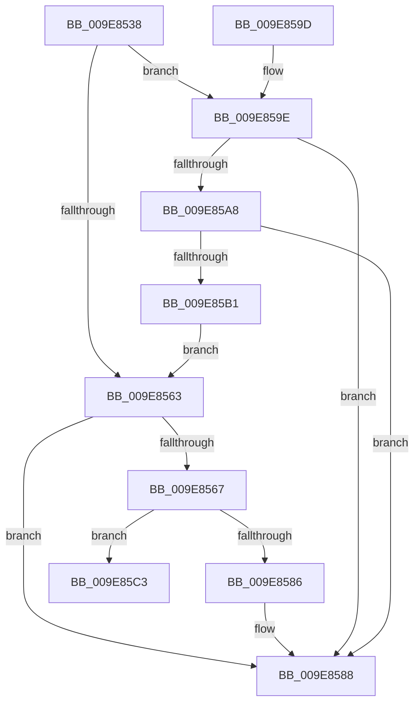

# PspGetStorageArray

- RVA: `0x009E8538`–`0x009E85CA` (길이 `146` bytes)
- VA: `0x00000001409E8538`
- 실행 섹션: `PAGE`
- PDB 이름 있음: `예`; PDB Function 태그: `아니요`
- unwind 정보 RVA: `0x00068ED8`
- 디코드: `43`개 명령, `146/146` bytes 표시
- 미해석 바이트: `0` (있으면 어셈블리에 `.byte`로 보존)

> 이 문서는 커널 이미지의 기계어와 PDB 기호를 분석해 생성했습니다. 4번과 5번은 함수 원형과 자료형을 바이너리 사용 방식에서 추정한 C 해석이며 원본 소스 복구 결과는 아닙니다.

## 1. Dependencies

- 직접 호출 지점: **3**; 고유 호출 대상: **2**
- 직접 호출자로 확인된 함수: **3**
- RIP 상대 이미지 참조: **2**

### Outgoing calls
- `0x009E8557` → [PspGetStorageArrayIfPossible](../../text/42/PspGetStorageArrayIfPossible_function_00420E40.md) (function, `0x00420E40`)
- `0x009E85A8` → [PspLazyInitializeStorageExpansion](PspLazyInitializeStorageExpansion_function_009E87E4.md) (function, `0x009E87E4`)
- `0x009E85BC` → [PspGetStorageArrayIfPossible](../../text/42/PspGetStorageArrayIfPossible_function_00420E40.md) (function, `0x00420E40`)

### Direct callers
- [PspStorageReplaceObject](../78/PspStorageReplaceObject_function_00789EA0.md) at `0x00789ECF`
- [PspStorageMakeSlotReadOnly](PspStorageMakeSlotReadOnly_function_009E8350.md) at `0x009E836F`
- [PspStorageInsertObject](PspStorageInsertObject_function_009E8420.md) at `0x009E844F`

### Static image references
- `0x009E8567` → RVA `0x00FDA050` (`PAGEDATA`; read)
- `0x009E8573` → RVA `0x00FDA060` (`PAGEDATA`; read)

## 2. Other-region calls and transfers

- 다른 실행 섹션으로 향하는 call: **2**
  - `0x009E8557` → [PspGetStorageArrayIfPossible](../../text/42/PspGetStorageArrayIfPossible_function_00420E40.md) (`PAGE` → `.text`)
  - `0x009E85BC` → [PspGetStorageArrayIfPossible](../../text/42/PspGetStorageArrayIfPossible_function_00420E40.md) (`PAGE` → `.text`)
- 별도 외부 분기/꼬리 이동을 확인하지 못했습니다.

## 3. Assembly (complete function range)

```asm
009E8538  48 89 5C 24 08                  mov qword ptr [rsp + 8], rbx
009E853D  48 89 6C 24 10                  mov qword ptr [rsp + 0x10], rbp
009E8542  48 89 74 24 18                  mov qword ptr [rsp + 0x18], rsi
009E8547  57                              push rdi
009E8548  48 83 EC 20                     sub rsp, 0x20
009E854C  49 8B E9                        mov rbp, r9
009E854F  49 8B F8                        mov rdi, r8
009E8552  8B F2                           mov esi, edx
009E8554  48 8B D9                        mov rbx, rcx
009E8557  E8 E4 88 A3 FF                  call 0x140420e40
009E855C  3D 25 02 00 C0                  cmp eax, 0xc0000225
009E8561  74 3B                           je 0x1409e859e
009E8563  85 C0                           test eax, eax
009E8565  78 21                           js 0x1409e8588
009E8567  48 8B 0D E2 1A 5F 00            mov rcx, qword ptr [rip + 0x5f1ae2]
009E856E  83 FE 20                        cmp esi, 0x20
009E8571  8B 07                           mov eax, dword ptr [rdi]
009E8573  48 0F 43 0D E5 1A 5F 00         cmovae rcx, qword ptr [rip + 0x5f1ae5]
009E857B  48 0F A3 01                     bt qword ptr [rcx], rax
009E857F  0F 92 C0                        setb al
009E8582  84 C0                           test al, al
009E8584  74 3D                           je 0x1409e85c3
009E8586  33 C0                           xor eax, eax
009E8588  48 8B 5C 24 30                  mov rbx, qword ptr [rsp + 0x30]
009E858D  48 8B 6C 24 38                  mov rbp, qword ptr [rsp + 0x38]
009E8592  48 8B 74 24 40                  mov rsi, qword ptr [rsp + 0x40]
009E8597  48 83 C4 20                     add rsp, 0x20
009E859B  5F                              pop rdi
009E859C  C3                              ret
009E859D  CC                              int3
009E859E  48 83 B9 00 02 00 00 00         cmp qword ptr [rcx + 0x200], 0
009E85A6  75 E0                           jne 0x1409e8588
009E85A8  E8 37 02 00 00                  call 0x1409e87e4
009E85AD  85 C0                           test eax, eax
009E85AF  78 D7                           js 0x1409e8588
009E85B1  4C 8B CD                        mov r9, rbp
009E85B4  4C 8B C7                        mov r8, rdi
009E85B7  8B D6                           mov edx, esi
009E85B9  48 8B CB                        mov rcx, rbx
009E85BC  E8 7F 88 A3 FF                  call 0x140420e40
009E85C1  EB A0                           jmp 0x1409e8563
009E85C3  B9 05 00 00 00                  mov ecx, 5
009E85C8  CD 29                           int 0x29
```

## 4. C-style interpretation (structured pseudocode)

```c
__int64 __fastcall PspGetStorageArray(__int64 a1, int a2, __int64 a3, __int64 a4)
{
    __int64 result;
    __int64 v_rsp;
    unsigned __int64 v_stack_p10;
    unsigned __int64 v_stack_p18;
    unsigned __int64 v_stack_p8;

    v_stack_p8 = v_rbx;
    v_stack_p10 = v_rbp;
    v_stack_p18 = v_rsi;
    v_rsp = (v_rsp) - (32);
    result = PspGetStorageArrayIfPossible(a1, a2, a3, a4);
    if (((unsigned int)(result)) == 0xC0000225ULL) goto loc_009E859E;
loc_009E8563:
    if (sign_flag) goto loc_009E8588;
    a1 = *(unsigned __int64 *)(v_rip + 6232802);
    if (((unsigned int)((unsigned int)(a2))) >= 32) { a1 = *(unsigned __int64 *)(v_rip + 6232805); }
    result = (((unsigned int)((unsigned int)(a2))) < 32) ? 1 : 0;
    if ((unsigned __int8)(result) == 0) goto loc_009E85C3;
    result = 0;
loc_009E8588:
    v_rsp = (v_rsp) + (32);
    return result;
loc_009E859E:
    if ((*(unsigned __int64 *)(a1 + 512)) != 0) goto loc_009E8588;
    result = PspLazyInitializeStorageExpansion(a1, a2, a3, a4);
    if (sign_flag) goto loc_009E8588;
    result = PspGetStorageArrayIfPossible(v_stack_p8, (unsigned int)((unsigned int)(v_stack_p18)), a3, v_stack_p10);
    goto loc_009E8563;
loc_009E85C3:
    return result;
}
```

## 5. (Beta) C Style

```c
int64_t PspGetStorageArray(int64_t Arg1, int32_t Arg2, void *Arg3, int64_t Arg4)
{
    uint8_t *arg3 = (uint8_t *)Arg3;

    int64_t result;
    int64_t local_rsp;
    uint64_t v_stack_p10;
    uint64_t v_stack_p18;
    uint64_t v_stack_p8;

    v_stack_p8 = local_rbx;
    v_stack_p10 = local_rbp;
    v_stack_p18 = local_rsi;
    local_rsp = (local_rsp) - (32);
    result = PspGetStorageArrayIfPossible(Arg1, Arg2, Arg3, Arg4);
    if (((uint32_t)(result)) == 0xC0000225ULL) goto loc_009E859E;
loc_009E8563:
    if (sign_flag) goto loc_009E8588;
    Arg1 = *(uint64_t *)(v_rip + 0x5F1AE2);
    if (((uint32_t)((uint32_t)(Arg2))) >= 32) { Arg1 = *(uint64_t *)(v_rip + 0x5F1AE5); }
    result = (((uint32_t)((uint32_t)(Arg2))) < 32) ? 1 : 0;
    if ((uint8_t)(result) == 0) goto loc_009E85C3;
    result = 0;
loc_009E8588:
    local_rsp = (local_rsp) + (32);
    return result;
loc_009E859E:
    if ((*(uint64_t *)(Arg1 + 0x200)) != 0) goto loc_009E8588;
    result = PspLazyInitializeStorageExpansion(Arg1, Arg2, Arg3, Arg4);
    if (sign_flag) goto loc_009E8588;
    result = PspGetStorageArrayIfPossible(v_stack_p8, (uint32_t)((uint32_t)(v_stack_p18)), Arg3, v_stack_p10);
    goto loc_009E8563;
loc_009E85C3:
    return result;
}
```

### 관측된 메모리 오프셋

구조체 형식이 확인되지 않은 접근은 인자 기준의 오프셋으로만 기록했습니다.

| 기준 인자 | 오프셋 표현 | 폭 (bit) | 접근 |
|---|---:|---:|---|
| `Arg3` | `+ 0x0` | `32` | `R` |

## 6. Execution-region graph

[열기: 2D/3D 그래프와 함수 탐색 컨트롤 패널](../../../control-panel.html?section=page&rva=0x009E8538&view=graph)

- 2D 그래프는 위에서 아래로 흐르고, 3D 그래프는 빈 공간을 드래그해 회전합니다. Shift+드래그는 이동, 휠은 확대·축소, 함수 노드 선택은 대상 보고서 이동입니다.

### Static fallback


