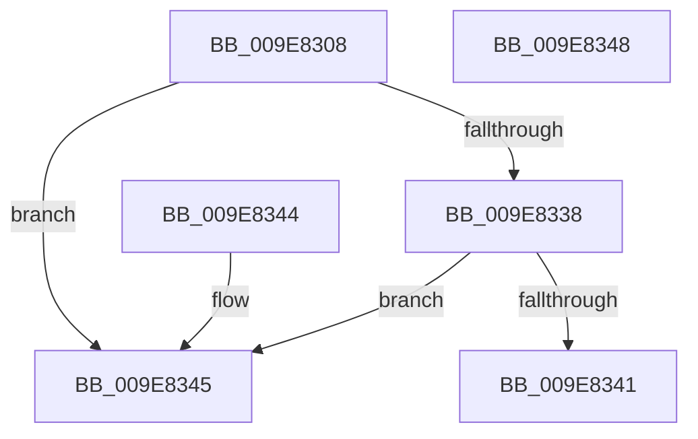

# PspIsSiloContext

- RVA: `0x009E8308`–`0x009E8349` (길이 `65` bytes)
- VA: `0x00000001409E8308`
- 실행 섹션: `PAGE`
- PDB 이름 있음: `예`; PDB Function 태그: `아니요`
- unwind 정보 RVA: `0x000DB714`
- 디코드: `19`개 명령, `65/65` bytes 표시
- 미해석 바이트: `0` (있으면 어셈블리에 `.byte`로 보존)

> 이 문서는 커널 이미지의 기계어와 PDB 기호를 분석해 생성했습니다. 4번과 5번은 함수 원형과 자료형을 바이너리 사용 방식에서 추정한 C 해석이며 원본 소스 복구 결과는 아닙니다.

## 1. Dependencies

- 직접 호출 지점: **0**; 고유 호출 대상: **0**
- 직접 호출자로 확인된 함수: **3**
- RIP 상대 이미지 참조: **4**

### Outgoing calls
- 직접 디코드된 call 명령이 없습니다.

### Direct callers
- [PsReplaceSiloContext](../77/PsReplaceSiloContext_function_0077F490.md) at `0x0077F4B8`
- [PsInsertSiloContext](PsInsertSiloContext_function_009E7D40.md) at `0x009E7D64`
- [PsInsertPermanentSiloContextEx](PsInsertPermanentSiloContextEx_function_009E8224.md) at `0x009E8269`

### Static image references
- `0x009E831A` → RVA `0x00FC6E4C` (`ALMOSTRO`; read)
- `0x009E8324` → RVA `0x00FC7800` (`ALMOSTRO`; read)
- `0x009E832F` → RVA `0x00FD9E90` (`PAGEDATA`; read)
- `0x009E8338` → RVA `0x00FD9DC0` (`PAGEDATA`; read)

## 2. Other-region calls and transfers

- 다른 실행 섹션으로 향하는 call: **0**
- 별도 외부 분기/꼬리 이동을 확인하지 못했습니다.

## 3. Assembly (complete function range)

```asm
009E8308  48 8D 41 D0                     lea rax, [rcx - 0x30]
009E830C  48 C1 E8 08                     shr rax, 8
009E8310  0F B6 D0                        movzx edx, al
009E8313  0F B6 41 E8                     movzx eax, byte ptr [rcx - 0x18]
009E8317  48 33 D0                        xor rdx, rax
009E831A  0F B6 05 2B EB 5D 00            movzx eax, byte ptr [rip + 0x5deb2b]
009E8321  48 33 D0                        xor rdx, rax
009E8324  48 8D 05 D5 F4 5D 00            lea rax, [rip + 0x5df4d5]
009E832B  48 8B 04 D0                     mov rax, qword ptr [rax + rdx*8]
009E832F  48 3B 05 5A 1B 5F 00            cmp rax, qword ptr [rip + 0x5f1b5a]
009E8336  74 0D                           je 0x1409e8345
009E8338  48 3B 05 81 1A 5F 00            cmp rax, qword ptr [rip + 0x5f1a81]
009E833F  74 04                           je 0x1409e8345
009E8341  32 C0                           xor al, al
009E8343  C3                              ret
009E8344  CC                              int3
009E8345  B0 01                           mov al, 1
009E8347  C3                              ret
009E8348  CC                              int3
```

## 4. C-style interpretation (structured pseudocode)

```c
__int64 __fastcall PspIsSiloContext(__int64 a1)
{
    __int64 result;

    result = (a1 - 48) >> (8);
    a2 = ((unsigned __int8)(result)) ^ (*(unsigned __int8 *)(a1 - 24));
    a2 = (a2) ^ (*(unsigned __int8 *)(v_rip + 6155051));
    if ((*(unsigned __int64 *)(v_rip + 6157525 + a2 * 8)) == (*(unsigned __int64 *)(v_rip + 6232922))) goto loc_009E8345;
    if ((*(unsigned __int64 *)(v_rip + 6157525 + a2 * 8)) == (*(unsigned __int64 *)(v_rip + 6232705))) goto loc_009E8345;
    result = 0;
    return result;
loc_009E8345:
    return 1;
}
```

## 5. (Beta) C Style

```c
int64_t PspIsSiloContext(void *Arg1)
{
    uint8_t *arg1 = (uint8_t *)Arg1;

    int64_t result;

    result = (Arg1 - 48) >> (8);
    a2 = ((uint8_t)(result)) ^ (*(uint8_t *)(arg1 - 0x18));
    a2 = (a2) ^ (*(uint8_t *)(v_rip + 0x5DEB2B));
    if ((*(uint64_t *)(v_rip + 0x5DF4D5 + a2 * 8)) == (*(uint64_t *)(v_rip + 0x5F1B5A))) goto loc_009E8345;
    if ((*(uint64_t *)(v_rip + 0x5DF4D5 + a2 * 8)) == (*(uint64_t *)(v_rip + 0x5F1A81))) goto loc_009E8345;
    result = 0;
    return result;
loc_009E8345:
    return 1;
}
```

### 관측된 메모리 오프셋

구조체 형식이 확인되지 않은 접근은 인자 기준의 오프셋으로만 기록했습니다.

| 기준 인자 | 오프셋 표현 | 폭 (bit) | 접근 |
|---|---:|---:|---|
| `Arg1` | `- 0x30` | `64` | `R` |
| `Arg1` | `- 0x18` | `8` | `R` |

## 6. Execution-region graph

[열기: 2D/3D 그래프와 함수 탐색 컨트롤 패널](../../../control-panel.html?section=page&rva=0x009E8308&view=graph)

- 2D 그래프는 위에서 아래로 흐르고, 3D 그래프는 빈 공간을 드래그해 회전합니다. Shift+드래그는 이동, 휠은 확대·축소, 함수 노드 선택은 대상 보고서 이동입니다.

### Static fallback


