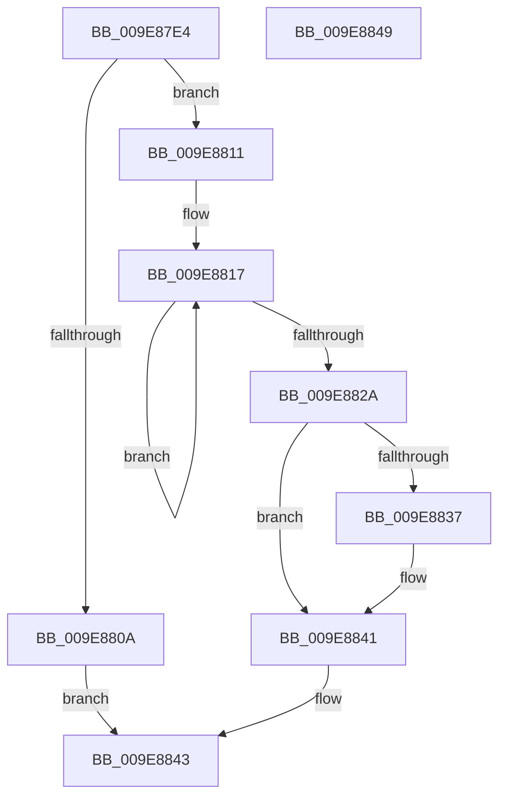

# PspLazyInitializeStorageExpansion

- RVA: `0x009E87E4`–`0x009E884A` (길이 `102` bytes)
- VA: `0x00000001409E87E4`
- 실행 섹션: `PAGE`
- PDB 이름 있음: `예`; PDB Function 태그: `아니요`
- unwind 정보 RVA: `0x0005CF00`
- 디코드: `28`개 명령, `102/102` bytes 표시
- 미해석 바이트: `0` (있으면 어셈블리에 `.byte`로 보존)

> 이 문서는 커널 이미지의 기계어와 PDB 기호를 분석해 생성했습니다. 4번과 5번은 함수 원형과 자료형을 바이너리 사용 방식에서 추정한 C 해석이며 원본 소스 복구 결과는 아닙니다.

## 1. Dependencies

- 직접 호출 지점: **2**; 고유 호출 대상: **2**
- 직접 호출자로 확인된 함수: **1**
- RIP 상대 이미지 참조: **0**

### Outgoing calls
- `0x009E87FD` → [ExAllocatePool2](../../poolcode/B8/ExAllocatePool2_function_00B820F0.md) (function, `0x00B820F0`)
- `0x009E883C` → [ExFreePoolWithTag](../../poolcode/B8/ExFreePoolWithTag_function_00B82870.md) (function, `0x00B82870`)

### Direct callers
- [PspGetStorageArray](PspGetStorageArray_function_009E8538.md) at `0x009E85A8`

### Static image references
- 디코드된 RIP-relative 메모리 참조가 없습니다.

## 2. Other-region calls and transfers

- 다른 실행 섹션으로 향하는 call: **2**
  - `0x009E87FD` → [ExAllocatePool2](../../poolcode/B8/ExAllocatePool2_function_00B820F0.md) (`PAGE` → `POOLCODE`)
  - `0x009E883C` → [ExFreePoolWithTag](../../poolcode/B8/ExFreePoolWithTag_function_00B82870.md) (`PAGE` → `POOLCODE`)
- 별도 외부 분기/꼬리 이동을 확인하지 못했습니다.

## 3. Assembly (complete function range)

```asm
009E87E4  40 53                           push rbx
009E87E6  48 83 EC 20                     sub rsp, 0x20
009E87EA  48 8B D9                        mov rbx, rcx
009E87ED  BA 00 10 00 00                  mov edx, 0x1000
009E87F2  B9 48 00 00 00                  mov ecx, 0x48
009E87F7  41 B8 50 73 45 78               mov r8d, 0x78457350
009E87FD  E8 EE 98 19 00                  call 0x140b820f0
009E8802  48 8B C8                        mov rcx, rax
009E8805  48 85 C0                        test rax, rax
009E8808  75 07                           jne 0x1409e8811
009E880A  B8 9A 00 00 C0                  mov eax, 0xc000009a
009E880F  EB 32                           jmp 0x1409e8843
009E8811  41 B8 00 01 00 00               mov r8d, 0x100
009E8817  48 83 20 00                     and qword ptr [rax], 0
009E881B  48 83 60 08 00                  and qword ptr [rax + 8], 0
009E8820  48 8D 40 10                     lea rax, [rax + 0x10]
009E8824  49 83 E8 01                     sub r8, 1
009E8828  75 ED                           jne 0x1409e8817
009E882A  33 C0                           xor eax, eax
009E882C  F0 48 0F B1 8B 00 02 00 00      lock cmpxchg qword ptr [rbx + 0x200], rcx
009E8835  74 0A                           je 0x1409e8841
009E8837  BA 50 73 45 78                  mov edx, 0x78457350
009E883C  E8 2F A0 19 00                  call 0x140b82870
009E8841  33 C0                           xor eax, eax
009E8843  48 83 C4 20                     add rsp, 0x20
009E8847  5B                              pop rbx
009E8848  C3                              ret
009E8849  CC                              int3
```

## 4. C-style interpretation (structured pseudocode)

```c
__int64 __fastcall PspLazyInitializeStorageExpansion(__int64 a1)
{
    __int64 result;
    __int64 v_rsp;

    v_rsp = (v_rsp) - (32);
    result = ExAllocatePool2(72, (unsigned int)(0x1000ULL), (unsigned int)(0x78457350ULL), a4);
    if (result != 0) goto loc_009E8811;
    goto loc_009E8843;
loc_009E8811:
loc_009E8817:
    a3 = (256) - (1);
    if (condition_is_not_equal) goto loc_009E8817;
    result = 0;
    if (!(condition_is_equal)) {
        a2 = 0x78457350ULL;
        result = ExFreePoolWithTag(result, a2, a3, a4);
    }
    result = 0;
loc_009E8843:
    v_rsp = (v_rsp) + (32);
    return result;
}
```

## 5. (Beta) C Style

```c
int64_t PspLazyInitializeStorageExpansion(void *Arg1)
{
    uint8_t *arg1 = (uint8_t *)Arg1;

    int64_t result;
    int64_t local_rsp;

    local_rsp = (local_rsp) - (32);
    result = ExAllocatePool2(72, (uint32_t)(0x1000ULL), (uint32_t)(0x78457350ULL), a4);
    if (result != 0) goto loc_009E8811;
    goto loc_009E8843;
loc_009E8811:
loc_009E8817:
    a3 = (256) - (1);
    if (condition_is_not_equal) goto loc_009E8817;
    result = 0;
    if (!(condition_is_equal)) {
        a2 = 0x78457350ULL;
        result = ExFreePoolWithTag(result, a2, a3, a4);
    }
    result = 0;
loc_009E8843:
    local_rsp = (local_rsp) + (32);
    return result;
}
```

### 관측된 메모리 오프셋

구조체 형식이 확인되지 않은 접근은 인자 기준의 오프셋으로만 기록했습니다.

| 기준 인자 | 오프셋 표현 | 폭 (bit) | 접근 |
|---|---:|---:|---|
| `Arg1` | `+ 0x200` | `64` | `R` |

## 6. Execution-region graph

[열기: 2D/3D 그래프와 함수 탐색 컨트롤 패널](../../../control-panel.html?section=page&rva=0x009E87E4&view=graph)

- 2D 그래프는 위에서 아래로 흐르고, 3D 그래프는 빈 공간을 드래그해 회전합니다. Shift+드래그는 이동, 휠은 확대·축소, 함수 노드 선택은 대상 보고서 이동입니다.

### Static fallback


