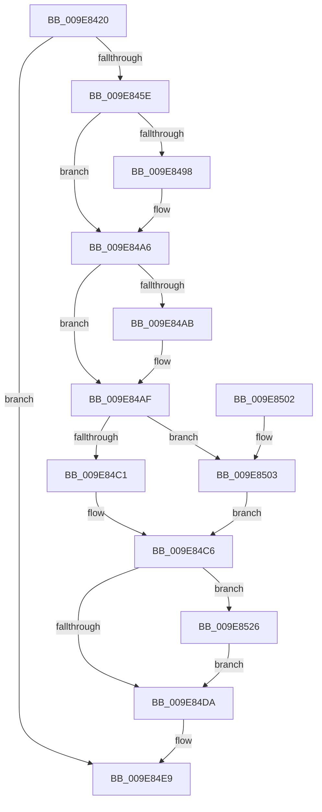

# PspStorageInsertObject

- RVA: `0x009E8420`–`0x009E8530` (길이 `272` bytes)
- VA: `0x00000001409E8420`
- 실행 섹션: `PAGE`
- PDB 이름 있음: `예`; PDB Function 태그: `아니요`
- unwind 정보 RVA: `0x0006EC98`
- 디코드: `77`개 명령, `272/272` bytes 표시
- 미해석 바이트: `0` (있으면 어셈블리에 `.byte`로 보존)

> 이 문서는 커널 이미지의 기계어와 PDB 기호를 분석해 생성했습니다. 4번과 5번은 함수 원형과 자료형을 바이너리 사용 방식에서 추정한 C 해석이며 원본 소스 복구 결과는 아닙니다.

## 1. Dependencies

- 직접 호출 지점: **7**; 고유 호출 대상: **7**
- 직접 호출자로 확인된 함수: **2**
- RIP 상대 이미지 참조: **0**

### Outgoing calls
- `0x009E844F` → [PspGetStorageArray](PspGetStorageArray_function_009E8538.md) (function, `0x009E8538`)
- `0x009E8488` → [KeAbPreAcquire](../../text/21/KeAbPreAcquire_function_00210230.md) (function, `0x00210230`)
- `0x009E84A1` → [ExfAcquirePushLockExclusiveEx](../../text/20/ExfAcquirePushLockExclusiveEx_function_0020FC90.md) (function, `0x0020FC90`)
- `0x009E84DD` → [KeAbPostRelease](../../text/2E/KeAbPostRelease_function_002E1600.md) (function, `0x002E1600`)
- `0x009E84E2` → [KeLeaveCriticalRegion](../../text/25/KeLeaveCriticalRegion_function_0025D8B0.md) (function, `0x0025D8B0`)
- `0x009E8506` → [ObfReferenceObject](../../text/20/ObfReferenceObject_function_0020FA20.md) (function, `0x0020FA20`)
- `0x009E8529` → [ExfTryToWakePushLock](../../text/26/ExfTryToWakePushLock_function_00265DD0.md) (function, `0x00265DD0`)

### Direct callers
- [PsInsertSiloContext](PsInsertSiloContext_function_009E7D40.md) at `0x009E7D78`
- [PsInsertPermanentSiloContextEx](PsInsertPermanentSiloContextEx_function_009E8224.md) at `0x009E8286`

### Static image references
- 디코드된 RIP-relative 메모리 참조가 없습니다.

## 2. Other-region calls and transfers

- 다른 실행 섹션으로 향하는 call: **6**
  - `0x009E8488` → [KeAbPreAcquire](../../text/21/KeAbPreAcquire_function_00210230.md) (`PAGE` → `.text`)
  - `0x009E84A1` → [ExfAcquirePushLockExclusiveEx](../../text/20/ExfAcquirePushLockExclusiveEx_function_0020FC90.md) (`PAGE` → `.text`)
  - `0x009E84DD` → [KeAbPostRelease](../../text/2E/KeAbPostRelease_function_002E1600.md) (`PAGE` → `.text`)
  - `0x009E84E2` → [KeLeaveCriticalRegion](../../text/25/KeLeaveCriticalRegion_function_0025D8B0.md) (`PAGE` → `.text`)
  - `0x009E8506` → [ObfReferenceObject](../../text/20/ObfReferenceObject_function_0020FA20.md) (`PAGE` → `.text`)
  - `0x009E8529` → [ExfTryToWakePushLock](../../text/26/ExfTryToWakePushLock_function_00265DD0.md) (`PAGE` → `.text`)
- 별도 외부 분기/꼬리 이동을 확인하지 못했습니다.

## 3. Assembly (complete function range)

```asm
009E8420  48 8B C4                        mov rax, rsp
009E8423  48 89 58 08                     mov qword ptr [rax + 8], rbx
009E8427  48 89 68 10                     mov qword ptr [rax + 0x10], rbp
009E842B  48 89 70 18                     mov qword ptr [rax + 0x18], rsi
009E842F  57                              push rdi
009E8430  41 56                           push r14
009E8432  41 57                           push r15
009E8434  48 83 EC 30                     sub rsp, 0x30
009E8438  83 60 D8 00                     and dword ptr [rax - 0x28], 0
009E843C  4D 8B F1                        mov r14, r9
009E843F  48 83 60 E0 00                  and qword ptr [rax - 0x20], 0
009E8444  4C 8D 48 E0                     lea r9, [rax - 0x20]
009E8448  45 8A F8                        mov r15b, r8b
009E844B  4C 8D 40 D8                     lea r8, [rax - 0x28]
009E844F  E8 E4 00 00 00                  call 0x1409e8538
009E8454  8B F0                           mov esi, eax
009E8456  85 C0                           test eax, eax
009E8458  0F 88 8B 00 00 00               js 0x1409e84e9
009E845E  65 48 8B 04 25 88 01 00 00      mov rax, qword ptr gs:[0x188]
009E8467  48 83 CB FF                     or rbx, 0xffffffffffffffff
009E846B  8B 7C 24 20                     mov edi, dword ptr [rsp + 0x20]
009E846F  45 33 C0                        xor r8d, r8d
009E8472  48 C1 E7 04                     shl rdi, 4
009E8476  33 D2                           xor edx, edx
009E8478  48 03 7C 24 28                  add rdi, qword ptr [rsp + 0x28]
009E847D  66 01 98 E4 01 00 00            add word ptr [rax + 0x1e4], bx
009E8484  48 8B CF                        mov rcx, rdi
009E8487  90                              nop
009E8488  E8 A3 7D 82 FF                  call 0x140210230
009E848D  F0 48 0F BA 2F 00               lock bts qword ptr [rdi], 0
009E8493  48 8B E8                        mov rbp, rax
009E8496  73 0E                           jae 0x1409e84a6
009E8498  4C 8B C7                        mov r8, rdi
009E849B  48 8B D0                        mov rdx, rax
009E849E  48 8B CF                        mov rcx, rdi
009E84A1  E8 EA 77 82 FF                  call 0x14020fc90
009E84A6  48 85 ED                        test rbp, rbp
009E84A9  74 04                           je 0x1409e84af
009E84AB  C6 45 0A 01                     mov byte ptr [rbp + 0xa], 1
009E84AF  48 8B 47 08                     mov rax, qword ptr [rdi + 8]
009E84B3  8B 7C 24 20                     mov edi, dword ptr [rsp + 0x20]
009E84B7  48 8B 6C 24 28                  mov rbp, qword ptr [rsp + 0x28]
009E84BC  48 85 C0                        test rax, rax
009E84BF  74 42                           je 0x1409e8503
009E84C1  BE BB 00 00 C0                  mov esi, 0xc00000bb
009E84C6  48 C1 E7 04                     shl rdi, 4
009E84CA  48 03 FD                        add rdi, rbp
009E84CD  F0 48 0F C1 1F                  lock xadd qword ptr [rdi], rbx
009E84D2  80 E3 06                        and bl, 6
009E84D5  80 FB 02                        cmp bl, 2
009E84D8  74 4C                           je 0x1409e8526
009E84DA  48 8B CF                        mov rcx, rdi
009E84DD  E8 1E 91 8F FF                  call 0x1402e1600
009E84E2  E8 C9 53 87 FF                  call 0x14025d8b0
009E84E7  8B C6                           mov eax, esi
009E84E9  48 8B 5C 24 50                  mov rbx, qword ptr [rsp + 0x50]
009E84EE  48 8B 6C 24 58                  mov rbp, qword ptr [rsp + 0x58]
009E84F3  48 8B 74 24 60                  mov rsi, qword ptr [rsp + 0x60]
009E84F8  48 83 C4 30                     add rsp, 0x30
009E84FC  41 5F                           pop r15
009E84FE  41 5E                           pop r14
009E8500  5F                              pop rdi
009E8501  C3                              ret
009E8502  CC                              int3
009E8503  49 8B CE                        mov rcx, r14
009E8506  E8 15 75 82 FF                  call 0x14020fa20
009E850B  49 8B CE                        mov rcx, r14
009E850E  48 8B C7                        mov rax, rdi
009E8511  48 83 C9 01                     or rcx, 1
009E8515  45 84 FF                        test r15b, r15b
009E8518  49 0F 44 CE                     cmove rcx, r14
009E851C  48 03 C0                        add rax, rax
009E851F  48 89 4C C5 08                  mov qword ptr [rbp + rax*8 + 8], rcx
009E8524  EB A0                           jmp 0x1409e84c6
009E8526  48 8B CF                        mov rcx, rdi
009E8529  E8 A2 D8 87 FF                  call 0x140265dd0
009E852E  EB AA                           jmp 0x1409e84da
```

## 4. C-style interpretation (structured pseudocode)

```c
__int64 __fastcall PspStorageInsertObject(__int64 a1, int a2, unsigned __int8 a3, __int64 a4)
{
    __int64 result;
    __int64 v_rbx;
    __int64 v_rdi;
    __int64 v_rsp;
    unsigned __int64 v_stack_m20;
    unsigned int v_stack_m28;
    unsigned __int64 v_stack_p10;
    unsigned __int64 v_stack_p18;
    unsigned __int64 v_stack_p8;

    *(unsigned __int64 *)(v_rsp + 8) = v_rbx;
    *(unsigned __int64 *)(v_rsp + 16) = v_rbp;
    *(unsigned __int64 *)(v_rsp + 24) = v_rsi;
    v_rsp = (v_rsp) - (48);
    result = PspGetStorageArray(a1, a2, v_rsp - 40, v_rsp - 32);
    if (sign_flag) goto loc_009E84E9;
    v_rbx = (v_rbx) | (-1);
    a3 = 0;
    v_rdi = ((unsigned int)(v_stack_m28)) << (4);
    a2 = 0;
    v_rdi = (v_rdi) + (v_stack_m20);
    result = KeAbPreAcquire(v_rdi, a2, a3, v_rsp - 32);
    if (!(condition_is_above_or_equal)) {
        a3 = v_rdi;
        a2 = result;
        a1 = v_rdi;
        result = ExfAcquirePushLockExclusiveEx(a1, a2, a3, v_rsp - 32);
    }
    if (result != 0) {
        *(unsigned __int8 *)(result + 10) = 1;
    }
    if (*(unsigned __int64 *)(v_rdi + 8) == 0) goto loc_009E8503;
loc_009E84C6:
    v_rdi = ((unsigned int)(v_stack_m28)) << (4);
    v_rdi = (v_rdi) + (v_stack_m20);
    v_rbx = (unsigned __int8)((v_rbx) & (6));
    if (((unsigned __int8)(v_rbx)) == 2) goto loc_009E8526;
loc_009E84DA:
    result = KeAbPostRelease(v_rdi, a2, a3, v_rsp - 32);
    result = KeLeaveCriticalRegion(v_rdi, a2, a3, v_rsp - 32);
loc_009E84E9:
    v_rsp = (v_rsp) + (48);
    return (unsigned int)((unsigned int)((unsigned int)(0xC00000BBULL)));
loc_009E8503:
    result = ObfReferenceObject(a4, a2, a3, v_rsp - 32);
    a1 = (a4) | (1);
    if (a3 == 0) { a1 = a4; }
    result = (v_rdi) + (v_rdi);
    *(unsigned __int64 *)(v_stack_p10 + result * 8 + 8) = a1;
    goto loc_009E84C6;
loc_009E8526:
    result = ExfTryToWakePushLock(v_rdi, a2, a3, v_rsp - 32);
    goto loc_009E84DA;
}
```

## 5. (Beta) C Style

```c
int64_t PspStorageInsertObject(int64_t Arg1, int32_t Arg2, uint8_t Arg3, int64_t Arg4)
{
    int64_t result;
    int64_t local_rbx;
    int64_t local_rdi;
    int64_t local_rsp;
    uint64_t v_stack_m20;
    uint32_t v_stack_m28;
    uint64_t v_stack_p10;
    uint64_t v_stack_p18;
    uint64_t v_stack_p8;

    *(uint64_t *)(local_rsp + 0x8) = local_rbx;
    *(uint64_t *)(local_rsp + 0x10) = local_rbp;
    *(uint64_t *)(local_rsp + 0x18) = local_rsi;
    local_rsp = (local_rsp) - (48);
    result = PspGetStorageArray(Arg1, Arg2, local_rsp - 40, local_rsp - 32);
    if (sign_flag) goto loc_009E84E9;
    local_rbx = (local_rbx) | (-1);
    Arg3 = 0;
    local_rdi = ((uint32_t)(v_stack_m28)) << (4);
    Arg2 = 0;
    local_rdi = (local_rdi) + (v_stack_m20);
    result = KeAbPreAcquire(local_rdi, Arg2, Arg3, local_rsp - 32);
    if (!(condition_is_above_or_equal)) {
        Arg3 = local_rdi;
        Arg2 = result;
        Arg1 = local_rdi;
        result = ExfAcquirePushLockExclusiveEx(Arg1, Arg2, Arg3, local_rsp - 32);
    }
    if (result != 0) {
        *(uint8_t *)(result + 0xA) = 1;
    }
    if (*(uint64_t *)(local_rdi + 0x8) == 0) goto loc_009E8503;
loc_009E84C6:
    local_rdi = ((uint32_t)(v_stack_m28)) << (4);
    local_rdi = (local_rdi) + (v_stack_m20);
    local_rbx = (uint8_t)((local_rbx) & (6));
    if (((uint8_t)(local_rbx)) == 2) goto loc_009E8526;
loc_009E84DA:
    result = KeAbPostRelease(local_rdi, Arg2, Arg3, local_rsp - 32);
    result = KeLeaveCriticalRegion(local_rdi, Arg2, Arg3, local_rsp - 32);
loc_009E84E9:
    local_rsp = (local_rsp) + (48);
    return (uint32_t)((uint32_t)((uint32_t)(0xC00000BBULL)));
loc_009E8503:
    result = ObfReferenceObject(Arg4, Arg2, Arg3, local_rsp - 32);
    Arg1 = (Arg4) | (1);
    if (Arg3 == 0) { Arg1 = Arg4; }
    result = (local_rdi) + (local_rdi);
    *(uint64_t *)(v_stack_p10 + result * 8 + 0x8) = Arg1;
    goto loc_009E84C6;
loc_009E8526:
    result = ExfTryToWakePushLock(local_rdi, Arg2, Arg3, local_rsp - 32);
    goto loc_009E84DA;
}
```

## 6. Execution-region graph

[열기: 2D/3D 그래프와 함수 탐색 컨트롤 패널](../../../control-panel.html?section=page&rva=0x009E8420&view=graph)

- 2D 그래프는 위에서 아래로 흐르고, 3D 그래프는 빈 공간을 드래그해 회전합니다. Shift+드래그는 이동, 휠은 확대·축소, 함수 노드 선택은 대상 보고서 이동입니다.

### Static fallback


