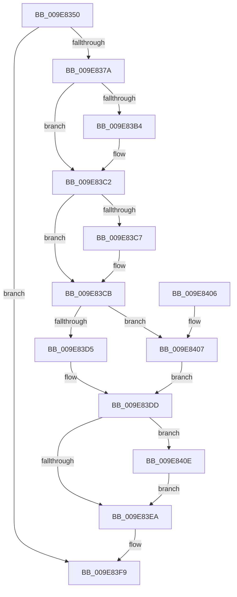

# PspStorageMakeSlotReadOnly

- RVA: `0x009E8350`–`0x009E8418` (길이 `200` bytes)
- VA: `0x00000001409E8350`
- 실행 섹션: `PAGE`
- PDB 이름 있음: `예`; PDB Function 태그: `아니요`
- unwind 정보 RVA: `0x000A4D1C`
- 디코드: `60`개 명령, `200/200` bytes 표시
- 미해석 바이트: `0` (있으면 어셈블리에 `.byte`로 보존)

> 이 문서는 커널 이미지의 기계어와 PDB 기호를 분석해 생성했습니다. 4번과 5번은 함수 원형과 자료형을 바이너리 사용 방식에서 추정한 C 해석이며 원본 소스 복구 결과는 아닙니다.

## 1. Dependencies

- 직접 호출 지점: **6**; 고유 호출 대상: **6**
- 직접 호출자로 확인된 함수: **1**
- RIP 상대 이미지 참조: **0**

### Outgoing calls
- `0x009E836F` → [PspGetStorageArray](PspGetStorageArray_function_009E8538.md) (function, `0x009E8538`)
- `0x009E83A4` → [KeAbPreAcquire](../../text/21/KeAbPreAcquire_function_00210230.md) (function, `0x00210230`)
- `0x009E83BD` → [ExfAcquirePushLockExclusiveEx](../../text/20/ExfAcquirePushLockExclusiveEx_function_0020FC90.md) (function, `0x0020FC90`)
- `0x009E83ED` → [KeAbPostRelease](../../text/2E/KeAbPostRelease_function_002E1600.md) (function, `0x002E1600`)
- `0x009E83F2` → [KeLeaveCriticalRegion](../../text/25/KeLeaveCriticalRegion_function_0025D8B0.md) (function, `0x0025D8B0`)
- `0x009E8411` → [ExfTryToWakePushLock](../../text/26/ExfTryToWakePushLock_function_00265DD0.md) (function, `0x00265DD0`)

### Direct callers
- [PsMakeSiloContextPermanent](../70/PsMakeSiloContextPermanent_function_007049A0.md) at `0x007049B9`

### Static image references
- 디코드된 RIP-relative 메모리 참조가 없습니다.

## 2. Other-region calls and transfers

- 다른 실행 섹션으로 향하는 call: **5**
  - `0x009E83A4` → [KeAbPreAcquire](../../text/21/KeAbPreAcquire_function_00210230.md) (`PAGE` → `.text`)
  - `0x009E83BD` → [ExfAcquirePushLockExclusiveEx](../../text/20/ExfAcquirePushLockExclusiveEx_function_0020FC90.md) (`PAGE` → `.text`)
  - `0x009E83ED` → [KeAbPostRelease](../../text/2E/KeAbPostRelease_function_002E1600.md) (`PAGE` → `.text`)
  - `0x009E83F2` → [KeLeaveCriticalRegion](../../text/25/KeLeaveCriticalRegion_function_0025D8B0.md) (`PAGE` → `.text`)
  - `0x009E8411` → [ExfTryToWakePushLock](../../text/26/ExfTryToWakePushLock_function_00265DD0.md) (`PAGE` → `.text`)
- 별도 외부 분기/꼬리 이동을 확인하지 못했습니다.

## 3. Assembly (complete function range)

```asm
009E8350  48 8B C4                        mov rax, rsp
009E8353  48 89 58 08                     mov qword ptr [rax + 8], rbx
009E8357  55                              push rbp
009E8358  56                              push rsi
009E8359  57                              push rdi
009E835A  48 83 EC 20                     sub rsp, 0x20
009E835E  83 60 18 00                     and dword ptr [rax + 0x18], 0
009E8362  4C 8D 48 20                     lea r9, [rax + 0x20]
009E8366  48 83 60 20 00                  and qword ptr [rax + 0x20], 0
009E836B  4C 8D 40 18                     lea r8, [rax + 0x18]
009E836F  E8 C4 01 00 00                  call 0x1409e8538
009E8374  8B F0                           mov esi, eax
009E8376  85 C0                           test eax, eax
009E8378  78 7F                           js 0x1409e83f9
009E837A  65 48 8B 04 25 88 01 00 00      mov rax, qword ptr gs:[0x188]
009E8383  48 83 CB FF                     or rbx, 0xffffffffffffffff
009E8387  8B 7C 24 50                     mov edi, dword ptr [rsp + 0x50]
009E838B  45 33 C0                        xor r8d, r8d
009E838E  48 C1 E7 04                     shl rdi, 4
009E8392  33 D2                           xor edx, edx
009E8394  48 03 7C 24 58                  add rdi, qword ptr [rsp + 0x58]
009E8399  66 01 98 E4 01 00 00            add word ptr [rax + 0x1e4], bx
009E83A0  48 8B CF                        mov rcx, rdi
009E83A3  90                              nop
009E83A4  E8 87 7E 82 FF                  call 0x140210230
009E83A9  F0 48 0F BA 2F 00               lock bts qword ptr [rdi], 0
009E83AF  48 8B E8                        mov rbp, rax
009E83B2  73 0E                           jae 0x1409e83c2
009E83B4  4C 8B C7                        mov r8, rdi
009E83B7  48 8B D0                        mov rdx, rax
009E83BA  48 8B CF                        mov rcx, rdi
009E83BD  E8 CE 78 82 FF                  call 0x14020fc90
009E83C2  48 85 ED                        test rbp, rbp
009E83C5  74 04                           je 0x1409e83cb
009E83C7  C6 45 0A 01                     mov byte ptr [rbp + 0xa], 1
009E83CB  48 8B 47 08                     mov rax, qword ptr [rdi + 8]
009E83CF  48 83 E0 FE                     and rax, 0xfffffffffffffffe
009E83D3  74 32                           je 0x1409e8407
009E83D5  48 83 C8 01                     or rax, 1
009E83D9  48 89 47 08                     mov qword ptr [rdi + 8], rax
009E83DD  F0 48 0F C1 1F                  lock xadd qword ptr [rdi], rbx
009E83E2  80 E3 06                        and bl, 6
009E83E5  80 FB 02                        cmp bl, 2
009E83E8  74 24                           je 0x1409e840e
009E83EA  48 8B CF                        mov rcx, rdi
009E83ED  E8 0E 92 8F FF                  call 0x1402e1600
009E83F2  E8 B9 54 87 FF                  call 0x14025d8b0
009E83F7  8B C6                           mov eax, esi
009E83F9  48 8B 5C 24 40                  mov rbx, qword ptr [rsp + 0x40]
009E83FE  48 83 C4 20                     add rsp, 0x20
009E8402  5F                              pop rdi
009E8403  5E                              pop rsi
009E8404  5D                              pop rbp
009E8405  C3                              ret
009E8406  CC                              int3
009E8407  BE 0D 00 00 C0                  mov esi, 0xc000000d
009E840C  EB CF                           jmp 0x1409e83dd
009E840E  48 8B CF                        mov rcx, rdi
009E8411  E8 BA D9 87 FF                  call 0x140265dd0
009E8416  EB D2                           jmp 0x1409e83ea
```

## 4. C-style interpretation (structured pseudocode)

```c
__int64 __fastcall PspStorageMakeSlotReadOnly(__int64 a1, int a2)
{
    __int64 result;
    __int64 v_rbx;
    __int64 v_rdi;
    __int64 v_rsp;
    unsigned int v_stack_p18;
    unsigned __int64 v_stack_p20;
    unsigned __int64 v_stack_p8;

    *(unsigned __int64 *)(v_rsp + 8) = v_rbx;
    v_rsp = (v_rsp) - (32);
    result = PspGetStorageArray(a1, a2, v_rsp + 24, v_rsp + 32);
    if (sign_flag) goto loc_009E83F9;
    v_rbx = (v_rbx) | (-1);
    a3 = 0;
    v_rdi = ((unsigned int)(v_stack_p18)) << (4);
    a2 = 0;
    v_rdi = (v_rdi) + (v_stack_p20);
    result = KeAbPreAcquire(v_rdi, a2, a3, v_rsp + 32);
    if (!(condition_is_above_or_equal)) {
        a3 = v_rdi;
        a2 = result;
        a1 = v_rdi;
        result = ExfAcquirePushLockExclusiveEx(a1, a2, a3, v_rsp + 32);
    }
    if (result != 0) {
        *(unsigned __int8 *)(result + 10) = 1;
    }
    result = (*(unsigned __int64 *)(v_rdi + 8)) & (-2);
    if (condition_is_equal) goto loc_009E8407;
    result = (result) | (1);
    *(unsigned __int64 *)(v_rdi + 8) = result;
loc_009E83DD:
    v_rbx = (unsigned __int8)((v_rbx) & (6));
    if (((unsigned __int8)(v_rbx)) == 2) goto loc_009E840E;
loc_009E83EA:
    result = KeAbPostRelease(v_rdi, a2, a3, v_rsp + 32);
    result = KeLeaveCriticalRegion(v_rdi, a2, a3, v_rsp + 32);
loc_009E83F9:
    v_rsp = (v_rsp) + (32);
    return (unsigned int)((unsigned int)((unsigned int)((unsigned int)(result))));
loc_009E8407:
    goto loc_009E83DD;
loc_009E840E:
    result = ExfTryToWakePushLock(v_rdi, a2, a3, v_rsp + 32);
    goto loc_009E83EA;
}
```

## 5. (Beta) C Style

```c
int64_t PspStorageMakeSlotReadOnly(int64_t Arg1, int32_t Arg2)
{
    int64_t result;
    int64_t local_rbx;
    int64_t local_rdi;
    int64_t local_rsp;
    uint32_t v_stack_p18;
    uint64_t v_stack_p20;
    uint64_t v_stack_p8;

    *(uint64_t *)(local_rsp + 0x8) = local_rbx;
    local_rsp = (local_rsp) - (32);
    result = PspGetStorageArray(Arg1, Arg2, local_rsp + 24, local_rsp + 32);
    if (sign_flag) goto loc_009E83F9;
    local_rbx = (local_rbx) | (-1);
    a3 = 0;
    local_rdi = ((uint32_t)(v_stack_p18)) << (4);
    Arg2 = 0;
    local_rdi = (local_rdi) + (v_stack_p20);
    result = KeAbPreAcquire(local_rdi, Arg2, a3, local_rsp + 32);
    if (!(condition_is_above_or_equal)) {
        a3 = local_rdi;
        Arg2 = result;
        Arg1 = local_rdi;
        result = ExfAcquirePushLockExclusiveEx(Arg1, Arg2, a3, local_rsp + 32);
    }
    if (result != 0) {
        *(uint8_t *)(result + 0xA) = 1;
    }
    result = (*(uint64_t *)(local_rdi + 0x8)) & (-2);
    if (condition_is_equal) goto loc_009E8407;
    result = (result) | (1);
    *(uint64_t *)(local_rdi + 0x8) = result;
loc_009E83DD:
    local_rbx = (uint8_t)((local_rbx) & (6));
    if (((uint8_t)(local_rbx)) == 2) goto loc_009E840E;
loc_009E83EA:
    result = KeAbPostRelease(local_rdi, Arg2, a3, local_rsp + 32);
    result = KeLeaveCriticalRegion(local_rdi, Arg2, a3, local_rsp + 32);
loc_009E83F9:
    local_rsp = (local_rsp) + (32);
    return (uint32_t)((uint32_t)((uint32_t)((uint32_t)(result))));
loc_009E8407:
    goto loc_009E83DD;
loc_009E840E:
    result = ExfTryToWakePushLock(local_rdi, Arg2, a3, local_rsp + 32);
    goto loc_009E83EA;
}
```

## 6. Execution-region graph

[열기: 2D/3D 그래프와 함수 탐색 컨트롤 패널](../../../control-panel.html?section=page&rva=0x009E8350&view=graph)

- 2D 그래프는 위에서 아래로 흐르고, 3D 그래프는 빈 공간을 드래그해 회전합니다. Shift+드래그는 이동, 휠은 확대·축소, 함수 노드 선택은 대상 보고서 이동입니다.

### Static fallback


