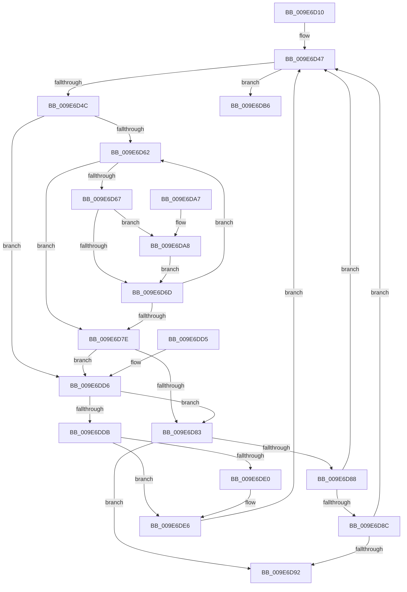

# PspValidateEnvironmentBlock

- RVA: `0x009E6D10`–`0x009E6DEF` (길이 `223` bytes)
- VA: `0x00000001409E6D10`
- 실행 섹션: `PAGE`
- PDB 이름 있음: `예`; PDB Function 태그: `아니요`
- unwind 정보 RVA: `0x000A47A4`
- 디코드: `68`개 명령, `223/223` bytes 표시
- 미해석 바이트: `0` (있으면 어셈블리에 `.byte`로 보존)

> 이 문서는 커널 이미지의 기계어와 PDB 기호를 분석해 생성했습니다. 4번과 5번은 함수 원형과 자료형을 바이너리 사용 방식에서 추정한 C 해석이며 원본 소스 복구 결과는 아닙니다.

## 1. Dependencies

- 직접 호출 지점: **0**; 고유 호출 대상: **0**
- 직접 호출자로 확인된 함수: **1**
- RIP 상대 이미지 참조: **0**

### Outgoing calls
- 직접 디코드된 call 명령이 없습니다.

### Direct callers
- [PspCaptureUserProcessParameters](PspCaptureUserProcessParameters_function_009E63C0.md) at `0x009E697B`

### Static image references
- 디코드된 RIP-relative 메모리 참조가 없습니다.

## 2. Other-region calls and transfers

- 다른 실행 섹션으로 향하는 call: **0**
- 별도 외부 분기/꼬리 이동을 확인하지 못했습니다.

## 3. Assembly (complete function range)

```asm
009E6D10  48 89 5C 24 08                  mov qword ptr [rsp + 8], rbx
009E6D15  48 89 74 24 10                  mov qword ptr [rsp + 0x10], rsi
009E6D1A  48 89 7C 24 18                  mov qword ptr [rsp + 0x18], rdi
009E6D1F  48 8B 02                        mov rax, qword ptr [rdx]
009E6D22  4C 8D 51 02                     lea r10, [rcx + 2]
009E6D26  44 0F B7 01                     movzx r8d, word ptr [rcx]
009E6D2A  40 32 FF                        xor dil, dil
009E6D2D  66 45 85 C0                     test r8w, r8w
009E6D31  48 8B DA                        mov rbx, rdx
009E6D34  4C 8D 48 FE                     lea r9, [rax - 2]
009E6D38  4C 0F 45 D1                     cmovne r10, rcx
009E6D3C  4C 0F 45 C8                     cmovne r9, rax
009E6D40  45 33 DB                        xor r11d, r11d
009E6D43  41 8D 73 01                     lea esi, [r11 + 1]
009E6D47  4D 85 C9                        test r9, r9
009E6D4A  74 6A                           je 0x1409e6db6
009E6D4C  41 0F B7 02                     movzx eax, word ptr [r10]
009E6D50  32 D2                           xor dl, dl
009E6D52  49 83 C2 02                     add r10, 2
009E6D56  4D 8B C3                        mov r8, r11
009E6D59  49 8B CB                        mov rcx, r11
009E6D5C  49 83 E9 02                     sub r9, 2
009E6D60  74 74                           je 0x1409e6dd6
009E6D62  66 85 C0                        test ax, ax
009E6D65  74 17                           je 0x1409e6d7e
009E6D67  66 83 F8 3D                     cmp ax, 0x3d
009E6D6B  74 3B                           je 0x1409e6da8
009E6D6D  41 0F B7 02                     movzx eax, word ptr [r10]
009E6D71  48 FF C1                        inc rcx
009E6D74  49 83 C2 02                     add r10, 2
009E6D78  49 83 E9 02                     sub r9, 2
009E6D7C  75 E4                           jne 0x1409e6d62
009E6D7E  48 85 C9                        test rcx, rcx
009E6D81  74 53                           je 0x1409e6dd6
009E6D83  4D 85 C0                        test r8, r8
009E6D86  74 0A                           je 0x1409e6d92
009E6D88  84 D2                           test dl, dl
009E6D8A  74 BB                           je 0x1409e6d47
009E6D8C  49 83 F8 02                     cmp r8, 2
009E6D90  73 B5                           jae 0x1409e6d47
009E6D92  B8 0D 00 00 C0                  mov eax, 0xc000000d
009E6D97  48 8B 5C 24 08                  mov rbx, qword ptr [rsp + 8]
009E6D9C  48 8B 74 24 10                  mov rsi, qword ptr [rsp + 0x10]
009E6DA1  48 8B 7C 24 18                  mov rdi, qword ptr [rsp + 0x18]
009E6DA6  C3                              ret
009E6DA7  CC                              int3
009E6DA8  49 FF C0                        inc r8
009E6DAB  0F B6 D2                        movzx edx, dl
009E6DAE  48 85 C9                        test rcx, rcx
009E6DB1  0F 44 D6                        cmove edx, esi
009E6DB4  EB B7                           jmp 0x1409e6d6d
009E6DB6  48 8B 5C 24 08                  mov rbx, qword ptr [rsp + 8]
009E6DBB  40 84 FF                        test dil, dil
009E6DBE  48 8B 74 24 10                  mov rsi, qword ptr [rsp + 0x10]
009E6DC3  B8 0D 00 00 C0                  mov eax, 0xc000000d
009E6DC8  48 8B 7C 24 18                  mov rdi, qword ptr [rsp + 0x18]
009E6DCD  44 0F 44 D8                     cmove r11d, eax
009E6DD1  41 8B C3                        mov eax, r11d
009E6DD4  C3                              ret
009E6DD5  CC                              int3
009E6DD6  66 85 C0                        test ax, ax
009E6DD9  75 A8                           jne 0x1409e6d83
009E6DDB  4D 85 C9                        test r9, r9
009E6DDE  74 06                           je 0x1409e6de6
009E6DE0  4C 29 0B                        sub qword ptr [rbx], r9
009E6DE3  4D 8B CB                        mov r9, r11
009E6DE6  40 0F B6 FE                     movzx edi, sil
009E6DEA  E9 58 FF FF FF                  jmp 0x1409e6d47
```

## 4. C-style interpretation (structured pseudocode)

```c
__int64 __fastcall PspValidateEnvironmentBlock(__int64 a1, __int64 a2)
{
    __int64 v_r10;
    __int64 v_r11;
    __int64 v_rdi;
    unsigned __int64 v_stack_p10;
    unsigned __int64 v_stack_p18;
    unsigned __int64 v_stack_p8;

    v_stack_p8 = v_rbx;
    v_stack_p10 = v_rsi;
    v_stack_p18 = v_rdi;
    v_rdi = 0;
    v_r10 = a1 + 2;
    if ((unsigned __int16)(*(unsigned __int16 *)(a1)) != 0) { v_r10 = a1; }
    a4 = *(unsigned __int64 *)(a2) - 2;
    if ((unsigned __int16)(*(unsigned __int16 *)(a1)) != 0) { a4 = *(unsigned __int64 *)(a2); }
    v_r11 = 0;
loc_009E6D47:
    if (a4 == 0) goto loc_009E6DB6;
    a2 = 0;
    v_r10 = (v_r10) + (2);
    a4 = (a4) - (2);
    if (condition_is_equal) goto loc_009E6DD6;
loc_009E6D62:
    if ((unsigned __int16)(*(unsigned __int16 *)(v_r10)) == 0) goto loc_009E6D7E;
    if (((unsigned __int16)(*(unsigned __int16 *)(v_r10))) == 61) goto loc_009E6DA8;
loc_009E6D6D:
    a1 = (0) + 1;
    v_r10 = (v_r10) + (2);
    a4 = (a4) - (2);
    if (condition_is_not_equal) goto loc_009E6D62;
loc_009E6D7E:
    if (a1 == 0) goto loc_009E6DD6;
loc_009E6D83:
    if (0 == 0) goto loc_009E6D92;
    if (0 == 0) goto loc_009E6D47;
    if (0 >= 2) goto loc_009E6D47;
loc_009E6D92:
    return (unsigned int)(0xC000000DULL);
loc_009E6DA8:
    a3 = (0) + 1;
    a2 = 0;
    if (a1 == 0) { a2 = (unsigned int)(v_stack_p10); }
    goto loc_009E6D6D;
loc_009E6DB6:
    if ((unsigned __int8)(v_stack_p18) == 0) { v_r11 = (unsigned int)((unsigned int)(0xC000000DULL)); }
    return (unsigned int)((unsigned int)(v_r11));
loc_009E6DD6:
    if ((unsigned __int16)((unsigned int)((unsigned int)(v_r11))) != 0) goto loc_009E6D83;
    if (a4 != 0) {
        a4 = v_r11;
    }
    goto loc_009E6D47;
}
```

## 5. (Beta) C Style

```c
int64_t PspValidateEnvironmentBlock(void *Arg1, void *Arg2)
{
    uint8_t *arg1 = (uint8_t *)Arg1;
    uint8_t *arg2 = (uint8_t *)Arg2;

    int64_t local_r10;
    int64_t local_r11;
    int64_t local_rdi;
    uint64_t v_stack_p10;
    uint64_t v_stack_p18;
    uint64_t v_stack_p8;

    v_stack_p8 = local_rbx;
    v_stack_p10 = local_rsi;
    v_stack_p18 = local_rdi;
    local_rdi = 0;
    local_r10 = Arg1 + 2;
    if ((uint16_t)(*(uint16_t *)(arg1)) != 0) { local_r10 = Arg1; }
    a4 = *(uint64_t *)(arg2) - 2;
    if ((uint16_t)(*(uint16_t *)(arg1)) != 0) { a4 = *(uint64_t *)(arg2); }
    local_r11 = 0;
loc_009E6D47:
    if (a4 == 0) goto loc_009E6DB6;
    Arg2 = 0;
    local_r10 = (local_r10) + (2);
    a4 = (a4) - (2);
    if (condition_is_equal) goto loc_009E6DD6;
loc_009E6D62:
    if ((uint16_t)(*(uint16_t *)(local_r10)) == 0) goto loc_009E6D7E;
    if (((uint16_t)(*(uint16_t *)(local_r10))) == 61) goto loc_009E6DA8;
loc_009E6D6D:
    Arg1 = (0) + 1;
    local_r10 = (local_r10) + (2);
    a4 = (a4) - (2);
    if (condition_is_not_equal) goto loc_009E6D62;
loc_009E6D7E:
    if (Arg1 == NULL) goto loc_009E6DD6;
loc_009E6D83:
    if (0 == 0) goto loc_009E6D92;
    if (0 == 0) goto loc_009E6D47;
    if (0 >= 2) goto loc_009E6D47;
loc_009E6D92:
    return (uint32_t)(0xC000000DULL);
loc_009E6DA8:
    a3 = (0) + 1;
    Arg2 = 0;
    if (Arg1 == NULL) { Arg2 = (uint32_t)(v_stack_p10); }
    goto loc_009E6D6D;
loc_009E6DB6:
    if ((uint8_t)(v_stack_p18) == 0) { local_r11 = (uint32_t)((uint32_t)(0xC000000DULL)); }
    return (uint32_t)((uint32_t)(local_r11));
loc_009E6DD6:
    if ((uint16_t)((uint32_t)((uint32_t)(local_r11))) != 0) goto loc_009E6D83;
    if (a4 != 0) {
        a4 = local_r11;
    }
    goto loc_009E6D47;
}
```

### 관측된 메모리 오프셋

구조체 형식이 확인되지 않은 접근은 인자 기준의 오프셋으로만 기록했습니다.

| 기준 인자 | 오프셋 표현 | 폭 (bit) | 접근 |
|---|---:|---:|---|
| `Arg1` | `+ 0x0` | `16` | `R` |
| `Arg1` | `+ 0x2` | `64` | `R` |
| `Arg2` | `+ 0x0` | `64` | `R` |
| `Arg2` | `+ 0x0` | `64` | `R/W` |

## 6. Execution-region graph

[열기: 2D/3D 그래프와 함수 탐색 컨트롤 패널](../../../control-panel.html?section=page&rva=0x009E6D10&view=graph)

- 2D 그래프는 위에서 아래로 흐르고, 3D 그래프는 빈 공간을 드래그해 회전합니다. Shift+드래그는 이동, 휠은 확대·축소, 함수 노드 선택은 대상 보고서 이동입니다.

### Static fallback


