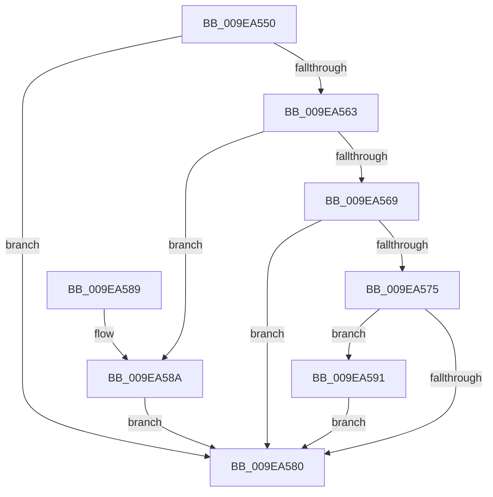

# RtlDowncaseUnicodeChar

- RVA: `0x009EA550`–`0x009EA5BC` (길이 `108` bytes)
- VA: `0x00000001409EA550`
- 실행 섹션: `PAGE`
- PDB 이름 있음: `예`; PDB Function 태그: `아니요`
- unwind 정보 RVA: `0x000A35EC`
- 디코드: `32`개 명령, `108/108` bytes 표시
- 미해석 바이트: `0` (있으면 어셈블리에 `.byte`로 보존)

> 이 문서는 커널 이미지의 기계어와 PDB 기호를 분석해 생성했습니다. 4번과 5번은 함수 원형과 자료형을 바이너리 사용 방식에서 추정한 C 해석이며 원본 소스 복구 결과는 아닙니다.

## 1. Dependencies

- 직접 호출 지점: **1**; 고유 호출 대상: **1**
- 직접 호출자로 확인된 함수: **0**
- RIP 상대 이미지 참조: **0**

### Outgoing calls
- `0x009EA558` → [PsGetCurrentServerSiloGlobals](../../text/2F/PsGetCurrentServerSiloGlobals_function_002FE1F0.md) (function, `0x002FE1F0`)

### Direct callers
- 이 함수 시작 RVA로 연결되는 직접 call은 확인되지 않았습니다. 간접 호출은 완전히 역산할 수 없습니다.

### Static image references
- 디코드된 RIP-relative 메모리 참조가 없습니다.

## 2. Other-region calls and transfers

- 다른 실행 섹션으로 향하는 call: **1**
  - `0x009EA558` → [PsGetCurrentServerSiloGlobals](../../text/2F/PsGetCurrentServerSiloGlobals_function_002FE1F0.md) (`PAGE` → `.text`)
- 별도 외부 분기/꼬리 이동을 확인하지 못했습니다.

## 3. Assembly (complete function range)

```asm
009EA550  48 83 EC 28                     sub rsp, 0x28
009EA554  44 0F B7 C1                     movzx r8d, cx
009EA558  E8 93 3C 91 FF                  call 0x1402fe1f0
009EA55D  41 83 F8 41                     cmp r8d, 0x41
009EA561  72 1D                           jb 0x1409ea580
009EA563  41 83 F8 5A                     cmp r8d, 0x5a
009EA567  76 21                           jbe 0x1409ea58a
009EA569  4C 8B 88 B8 04 00 00            mov r9, qword ptr [rax + 0x4b8]
009EA570  4D 85 C9                        test r9, r9
009EA573  74 0B                           je 0x1409ea580
009EA575  B8 C0 00 00 00                  mov eax, 0xc0
009EA57A  66 44 3B C0                     cmp r8w, ax
009EA57E  73 11                           jae 0x1409ea591
009EA580  41 0F B7 C0                     movzx eax, r8w
009EA584  48 83 C4 28                     add rsp, 0x28
009EA588  C3                              ret
009EA589  CC                              int3
009EA58A  66 41 83 C0 20                  add r8w, 0x20
009EA58F  EB EF                           jmp 0x1409ea580
009EA591  49 8B C0                        mov rax, r8
009EA594  41 8B D0                        mov edx, r8d
009EA597  48 C1 E8 08                     shr rax, 8
009EA59B  83 E2 0F                        and edx, 0xf
009EA59E  41 0F B7 0C 41                  movzx ecx, word ptr [r9 + rax*2]
009EA5A3  41 8B C0                        mov eax, r8d
009EA5A6  C1 E8 04                        shr eax, 4
009EA5A9  83 E0 0F                        and eax, 0xf
009EA5AC  03 C8                           add ecx, eax
009EA5AE  41 0F B7 0C 49                  movzx ecx, word ptr [r9 + rcx*2]
009EA5B3  03 CA                           add ecx, edx
009EA5B5  66 45 03 04 49                  add r8w, word ptr [r9 + rcx*2]
009EA5BA  EB C4                           jmp 0x1409ea580
```

## 4. C-style interpretation (structured pseudocode)

```c
__int64 __fastcall RtlDowncaseUnicodeChar(unsigned __int16 a1)
{
    __int64 result;
    __int64 v_rsp;

    v_rsp = (v_rsp) - (40);
    result = PsGetCurrentServerSiloGlobals(a1, a2, a1, a4);
    if (a1 < 65) goto loc_009EA580;
    if (a1 <= 90) goto loc_009EA58A;
    if (*(unsigned __int64 *)(result + 1208) == 0) goto loc_009EA580;
    if (a1 >= 192) goto loc_009EA591;
loc_009EA580:
    v_rsp = (v_rsp) + (40);
    return a1;
loc_009EA58A:
    a3 = (unsigned __int16)((a1) + (32));
    goto loc_009EA580;
loc_009EA591:
    result = (a3) >> (8);
    a2 = (unsigned int)(((unsigned int)((unsigned int)(a3))) & (15));
    result = (unsigned int)(((unsigned int)((unsigned int)(a3))) >> (4));
    result = (unsigned int)((result) & (15));
    a1 = (unsigned int)((*(unsigned __int16 *)(*(unsigned __int64 *)(result + 1208) + result * 2)) + ((unsigned int)(result)));
    a1 = (unsigned int)((*(unsigned __int16 *)(*(unsigned __int64 *)(result + 1208) + a1 * 2)) + ((unsigned int)(a2)));
    a3 = (unsigned __int16)((a3) + (*(unsigned __int16 *)(*(unsigned __int64 *)(result + 1208) + a1 * 2)));
    goto loc_009EA580;
}
```

## 5. (Beta) C Style

```c
int64_t RtlDowncaseUnicodeChar(uint16_t Arg1)
{
    int64_t result;
    int64_t local_rsp;

    local_rsp = (local_rsp) - (40);
    result = PsGetCurrentServerSiloGlobals(Arg1, a2, Arg1, a4);
    if (Arg1 < 65) goto loc_009EA580;
    if (Arg1 <= 90) goto loc_009EA58A;
    if (*(uint64_t *)(result + 0x4B8) == 0) goto loc_009EA580;
    if (Arg1 >= 192) goto loc_009EA591;
loc_009EA580:
    local_rsp = (local_rsp) + (40);
    return Arg1;
loc_009EA58A:
    a3 = (uint16_t)((Arg1) + (32));
    goto loc_009EA580;
loc_009EA591:
    result = (a3) >> (8);
    a2 = (uint32_t)(((uint32_t)((uint32_t)(a3))) & (15));
    result = (uint32_t)(((uint32_t)((uint32_t)(a3))) >> (4));
    result = (uint32_t)((result) & (15));
    Arg1 = (uint32_t)((*(uint16_t *)(*(uint64_t *)(result + 0x4B8) + result * 2)) + ((uint32_t)(result)));
    Arg1 = (uint32_t)((*(uint16_t *)(*(uint64_t *)(result + 0x4B8) + Arg1 * 2)) + ((uint32_t)(a2)));
    a3 = (uint16_t)((a3) + (*(uint16_t *)(*(uint64_t *)(result + 0x4B8) + Arg1 * 2)));
    goto loc_009EA580;
}
```

## 6. Execution-region graph

[열기: 2D/3D 그래프와 함수 탐색 컨트롤 패널](../../../control-panel.html?section=page&rva=0x009EA550&view=graph)

- 2D 그래프는 위에서 아래로 흐르고, 3D 그래프는 빈 공간을 드래그해 회전합니다. Shift+드래그는 이동, 휠은 확대·축소, 함수 노드 선택은 대상 보고서 이동입니다.

### Static fallback


