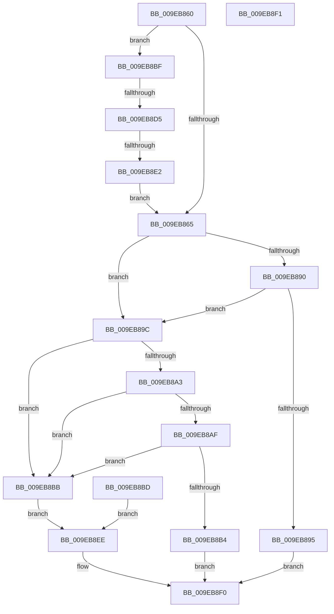

# RtlGuardIsValidStackPointer

- RVA: `0x009EB860`–`0x009EB8F2` (길이 `146` bytes)
- VA: `0x00000001409EB860`
- 실행 섹션: `PAGE`
- PDB 이름 있음: `예`; PDB Function 태그: `예`
- unwind 정보 RVA: `0x000A55EC`
- 디코드: `37`개 명령, `146/146` bytes 표시
- 미해석 바이트: `0` (있으면 어셈블리에 `.byte`로 보존)

> 이 문서는 커널 이미지의 기계어와 PDB 기호를 분석해 생성했습니다. 4번과 5번은 함수 원형과 자료형을 바이너리 사용 방식에서 추정한 C 해석이며 원본 소스 복구 결과는 아닙니다.

## 1. Dependencies

- 직접 호출 지점: **0**; 고유 호출 대상: **0**
- 직접 호출자로 확인된 함수: **2**
- RIP 상대 이미지 참조: **0**

### Outgoing calls
- 직접 디코드된 call 명령이 없습니다.

### Direct callers
- [KiContinuePreviousModeUser](../../text/2F/KiContinuePreviousModeUser_function_002F9B10.md) at `0x002F9D5A`
- [KeVerifyContextRecord](../../text/40/KeVerifyContextRecord_function_0040BE90.md) at `0x0040BEF3`

### Static image references
- 디코드된 RIP-relative 메모리 참조가 없습니다.

## 2. Other-region calls and transfers

- 다른 실행 섹션으로 향하는 call: **0**
- call이 아닌 외부 분기/꼬리 이동: **2**
  - `0x009EB8CF` → [sub_00B30AA6](../B3/Unknown_function_00B30AA6.md) (`tail-transfer`)
  - `0x009EB8DC` → [sub_00B30AA6](../B3/Unknown_function_00B30AA6.md) (`tail-transfer`)

## 3. Assembly (complete function range)

```asm
009EB860  48 85 D2                        test rdx, rdx
009EB863  74 5A                           je 0x1409eb8bf
009EB865  48 8B 82 78 14 00 00            mov rax, qword ptr [rdx + 0x1478]
009EB86C  48 89 44 24 20                  mov qword ptr [rsp + 0x20], rax
009EB871  48 8B 42 08                     mov rax, qword ptr [rdx + 8]
009EB875  48 89 44 24 10                  mov qword ptr [rsp + 0x10], rax
009EB87A  48 8B 42 10                     mov rax, qword ptr [rdx + 0x10]
009EB87E  48 89 44 24 18                  mov qword ptr [rsp + 0x18], rax
009EB883  48 8B D0                        mov rdx, rax
009EB886  48 8B 44 24 10                  mov rax, qword ptr [rsp + 0x10]
009EB88B  48 3B CA                        cmp rcx, rdx
009EB88E  72 0C                           jb 0x1409eb89c
009EB890  48 3B C8                        cmp rcx, rax
009EB893  77 07                           ja 0x1409eb89c
009EB895  B8 01 00 00 00                  mov eax, 1
009EB89A  EB 54                           jmp 0x1409eb8f0
009EB89C  48 3B 54 24 20                  cmp rdx, qword ptr [rsp + 0x20]
009EB8A1  74 18                           je 0x1409eb8bb
009EB8A3  48 81 EA 00 10 00 00            sub rdx, 0x1000
009EB8AA  48 3B CA                        cmp rcx, rdx
009EB8AD  72 0C                           jb 0x1409eb8bb
009EB8AF  48 3B C8                        cmp rcx, rax
009EB8B2  77 07                           ja 0x1409eb8bb
009EB8B4  B8 01 00 00 00                  mov eax, 1
009EB8B9  EB 35                           jmp 0x1409eb8f0
009EB8BB  EB 31                           jmp 0x1409eb8ee
009EB8BD  EB 2F                           jmp 0x1409eb8ee
009EB8BF  65 48 8B 14 25 88 01 00 00      mov rdx, qword ptr gs:[0x188]
009EB8C8  F7 42 74 00 04 00 00            test dword ptr [rdx + 0x74], 0x400
009EB8CF  0F 85 D1 51 14 00               jne 0x140b30aa6
009EB8D5  80 BA 4A 02 00 00 01            cmp byte ptr [rdx + 0x24a], 1
009EB8DC  0F 84 C4 51 14 00               je 0x140b30aa6
009EB8E2  48 8B 92 F0 00 00 00            mov rdx, qword ptr [rdx + 0xf0]
009EB8E9  E9 77 FF FF FF                  jmp 0x1409eb865
009EB8EE  33 C0                           xor eax, eax
009EB8F0  C3                              ret
009EB8F1  CC                              int3
```

## 4. C-style interpretation (structured pseudocode)

```c
__int64 __fastcall RtlGuardIsValidStackPointer(__int64 a1, __int64 a2)
{
    __int64 result;
    unsigned __int64 v_stack_p10;
    unsigned __int64 v_stack_p18;
    unsigned __int64 v_stack_p20;

    if (a2 == 0) goto loc_009EB8BF;
loc_009EB865:
    v_stack_p20 = *(unsigned __int64 *)(a2 + 5240);
    v_stack_p10 = *(unsigned __int64 *)(a2 + 8);
    v_stack_p18 = *(unsigned __int64 *)(a2 + 16);
    if (a1 < (*(unsigned __int64 *)(a2 + 16))) goto loc_009EB89C;
    if (a1 > v_stack_p10) goto loc_009EB89C;
    goto loc_009EB8F0;
loc_009EB89C:
    if ((*(unsigned __int64 *)(a2 + 16)) == v_stack_p20) goto loc_009EB8BB;
    a2 = (*(unsigned __int64 *)(a2 + 16)) - (0x1000ULL);
    if (a1 < a2) goto loc_009EB8BB;
    if (a1 > 1) goto loc_009EB8BB;
    goto loc_009EB8F0;
loc_009EB8BB:
    goto loc_009EB8EE;
loc_009EB8BF:
    goto loc_009EB865;
loc_009EB8EE:
    result = 0;
loc_009EB8F0:
    return result;
}
```

## 5. (Beta) C Style

```c
int64_t RtlGuardIsValidStackPointer(int64_t Arg1, int64_t Arg2)
{
    int64_t result;
    uint64_t v_stack_p10;
    uint64_t v_stack_p18;
    uint64_t v_stack_p20;

    if (Arg2 == 0) goto loc_009EB8BF;
loc_009EB865:
    v_stack_p20 = *(uint64_t *)(Arg2 + 0x1478);
    v_stack_p10 = *(uint64_t *)(Arg2 + 0x8);
    v_stack_p18 = *(uint64_t *)(Arg2 + 0x10);
    if (Arg1 < (*(uint64_t *)(Arg2 + 0x10))) goto loc_009EB89C;
    if (Arg1 > v_stack_p10) goto loc_009EB89C;
    goto loc_009EB8F0;
loc_009EB89C:
    if ((*(uint64_t *)(Arg2 + 0x10)) == v_stack_p20) goto loc_009EB8BB;
    Arg2 = (*(uint64_t *)(Arg2 + 0x10)) - (0x1000ULL);
    if (Arg1 < Arg2) goto loc_009EB8BB;
    if (Arg1 > 1) goto loc_009EB8BB;
    goto loc_009EB8F0;
loc_009EB8BB:
    goto loc_009EB8EE;
loc_009EB8BF:
    goto loc_009EB865;
loc_009EB8EE:
    result = 0;
loc_009EB8F0:
    return result;
}
```

## 6. Execution-region graph

[열기: 2D/3D 그래프와 함수 탐색 컨트롤 패널](../../../control-panel.html?section=page&rva=0x009EB860&view=graph)

- 2D 그래프는 위에서 아래로 흐르고, 3D 그래프는 빈 공간을 드래그해 회전합니다. Shift+드래그는 이동, 휠은 확대·축소, 함수 노드 선택은 대상 보고서 이동입니다.

### Static fallback


