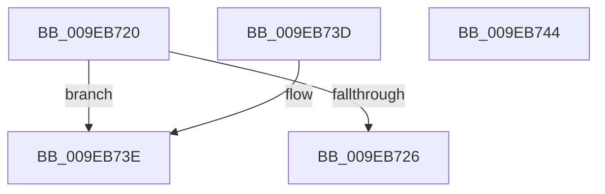

# RtlInitializeSid

- RVA: `0x009EB720`–`0x009EB745` (길이 `37` bytes)
- VA: `0x00000001409EB720`
- 실행 섹션: `PAGE`
- PDB 이름 있음: `예`; PDB Function 태그: `아니요`
- unwind 정보 RVA: `0x000DB714`
- 디코드: `14`개 명령, `37/37` bytes 표시
- 미해석 바이트: `0` (있으면 어셈블리에 `.byte`로 보존)

> 이 문서는 커널 이미지의 기계어와 PDB 기호를 분석해 생성했습니다. 4번과 5번은 함수 원형과 자료형을 바이너리 사용 방식에서 추정한 C 해석이며 원본 소스 복구 결과는 아닙니다.

## 1. Dependencies

- 직접 호출 지점: **0**; 고유 호출 대상: **0**
- 직접 호출자로 확인된 함수: **28**
- RIP 상대 이미지 참조: **0**

### Outgoing calls
- 직접 디코드된 call 명령이 없습니다.

### Direct callers
- [RtlInitializeSidEx](../../text/3A/RtlInitializeSidEx_function_003A5320.md) at `0x003A533A`
- [RtlDeriveCapabilitySidsFromName](../../text/47/RtlDeriveCapabilitySidsFromName_function_00474DC0.md) at `0x00474E61`
- [RtlDeriveCapabilitySidsFromName](../../text/47/RtlDeriveCapabilitySidsFromName_function_00474DC0.md) at `0x00474EBB`
- [RtlDeriveCapabilitySidsFromName](../../text/47/RtlDeriveCapabilitySidsFromName_function_00474DC0.md) at `0x00474EE6`
- [SepAppIdentityFromHash](../../text/60/SepAppIdentityFromHash_function_006079E4.md) at `0x00607A46`
- [SepAppSuiteFromHash](../../text/60/SepAppSuiteFromHash_function_00607F3C.md) at `0x00607F97`
- [SepAllocateInstanceSid](../../text/60/SepAllocateInstanceSid_function_0060A788.md) at `0x0060A7DF`
- [WdipAccessCheck](../../text/64/WdipAccessCheck_function_0064E084.md) at `0x0064E120`
- [PiAuAllocateAndInitializeSid](../73/PiAuAllocateAndInitializeSid_function_00731200.md) at `0x0073124A`
- [PiAuCheckClientInteractive](../73/PiAuCheckClientInteractive_function_00731284.md) at `0x007312DE`
- [PopCreateHiberFileSecurityDescriptor](../75/PopCreateHiberFileSecurityDescriptor_function_0075D3DC.md) at `0x0075D42D`
- [RtlGetAppContainerParent](../78/RtlGetAppContainerParent_function_0078E4A0.md) at `0x0078E511`
- [InitializeSidLookupTable](../7A/InitializeSidLookupTable_function_007A4B90.md) at `0x007A4C5E`
- [InitializeSidLookupTable](../7A/InitializeSidLookupTable_function_007A4B90.md) at `0x007A4C81`
- [InitializeSidLookupTable](../7A/InitializeSidLookupTable_function_007A4B90.md) at `0x007A4CB7`
- [InitializeSidLookupTable](../7A/InitializeSidLookupTable_function_007A4B90.md) at `0x007A4CE0`
- [InitializeSidLookupTable](../7A/InitializeSidLookupTable_function_007A4B90.md) at `0x007A4D19`
- [SmKmStoreFileMakeSecurityDescriptor](../7A/SmKmStoreFileMakeSecurityDescriptor_function_007A9988.md) at `0x007A99FB`
- [SmKmStoreFileMakeSecurityDescriptor](../7A/SmKmStoreFileMakeSecurityDescriptor_function_007A9988.md) at `0x007A9A39`
- [SmKmStoreFileMakeSecurityDescriptor](../7A/SmKmStoreFileMakeSecurityDescriptor_function_007A9988.md) at `0x007A9A7A`
- [NtSetUuidSeed](../7D/NtSetUuidSeed_function_007D0DD0.md) at `0x007D0EC5`
- [CMFCreateSecurityDescriptor](../7D/CMFCreateSecurityDescriptor_function_007D2B10.md) at `0x007D2BD8`
- [CMFCreateSecurityDescriptor](../7D/CMFCreateSecurityDescriptor_function_007D2B10.md) at `0x007D2C3A`
- [CMFCreateSecurityDescriptor](../7D/CMFCreateSecurityDescriptor_function_007D2B10.md) at `0x007D2CED`
- [CMFCreateSecurityDescriptor](../7D/CMFCreateSecurityDescriptor_function_007D2B10.md) at `0x007D2D58`
- [CMFCreateSecurityDescriptor](../7D/CMFCreateSecurityDescriptor_function_007D2B10.md) at `0x007D2DC1`
- [CmpAdminSystemSecurityDescriptor](../7E/CmpAdminSystemSecurityDescriptor_function_007EBED8.md) at `0x007EBF58`
- [CmpAdminSystemSecurityDescriptor](../7E/CmpAdminSystemSecurityDescriptor_function_007EBED8.md) at `0x007EBF70`
- [CmpHiveRootSecurityDescriptor](../7E/CmpHiveRootSecurityDescriptor_function_007ED104.md) at `0x007ED20F`
- [CmpHiveRootSecurityDescriptor](../7E/CmpHiveRootSecurityDescriptor_function_007ED104.md) at `0x007ED226`
- [CmpHiveRootSecurityDescriptor](../7E/CmpHiveRootSecurityDescriptor_function_007ED104.md) at `0x007ED23D`
- [CmpHiveRootSecurityDescriptor](../7E/CmpHiveRootSecurityDescriptor_function_007ED104.md) at `0x007ED254`
- [CmpHiveRootSecurityDescriptor](../7E/CmpHiveRootSecurityDescriptor_function_007ED104.md) at `0x007ED26B`
- [PnpGetEnumSecurityDescriptor](../83/PnpGetEnumSecurityDescriptor_function_00831FCC.md) at `0x00832032`
- [PnpGetEnumSecurityDescriptor](../83/PnpGetEnumSecurityDescriptor_function_00831FCC.md) at `0x0083206C`
- [PnpGetEnumSecurityDescriptor](../83/PnpGetEnumSecurityDescriptor_function_00831FCC.md) at `0x008320A6`
- [PnpGetEnumSecurityDescriptor](../83/PnpGetEnumSecurityDescriptor_function_00831FCC.md) at `0x008320E0`
- [DrvDbGetSecurityDescriptor](../83/DrvDbGetSecurityDescriptor_function_0083580C.md) at `0x0083588D`
- [DrvDbGetSecurityDescriptor](../83/DrvDbGetSecurityDescriptor_function_0083580C.md) at `0x008358DD`
- [DrvDbGetSecurityDescriptor](../83/DrvDbGetSecurityDescriptor_function_0083580C.md) at `0x0083592D`
- [DrvDbGetSecurityDescriptor](../83/DrvDbGetSecurityDescriptor_function_0083580C.md) at `0x00835983`
- [SysCtxRegOpenCurrentUserKey](../8F/SysCtxRegOpenCurrentUserKey_function_008F455C.md) at `0x008F4692`
- [ExpFirmwareAccessAppContainerCheck](../AB/ExpFirmwareAccessAppContainerCheck_function_00AB7AFC.md) at `0x00AB7C9C`
- [sub_00B37578](../B3/Unknown_function_00B37578.md) at `0x00B37584`
- [sub_00B37784](../B3/Unknown_function_00B37784.md) at `0x00B377C3`
- [sub_00B37784](../B3/Unknown_function_00B37784.md) at `0x00B3781C`
- [IopCreateUmdfDirectory](../../init/C2/IopCreateUmdfDirectory_function_00C2C818.md) at `0x00C2C8A5`
- [PopCreateTimebrokerServiceSid](../../init/C3/PopCreateTimebrokerServiceSid_function_00C3D2C8.md) at `0x00C3D314`
- [PopNetInitialize](../../init/C4/PopNetInitialize_function_00C423AC.md) at `0x00C4240A`
- [PspInitializeCpuPartitionsDefaultSd](../../init/C4/PspInitializeCpuPartitionsDefaultSd_function_00C457D4.md) at `0x00C4585C`
- [PspInitializeCpuPartitionsDefaultSd](../../init/C4/PspInitializeCpuPartitionsDefaultSd_function_00C457D4.md) at `0x00C4587D`
- [SepVariableInitialization](../../init/C4/SepVariableInitialization_function_00C483A4.md) at `0x00C4886B`
- [SepVariableInitialization](../../init/C4/SepVariableInitialization_function_00C483A4.md) at `0x00C4887D`
- [SepVariableInitialization](../../init/C4/SepVariableInitialization_function_00C483A4.md) at `0x00C4888D`
- [SepVariableInitialization](../../init/C4/SepVariableInitialization_function_00C483A4.md) at `0x00C4889F`
- [SepVariableInitialization](../../init/C4/SepVariableInitialization_function_00C483A4.md) at `0x00C488B1`
- [SepVariableInitialization](../../init/C4/SepVariableInitialization_function_00C483A4.md) at `0x00C488C3`
- [SepVariableInitialization](../../init/C4/SepVariableInitialization_function_00C483A4.md) at `0x00C488D5`
- [SepVariableInitialization](../../init/C4/SepVariableInitialization_function_00C483A4.md) at `0x00C488E7`
- [SepVariableInitialization](../../init/C4/SepVariableInitialization_function_00C483A4.md) at `0x00C493D4`
- [SepVariableInitialization](../../init/C4/SepVariableInitialization_function_00C483A4.md) at `0x00C493EA`
- [SepVariableInitialization](../../init/C4/SepVariableInitialization_function_00C483A4.md) at `0x00C493FE`
- [SepVariableInitialization](../../init/C4/SepVariableInitialization_function_00C483A4.md) at `0x00C49411`
- [SepVariableInitialization](../../init/C4/SepVariableInitialization_function_00C483A4.md) at `0x00C49424`
- [SepVariableInitialization](../../init/C4/SepVariableInitialization_function_00C483A4.md) at `0x00C49437`
- [SepVariableInitialization](../../init/C4/SepVariableInitialization_function_00C483A4.md) at `0x00C4944A`
- [SepVariableInitialization](../../init/C4/SepVariableInitialization_function_00C483A4.md) at `0x00C4945D`
- [SepVariableInitialization](../../init/C4/SepVariableInitialization_function_00C483A4.md) at `0x00C49470`
- [SepVariableInitialization](../../init/C4/SepVariableInitialization_function_00C483A4.md) at `0x00C49483`
- [SepVariableInitialization](../../init/C4/SepVariableInitialization_function_00C483A4.md) at `0x00C49497`
- [SepVariableInitialization](../../init/C4/SepVariableInitialization_function_00C483A4.md) at `0x00C494AB`
- [SepVariableInitialization](../../init/C4/SepVariableInitialization_function_00C483A4.md) at `0x00C494BF`
- [SepVariableInitialization](../../init/C4/SepVariableInitialization_function_00C483A4.md) at `0x00C494D3`
- [SepVariableInitialization](../../init/C4/SepVariableInitialization_function_00C483A4.md) at `0x00C494E7`
- [SepVariableInitialization](../../init/C4/SepVariableInitialization_function_00C483A4.md) at `0x00C494FB`
- [SepVariableInitialization](../../init/C4/SepVariableInitialization_function_00C483A4.md) at `0x00C4950F`
- [SepVariableInitialization](../../init/C4/SepVariableInitialization_function_00C483A4.md) at `0x00C49523`
- [SepVariableInitialization](../../init/C4/SepVariableInitialization_function_00C483A4.md) at `0x00C49537`
- [SepVariableInitialization](../../init/C4/SepVariableInitialization_function_00C483A4.md) at `0x00C49549`
- [SepVariableInitialization](../../init/C4/SepVariableInitialization_function_00C483A4.md) at `0x00C4955B`
- [SepVariableInitialization](../../init/C4/SepVariableInitialization_function_00C483A4.md) at `0x00C4956D`
- [SepVariableInitialization](../../init/C4/SepVariableInitialization_function_00C483A4.md) at `0x00C49583`
- [SepVariableInitialization](../../init/C4/SepVariableInitialization_function_00C483A4.md) at `0x00C49597`
- [SepVariableInitialization](../../init/C4/SepVariableInitialization_function_00C483A4.md) at `0x00C495AA`
- [SepVariableInitialization](../../init/C4/SepVariableInitialization_function_00C483A4.md) at `0x00C495BD`
- [SepVariableInitialization](../../init/C4/SepVariableInitialization_function_00C483A4.md) at `0x00C495D0`
- [SepVariableInitialization](../../init/C4/SepVariableInitialization_function_00C483A4.md) at `0x00C495E3`
- [SepVariableInitialization](../../init/C4/SepVariableInitialization_function_00C483A4.md) at `0x00C495F4`
- [SepVariableInitialization](../../init/C4/SepVariableInitialization_function_00C483A4.md) at `0x00C49605`
- [SepVariableInitialization](../../init/C4/SepVariableInitialization_function_00C483A4.md) at `0x00C49615`
- [SepVariableInitialization](../../init/C4/SepVariableInitialization_function_00C483A4.md) at `0x00C49625`
- [SepVariableInitialization](../../init/C4/SepVariableInitialization_function_00C483A4.md) at `0x00C49648`
- [SepVariableInitialization](../../init/C4/SepVariableInitialization_function_00C483A4.md) at `0x00C49664`
- [SepVariableInitialization](../../init/C4/SepVariableInitialization_function_00C483A4.md) at `0x00C4967A`
- [SepVariableInitialization](../../init/C4/SepVariableInitialization_function_00C483A4.md) at `0x00C49690`
- [SepVariableInitialization](../../init/C4/SepVariableInitialization_function_00C483A4.md) at `0x00C496A6`
- [SepVariableInitialization](../../init/C4/SepVariableInitialization_function_00C483A4.md) at `0x00C496BC`
- [SepVariableInitialization](../../init/C4/SepVariableInitialization_function_00C483A4.md) at `0x00C496D2`
- [SepVariableInitialization](../../init/C4/SepVariableInitialization_function_00C483A4.md) at `0x00C496E8`
- [SepVariableInitialization](../../init/C4/SepVariableInitialization_function_00C483A4.md) at `0x00C496FE`
- [SepVariableInitialization](../../init/C4/SepVariableInitialization_function_00C483A4.md) at `0x00C4970E`
- [SepVariableInitialization](../../init/C4/SepVariableInitialization_function_00C483A4.md) at `0x00C49C38`
- [CmpInitializeTrustedInstallerSid](../../init/C5/CmpInitializeTrustedInstallerSid_function_00C5B108.md) at `0x00C5B150`

### Static image references
- 디코드된 RIP-relative 메모리 참조가 없습니다.

## 2. Other-region calls and transfers

- 다른 실행 섹션으로 향하는 call: **0**
- 별도 외부 분기/꼬리 이동을 확인하지 못했습니다.

## 3. Assembly (complete function range)

```asm
009EB720  41 80 F8 0F                     cmp r8b, 0xf
009EB724  77 18                           ja 0x1409eb73e
009EB726  44 88 41 01                     mov byte ptr [rcx + 1], r8b
009EB72A  C6 01 01                        mov byte ptr [rcx], 1
009EB72D  8B 02                           mov eax, dword ptr [rdx]
009EB72F  89 41 02                        mov dword ptr [rcx + 2], eax
009EB732  0F B7 42 04                     movzx eax, word ptr [rdx + 4]
009EB736  66 89 41 06                     mov word ptr [rcx + 6], ax
009EB73A  33 C0                           xor eax, eax
009EB73C  C3                              ret
009EB73D  CC                              int3
009EB73E  B8 0D 00 00 C0                  mov eax, 0xc000000d
009EB743  C3                              ret
009EB744  CC                              int3
```

## 4. C-style interpretation (structured pseudocode)

```c
__int64 __fastcall RtlInitializeSid(__int64 a1, __int64 a2, unsigned __int8 a3)
{
    __int64 result;

    if (a3 > 15) goto loc_009EB73E;
    *(unsigned __int8 *)(a1 + 1) = a3;
    *(unsigned __int8 *)(a1) = 1;
    *(unsigned int *)(a1 + 2) = (unsigned int)((unsigned int)(*(unsigned int *)(a2)));
    *(unsigned __int16 *)(a1 + 6) = (unsigned __int16)(*(unsigned __int16 *)(a2 + 4));
    result = 0;
    return result;
loc_009EB73E:
    return (unsigned int)(0xC000000DULL);
}
```

## 5. (Beta) C Style

```c
int64_t RtlInitializeSid(void *Sid, void *Arg2, uint8_t Arg3)
{
    uint8_t *sid = (uint8_t *)Sid;
    uint8_t *arg2 = (uint8_t *)Arg2;

    int64_t result;

    if (Arg3 > 15) goto loc_009EB73E;
    *(uint8_t *)(sid + 0x1) = Arg3;
    *(uint8_t *)(sid) = 1;
    *(uint32_t *)(sid + 0x2) = (uint32_t)((uint32_t)(*(uint32_t *)(arg2)));
    *(uint16_t *)(sid + 0x6) = (uint16_t)(*(uint16_t *)(arg2 + 0x4));
    result = 0;
    return result;
loc_009EB73E:
    return (uint32_t)(0xC000000DULL);
}
```

### 관측된 메모리 오프셋

구조체 형식이 확인되지 않은 접근은 인자 기준의 오프셋으로만 기록했습니다.

| 기준 인자 | 오프셋 표현 | 폭 (bit) | 접근 |
|---|---:|---:|---|
| `Sid` | `+ 0x0` | `8` | `W` |
| `Sid` | `+ 0x1` | `8` | `W` |
| `Sid` | `+ 0x2` | `32` | `W` |
| `Sid` | `+ 0x6` | `16` | `W` |
| `Arg2` | `+ 0x0` | `32` | `R` |
| `Arg2` | `+ 0x4` | `16` | `R` |

## 6. Execution-region graph

[열기: 2D/3D 그래프와 함수 탐색 컨트롤 패널](../../../control-panel.html?section=page&rva=0x009EB720&view=graph)

- 2D 그래프는 위에서 아래로 흐르고, 3D 그래프는 빈 공간을 드래그해 회전합니다. Shift+드래그는 이동, 휠은 확대·축소, 함수 노드 선택은 대상 보고서 이동입니다.

### Static fallback


