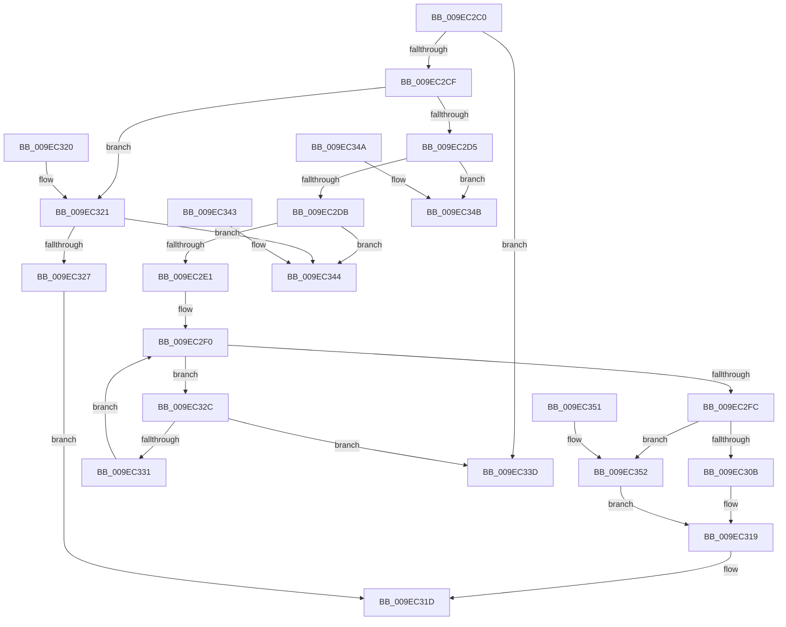

# RtlQueryInformationAcl

- RVA: `0x009EC2C0`–`0x009EC35C` (길이 `156` bytes)
- VA: `0x00000001409EC2C0`
- 실행 섹션: `PAGE`
- PDB 이름 있음: `예`; PDB Function 태그: `아니요`
- unwind 정보 RVA: `0x000DB714`
- 디코드: `54`개 명령, `156/156` bytes 표시
- 미해석 바이트: `0` (있으면 어셈블리에 `.byte`로 보존)

> 이 문서는 커널 이미지의 기계어와 PDB 기호를 분석해 생성했습니다. 4번과 5번은 함수 원형과 자료형을 바이너리 사용 방식에서 추정한 C 해석이며 원본 소스 복구 결과는 아닙니다.

## 1. Dependencies

- 직접 호출 지점: **0**; 고유 호출 대상: **0**
- 직접 호출자로 확인된 함수: **2**
- RIP 상대 이미지 참조: **0**

### Outgoing calls
- 직접 디코드된 call 명령이 없습니다.

### Direct callers
- [SepAppendAceToTokenDefaultDacl](../../text/40/SepAppendAceToTokenDefaultDacl_function_004002F8.md) at `0x0040036C`
- [SepAppendAceToTokenDefaultDacl](../../text/40/SepAppendAceToTokenDefaultDacl_function_004002F8.md) at `0x0040038B`
- [sub_00400840](../../text/40/Unknown_function_00400840.md) at `0x004009BD`
- [sub_00400840](../../text/40/Unknown_function_00400840.md) at `0x004009DF`

### Static image references
- 디코드된 RIP-relative 메모리 참조가 없습니다.

## 2. Other-region calls and transfers

- 다른 실행 섹션으로 향하는 call: **0**
- 별도 외부 분기/꼬리 이동을 확인하지 못했습니다.

## 3. Assembly (complete function range)

```asm
009EC2C0  44 0F B6 11                     movzx r10d, byte ptr [rcx]
009EC2C4  4C 8B DA                        mov r11, rdx
009EC2C7  41 8D 42 FE                     lea eax, [r10 - 2]
009EC2CB  3C 02                           cmp al, 2
009EC2CD  77 6E                           ja 0x1409ec33d
009EC2CF  41 83 E9 01                     sub r9d, 1
009EC2D3  74 4C                           je 0x1409ec321
009EC2D5  41 83 F9 01                     cmp r9d, 1
009EC2D9  75 70                           jne 0x1409ec34b
009EC2DB  41 83 F8 0C                     cmp r8d, 0xc
009EC2DF  72 63                           jb 0x1409ec344
009EC2E1  44 0F B7 51 04                  movzx r10d, word ptr [rcx + 4]
009EC2E6  48 8D 51 08                     lea rdx, [rcx + 8]
009EC2EA  45 33 C0                        xor r8d, r8d
009EC2ED  45 8B C8                        mov r9d, r8d
009EC2F0  0F B7 41 02                     movzx eax, word ptr [rcx + 2]
009EC2F4  48 03 C1                        add rax, rcx
009EC2F7  45 3B CA                        cmp r9d, r10d
009EC2FA  72 30                           jb 0x1409ec32c
009EC2FC  48 3B D0                        cmp rdx, rax
009EC2FF  45 89 13                        mov dword ptr [r11], r10d
009EC302  49 0F 47 D0                     cmova rdx, r8
009EC306  48 85 D2                        test rdx, rdx
009EC309  74 47                           je 0x1409ec352
009EC30B  2B D1                           sub edx, ecx
009EC30D  41 89 53 04                     mov dword ptr [r11 + 4], edx
009EC311  44 0F B7 41 02                  movzx r8d, word ptr [rcx + 2]
009EC316  44 2B C2                        sub r8d, edx
009EC319  45 89 43 08                     mov dword ptr [r11 + 8], r8d
009EC31D  33 C0                           xor eax, eax
009EC31F  C3                              ret
009EC320  CC                              int3
009EC321  41 83 F8 04                     cmp r8d, 4
009EC325  72 1D                           jb 0x1409ec344
009EC327  44 89 12                        mov dword ptr [rdx], r10d
009EC32A  EB F1                           jmp 0x1409ec31d
009EC32C  48 3B D0                        cmp rdx, rax
009EC32F  73 0C                           jae 0x1409ec33d
009EC331  0F B7 42 02                     movzx eax, word ptr [rdx + 2]
009EC335  41 FF C1                        inc r9d
009EC338  48 03 D0                        add rdx, rax
009EC33B  EB B3                           jmp 0x1409ec2f0
009EC33D  B8 0D 00 00 C0                  mov eax, 0xc000000d
009EC342  C3                              ret
009EC343  CC                              int3
009EC344  B8 23 00 00 C0                  mov eax, 0xc0000023
009EC349  C3                              ret
009EC34A  CC                              int3
009EC34B  B8 03 00 00 C0                  mov eax, 0xc0000003
009EC350  C3                              ret
009EC351  CC                              int3
009EC352  0F B7 41 02                     movzx eax, word ptr [rcx + 2]
009EC356  41 89 43 04                     mov dword ptr [r11 + 4], eax
009EC35A  EB BD                           jmp 0x1409ec319
```

## 4. C-style interpretation (structured pseudocode)

```c
__int64 __fastcall RtlQueryInformationAcl(__int64 a1, __int64 a2, int a3, int a4)
{
    __int64 result;

    if (((unsigned __int8)(*(unsigned __int8 *)(a1) - 2)) > 2) goto loc_009EC33D;
    a4 = (unsigned int)((a4) - (1));
    if (condition_is_equal) goto loc_009EC321;
    if (a4 != 1) goto loc_009EC34B;
    if (a3 < 12) goto loc_009EC344;
    a3 = 0;
loc_009EC2F0:
    result = (*(unsigned __int16 *)(a1 + 2)) + (a1);
    if (0 < ((unsigned int)(*(unsigned __int16 *)(a1 + 4)))) goto loc_009EC32C;
    *(unsigned int *)(a2) = (unsigned int)(*(unsigned __int16 *)(a1 + 4));
    a2 = a1 + 8;
    if ((a1 + 8) > result) { a2 = 0; }
    if (a2 == 0) goto loc_009EC352;
    a2 = (unsigned int)((a2) - ((unsigned int)(a1)));
    *(unsigned int *)(a2 + 4) = (unsigned int)(a2);
    a3 = (unsigned int)((*(unsigned __int16 *)(a1 + 2)) - ((unsigned int)(a2)));
loc_009EC319:
    *(unsigned int *)(a2 + 8) = a3;
loc_009EC31D:
    result = 0;
    return result;
loc_009EC321:
    if (a3 < 4) goto loc_009EC344;
    *(unsigned int *)(a2) = (unsigned int)(*(unsigned __int16 *)(a1 + 4));
    goto loc_009EC31D;
loc_009EC32C:
    if (a2 >= 0) goto loc_009EC33D;
    a4 = (unsigned int)((0) + 1);
    a2 = (a2) + (*(unsigned __int16 *)(a2 + 2));
    goto loc_009EC2F0;
loc_009EC33D:
    return (unsigned int)(0xC000000DULL);
loc_009EC344:
    return (unsigned int)(0xC0000023ULL);
loc_009EC34B:
    return (unsigned int)(0xC0000003ULL);
loc_009EC352:
    *(unsigned int *)(a2 + 4) = (unsigned int)(*(unsigned __int16 *)(a1 + 2));
    goto loc_009EC319;
}
```

## 5. (Beta) C Style

```c
int64_t RtlQueryInformationAcl(void *Arg1, void *Arg2, int32_t Arg3, int32_t Arg4)
{
    uint8_t *arg1 = (uint8_t *)Arg1;
    uint8_t *arg2 = (uint8_t *)Arg2;

    int64_t result;

    if (((uint8_t)(*(uint8_t *)(arg1) - 2)) > 2) goto loc_009EC33D;
    Arg4 = (uint32_t)((Arg4) - (1));
    if (condition_is_equal) goto loc_009EC321;
    if (Arg4 != 1) goto loc_009EC34B;
    if (Arg3 < 12) goto loc_009EC344;
    Arg3 = 0;
loc_009EC2F0:
    result = (*(uint16_t *)(arg1 + 0x2)) + (Arg1);
    if (0 < ((uint32_t)(*(uint16_t *)(arg1 + 0x4)))) goto loc_009EC32C;
    *(uint32_t *)(arg2) = (uint32_t)(*(uint16_t *)(arg1 + 0x4));
    Arg2 = Arg1 + 8;
    if ((Arg1 + 8) > result) { Arg2 = 0; }
    if (Arg2 == NULL) goto loc_009EC352;
    Arg2 = (uint32_t)((Arg2) - ((uint32_t)(Arg1)));
    *(uint32_t *)(arg2 + 0x4) = (uint32_t)(Arg2);
    Arg3 = (uint32_t)((*(uint16_t *)(arg1 + 0x2)) - ((uint32_t)(Arg2)));
loc_009EC319:
    *(uint32_t *)(arg2 + 0x8) = Arg3;
loc_009EC31D:
    result = 0;
    return result;
loc_009EC321:
    if (Arg3 < 4) goto loc_009EC344;
    *(uint32_t *)(arg2) = (uint32_t)(*(uint16_t *)(arg1 + 0x4));
    goto loc_009EC31D;
loc_009EC32C:
    if (Arg2 >= 0) goto loc_009EC33D;
    Arg4 = (uint32_t)((0) + 1);
    Arg2 = (Arg2) + (*(uint16_t *)(arg2 + 0x2));
    goto loc_009EC2F0;
loc_009EC33D:
    return (uint32_t)(0xC000000DULL);
loc_009EC344:
    return (uint32_t)(0xC0000023ULL);
loc_009EC34B:
    return (uint32_t)(0xC0000003ULL);
loc_009EC352:
    *(uint32_t *)(arg2 + 0x4) = (uint32_t)(*(uint16_t *)(arg1 + 0x2));
    goto loc_009EC319;
}
```

### 관측된 메모리 오프셋

구조체 형식이 확인되지 않은 접근은 인자 기준의 오프셋으로만 기록했습니다.

| 기준 인자 | 오프셋 표현 | 폭 (bit) | 접근 |
|---|---:|---:|---|
| `Arg1` | `+ 0x0` | `8` | `R` |
| `Arg1` | `+ 0x2` | `16` | `R` |
| `Arg1` | `+ 0x4` | `16` | `R` |
| `Arg1` | `+ 0x8` | `64` | `R` |
| `Arg2` | `+ 0x0` | `32` | `W` |
| `Arg2` | `+ 0x4` | `32` | `W` |
| `Arg2` | `+ 0x8` | `32` | `W` |

## 6. Execution-region graph

[열기: 2D/3D 그래프와 함수 탐색 컨트롤 패널](../../../control-panel.html?section=page&rva=0x009EC2C0&view=graph)

- 2D 그래프는 위에서 아래로 흐르고, 3D 그래프는 빈 공간을 드래그해 회전합니다. Shift+드래그는 이동, 휠은 확대·축소, 함수 노드 선택은 대상 보고서 이동입니다.

### Static fallback


