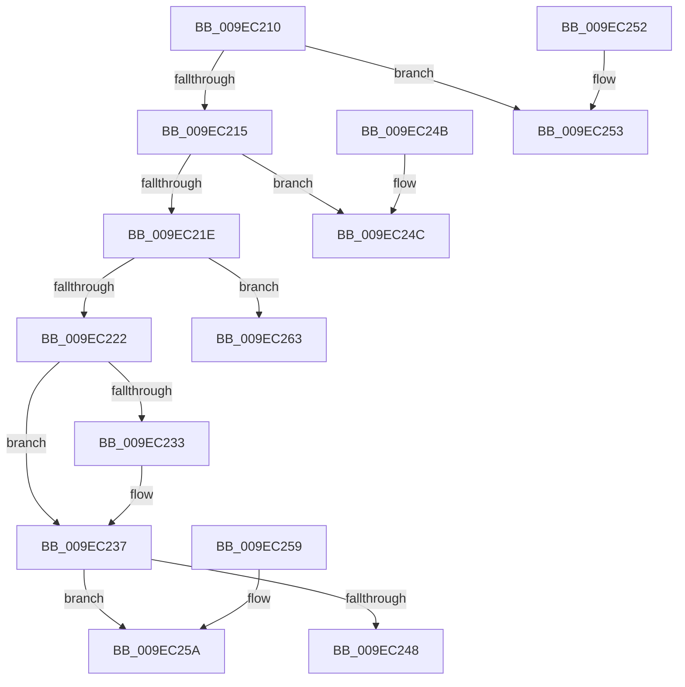

# RtlSetDaclSecurityDescriptor

- RVA: `0x009EC210`–`0x009EC270` (길이 `96` bytes)
- VA: `0x00000001409EC210`
- 실행 섹션: `PAGE`
- PDB 이름 있음: `예`; PDB Function 태그: `예`
- unwind 정보 RVA: `0x000DB714`
- 디코드: `31`개 명령, `96/96` bytes 표시
- 미해석 바이트: `0` (있으면 어셈블리에 `.byte`로 보존)

> 이 문서는 커널 이미지의 기계어와 PDB 기호를 분석해 생성했습니다. 4번과 5번은 함수 원형과 자료형을 바이너리 사용 방식에서 추정한 C 해석이며 원본 소스 복구 결과는 아닙니다.

## 1. Dependencies

- 직접 호출 지점: **0**; 고유 호출 대상: **0**
- 직접 호출자로 확인된 함수: **53**
- RIP 상대 이미지 참조: **0**

### Outgoing calls
- 직접 디코드된 call 명령이 없습니다.

### Direct callers
- [RtlCheckTokenCapability](../../text/3A/RtlCheckTokenCapability_function_003A5520.md) at `0x003A5703`
- [RtlCheckTokenMembershipEx](../../text/3A/RtlCheckTokenMembershipEx_function_003A5A30.md) at `0x003A5B99`
- [AdtpBuildAccessReasonAuditStringInternal](../../text/40/AdtpBuildAccessReasonAuditStringInternal_function_0040F344.md) at `0x0040F716`
- [SepBuildCapeSecurityDescriptor](../../text/4D/SepBuildCapeSecurityDescriptor_function_004D9E38.md) at `0x004D9EA4`
- [SepInitProcessAuditSd](../../text/60/SepInitProcessAuditSd_function_00606230.md) at `0x0060645C`
- [WdipAccessCheck](../../text/64/WdipAccessCheck_function_0064E084.md) at `0x0064E245`
- [ExpPlRunOnceInit](../../text/65/ExpPlRunOnceInit_function_006571E0.md) at `0x00657245`
- [DbgkpCreateNotificationEvent](../71/DbgkpCreateNotificationEvent_function_00710480.md) at `0x00710698`
- [PiAuCheckTokenMembership](../73/PiAuCheckTokenMembership_function_00731348.md) at `0x0073144A`
- [PiAuGetServiceStateSecurityObject](../73/PiAuGetServiceStateSecurityObject_function_007314F0.md) at `0x0073165B`
- [PiAuGetStateDirectorySecurityObject](../73/PiAuGetStateDirectorySecurityObject_function_00731738.md) at `0x0073193B`
- [ObCreateKernelObjectsSD](../74/ObCreateKernelObjectsSD_function_0074D7A8.md) at `0x0074D8C8`
- [ObpGetDosDevicesProtection](../74/ObpGetDosDevicesProtection_function_0074E2BC.md) at `0x0074E563`
- [PfpCreateEventInternal](../75/PfpCreateEventInternal_function_00753480.md) at `0x007535B5`
- [PopCreateHiberFileSecurityDescriptor](../75/PopCreateHiberFileSecurityDescriptor_function_0075D3DC.md) at `0x0075D519`
- [PspSessionObjectCreate](../78/PspSessionObjectCreate_function_007892A8.md) at `0x007893E9`
- [RtlpSysVolCheckOwnerAndSecurity](../79/RtlpSysVolCheckOwnerAndSecurity_function_00791324.md) at `0x00791596`
- [RtlpSysVolCreateSecurityDescriptor](../79/RtlpSysVolCreateSecurityDescriptor_function_00791654.md) at `0x0079175A`
- [SepInitializationPhase1](../79/SepInitializationPhase1_function_0079C580.md) at `0x0079C6FF`
- [SmKmStoreFileMakeSecurityDescriptor](../7A/SmKmStoreFileMakeSecurityDescriptor_function_007A9988.md) at `0x007A9BA8`
- [NtSetUuidSeed](../7D/NtSetUuidSeed_function_007D0DD0.md) at `0x007D0FC1`
- [CMFCreateSecurityDescriptor](../7D/CMFCreateSecurityDescriptor_function_007D2B10.md) at `0x007D3021`
- [CmpAdminSystemSecurityDescriptor](../7E/CmpAdminSystemSecurityDescriptor_function_007EBED8.md) at `0x007EC0EE`
- [CmpCopySaclToVirtualKey](../7E/CmpCopySaclToVirtualKey_function_007ECA6C.md) at `0x007ECC37`
- [CmpGenerateAppHiveSecurityDescriptor](../7E/CmpGenerateAppHiveSecurityDescriptor_function_007ECEAC.md) at `0x007ED023`
- [CmpHiveRootSecurityDescriptor](../7E/CmpHiveRootSecurityDescriptor_function_007ED104.md) at `0x007ED5B0`
- [MiCreatePagingFile](../7F/MiCreatePagingFile_function_007FEFF4.md) at `0x007FF401`
- [MiCreateMemoryEventSD](../81/MiCreateMemoryEventSD_function_00810F40.md) at `0x008110DA`
- [PnpGetEnumSecurityDescriptor](../83/PnpGetEnumSecurityDescriptor_function_00831FCC.md) at `0x00832216`
- [DrvDbGetRegistrarSecurityDescriptor](../83/DrvDbGetRegistrarSecurityDescriptor_function_00835728.md) at `0x00835786`
- [DrvDbGetSecurityDescriptor](../83/DrvDbGetSecurityDescriptor_function_0083580C.md) at `0x00835AA8`
- [ObpGetSilosRootDirectory](../83/ObpGetSilosRootDirectory_function_0083CF00.md) at `0x0083D01E`
- [PiDevCfgGetKeySecurityDescriptor](../99/PiDevCfgGetKeySecurityDescriptor_function_00996240.md) at `0x0099651F`
- [IopCreateDefaultDeviceSecurityDescriptor](../9A/IopCreateDefaultDeviceSecurityDescriptor_function_009A5008.md) at `0x009A51C3`
- [IopCreateSecurityDescriptorPerType](../AD/IopCreateSecurityDescriptorPerType_function_00ADCC6C.md) at `0x00ADCD98`
- [sub_00B4403A](../B4/Unknown_function_00B4403A.md) at `0x00B4405E`
- [ViInitializeLocalSystemDescriptor](../../pagevrfy/B9/ViInitializeLocalSystemDescriptor_function_00B936F8.md) at `0x00B937C0`
- [IopCreateUmdfDirectory](../../init/C2/IopCreateUmdfDirectory_function_00C2C818.md) at `0x00C2C98C`
- [IopApplySystemPartitionProt](../../init/C2/IopApplySystemPartitionProt_function_00C2E398.md) at `0x00C2E4CC`
- [PiAuCreateLocalSystemSecurityObject](../../init/C3/PiAuCreateLocalSystemSecurityObject_function_00C34570.md) at `0x00C34632`
- [PiAuCreateStandardSecurityObject](../../init/C3/PiAuCreateStandardSecurityObject_function_00C34710.md) at `0x00C34B6F`
- [PiAuGetDriverDataDirectorySecurityObject](../../init/C3/PiAuGetDriverDataDirectorySecurityObject_function_00C34EEC.md) at `0x00C35040`
- [PopUmpoInitializeChannel](../../init/C4/PopUmpoInitializeChannel_function_00C428F0.md) at `0x00C42A23`
- [SshpAlpcInitialize](../../init/C4/SshpAlpcInitialize_function_00C448B4.md) at `0x00C44A4E`
- [PspInitializeCpuPartitionsDefaultSd](../../init/C4/PspInitializeCpuPartitionsDefaultSd_function_00C457D4.md) at `0x00C459BE`
- [PspInitializeSystemPartitionPhase0](../../init/C4/PspInitializeSystemPartitionPhase0_function_00C46898.md) at `0x00C46970`
- [SepInitSystemDacls](../../init/C4/SepInitSystemDacls_function_00C478DC.md) at `0x00C48089`
- [SepInitSystemDacls](../../init/C4/SepInitSystemDacls_function_00C478DC.md) at `0x00C480B6`
- [SepInitSystemDacls](../../init/C4/SepInitSystemDacls_function_00C478DC.md) at `0x00C480EC`
- [SepInitSystemDacls](../../init/C4/SepInitSystemDacls_function_00C478DC.md) at `0x00C48119`
- [SepInitSystemDacls](../../init/C4/SepInitSystemDacls_function_00C478DC.md) at `0x00C48146`
- [SepInitSystemDacls](../../init/C4/SepInitSystemDacls_function_00C478DC.md) at `0x00C48174`
- [SepInitSystemDacls](../../init/C4/SepInitSystemDacls_function_00C478DC.md) at `0x00C481A1`
- [SepInitSystemDacls](../../init/C4/SepInitSystemDacls_function_00C478DC.md) at `0x00C481CE`
- [SepInitSystemDacls](../../init/C4/SepInitSystemDacls_function_00C478DC.md) at `0x00C481FB`
- [SepInitSystemDacls](../../init/C4/SepInitSystemDacls_function_00C478DC.md) at `0x00C4824B`
- [SeMakeAnonymousLogonToken](../../init/C4/SeMakeAnonymousLogonToken_function_00C4A8D8.md) at `0x00C4AA5E`
- [SeMakeAnonymousLogonTokenNoEveryone](../../init/C4/SeMakeAnonymousLogonTokenNoEveryone_function_00C4AB5C.md) at `0x00C4ACBC`
- [SeMakeSystemToken](../../init/C4/SeMakeSystemToken_function_00C4ADBC.md) at `0x00C4B222`
- [WmipInitializeSecurity](../../init/C4/WmipInitializeSecurity_function_00C4D840.md) at `0x00C4D9D5`
- [ExpKeyedEventInitialization](../../init/C5/ExpKeyedEventInitialization_function_00C5460C.md) at `0x00C547D5`
- [ObInitSystem](../../init/C7/ObInitSystem_function_00C71C7C.md) at `0x00C72173`

### Static image references
- 디코드된 RIP-relative 메모리 참조가 없습니다.

## 2. Other-region calls and transfers

- 다른 실행 섹션으로 향하는 call: **0**
- call이 아닌 외부 분기/꼬리 이동: **2**
  - `0x009EC25E` → `0x00B30AAE` (`tail-transfer`)
  - `0x009EC26B` → `0x00B30AAE` (`tail-transfer`)

## 3. Assembly (complete function range)

```asm
009EC210  80 39 01                        cmp byte ptr [rcx], 1
009EC213  75 3E                           jne 0x1409ec253
009EC215  0F B7 41 02                     movzx eax, word ptr [rcx + 2]
009EC219  66 85 C0                        test ax, ax
009EC21C  78 2E                           js 0x1409ec24c
009EC21E  84 D2                           test dl, dl
009EC220  74 41                           je 0x1409ec263
009EC222  66 83 C8 04                     or ax, 4
009EC226  48 C7 41 20 00 00 00 00         mov qword ptr [rcx + 0x20], 0
009EC22E  4D 85 C0                        test r8, r8
009EC231  74 04                           je 0x1409ec237
009EC233  4C 89 41 20                     mov qword ptr [rcx + 0x20], r8
009EC237  BA F7 FF 00 00                  mov edx, 0xfff7
009EC23C  66 23 C2                        and ax, dx
009EC23F  66 89 41 02                     mov word ptr [rcx + 2], ax
009EC243  45 84 C9                        test r9b, r9b
009EC246  75 12                           jne 0x1409ec25a
009EC248  33 C0                           xor eax, eax
009EC24A  C3                              ret
009EC24B  CC                              int3
009EC24C  B8 79 00 00 C0                  mov eax, 0xc0000079
009EC251  C3                              ret
009EC252  CC                              int3
009EC253  B8 58 00 00 C0                  mov eax, 0xc0000058
009EC258  C3                              ret
009EC259  CC                              int3
009EC25A  66 83 C8 08                     or ax, 8
009EC25E  E9 4B 48 14 00                  jmp 0x140b30aae
009EC263  BA FB FF 00 00                  mov edx, 0xfffb
009EC268  66 23 C2                        and ax, dx
009EC26B  E9 3E 48 14 00                  jmp 0x140b30aae
```

## 4. C-style interpretation (structured pseudocode)

```c
__int64 __fastcall RtlSetDaclSecurityDescriptor(__int64 a1, unsigned __int8 a2, __int64 a3, unsigned __int8 a4)
{
    __int64 result;

    if ((*(unsigned __int8 *)(a1)) != 1) goto loc_009EC253;
    if (sign_flag) goto loc_009EC24C;
    if (a2 == 0) goto loc_009EC263;
    result = (unsigned __int16)((*(unsigned __int16 *)(a1 + 2)) | (4));
    *(unsigned __int64 *)(a1 + 32) = 0;
    if (a3 != 0) {
        *(unsigned __int64 *)(a1 + 32) = a3;
    }
    result = (unsigned __int16)((result) & ((unsigned __int16)((unsigned int)(0xFFF7ULL))));
    *(unsigned __int16 *)(a1 + 2) = (unsigned __int16)(result);
    if (a4 != 0) goto loc_009EC25A;
    result = 0;
    return result;
loc_009EC24C:
    return (unsigned int)(0xC0000079ULL);
loc_009EC253:
    return (unsigned int)(0xC0000058ULL);
loc_009EC25A:
    result = (unsigned __int16)(((unsigned int)(0xC0000058ULL)) | (8));
loc_009EC263:
    result = (unsigned __int16)((result) & ((unsigned __int16)((unsigned int)(0xFFFBULL))));
}
```

## 5. (Beta) C Style

```c
int64_t RtlSetDaclSecurityDescriptor(void *Arg1, uint8_t Arg2, int64_t Arg3, uint8_t Arg4)
{
    uint8_t *arg1 = (uint8_t *)Arg1;

    int64_t result;

    if ((*(uint8_t *)(arg1)) != 1) goto loc_009EC253;
    if (sign_flag) goto loc_009EC24C;
    if (Arg2 == 0) goto loc_009EC263;
    result = (uint16_t)((*(uint16_t *)(arg1 + 0x2)) | (4));
    *(uint64_t *)(arg1 + 0x20) = 0;
    if (Arg3 != 0) {
        *(uint64_t *)(arg1 + 0x20) = Arg3;
    }
    result = (uint16_t)((result) & ((uint16_t)((uint32_t)(0xFFF7ULL))));
    *(uint16_t *)(arg1 + 0x2) = (uint16_t)(result);
    if (Arg4 != 0) goto loc_009EC25A;
    result = 0;
    return result;
loc_009EC24C:
    return (uint32_t)(0xC0000079ULL);
loc_009EC253:
    return (uint32_t)(0xC0000058ULL);
loc_009EC25A:
    result = (uint16_t)(((uint32_t)(0xC0000058ULL)) | (8));
loc_009EC263:
    result = (uint16_t)((result) & ((uint16_t)((uint32_t)(0xFFFBULL))));
}
```

### 관측된 메모리 오프셋

구조체 형식이 확인되지 않은 접근은 인자 기준의 오프셋으로만 기록했습니다.

| 기준 인자 | 오프셋 표현 | 폭 (bit) | 접근 |
|---|---:|---:|---|
| `Arg1` | `+ 0x0` | `8` | `R` |
| `Arg1` | `+ 0x2` | `16` | `R` |
| `Arg1` | `+ 0x2` | `16` | `W` |
| `Arg1` | `+ 0x20` | `64` | `W` |

## 6. Execution-region graph

[열기: 2D/3D 그래프와 함수 탐색 컨트롤 패널](../../../control-panel.html?section=page&rva=0x009EC210&view=graph)

- 2D 그래프는 위에서 아래로 흐르고, 3D 그래프는 빈 공간을 드래그해 회전합니다. Shift+드래그는 이동, 휠은 확대·축소, 함수 노드 선택은 대상 보고서 이동입니다.

### Static fallback


