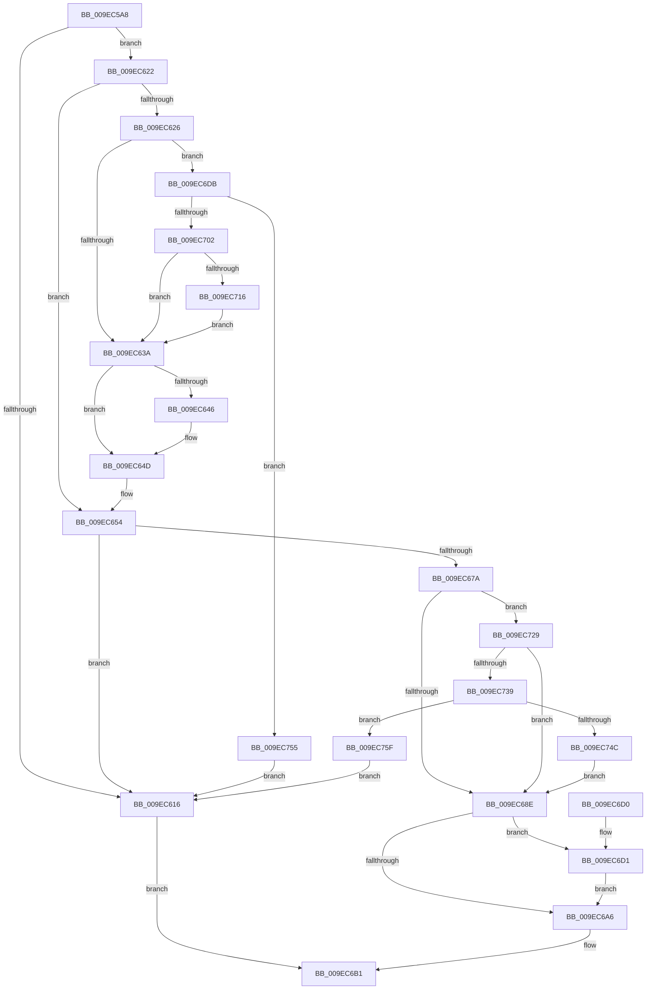

# SeCopyClientToken

- RVA: `0x009EC5A8`–`0x009EC76D` (길이 `453` bytes)
- VA: `0x00000001409EC5A8`
- 실행 섹션: `PAGE`
- PDB 이름 있음: `예`; PDB Function 태그: `아니요`
- unwind 정보 RVA: `0x000A5AD0`
- 디코드: `117`개 명령, `453/453` bytes 표시
- 미해석 바이트: `0` (있으면 어셈블리에 `.byte`로 보존)

> 이 문서는 커널 이미지의 기계어와 PDB 기호를 분석해 생성했습니다. 4번과 5번은 함수 원형과 자료형을 바이너리 사용 방식에서 추정한 C 해석이며 원본 소스 복구 결과는 아닙니다.

## 1. Dependencies

- 직접 호출 지점: **9**; 고유 호출 대상: **8**
- 직접 호출자로 확인된 함수: **2**
- RIP 상대 이미지 참조: **1**

### Outgoing calls
- `0x009EC60B` → [SepDuplicateToken](../8B/SepDuplicateToken_function_008B87EC.md) (function, `0x008B87EC`)
- `0x009EC648` → [ExFreePoolWithTag](../../poolcode/B8/ExFreePoolWithTag_function_00B82870.md) (function, `0x00B82870`)
- `0x009EC66F` → [ObInsertObjectEx](../8B/ObInsertObjectEx_function_008B97A0.md) (function, `0x008B97A0`)
- `0x009EC69D` → [SepAppendAceToTokenObjectAcl](../8B/SepAppendAceToTokenObjectAcl_function_008B6430.md) (function, `0x008B6430`)
- `0x009EC6D4` → [SepSetProcessTrustLabelAceForToken](../../text/40/SepSetProcessTrustLabelAceForToken_function_004007A0.md) (function, `0x004007A0`)
- `0x009EC6F5` → [ExAllocatePool2](../../poolcode/B8/ExAllocatePool2_function_00B820F0.md) (function, `0x00B820F0`)
- `0x009EC71F` → [memcpy](../../text/6C/memcpy_function_006C6840.md) (function, `0x006C6840`)
- `0x009EC741` → [SepAppendAceToTokenObjectAcl](../8B/SepAppendAceToTokenObjectAcl_function_008B6430.md) (function, `0x008B6430`)
- `0x009EC763` → [ObfDereferenceObject](../../text/2F/ObfDereferenceObject_function_002F9350.md) (function, `0x002F9350`)

### Direct callers
- [SepCopyClientTokenAndSetSilo](../79/SepCopyClientTokenAndSetSilo_function_0079CE34.md) at `0x0079CE56`
- [sub_00B1943A](../B1/Unknown_function_00B1943A.md) at `0x00B1949B`

### Static image references
- `0x009EC68E` → RVA `0x00FD9A68` (`PAGEDATA`; read)

## 2. Other-region calls and transfers

- 다른 실행 섹션으로 향하는 call: **5**
  - `0x009EC648` → [ExFreePoolWithTag](../../poolcode/B8/ExFreePoolWithTag_function_00B82870.md) (`PAGE` → `POOLCODE`)
  - `0x009EC6D4` → [SepSetProcessTrustLabelAceForToken](../../text/40/SepSetProcessTrustLabelAceForToken_function_004007A0.md) (`PAGE` → `.text`)
  - `0x009EC6F5` → [ExAllocatePool2](../../poolcode/B8/ExAllocatePool2_function_00B820F0.md) (`PAGE` → `POOLCODE`)
  - `0x009EC71F` → [memcpy](../../text/6C/memcpy_function_006C6840.md) (`PAGE` → `.text`)
  - `0x009EC763` → [ObfDereferenceObject](../../text/2F/ObfDereferenceObject_function_002F9350.md) (`PAGE` → `.text`)
- 별도 외부 분기/꼬리 이동을 확인하지 못했습니다.

## 3. Assembly (complete function range)

```asm
009EC5A8  4C 8B DC                        mov r11, rsp
009EC5AB  49 89 5B 08                     mov qword ptr [r11 + 8], rbx
009EC5AF  49 89 73 10                     mov qword ptr [r11 + 0x10], rsi
009EC5B3  49 89 7B 18                     mov qword ptr [r11 + 0x18], rdi
009EC5B7  55                              push rbp
009EC5B8  41 56                           push r14
009EC5BA  41 57                           push r15
009EC5BC  48 8B EC                        mov rbp, rsp
009EC5BF  48 81 EC 80 00 00 00            sub rsp, 0x80
009EC5C6  45 33 FF                        xor r15d, r15d
009EC5C9  48 C7 45 C8 30 00 00 00         mov qword ptr [rbp - 0x38], 0x30
009EC5D1  48 8D 45 C0                     lea rax, [rbp - 0x40]
009EC5D5  4C 89 7D E0                     mov qword ptr [rbp - 0x20], r15
009EC5D9  49 89 43 A0                     mov qword ptr [r11 - 0x60], rax
009EC5DD  41 8A D9                        mov bl, r9b
009EC5E0  45 88 7B 98                     mov byte ptr [r11 - 0x68], r15b
009EC5E4  0F 57 C0                        xorps xmm0, xmm0
009EC5E7  45 88 7B 90                     mov byte ptr [r11 - 0x70], r15b
009EC5EB  45 8D 4F 02                     lea r9d, [r15 + 2]
009EC5EF  89 54 24 20                     mov dword ptr [rsp + 0x20], edx
009EC5F3  45 33 C0                        xor r8d, r8d
009EC5F6  48 8D 55 C8                     lea rdx, [rbp - 0x38]
009EC5FA  4C 89 7D C0                     mov qword ptr [rbp - 0x40], r15
009EC5FE  4C 89 7D D0                     mov qword ptr [rbp - 0x30], r15
009EC602  4C 89 7D D8                     mov qword ptr [rbp - 0x28], r15
009EC606  F3 0F 7F 45 E8                  movdqu xmmword ptr [rbp - 0x18], xmm0
009EC60B  E8 DC C1 EC FF                  call 0x1408b87ec
009EC610  8B F8                           mov edi, eax
009EC612  85 C0                           test eax, eax
009EC614  79 0C                           jns 0x1409ec622
009EC616  48 8B 45 48                     mov rax, qword ptr [rbp + 0x48]
009EC61A  4C 89 38                        mov qword ptr [rax], r15
009EC61D  E9 8F 00 00 00                  jmp 0x1409ec6b1
009EC622  84 DB                           test bl, bl
009EC624  74 2E                           je 0x1409ec654
009EC626  48 8B 5D 40                     mov rbx, qword ptr [rbp + 0x40]
009EC62A  49 8B FF                        mov rdi, r15
009EC62D  48 8B 75 C0                     mov rsi, qword ptr [rbp - 0x40]
009EC631  48 85 DB                        test rbx, rbx
009EC634  0F 85 A1 00 00 00               jne 0x1409ec6db
009EC63A  48 8B 8E 50 04 00 00            mov rcx, qword ptr [rsi + 0x450]
009EC641  48 85 C9                        test rcx, rcx
009EC644  74 07                           je 0x1409ec64d
009EC646  33 D2                           xor edx, edx
009EC648  E8 23 62 19 00                  call 0x140b82870
009EC64D  48 89 BE 50 04 00 00            mov qword ptr [rsi + 0x450], rdi
009EC654  48 8B 4D C0                     mov rcx, qword ptr [rbp - 0x40]
009EC658  45 33 C9                        xor r9d, r9d
009EC65B  4C 89 7C 24 30                  mov qword ptr [rsp + 0x30], r15
009EC660  45 33 C0                        xor r8d, r8d
009EC663  4C 89 7C 24 28                  mov qword ptr [rsp + 0x28], r15
009EC668  33 D2                           xor edx, edx
009EC66A  44 89 7C 24 20                  mov dword ptr [rsp + 0x20], r15d
009EC66F  E8 2C D1 EC FF                  call 0x1408b97a0
009EC674  8B F8                           mov edi, eax
009EC676  85 C0                           test eax, eax
009EC678  78 9C                           js 0x1409ec616
009EC67A  48 8B 5D C0                     mov rbx, qword ptr [rbp - 0x40]
009EC67E  F7 83 C8 00 00 00 00 40 00 00   test dword ptr [rbx + 0xc8], 0x4000
009EC688  0F 85 9B 00 00 00               jne 0x1409ec729
009EC68E  4C 8B 05 D3 D3 5E 00            mov r8, qword ptr [rip + 0x5ed3d3]
009EC695  BA 08 00 00 00                  mov edx, 8
009EC69A  48 8B CB                        mov rcx, rbx
009EC69D  E8 8E 9D EC FF                  call 0x1408b6430
009EC6A2  85 C0                           test eax, eax
009EC6A4  79 2B                           jns 0x1409ec6d1
009EC6A6  48 8B 4D 48                     mov rcx, qword ptr [rbp + 0x48]
009EC6AA  48 8B 45 C0                     mov rax, qword ptr [rbp - 0x40]
009EC6AE  48 89 01                        mov qword ptr [rcx], rax
009EC6B1  4C 8D 9C 24 80 00 00 00         lea r11, [rsp + 0x80]
009EC6B9  8B C7                           mov eax, edi
009EC6BB  49 8B 5B 20                     mov rbx, qword ptr [r11 + 0x20]
009EC6BF  49 8B 73 28                     mov rsi, qword ptr [r11 + 0x28]
009EC6C3  49 8B 7B 30                     mov rdi, qword ptr [r11 + 0x30]
009EC6C7  49 8B E3                        mov rsp, r11
009EC6CA  41 5F                           pop r15
009EC6CC  41 5E                           pop r14
009EC6CE  5D                              pop rbp
009EC6CF  C3                              ret
009EC6D0  CC                              int3
009EC6D1  48 8B CB                        mov rcx, rbx
009EC6D4  E8 C7 40 A1 FF                  call 0x1404007a0
009EC6D9  EB CB                           jmp 0x1409ec6a6
009EC6DB  0F B6 43 01                     movzx eax, byte ptr [rbx + 1]
009EC6DF  B9 00 01 00 00                  mov ecx, 0x100
009EC6E4  41 B8 53 65 53 69               mov r8d, 0x69536553
009EC6EA  44 8D 34 85 08 00 00 00         lea r14d, [rax*4 + 8]
009EC6F2  41 8B D6                        mov edx, r14d
009EC6F5  E8 F6 59 19 00                  call 0x140b820f0
009EC6FA  48 8B F8                        mov rdi, rax
009EC6FD  48 85 C0                        test rax, rax
009EC700  74 53                           je 0x1409ec755
009EC702  0F B6 4B 01                     movzx ecx, byte ptr [rbx + 1]
009EC706  8D 0C 8D 08 00 00 00            lea ecx, [rcx*4 + 8]
009EC70D  41 3B CE                        cmp ecx, r14d
009EC710  0F 87 24 FF FF FF               ja 0x1409ec63a
009EC716  44 8B C1                        mov r8d, ecx
009EC719  48 8B D3                        mov rdx, rbx
009EC71C  48 8B C8                        mov rcx, rax
009EC71F  E8 1C A1 CD FF                  call 0x1406c6840
009EC724  E9 11 FF FF FF                  jmp 0x1409ec63a
009EC729  4C 8B 83 10 03 00 00            mov r8, qword ptr [rbx + 0x310]
009EC730  4D 85 C0                        test r8, r8
009EC733  0F 84 55 FF FF FF               je 0x1409ec68e
009EC739  BA FF 01 0F 00                  mov edx, 0xf01ff
009EC73E  48 8B CB                        mov rcx, rbx
009EC741  E8 EA 9C EC FF                  call 0x1408b6430
009EC746  8B F8                           mov edi, eax
009EC748  85 C0                           test eax, eax
009EC74A  78 13                           js 0x1409ec75f
009EC74C  48 8B 5D C0                     mov rbx, qword ptr [rbp - 0x40]
009EC750  E9 39 FF FF FF                  jmp 0x1409ec68e
009EC755  BF 9A 00 00 C0                  mov edi, 0xc000009a
009EC75A  E9 B7 FE FF FF                  jmp 0x1409ec616
009EC75F  48 8B 4D C0                     mov rcx, qword ptr [rbp - 0x40]
009EC763  E8 E8 CB 90 FF                  call 0x1402f9350
009EC768  E9 A9 FE FF FF                  jmp 0x1409ec616
```

## 4. C-style interpretation (structured pseudocode)

```c
__int64 __fastcall SeCopyClientToken(__int64 a1, int a2, int a3, unsigned __int8 a4, __int64 a5, __int64 a6)
{
    __int64 result;
    __int64 v_r15;
    __int64 v_rsp;
    unsigned __int64 v_stack_m18;
    unsigned __int64 v_stack_m30;
    unsigned __int64 v_stack_m38;
    unsigned __int64 v_stack_m40;
    unsigned __int64 v_stack_m48;
    unsigned __int64 v_stack_m50;
    unsigned __int64 v_stack_m58;
    unsigned __int64 v_stack_m68;
    unsigned __int64 v_stack_m70;
    unsigned int v_stack_m78;

    *(unsigned __int64 *)(v_rsp + 8) = v_rbx;
    *(unsigned __int64 *)(v_rsp + 16) = v_rsi;
    *(unsigned __int64 *)(v_rsp + 24) = v_rdi;
    v_rsp = (v_rsp) - (128);
    v_r15 = 0;
    v_stack_m50 = 48;
    v_stack_m38 = 0;
    *(unsigned __int64 *)(v_rsp - 96) = v_stack_m58;
    *(unsigned __int8 *)(v_rsp - 104) = 0;
    *(unsigned __int8 *)(v_rsp - 112) = 0;
    v_stack_m78 = a2;
    a3 = 0;
    v_stack_m58 = 0;
    v_stack_m48 = 0;
    v_stack_m40 = 0;
    v_stack_m30 = v_xmm0;
    result = SepDuplicateToken(a1, v_stack_m50, a3, v_r15 + 2);
    if (!sign_flag) goto loc_009EC622;
loc_009EC616:
    *(unsigned __int64 *)(a6) = 0;
    goto loc_009EC6B1;
loc_009EC622:
    if (a4 == 0) goto loc_009EC654;
    if (a5 != 0) goto loc_009EC6DB;
loc_009EC63A:
    result = a6;
    if (*(unsigned __int64 *)(v_stack_m58 + 1104) != 0) {
        a2 = 0;
        result = ExFreePoolWithTag(*(unsigned __int64 *)(v_stack_m58 + 1104), a2, a3, v_r15 + 2);
    }
    *(unsigned __int64 *)(v_stack_m58 + 1104) = 0;
loc_009EC654:
    a4 = 0;
    v_stack_m68 = 0;
    a3 = 0;
    v_stack_m70 = 0;
    a2 = 0;
    v_stack_m78 = 0;
    result = ObInsertObjectEx(v_stack_m58, a2, a3, a4);
    if (sign_flag) goto loc_009EC616;
    if (((*(unsigned int *)(v_stack_m58 + 200)) & (0x4000ULL)) != 0) goto loc_009EC729;
loc_009EC68E:
    result = SepAppendAceToTokenObjectAcl(v_stack_m58, 8, *(unsigned __int64 *)(v_rip + 6214611), a4);
    if (!sign_flag) goto loc_009EC6D1;
loc_009EC6A6:
    *(unsigned __int64 *)(a6) = v_stack_m58;
loc_009EC6B1:
    return (unsigned int)((unsigned int)((unsigned int)((unsigned int)(result))));
loc_009EC6D1:
    result = SepSetProcessTrustLabelAceForToken(*(unsigned __int64 *)(v_stack_m18 + 32), 8, *(unsigned __int64 *)(v_rip + 6214611), a4);
    goto loc_009EC6A6;
loc_009EC6DB:
    result = ExAllocatePool2(256, (unsigned int)((unsigned int)(*(unsigned __int8 *)(*(unsigned __int64 *)(v_stack_m18 + 32) + 1) * 4 + 8)), (unsigned int)(0x69536553ULL), a4);
    if (result == 0) goto loc_009EC755;
    if (((unsigned int)(*(unsigned __int8 *)(*(unsigned __int64 *)(v_stack_m18 + 32) + 1) * 4 + 8)) > ((unsigned int)(*(unsigned __int8 *)(*(unsigned __int64 *)(v_stack_m18 + 32) + 1) * 4 + 8))) goto loc_009EC63A;
    result = memcpy(result, *(unsigned __int64 *)(v_stack_m18 + 32), (unsigned int)((unsigned int)(*(unsigned __int8 *)(*(unsigned __int64 *)(v_stack_m18 + 32) + 1) * 4 + 8)), a4);
    goto loc_009EC63A;
loc_009EC729:
    if (*(unsigned __int64 *)(*(unsigned __int64 *)(v_stack_m18 + 32) + 784) == 0) goto loc_009EC68E;
    result = SepAppendAceToTokenObjectAcl(*(unsigned __int64 *)(v_stack_m18 + 32), (unsigned int)(0xF01FFULL), *(unsigned __int64 *)(*(unsigned __int64 *)(v_stack_m18 + 32) + 784), a4);
    if (sign_flag) goto loc_009EC75F;
    goto loc_009EC68E;
loc_009EC755:
    goto loc_009EC616;
loc_009EC75F:
    result = ObfDereferenceObject(v_stack_m58, (unsigned int)(0xF01FFULL), *(unsigned __int64 *)(*(unsigned __int64 *)(v_stack_m18 + 32) + 784), a4);
    goto loc_009EC616;
}
```

## 5. (Beta) C Style

```c
int64_t SeCopyClientToken(int64_t Arg1, int32_t Arg2, int32_t Arg3, uint8_t Arg4, int64_t Arg5, void *Arg6)
{
    uint8_t *arg6 = (uint8_t *)Arg6;

    int64_t result;
    int64_t local_r15;
    int64_t local_rsp;
    uint64_t v_stack_m18;
    uint64_t v_stack_m30;
    uint64_t v_stack_m38;
    uint64_t v_stack_m40;
    uint64_t v_stack_m48;
    uint64_t v_stack_m50;
    uint64_t v_stack_m58;
    uint64_t v_stack_m68;
    uint64_t v_stack_m70;
    uint32_t v_stack_m78;

    *(uint64_t *)(local_rsp + 0x8) = local_rbx;
    *(uint64_t *)(local_rsp + 0x10) = local_rsi;
    *(uint64_t *)(local_rsp + 0x18) = local_rdi;
    local_rsp = (local_rsp) - (128);
    local_r15 = 0;
    v_stack_m50 = 48;
    v_stack_m38 = 0;
    *(uint64_t *)(local_rsp - 0x60) = v_stack_m58;
    *(uint8_t *)(local_rsp - 0x68) = 0;
    *(uint8_t *)(local_rsp - 0x70) = 0;
    v_stack_m78 = Arg2;
    Arg3 = 0;
    v_stack_m58 = 0;
    v_stack_m48 = 0;
    v_stack_m40 = 0;
    v_stack_m30 = v_xmm0;
    result = SepDuplicateToken(Arg1, v_stack_m50, Arg3, local_r15 + 2);
    if (!sign_flag) goto loc_009EC622;
loc_009EC616:
    *(uint64_t *)(arg6) = 0;
    goto loc_009EC6B1;
loc_009EC622:
    if (Arg4 == 0) goto loc_009EC654;
    if (Arg5 != 0) goto loc_009EC6DB;
loc_009EC63A:
    result = Arg6;
    if (*(uint64_t *)(v_stack_m58 + 0x450) != 0) {
        Arg2 = 0;
        result = ExFreePoolWithTag(*(uint64_t *)(v_stack_m58 + 0x450), Arg2, Arg3, local_r15 + 2);
    }
    *(uint64_t *)(v_stack_m58 + 0x450) = 0;
loc_009EC654:
    Arg4 = 0;
    v_stack_m68 = 0;
    Arg3 = 0;
    v_stack_m70 = 0;
    Arg2 = 0;
    v_stack_m78 = 0;
    result = ObInsertObjectEx(v_stack_m58, Arg2, Arg3, Arg4);
    if (sign_flag) goto loc_009EC616;
    if (((*(uint32_t *)(v_stack_m58 + 0xC8)) & (0x4000ULL)) != 0) goto loc_009EC729;
loc_009EC68E:
    result = SepAppendAceToTokenObjectAcl(v_stack_m58, 8, *(uint64_t *)(v_rip + 0x5ED3D3), Arg4);
    if (!sign_flag) goto loc_009EC6D1;
loc_009EC6A6:
    *(uint64_t *)(arg6) = v_stack_m58;
loc_009EC6B1:
    return (uint32_t)((uint32_t)((uint32_t)((uint32_t)(result))));
loc_009EC6D1:
    result = SepSetProcessTrustLabelAceForToken(*(uint64_t *)(v_stack_m18 + 0x20), 8, *(uint64_t *)(v_rip + 0x5ED3D3), Arg4);
    goto loc_009EC6A6;
loc_009EC6DB:
    result = ExAllocatePool2(256, (uint32_t)((uint32_t)(*(uint8_t *)(*(uint64_t *)(v_stack_m18 + 0x20) + 0x1) * 4 + 8)), (uint32_t)(0x69536553ULL), Arg4);
    if (result == 0) goto loc_009EC755;
    if (((uint32_t)(*(uint8_t *)(*(uint64_t *)(v_stack_m18 + 0x20) + 0x1) * 4 + 8)) > ((uint32_t)(*(uint8_t *)(*(uint64_t *)(v_stack_m18 + 0x20) + 0x1) * 4 + 8))) goto loc_009EC63A;
    result = memcpy(result, *(uint64_t *)(v_stack_m18 + 0x20), (uint32_t)((uint32_t)(*(uint8_t *)(*(uint64_t *)(v_stack_m18 + 0x20) + 0x1) * 4 + 8)), Arg4);
    goto loc_009EC63A;
loc_009EC729:
    if (*(uint64_t *)(*(uint64_t *)(v_stack_m18 + 0x20) + 0x310) == 0) goto loc_009EC68E;
    result = SepAppendAceToTokenObjectAcl(*(uint64_t *)(v_stack_m18 + 0x20), (uint32_t)(0xF01FFULL), *(uint64_t *)(*(uint64_t *)(v_stack_m18 + 0x20) + 0x310), Arg4);
    if (sign_flag) goto loc_009EC75F;
    goto loc_009EC68E;
loc_009EC755:
    goto loc_009EC616;
loc_009EC75F:
    result = ObfDereferenceObject(v_stack_m58, (uint32_t)(0xF01FFULL), *(uint64_t *)(*(uint64_t *)(v_stack_m18 + 0x20) + 0x310), Arg4);
    goto loc_009EC616;
}
```

### 관측된 메모리 오프셋

구조체 형식이 확인되지 않은 접근은 인자 기준의 오프셋으로만 기록했습니다.

| 기준 인자 | 오프셋 표현 | 폭 (bit) | 접근 |
|---|---:|---:|---|
| `Arg6` | `+ 0x0` | `64` | `W` |

## 6. Execution-region graph

[열기: 2D/3D 그래프와 함수 탐색 컨트롤 패널](../../../control-panel.html?section=page&rva=0x009EC5A8&view=graph)

- 2D 그래프는 위에서 아래로 흐르고, 3D 그래프는 빈 공간을 드래그해 회전합니다. Shift+드래그는 이동, 휠은 확대·축소, 함수 노드 선택은 대상 보고서 이동입니다.

### Static fallback


