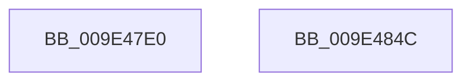

# SeGetTokenControlInformation

- RVA: `0x009E47E0`–`0x009E484D` (길이 `109` bytes)
- VA: `0x00000001409E47E0`
- 실행 섹션: `PAGE`
- PDB 이름 있음: `예`; PDB Function 태그: `아니요`
- unwind 정보 RVA: `0x0005CAAC`
- 디코드: `28`개 명령, `109/109` bytes 표시
- 미해석 바이트: `0` (있으면 어셈블리에 `.byte`로 보존)

> 이 문서는 커널 이미지의 기계어와 PDB 기호를 분석해 생성했습니다. 4번과 5번은 함수 원형과 자료형을 바이너리 사용 방식에서 추정한 C 해석이며 원본 소스 복구 결과는 아닙니다.

## 1. Dependencies

- 직접 호출 지점: **3**; 고유 호출 대상: **3**
- 직접 호출자로 확인된 함수: **3**
- RIP 상대 이미지 참조: **0**

### Outgoing calls
- `0x009E481D` → [ExAcquireResourceSharedLite](../../text/21/ExAcquireResourceSharedLite_function_00211BC0.md) (function, `0x00211BC0`)
- `0x009E482E` → [ExReleaseResourceLite](../../text/25/ExReleaseResourceLite_function_0025FA10.md) (function, `0x0025FA10`)
- `0x009E483C` → [KeLeaveCriticalRegionThread](../../text/25/KeLeaveCriticalRegionThread_function_0025EFF0.md) (function, `0x0025EFF0`)

### Direct callers
- [AlpcpQueryTokenModifiedIdMessage](../74/AlpcpQueryTokenModifiedIdMessage_function_0074C0C0.md) at `0x0074C14D`
- [sub_008920C1](../89/Unknown_function_008920C1.md) at `0x008920C8`
- [SepUpdateSiloInClientSecurity](../AD/SepUpdateSiloInClientSecurity_function_00AD4E10.md) at `0x00AD4EB3`

### Static image references
- 디코드된 RIP-relative 메모리 참조가 없습니다.

## 2. Other-region calls and transfers

- 다른 실행 섹션으로 향하는 call: **3**
  - `0x009E481D` → [ExAcquireResourceSharedLite](../../text/21/ExAcquireResourceSharedLite_function_00211BC0.md) (`PAGE` → `.text`)
  - `0x009E482E` → [ExReleaseResourceLite](../../text/25/ExReleaseResourceLite_function_0025FA10.md) (`PAGE` → `.text`)
  - `0x009E483C` → [KeLeaveCriticalRegionThread](../../text/25/KeLeaveCriticalRegionThread_function_0025EFF0.md) (`PAGE` → `.text`)
- 별도 외부 분기/꼬리 이동을 확인하지 못했습니다.

## 3. Assembly (complete function range)

```asm
009E47E0  48 89 5C 24 08                  mov qword ptr [rsp + 8], rbx
009E47E5  57                              push rdi
009E47E6  48 83 EC 20                     sub rsp, 0x20
009E47EA  48 8B 41 18                     mov rax, qword ptr [rcx + 0x18]
009E47EE  48 8B DA                        mov rbx, rdx
009E47F1  48 89 42 08                     mov qword ptr [rdx + 8], rax
009E47F5  48 8B F9                        mov rdi, rcx
009E47F8  48 8B 41 10                     mov rax, qword ptr [rcx + 0x10]
009E47FC  48 89 02                        mov qword ptr [rdx], rax
009E47FF  0F 10 01                        movups xmm0, xmmword ptr [rcx]
009E4802  0F 11 42 18                     movups xmmword ptr [rdx + 0x18], xmm0
009E4806  65 48 8B 04 25 88 01 00 00      mov rax, qword ptr gs:[0x188]
009E480F  B2 01                           mov dl, 1
009E4811  66 FF 88 E4 01 00 00            dec word ptr [rax + 0x1e4]
009E4818  90                              nop
009E4819  48 8B 49 30                     mov rcx, qword ptr [rcx + 0x30]
009E481D  E8 9E D3 82 FF                  call 0x140211bc0
009E4822  48 8B 47 38                     mov rax, qword ptr [rdi + 0x38]
009E4826  48 89 43 10                     mov qword ptr [rbx + 0x10], rax
009E482A  48 8B 4F 30                     mov rcx, qword ptr [rdi + 0x30]
009E482E  E8 DD B1 87 FF                  call 0x14025fa10
009E4833  65 48 8B 0C 25 88 01 00 00      mov rcx, qword ptr gs:[0x188]
009E483C  E8 AF A7 87 FF                  call 0x14025eff0
009E4841  48 8B 5C 24 30                  mov rbx, qword ptr [rsp + 0x30]
009E4846  48 83 C4 20                     add rsp, 0x20
009E484A  5F                              pop rdi
009E484B  C3                              ret
009E484C  CC                              int3
```

## 4. C-style interpretation (structured pseudocode)

```c
__int64 __fastcall SeGetTokenControlInformation(__int64 a1, __int64 a2)
{
    __int64 result;
    __int64 v_rsp;
    unsigned __int64 v_stack_p8;

    v_stack_p8 = v_rbx;
    v_rsp = (v_rsp) - (32);
    *(unsigned __int64 *)(a2 + 8) = *(unsigned __int64 *)(a1 + 24);
    *(unsigned __int64 *)(a2) = *(unsigned __int64 *)(a1 + 16);
    *(unsigned __int64 *)(a2 + 24) = v_xmm0;
    result = ExAcquireResourceSharedLite(*(unsigned __int64 *)(a1 + 48), 1, a3, a4);
    *(unsigned __int64 *)(a2 + 16) = *(unsigned __int64 *)(a1 + 56);
    result = ExReleaseResourceLite(*(unsigned __int64 *)(a1 + 48), 1, a3, a4);
    result = KeLeaveCriticalRegionThread(*(unsigned __int64 *)(gs_base + (0 + 392)), 1, a3, a4);
    v_rsp = (v_rsp) + (32);
    return result;
}
```

## 5. (Beta) C Style

```c
int64_t SeGetTokenControlInformation(void *Arg1, void *Arg2)
{
    uint8_t *arg1 = (uint8_t *)Arg1;
    uint8_t *arg2 = (uint8_t *)Arg2;

    int64_t result;
    int64_t local_rsp;
    uint64_t v_stack_p8;

    v_stack_p8 = local_rbx;
    local_rsp = (local_rsp) - (32);
    *(uint64_t *)(arg2 + 0x8) = *(uint64_t *)(arg1 + 0x18);
    *(uint64_t *)(arg2) = *(uint64_t *)(arg1 + 0x10);
    *(uint64_t *)(arg2 + 0x18) = v_xmm0;
    result = ExAcquireResourceSharedLite(*(uint64_t *)(arg1 + 0x30), 1, a3, a4);
    *(uint64_t *)(arg2 + 0x10) = *(uint64_t *)(arg1 + 0x38);
    result = ExReleaseResourceLite(*(uint64_t *)(arg1 + 0x30), 1, a3, a4);
    result = KeLeaveCriticalRegionThread(*(uint64_t *)(gs_base + (0 + 0x188)), 1, a3, a4);
    local_rsp = (local_rsp) + (32);
    return result;
}
```

### 관측된 메모리 오프셋

구조체 형식이 확인되지 않은 접근은 인자 기준의 오프셋으로만 기록했습니다.

| 기준 인자 | 오프셋 표현 | 폭 (bit) | 접근 |
|---|---:|---:|---|
| `Arg1` | `+ 0x0` | `128` | `R` |
| `Arg1` | `+ 0x10` | `64` | `R` |
| `Arg1` | `+ 0x18` | `64` | `R` |
| `Arg1` | `+ 0x30` | `64` | `R` |
| `Arg1` | `+ 0x38` | `64` | `R` |
| `Arg2` | `+ 0x0` | `64` | `W` |
| `Arg2` | `+ 0x8` | `64` | `W` |
| `Arg2` | `+ 0x10` | `64` | `W` |
| `Arg2` | `+ 0x18` | `128` | `R` |

## 6. Execution-region graph

[열기: 2D/3D 그래프와 함수 탐색 컨트롤 패널](../../../control-panel.html?section=page&rva=0x009E47E0&view=graph)

- 2D 그래프는 위에서 아래로 흐르고, 3D 그래프는 빈 공간을 드래그해 회전합니다. Shift+드래그는 이동, 휠은 확대·축소, 함수 노드 선택은 대상 보고서 이동입니다.

### Static fallback


