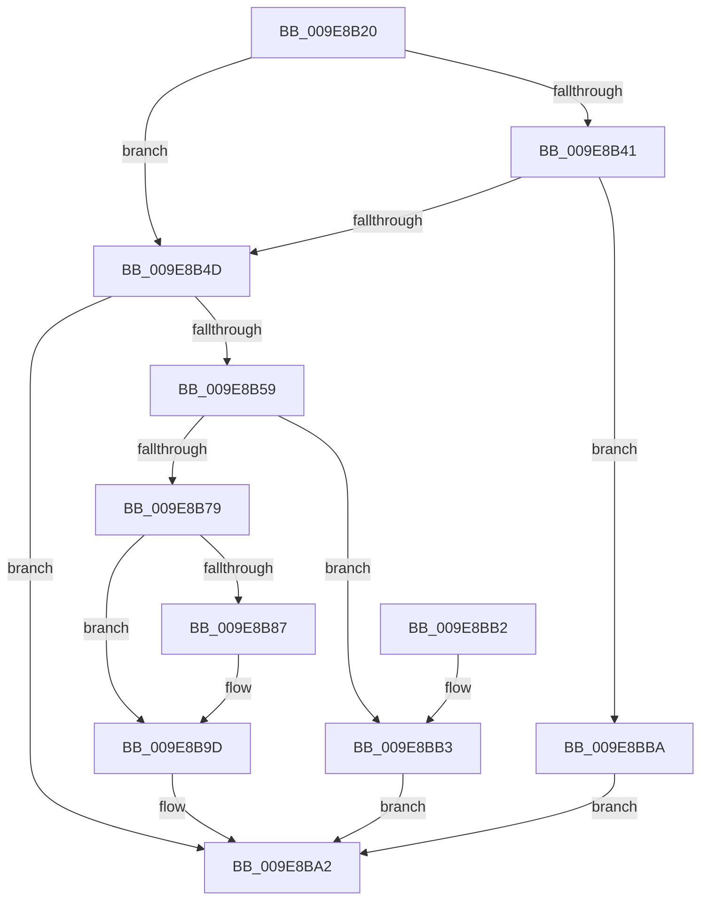

# SeLocateProcessImageName

- RVA: `0x009E8B20`–`0x009E8BC4` (길이 `164` bytes)
- VA: `0x00000001409E8B20`
- 실행 섹션: `PAGE`
- PDB 이름 있음: `예`; PDB Function 태그: `아니요`
- unwind 정보 RVA: `0x00078D6C`
- 디코드: `44`개 명령, `164/164` bytes 표시
- 미해석 바이트: `0` (있으면 어셈블리에 `.byte`로 보존)

> 이 문서는 커널 이미지의 기계어와 PDB 기호를 분석해 생성했습니다. 4번과 5번은 함수 원형과 자료형을 바이너리 사용 방식에서 추정한 C 해석이며 원본 소스 복구 결과는 아닙니다.

## 1. Dependencies

- 직접 호출 지점: **3**; 고유 호출 대상: **3**
- 직접 호출자로 확인된 함수: **0**
- RIP 상대 이미지 참조: **1**

### Outgoing calls
- `0x009E8B6C` → [ExAllocatePool2](../../poolcode/B8/ExAllocatePool2_function_00B820F0.md) (function, `0x00B820F0`)
- `0x009E8B98` → [memcpy](../../text/6C/memcpy_function_006C6840.md) (function, `0x006C6840`)
- `0x009E8BBD` → [guard_dispatch_icall](../../text/6B/guard_dispatch_icall_function_006BAAD0.md) (function, `0x006BAAD0`)

### Direct callers
- 이 함수 시작 RVA로 연결되는 직접 call은 확인되지 않았습니다. 간접 호출은 완전히 역산할 수 없습니다.

### Static image references
- `0x009E8B41` → RVA `0x00F06560` (`.data`; read)

## 2. Other-region calls and transfers

- 다른 실행 섹션으로 향하는 call: **3**
  - `0x009E8B6C` → [ExAllocatePool2](../../poolcode/B8/ExAllocatePool2_function_00B820F0.md) (`PAGE` → `POOLCODE`)
  - `0x009E8B98` → [memcpy](../../text/6C/memcpy_function_006C6840.md) (`PAGE` → `.text`)
  - `0x009E8BBD` → [guard_dispatch_icall](../../text/6B/guard_dispatch_icall_function_006BAAD0.md) (`PAGE` → `.text`)
- 별도 외부 분기/꼬리 이동을 확인하지 못했습니다.

## 3. Assembly (complete function range)

```asm
009E8B20  48 89 5C 24 08                  mov qword ptr [rsp + 8], rbx
009E8B25  48 89 74 24 10                  mov qword ptr [rsp + 0x10], rsi
009E8B2A  57                              push rdi
009E8B2B  48 83 EC 20                     sub rsp, 0x20
009E8B2F  48 83 B9 40 06 00 00 00         cmp qword ptr [rcx + 0x640], 0
009E8B37  48 8B F2                        mov rsi, rdx
009E8B3A  B8 25 02 00 C0                  mov eax, 0xc0000225
009E8B3F  74 0C                           je 0x1409e8b4d
009E8B41  4C 8B 05 18 DA 51 00            mov r8, qword ptr [rip + 0x51da18]
009E8B48  4D 85 C0                        test r8, r8
009E8B4B  75 6D                           jne 0x1409e8bba
009E8B4D  48 8B B9 50 03 00 00            mov rdi, qword ptr [rcx + 0x350]
009E8B54  48 85 FF                        test rdi, rdi
009E8B57  74 49                           je 0x1409e8ba2
009E8B59  0F B7 57 02                     movzx edx, word ptr [rdi + 2]
009E8B5D  B9 40 00 00 00                  mov ecx, 0x40
009E8B62  48 83 C2 10                     add rdx, 0x10
009E8B66  41 B8 50 73 49 6E               mov r8d, 0x6e497350
009E8B6C  E8 7F 95 19 00                  call 0x140b820f0
009E8B71  48 8B D8                        mov rbx, rax
009E8B74  48 85 C0                        test rax, rax
009E8B77  74 3A                           je 0x1409e8bb3
009E8B79  0F 10 07                        movups xmm0, xmmword ptr [rdi]
009E8B7C  F3 0F 7F 00                     movdqu xmmword ptr [rax], xmm0
009E8B80  48 83 78 08 00                  cmp qword ptr [rax + 8], 0
009E8B85  74 16                           je 0x1409e8b9d
009E8B87  48 8D 48 10                     lea rcx, [rax + 0x10]
009E8B8B  48 89 48 08                     mov qword ptr [rax + 8], rcx
009E8B8F  44 0F B7 47 02                  movzx r8d, word ptr [rdi + 2]
009E8B94  48 8B 57 08                     mov rdx, qword ptr [rdi + 8]
009E8B98  E8 A3 DC CD FF                  call 0x1406c6840
009E8B9D  48 89 1E                        mov qword ptr [rsi], rbx
009E8BA0  33 C0                           xor eax, eax
009E8BA2  48 8B 5C 24 30                  mov rbx, qword ptr [rsp + 0x30]
009E8BA7  48 8B 74 24 38                  mov rsi, qword ptr [rsp + 0x38]
009E8BAC  48 83 C4 20                     add rsp, 0x20
009E8BB0  5F                              pop rdi
009E8BB1  C3                              ret
009E8BB2  CC                              int3
009E8BB3  B8 17 00 00 C0                  mov eax, 0xc0000017
009E8BB8  EB E8                           jmp 0x1409e8ba2
009E8BBA  49 8B C0                        mov rax, r8
009E8BBD  E8 0E 1F CD FF                  call 0x1406baad0
009E8BC2  EB DE                           jmp 0x1409e8ba2
```

## 4. C-style interpretation (structured pseudocode)

```c
__int64 __fastcall SeLocateProcessImageName(__int64 a1, __int64 a2)
{
    __int64 result;
    __int64 v_rsp;
    unsigned __int64 v_stack_p10;
    unsigned __int64 v_stack_p8;

    v_stack_p8 = v_rbx;
    v_stack_p10 = v_rsi;
    v_rsp = (v_rsp) - (32);
    if ((*(unsigned __int64 *)(a1 + 1600)) == 0) goto loc_009E8B4D;
    if (*(unsigned __int64 *)(v_rip + 5364248) != 0) goto loc_009E8BBA;
loc_009E8B4D:
    if (*(unsigned __int64 *)(a1 + 848) == 0) goto loc_009E8BA2;
    a2 = (*(unsigned __int16 *)(*(unsigned __int64 *)(a1 + 848) + 2)) + (16);
    result = ExAllocatePool2(64, a2, (unsigned int)(0x6E497350ULL), a4);
    if (result == 0) goto loc_009E8BB3;
    *(unsigned __int64 *)(result) = v_xmm0;
    if ((*(unsigned __int64 *)(result + 8)) != 0) {
        a1 = result + 16;
        *(unsigned __int64 *)(result + 8) = a1;
        a3 = *(unsigned __int16 *)(*(unsigned __int64 *)(a1 + 848) + 2);
        a2 = *(unsigned __int64 *)(*(unsigned __int64 *)(a1 + 848) + 8);
        result = memcpy(a1, a2, a3, a4);
    }
    *(unsigned __int64 *)(a2) = result;
    result = 0;
loc_009E8BA2:
    v_rsp = (v_rsp) + (32);
    return result;
loc_009E8BB3:
    goto loc_009E8BA2;
loc_009E8BBA:
    result = guard_dispatch_icall(a1, a2, a3, a4);
    goto loc_009E8BA2;
}
```

## 5. (Beta) C Style

```c
int64_t SeLocateProcessImageName(void *Arg1, void *Arg2)
{
    uint8_t *arg1 = (uint8_t *)Arg1;
    uint8_t *arg2 = (uint8_t *)Arg2;

    int64_t result;
    int64_t local_rsp;
    uint64_t v_stack_p10;
    uint64_t v_stack_p8;

    v_stack_p8 = local_rbx;
    v_stack_p10 = local_rsi;
    local_rsp = (local_rsp) - (32);
    if ((*(uint64_t *)(arg1 + 0x640)) == 0) goto loc_009E8B4D;
    if (*(uint64_t *)(v_rip + 0x51DA18) != 0) goto loc_009E8BBA;
loc_009E8B4D:
    if (*(uint64_t *)(arg1 + 0x350) == 0) goto loc_009E8BA2;
    Arg2 = (*(uint16_t *)(*(uint64_t *)(arg1 + 0x350) + 0x2)) + (16);
    result = ExAllocatePool2(64, Arg2, (uint32_t)(0x6E497350ULL), a4);
    if (result == 0) goto loc_009E8BB3;
    *(uint64_t *)(result) = v_xmm0;
    if ((*(uint64_t *)(result + 0x8)) != 0) {
        Arg1 = result + 16;
        *(void **)(result + 0x8) = Arg1;
        a3 = *(uint16_t *)(*(uint64_t *)(arg1 + 0x350) + 0x2);
        Arg2 = *(uint64_t *)(*(uint64_t *)(arg1 + 0x350) + 0x8);
        result = memcpy(Arg1, Arg2, a3, a4);
    }
    *(uint64_t *)(arg2) = result;
    result = 0;
loc_009E8BA2:
    local_rsp = (local_rsp) + (32);
    return result;
loc_009E8BB3:
    goto loc_009E8BA2;
loc_009E8BBA:
    result = guard_dispatch_icall(Arg1, Arg2, a3, a4);
    goto loc_009E8BA2;
}
```

### 관측된 메모리 오프셋

구조체 형식이 확인되지 않은 접근은 인자 기준의 오프셋으로만 기록했습니다.

| 기준 인자 | 오프셋 표현 | 폭 (bit) | 접근 |
|---|---:|---:|---|
| `Arg1` | `+ 0x350` | `64` | `R` |
| `Arg1` | `+ 0x640` | `64` | `R` |
| `Arg2` | `+ 0x0` | `64` | `W` |

## 6. Execution-region graph

[열기: 2D/3D 그래프와 함수 탐색 컨트롤 패널](../../../control-panel.html?section=page&rva=0x009E8B20&view=graph)

- 2D 그래프는 위에서 아래로 흐르고, 3D 그래프는 빈 공간을 드래그해 회전합니다. Shift+드래그는 이동, 휠은 확대·축소, 함수 노드 선택은 대상 보고서 이동입니다.

### Static fallback


