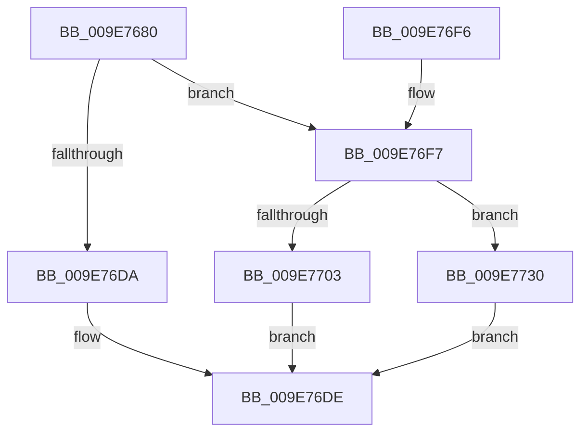

# SeQuerySessionIdTokenEx

- RVA: `0x009E7680`–`0x009E7736` (길이 `182` bytes)
- VA: `0x00000001409E7680`
- 실행 섹션: `PAGE`
- PDB 이름 있음: `예`; PDB Function 태그: `아니요`
- unwind 정보 RVA: `0x000A4A28`
- 디코드: `48`개 명령, `182/182` bytes 표시
- 미해석 바이트: `0` (있으면 어셈블리에 `.byte`로 보존)

> 이 문서는 커널 이미지의 기계어와 PDB 기호를 분석해 생성했습니다. 4번과 5번은 함수 원형과 자료형을 바이너리 사용 방식에서 추정한 C 해석이며 원본 소스 복구 결과는 아닙니다.

## 1. Dependencies

- 직접 호출 지점: **6**; 고유 호출 대상: **6**
- 직접 호출자로 확인된 함수: **1**
- RIP 상대 이미지 참조: **0**

### Outgoing calls
- `0x009E76B5` → [ExAcquireResourceSharedLite](../../text/21/ExAcquireResourceSharedLite_function_00211BC0.md) (function, `0x00211BC0`)
- `0x009E76C3` → [ExReleaseResourceLite](../../text/25/ExReleaseResourceLite_function_0025FA10.md) (function, `0x0025FA10`)
- `0x009E76D1` → [KeLeaveCriticalRegionThread](../../text/25/KeLeaveCriticalRegionThread_function_0025EFF0.md) (function, `0x0025EFF0`)
- `0x009E76F9` → [PsGetSessionById](../../text/22/PsGetSessionById_function_00225150.md) (function, `0x00225150`)
- `0x009E7719` → [ObfDereferenceObjectWithTag](../../text/2F/ObfDereferenceObjectWithTag_function_002F78E0.md) (function, `0x002F78E0`)
- `0x009E7721` → [PsGetServerSiloServiceSessionId](../../text/45/PsGetServerSiloServiceSessionId_function_0045ED00.md) (function, `0x0045ED00`)

### Direct callers
- [sub_008E69C9](../8E/Unknown_function_008E69C9.md) at `0x008E6A2C`

### Static image references
- 디코드된 RIP-relative 메모리 참조가 없습니다.

## 2. Other-region calls and transfers

- 다른 실행 섹션으로 향하는 call: **6**
  - `0x009E76B5` → [ExAcquireResourceSharedLite](../../text/21/ExAcquireResourceSharedLite_function_00211BC0.md) (`PAGE` → `.text`)
  - `0x009E76C3` → [ExReleaseResourceLite](../../text/25/ExReleaseResourceLite_function_0025FA10.md) (`PAGE` → `.text`)
  - `0x009E76D1` → [KeLeaveCriticalRegionThread](../../text/25/KeLeaveCriticalRegionThread_function_0025EFF0.md) (`PAGE` → `.text`)
  - `0x009E76F9` → [PsGetSessionById](../../text/22/PsGetSessionById_function_00225150.md) (`PAGE` → `.text`)
  - `0x009E7719` → [ObfDereferenceObjectWithTag](../../text/2F/ObfDereferenceObjectWithTag_function_002F78E0.md) (`PAGE` → `.text`)
  - `0x009E7721` → [PsGetServerSiloServiceSessionId](../../text/45/PsGetServerSiloServiceSessionId_function_0045ED00.md) (`PAGE` → `.text`)
- 별도 외부 분기/꼬리 이동을 확인하지 못했습니다.

## 3. Assembly (complete function range)

```asm
009E7680  48 89 5C 24 08                  mov qword ptr [rsp + 8], rbx
009E7685  48 89 74 24 10                  mov qword ptr [rsp + 0x10], rsi
009E768A  48 89 7C 24 18                  mov qword ptr [rsp + 0x18], rdi
009E768F  41 56                           push r14
009E7691  48 83 EC 20                     sub rsp, 0x20
009E7695  65 48 8B 04 25 88 01 00 00      mov rax, qword ptr gs:[0x188]
009E769E  48 8B FA                        mov rdi, rdx
009E76A1  48 8B F1                        mov rsi, rcx
009E76A4  B2 01                           mov dl, 1
009E76A6  4D 8B F0                        mov r14, r8
009E76A9  66 FF 88 E4 01 00 00            dec word ptr [rax + 0x1e4]
009E76B0  90                              nop
009E76B1  48 8B 49 30                     mov rcx, qword ptr [rcx + 0x30]
009E76B5  E8 06 A5 82 FF                  call 0x140211bc0
009E76BA  8B 5E 78                        mov ebx, dword ptr [rsi + 0x78]
009E76BD  89 1F                           mov dword ptr [rdi], ebx
009E76BF  48 8B 4E 30                     mov rcx, qword ptr [rsi + 0x30]
009E76C3  E8 48 83 87 FF                  call 0x14025fa10
009E76C8  65 48 8B 0C 25 88 01 00 00      mov rcx, qword ptr gs:[0x188]
009E76D1  E8 1A 79 87 FF                  call 0x14025eff0
009E76D6  85 DB                           test ebx, ebx
009E76D8  75 1D                           jne 0x1409e76f7
009E76DA  41 C6 06 01                     mov byte ptr [r14], 1
009E76DE  48 8B 5C 24 30                  mov rbx, qword ptr [rsp + 0x30]
009E76E3  33 C0                           xor eax, eax
009E76E5  48 8B 74 24 38                  mov rsi, qword ptr [rsp + 0x38]
009E76EA  48 8B 7C 24 40                  mov rdi, qword ptr [rsp + 0x40]
009E76EF  48 83 C4 20                     add rsp, 0x20
009E76F3  41 5E                           pop r14
009E76F5  C3                              ret
009E76F6  CC                              int3
009E76F7  8B CB                           mov ecx, ebx
009E76F9  E8 52 DA 83 FF                  call 0x140225150
009E76FE  48 85 C0                        test rax, rax
009E7701  74 2D                           je 0x1409e7730
009E7703  48 8B 88 E8 02 00 00            mov rcx, qword ptr [rax + 0x2e8]
009E770A  BA 50 73 51 79                  mov edx, 0x79517350
009E770F  48 8B B9 A0 00 00 00            mov rdi, qword ptr [rcx + 0xa0]
009E7716  48 8B C8                        mov rcx, rax
009E7719  E8 C2 01 91 FF                  call 0x1402f78e0
009E771E  48 8B CF                        mov rcx, rdi
009E7721  E8 DA 75 A7 FF                  call 0x14045ed00
009E7726  3B D8                           cmp ebx, eax
009E7728  0F 94 C0                        sete al
009E772B  41 88 06                        mov byte ptr [r14], al
009E772E  EB AE                           jmp 0x1409e76de
009E7730  41 C6 06 00                     mov byte ptr [r14], 0
009E7734  EB A8                           jmp 0x1409e76de
```

## 4. C-style interpretation (structured pseudocode)

```c
__int64 __fastcall SeQuerySessionIdTokenEx(__int64 a1, __int64 a2, __int64 a3)
{
    __int64 result;
    __int64 v_rsp;
    unsigned __int64 v_stack_p10;
    unsigned __int64 v_stack_p18;
    unsigned __int64 v_stack_p8;

    v_stack_p8 = v_rbx;
    v_stack_p10 = v_rsi;
    v_stack_p18 = v_rdi;
    v_rsp = (v_rsp) - (32);
    result = ExAcquireResourceSharedLite(*(unsigned __int64 *)(a1 + 48), 1, a3, a4);
    *(unsigned int *)(a2) = (unsigned int)((unsigned int)(*(unsigned int *)(a1 + 120)));
    result = ExReleaseResourceLite(*(unsigned __int64 *)(a1 + 48), 1, a3, a4);
    result = KeLeaveCriticalRegionThread(*(unsigned __int64 *)(gs_base + (0 + 392)), 1, a3, a4);
    if ((unsigned int)((unsigned int)(*(unsigned int *)(a1 + 120))) != 0) goto loc_009E76F7;
    *(unsigned __int8 *)(a3) = 1;
loc_009E76DE:
    result = 0;
    v_rsp = (v_rsp) + (32);
    return result;
loc_009E76F7:
    result = PsGetSessionById((unsigned int)((unsigned int)(v_stack_p8)), 1, a3, a4);
    if (result == 0) goto loc_009E7730;
    result = ObfDereferenceObjectWithTag(result, (unsigned int)(0x79517350ULL), a3, a4);
    result = PsGetServerSiloServiceSessionId(*(unsigned __int64 *)(*(unsigned __int64 *)(result + 744) + 160), (unsigned int)(0x79517350ULL), a3, a4);
    result = (((unsigned int)(v_stack_p8)) == ((unsigned int)(result))) ? 1 : 0;
    *(unsigned __int8 *)(a3) = (unsigned __int8)(result);
    goto loc_009E76DE;
loc_009E7730:
    *(unsigned __int8 *)(a3) = 0;
    goto loc_009E76DE;
}
```

## 5. (Beta) C Style

```c
int64_t SeQuerySessionIdTokenEx(void *Arg1, void *Arg2, void *Arg3)
{
    uint8_t *arg1 = (uint8_t *)Arg1;
    uint8_t *arg2 = (uint8_t *)Arg2;
    uint8_t *arg3 = (uint8_t *)Arg3;

    int64_t result;
    int64_t local_rsp;
    uint64_t v_stack_p10;
    uint64_t v_stack_p18;
    uint64_t v_stack_p8;

    v_stack_p8 = local_rbx;
    v_stack_p10 = local_rsi;
    v_stack_p18 = local_rdi;
    local_rsp = (local_rsp) - (32);
    result = ExAcquireResourceSharedLite(*(uint64_t *)(arg1 + 0x30), 1, Arg3, a4);
    *(uint32_t *)(arg2) = (uint32_t)((uint32_t)(*(uint32_t *)(arg1 + 0x78)));
    result = ExReleaseResourceLite(*(uint64_t *)(arg1 + 0x30), 1, Arg3, a4);
    result = KeLeaveCriticalRegionThread(*(uint64_t *)(gs_base + (0 + 0x188)), 1, Arg3, a4);
    if ((uint32_t)((uint32_t)(*(uint32_t *)(arg1 + 0x78))) != 0) goto loc_009E76F7;
    *(uint8_t *)(arg3) = 1;
loc_009E76DE:
    result = 0;
    local_rsp = (local_rsp) + (32);
    return result;
loc_009E76F7:
    result = PsGetSessionById((uint32_t)((uint32_t)(v_stack_p8)), 1, Arg3, a4);
    if (result == 0) goto loc_009E7730;
    result = ObfDereferenceObjectWithTag(result, (uint32_t)(0x79517350ULL), Arg3, a4);
    result = PsGetServerSiloServiceSessionId(*(uint64_t *)(*(uint64_t *)(result + 0x2E8) + 0xA0), (uint32_t)(0x79517350ULL), Arg3, a4);
    result = (((uint32_t)(v_stack_p8)) == ((uint32_t)(result))) ? 1 : 0;
    *(uint8_t *)(arg3) = (uint8_t)(result);
    goto loc_009E76DE;
loc_009E7730:
    *(uint8_t *)(arg3) = 0;
    goto loc_009E76DE;
}
```

### 관측된 메모리 오프셋

구조체 형식이 확인되지 않은 접근은 인자 기준의 오프셋으로만 기록했습니다.

| 기준 인자 | 오프셋 표현 | 폭 (bit) | 접근 |
|---|---:|---:|---|
| `Arg1` | `+ 0x30` | `64` | `R` |
| `Arg1` | `+ 0x78` | `32` | `R` |
| `Arg2` | `+ 0x0` | `32` | `W` |
| `Arg3` | `+ 0x0` | `8` | `W` |

## 6. Execution-region graph

[열기: 2D/3D 그래프와 함수 탐색 컨트롤 패널](../../../control-panel.html?section=page&rva=0x009E7680&view=graph)

- 2D 그래프는 위에서 아래로 흐르고, 3D 그래프는 빈 공간을 드래그해 회전합니다. Shift+드래그는 이동, 휠은 확대·축소, 함수 노드 선택은 대상 보고서 이동입니다.

### Static fallback


