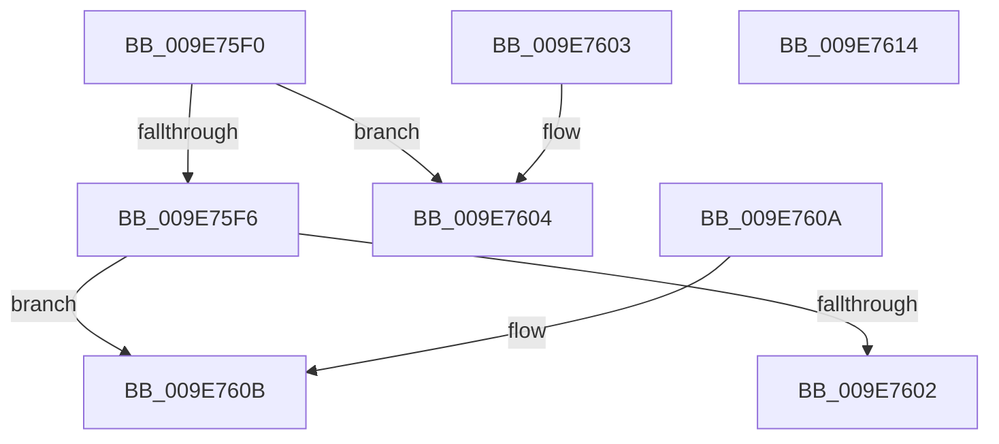

# SeValidateSecurityQos

- RVA: `0x009E75F0`–`0x009E7615` (길이 `37` bytes)
- VA: `0x00000001409E75F0`
- 실행 섹션: `PAGE`
- PDB 이름 있음: `예`; PDB Function 태그: `아니요`
- unwind 정보 RVA: `0x000DB714`
- 디코드: `16`개 명령, `37/37` bytes 표시
- 미해석 바이트: `0` (있으면 어셈블리에 `.byte`로 보존)

> 이 문서는 커널 이미지의 기계어와 PDB 기호를 분석해 생성했습니다. 4번과 5번은 함수 원형과 자료형을 바이너리 사용 방식에서 추정한 C 해석이며 원본 소스 복구 결과는 아닙니다.

## 1. Dependencies

- 직접 호출 지점: **0**; 고유 호출 대상: **0**
- 직접 호출자로 확인된 함수: **1**
- RIP 상대 이미지 참조: **0**

### Outgoing calls
- 직접 디코드된 call 명령이 없습니다.

### Direct callers
- [AlpcpValidateAndSetPortAttributes](AlpcpValidateAndSetPortAttributes_function_009E73BC.md) at `0x009E7490`

### Static image references
- 디코드된 RIP-relative 메모리 참조가 없습니다.

## 2. Other-region calls and transfers

- 다른 실행 섹션으로 향하는 call: **0**
- 별도 외부 분기/꼬리 이동을 확인하지 못했습니다.

## 3. Assembly (complete function range)

```asm
009E75F0  80 79 08 02                     cmp byte ptr [rcx + 8], 2
009E75F4  73 0E                           jae 0x1409e7604
009E75F6  8B 51 04                        mov edx, dword ptr [rcx + 4]
009E75F9  B8 A5 00 00 C0                  mov eax, 0xc00000a5
009E75FE  85 D2                           test edx, edx
009E7600  79 09                           jns 0x1409e760b
009E7602  C3                              ret
009E7603  CC                              int3
009E7604  B8 0D 00 00 C0                  mov eax, 0xc000000d
009E7609  C3                              ret
009E760A  CC                              int3
009E760B  33 C9                           xor ecx, ecx
009E760D  83 FA 03                        cmp edx, 3
009E7610  0F 4E C1                        cmovle eax, ecx
009E7613  C3                              ret
009E7614  CC                              int3
```

## 4. C-style interpretation (structured pseudocode)

```c
__int64 __fastcall SeValidateSecurityQos(__int64 a1)
{
    __int64 result;

    if ((*(unsigned __int8 *)(a1 + 8)) >= 2) goto loc_009E7604;
    if (!sign_flag) goto loc_009E760B;
    return (unsigned int)(0xC00000A5ULL);
loc_009E7604:
    return (unsigned int)(0xC000000DULL);
loc_009E760B:
    a1 = 0;
    result = (unsigned int)(0xC000000DULL);
    if (((unsigned int)((unsigned int)(*(unsigned int *)(a1 + 4)))) <= 3) { result = 0; }
    return result;
}
```

## 5. (Beta) C Style

```c
int64_t SeValidateSecurityQos(void *Arg1)
{
    uint8_t *arg1 = (uint8_t *)Arg1;

    int64_t result;

    if ((*(uint8_t *)(arg1 + 0x8)) >= 2) goto loc_009E7604;
    if (!sign_flag) goto loc_009E760B;
    return (uint32_t)(0xC00000A5ULL);
loc_009E7604:
    return (uint32_t)(0xC000000DULL);
loc_009E760B:
    Arg1 = 0;
    result = (uint32_t)(0xC000000DULL);
    if (((uint32_t)((uint32_t)(*(uint32_t *)(arg1 + 0x4)))) <= 3) { result = 0; }
    return result;
}
```

### 관측된 메모리 오프셋

구조체 형식이 확인되지 않은 접근은 인자 기준의 오프셋으로만 기록했습니다.

| 기준 인자 | 오프셋 표현 | 폭 (bit) | 접근 |
|---|---:|---:|---|
| `Arg1` | `+ 0x4` | `32` | `R` |
| `Arg1` | `+ 0x8` | `8` | `R` |

## 6. Execution-region graph

[열기: 2D/3D 그래프와 함수 탐색 컨트롤 패널](../../../control-panel.html?section=page&rva=0x009E75F0&view=graph)

- 2D 그래프는 위에서 아래로 흐르고, 3D 그래프는 빈 공간을 드래그해 회전합니다. Shift+드래그는 이동, 휠은 확대·축소, 함수 노드 선택은 대상 보고서 이동입니다.

### Static fallback


