# SepCopyTokenAccessInformation

- RVA: `0x009E9C0C`–`0x009EA278` (길이 `1,644` bytes)
- VA: `0x00000001409E9C0C`
- 실행 섹션: `PAGE`
- PDB 이름 있음: `예`; PDB Function 태그: `아니요`
- unwind 정보 RVA: `0x000A52A4`
- 디코드: `411`개 명령, `1,644/1,644` bytes 표시
- 미해석 바이트: `0` (있으면 어셈블리에 `.byte`로 보존)

> 이 문서는 커널 이미지의 기계어와 PDB 기호를 분석해 생성했습니다. 4번과 5번은 함수 원형과 자료형을 바이너리 사용 방식에서 추정한 C 해석이며 원본 소스 복구 결과는 아닙니다.

## 1. Dependencies

- 직접 호출 지점: **14**; 고유 호출 대상: **8**
- 직접 호출자로 확인된 함수: **2**
- RIP 상대 이미지 참조: **1**

### Outgoing calls
- `0x009E9CC3` → [memset](../../text/6C/memset_function_006C6C40.md) (function, `0x006C6C40`)
- `0x009E9D02` → [SeQueryMandatoryPolicyToken](../../text/43/SeQueryMandatoryPolicyToken_function_004382B0.md) (function, `0x004382B0`)
- `0x009E9DB2` → [memcpy](../../text/6C/memcpy_function_006C6840.md) (function, `0x006C6840`)
- `0x009E9DF6` → [RtlSidHashInitialize](../../text/41/RtlSidHashInitialize_function_00416EA0.md) (function, `0x00416EA0`)
- `0x009E9F04` → [memcpy](../../text/6C/memcpy_function_006C6840.md) (function, `0x006C6840`)
- `0x009E9F41` → [RtlSidHashInitialize](../../text/41/RtlSidHashInitialize_function_00416EA0.md) (function, `0x00416EA0`)
- `0x009EA059` → [memcpy](../../text/6C/memcpy_function_006C6840.md) (function, `0x006C6840`)
- `0x009EA096` → [RtlSidHashInitialize](../../text/41/RtlSidHashInitialize_function_00416EA0.md) (function, `0x00416EA0`)
- `0x009EA132` → [memcpy](../../text/6C/memcpy_function_006C6840.md) (function, `0x006C6840`)
- `0x009EA17A` → [memcpy](../../text/6C/memcpy_function_006C6840.md) (function, `0x006C6840`)
- `0x009EA1EC` → [AuthzBasepGetInternalSecurityAttributeValueCopyoutBufferSize](../../text/46/AuthzBasepGetInternalSecurityAttributeValueCopyoutBufferSize_function_00469B40.md) (function, `0x00469B40`)
- `0x009EA225` → [SepConvertTokenPrivilegesToLuidAndAttributes](../../text/42/SepConvertTokenPrivilegesToLuidAndAttributes_function_0042A870.md) (function, `0x0042A870`)
- `0x009EA234` → [_security_check_cookie](../../text/6A/_security_check_cookie_function_006AC640.md) (function, `0x006AC640`)
- `0x009EA269` → [AuthzBasepCopyoutInternalSecurityAttributes](AuthzBasepCopyoutInternalSecurityAttributes_function_009EA280.md) (function, `0x009EA280`)

### Direct callers
- [SeQueryInformationToken](../8B/SeQueryInformationToken_function_008B5090.md) at `0x008B5828`
- [NtQueryInformationToken](../AE/NtQueryInformationToken_function_00AECDD0.md) at `0x00AEECB0`

### Static image references
- `0x009E9C2B` → RVA `0x00E0A740` (`.data`; read)

## 2. Other-region calls and transfers

- 다른 실행 섹션으로 향하는 call: **13**
  - `0x009E9CC3` → [memset](../../text/6C/memset_function_006C6C40.md) (`PAGE` → `.text`)
  - `0x009E9D02` → [SeQueryMandatoryPolicyToken](../../text/43/SeQueryMandatoryPolicyToken_function_004382B0.md) (`PAGE` → `.text`)
  - `0x009E9DB2` → [memcpy](../../text/6C/memcpy_function_006C6840.md) (`PAGE` → `.text`)
  - `0x009E9DF6` → [RtlSidHashInitialize](../../text/41/RtlSidHashInitialize_function_00416EA0.md) (`PAGE` → `.text`)
  - `0x009E9F04` → [memcpy](../../text/6C/memcpy_function_006C6840.md) (`PAGE` → `.text`)
  - `0x009E9F41` → [RtlSidHashInitialize](../../text/41/RtlSidHashInitialize_function_00416EA0.md) (`PAGE` → `.text`)
  - `0x009EA059` → [memcpy](../../text/6C/memcpy_function_006C6840.md) (`PAGE` → `.text`)
  - `0x009EA096` → [RtlSidHashInitialize](../../text/41/RtlSidHashInitialize_function_00416EA0.md) (`PAGE` → `.text`)
  - `0x009EA132` → [memcpy](../../text/6C/memcpy_function_006C6840.md) (`PAGE` → `.text`)
  - `0x009EA17A` → [memcpy](../../text/6C/memcpy_function_006C6840.md) (`PAGE` → `.text`)
  - `0x009EA1EC` → [AuthzBasepGetInternalSecurityAttributeValueCopyoutBufferSize](../../text/46/AuthzBasepGetInternalSecurityAttributeValueCopyoutBufferSize_function_00469B40.md) (`PAGE` → `.text`)
  - `0x009EA225` → [SepConvertTokenPrivilegesToLuidAndAttributes](../../text/42/SepConvertTokenPrivilegesToLuidAndAttributes_function_0042A870.md) (`PAGE` → `.text`)
  - `0x009EA234` → [_security_check_cookie](../../text/6A/_security_check_cookie_function_006AC640.md) (`PAGE` → `.text`)
- 별도 외부 분기/꼬리 이동을 확인하지 못했습니다.

## 3. Assembly (complete function range)

```asm
009E9C0C  48 89 5C 24 20                  mov qword ptr [rsp + 0x20], rbx
009E9C11  55                              push rbp
009E9C12  56                              push rsi
009E9C13  57                              push rdi
009E9C14  41 54                           push r12
009E9C16  41 55                           push r13
009E9C18  41 56                           push r14
009E9C1A  41 57                           push r15
009E9C1C  48 8D AC 24 70 FF FF FF         lea rbp, [rsp - 0x90]
009E9C24  48 81 EC 90 01 00 00            sub rsp, 0x190
009E9C2B  48 8B 05 0E 0B 42 00            mov rax, qword ptr [rip + 0x420b0e]
009E9C32  48 33 C4                        xor rax, rsp
009E9C35  48 89 85 80 00 00 00            mov qword ptr [rbp + 0x80], rax
009E9C3C  8B 85 F0 00 00 00               mov eax, dword ptr [rbp + 0xf0]
009E9C42  4C 8B E2                        mov r12, rdx
009E9C45  8B B5 F8 00 00 00               mov esi, dword ptr [rbp + 0xf8]
009E9C4B  48 8B F9                        mov rdi, rcx
009E9C4E  89 44 24 20                     mov dword ptr [rsp + 0x20], eax
009E9C52  48 8D 4C 24 70                  lea rcx, [rsp + 0x70]
009E9C57  8B 85 00 01 00 00               mov eax, dword ptr [rbp + 0x100]
009E9C5D  33 D2                           xor edx, edx
009E9C5F  89 44 24 24                     mov dword ptr [rsp + 0x24], eax
009E9C63  8B 85 08 01 00 00               mov eax, dword ptr [rbp + 0x108]
009E9C69  89 44 24 30                     mov dword ptr [rsp + 0x30], eax
009E9C6D  8B 85 10 01 00 00               mov eax, dword ptr [rbp + 0x110]
009E9C73  89 44 24 28                     mov dword ptr [rsp + 0x28], eax
009E9C77  8B 85 18 01 00 00               mov eax, dword ptr [rbp + 0x118]
009E9C7D  89 44 24 3C                     mov dword ptr [rsp + 0x3c], eax
009E9C81  8B 85 20 01 00 00               mov eax, dword ptr [rbp + 0x120]
009E9C87  89 44 24 34                     mov dword ptr [rsp + 0x34], eax
009E9C8B  8B 85 28 01 00 00               mov eax, dword ptr [rbp + 0x128]
009E9C91  89 44 24 4C                     mov dword ptr [rsp + 0x4c], eax
009E9C95  8B 85 30 01 00 00               mov eax, dword ptr [rbp + 0x130]
009E9C9B  89 44 24 50                     mov dword ptr [rsp + 0x50], eax
009E9C9F  48 8B 85 40 01 00 00            mov rax, qword ptr [rbp + 0x140]
009E9CA6  48 89 44 24 60                  mov qword ptr [rsp + 0x60], rax
009E9CAB  33 C0                           xor eax, eax
009E9CAD  41 8B D8                        mov ebx, r8d
009E9CB0  41 B8 0C 01 00 00               mov r8d, 0x10c
009E9CB6  89 44 24 74                     mov dword ptr [rsp + 0x74], eax
009E9CBA  44 89 4C 24 54                  mov dword ptr [rsp + 0x54], r9d
009E9CBF  89 74 24 48                     mov dword ptr [rsp + 0x48], esi
009E9CC3  E8 78 CF CD FF                  call 0x1406c6c40
009E9CC8  48 8B 47 18                     mov rax, qword ptr [rdi + 0x18]
009E9CCC  49 8D 54 24 28                  lea rdx, [r12 + 0x28]
009E9CD1  49 89 44 24 18                  mov qword ptr [r12 + 0x18], rax
009E9CD6  49 03 DC                        add rbx, r12
009E9CD9  8B 87 C0 00 00 00               mov eax, dword ptr [rdi + 0xc0]
009E9CDF  48 8B CF                        mov rcx, rdi
009E9CE2  41 89 44 24 20                  mov dword ptr [r12 + 0x20], eax
009E9CE7  8B 87 C4 00 00 00               mov eax, dword ptr [rdi + 0xc4]
009E9CED  41 89 44 24 24                  mov dword ptr [r12 + 0x24], eax
009E9CF2  8B 87 C8 00 00 00               mov eax, dword ptr [rdi + 0xc8]
009E9CF8  41 89 44 24 2C                  mov dword ptr [r12 + 0x2c], eax
009E9CFD  48 89 5C 24 58                  mov qword ptr [rsp + 0x58], rbx
009E9D02  E8 A9 E5 A4 FF                  call 0x1404382b0
009E9D07  48 8B 87 38 04 00 00            mov rax, qword ptr [rdi + 0x438]
009E9D0E  48 85 C0                        test rax, rax
009E9D11  0F 85 59 05 00 00               jne 0x1409ea270
009E9D17  8B 5C 24 20                     mov ebx, dword ptr [rsp + 0x20]
009E9D1B  4D 8D 6C 24 58                  lea r13, [r12 + 0x58]
009E9D20  41 89 44 24 30                  mov dword ptr [r12 + 0x30], eax
009E9D25  4D 8D BD 10 01 00 00            lea r15, [r13 + 0x110]
009E9D2C  8B 47 7C                        mov eax, dword ptr [rdi + 0x7c]
009E9D2F  45 33 C0                        xor r8d, r8d
009E9D32  4D 89 7D 08                     mov qword ptr [r13 + 8], r15
009E9D36  8B D3                           mov edx, ebx
009E9D38  2B 54 24 48                     sub edx, dword ptr [rsp + 0x48]
009E9D3C  49 03 F7                        add rsi, r15
009E9D3F  41 89 45 00                     mov dword ptr [r13], eax
009E9D43  4D 89 2C 24                     mov qword ptr [r12], r13
009E9D47  8B 47 7C                        mov eax, dword ptr [rdi + 0x7c]
009E9D4A  4C 8B B7 98 00 00 00            mov r14, qword ptr [rdi + 0x98]
009E9D51  4C 89 6C 24 40                  mov qword ptr [rsp + 0x40], r13
009E9D56  44 89 44 24 38                  mov dword ptr [rsp + 0x38], r8d
009E9D5B  85 C0                           test eax, eax
009E9D5D  0F 84 84 00 00 00               je 0x1409e9de7
009E9D63  49 8D 5F 08                     lea rbx, [r15 + 8]
009E9D67  4D 2B F7                        sub r14, r15
009E9D6A  44 8B E8                        mov r13d, eax
009E9D6D  49 8B 44 1E F8                  mov rax, qword ptr [r14 + rbx - 8]
009E9D72  0F B6 48 01                     movzx ecx, byte ptr [rax + 1]
009E9D76  44 8D 3C 8D 08 00 00 00         lea r15d, [rcx*4 + 8]
009E9D7E  44 3B FA                        cmp r15d, edx
009E9D81  77 54                           ja 0x1409e9dd7
009E9D83  48 89 73 F8                     mov qword ptr [rbx - 8], rsi
009E9D87  41 2B D7                        sub edx, r15d
009E9D8A  41 8B 04 1E                     mov eax, dword ptr [r14 + rbx]
009E9D8E  89 03                           mov dword ptr [rbx], eax
009E9D90  49 8B 4C 1E F8                  mov rcx, qword ptr [r14 + rbx - 8]
009E9D95  89 54 24 2C                     mov dword ptr [rsp + 0x2c], edx
009E9D99  0F B6 41 01                     movzx eax, byte ptr [rcx + 1]
009E9D9D  8D 04 85 08 00 00 00            lea eax, [rax*4 + 8]
009E9DA4  41 3B C7                        cmp eax, r15d
009E9DA7  77 17                           ja 0x1409e9dc0
009E9DA9  48 8B D1                        mov rdx, rcx
009E9DAC  44 8B C0                        mov r8d, eax
009E9DAF  48 8B CE                        mov rcx, rsi
009E9DB2  E8 89 CA CD FF                  call 0x1406c6840
009E9DB7  8B 54 24 2C                     mov edx, dword ptr [rsp + 0x2c]
009E9DBB  44 8B 44 24 38                  mov r8d, dword ptr [rsp + 0x38]
009E9DC0  41 FF C0                        inc r8d
009E9DC3  41 8B C7                        mov eax, r15d
009E9DC6  48 03 F0                        add rsi, rax
009E9DC9  44 89 44 24 38                  mov dword ptr [rsp + 0x38], r8d
009E9DCE  48 83 C3 10                     add rbx, 0x10
009E9DD2  45 3B C5                        cmp r8d, r13d
009E9DD5  72 96                           jb 0x1409e9d6d
009E9DD7  4C 8B 6C 24 40                  mov r13, qword ptr [rsp + 0x40]
009E9DDC  8B 5C 24 20                     mov ebx, dword ptr [rsp + 0x20]
009E9DE0  4D 8D BD 10 01 00 00            lea r15, [r13 + 0x110]
009E9DE7  8B 57 7C                        mov edx, dword ptr [rdi + 0x7c]
009E9DEA  4C 8D 44 24 70                  lea r8, [rsp + 0x70]
009E9DEF  48 8B 8F 98 00 00 00            mov rcx, qword ptr [rdi + 0x98]
009E9DF6  E8 A5 D0 A2 FF                  call 0x140416ea0
009E9DFB  8B 44 24 70                     mov eax, dword ptr [rsp + 0x70]
009E9DFF  48 8D 4D 80                     lea rcx, [rbp - 0x80]
009E9E03  BA 02 00 00 00                  mov edx, 2
009E9E08  41 89 45 00                     mov dword ptr [r13], eax
009E9E0C  49 8D 45 10                     lea rax, [r13 + 0x10]
009E9E10  44 8D 42 7E                     lea r8d, [rdx + 0x7e]
009E9E14  0F 10 01                        movups xmm0, xmmword ptr [rcx]
009E9E17  0F 10 49 10                     movups xmm1, xmmword ptr [rcx + 0x10]
009E9E1B  0F 11 00                        movups xmmword ptr [rax], xmm0
009E9E1E  0F 10 41 20                     movups xmm0, xmmword ptr [rcx + 0x20]
009E9E22  0F 11 48 10                     movups xmmword ptr [rax + 0x10], xmm1
009E9E26  0F 10 49 30                     movups xmm1, xmmword ptr [rcx + 0x30]
009E9E2A  0F 11 40 20                     movups xmmword ptr [rax + 0x20], xmm0
009E9E2E  0F 10 41 40                     movups xmm0, xmmword ptr [rcx + 0x40]
009E9E32  0F 11 48 30                     movups xmmword ptr [rax + 0x30], xmm1
009E9E36  0F 10 49 50                     movups xmm1, xmmword ptr [rcx + 0x50]
009E9E3A  0F 11 40 40                     movups xmmword ptr [rax + 0x40], xmm0
009E9E3E  0F 10 41 60                     movups xmm0, xmmword ptr [rcx + 0x60]
009E9E42  0F 11 48 50                     movups xmmword ptr [rax + 0x50], xmm1
009E9E46  0F 10 49 70                     movups xmm1, xmmword ptr [rcx + 0x70]
009E9E4A  49 03 C8                        add rcx, r8
009E9E4D  0F 11 40 60                     movups xmmword ptr [rax + 0x60], xmm0
009E9E51  49 03 C0                        add rax, r8
009E9E54  0F 11 48 F0                     movups xmmword ptr [rax - 0x10], xmm1
009E9E58  48 83 EA 01                     sub rdx, 1
009E9E5C  75 B6                           jne 0x1409e9e14
009E9E5E  49 03 DF                        add rbx, r15
009E9E61  4D 89 7D 08                     mov qword ptr [r13 + 8], r15
009E9E65  8B 87 80 00 00 00               mov eax, dword ptr [rdi + 0x80]
009E9E6B  89 03                           mov dword ptr [rbx], eax
009E9E6D  4C 8D B3 10 01 00 00            lea r14, [rbx + 0x110]
009E9E74  4C 89 73 08                     mov qword ptr [rbx + 8], r14
009E9E78  49 89 5C 24 08                  mov qword ptr [r12 + 8], rbx
009E9E7D  8B 87 80 00 00 00               mov eax, dword ptr [rdi + 0x80]
009E9E83  89 44 24 2C                     mov dword ptr [rsp + 0x2c], eax
009E9E87  85 C0                           test eax, eax
009E9E89  0F 84 23 01 00 00               je 0x1409e9fb2
009E9E8F  8B 44 24 30                     mov eax, dword ptr [rsp + 0x30]
009E9E93  49 8D 76 08                     lea rsi, [r14 + 8]
009E9E97  44 8B 44 24 24                  mov r8d, dword ptr [rsp + 0x24]
009E9E9C  45 33 C9                        xor r9d, r9d
009E9E9F  48 8B 97 A0 00 00 00            mov rdx, qword ptr [rdi + 0xa0]
009E9EA6  44 2B C0                        sub r8d, eax
009E9EA9  49 2B D6                        sub rdx, r14
009E9EAC  44 89 4C 24 20                  mov dword ptr [rsp + 0x20], r9d
009E9EB1  4D 8D 3C 06                     lea r15, [r14 + rax]
009E9EB5  48 89 54 24 40                  mov qword ptr [rsp + 0x40], rdx
009E9EBA  44 8B 74 24 2C                  mov r14d, dword ptr [rsp + 0x2c]
009E9EBF  48 8B 44 32 F8                  mov rax, qword ptr [rdx + rsi - 8]
009E9EC4  0F B6 48 01                     movzx ecx, byte ptr [rax + 1]
009E9EC8  44 8D 2C 8D 08 00 00 00         lea r13d, [rcx*4 + 8]
009E9ED0  45 3B E8                        cmp r13d, r8d
009E9ED3  77 5A                           ja 0x1409e9f2f
009E9ED5  4C 89 7E F8                     mov qword ptr [rsi - 8], r15
009E9ED9  45 2B C5                        sub r8d, r13d
009E9EDC  8B 04 32                        mov eax, dword ptr [rdx + rsi]
009E9EDF  89 06                           mov dword ptr [rsi], eax
009E9EE1  48 8B 4C 32 F8                  mov rcx, qword ptr [rdx + rsi - 8]
009E9EE6  44 89 44 24 30                  mov dword ptr [rsp + 0x30], r8d
009E9EEB  0F B6 41 01                     movzx eax, byte ptr [rcx + 1]
009E9EEF  8D 04 85 08 00 00 00            lea eax, [rax*4 + 8]
009E9EF6  41 3B C5                        cmp eax, r13d
009E9EF9  77 1D                           ja 0x1409e9f18
009E9EFB  48 8B D1                        mov rdx, rcx
009E9EFE  44 8B C0                        mov r8d, eax
009E9F01  49 8B CF                        mov rcx, r15
009E9F04  E8 37 C9 CD FF                  call 0x1406c6840
009E9F09  48 8B 54 24 40                  mov rdx, qword ptr [rsp + 0x40]
009E9F0E  44 8B 44 24 30                  mov r8d, dword ptr [rsp + 0x30]
009E9F13  44 8B 4C 24 20                  mov r9d, dword ptr [rsp + 0x20]
009E9F18  41 FF C1                        inc r9d
009E9F1B  41 8B C5                        mov eax, r13d
009E9F1E  4C 03 F8                        add r15, rax
009E9F21  44 89 4C 24 20                  mov dword ptr [rsp + 0x20], r9d
009E9F26  48 83 C6 10                     add rsi, 0x10
009E9F2A  45 3B CE                        cmp r9d, r14d
009E9F2D  72 90                           jb 0x1409e9ebf
009E9F2F  8B 97 80 00 00 00               mov edx, dword ptr [rdi + 0x80]
009E9F35  4C 8D 44 24 70                  lea r8, [rsp + 0x70]
009E9F3A  48 8B 8F A0 00 00 00            mov rcx, qword ptr [rdi + 0xa0]
009E9F41  E8 5A CF A2 FF                  call 0x140416ea0
009E9F46  8B 44 24 70                     mov eax, dword ptr [rsp + 0x70]
009E9F4A  48 8D 4D 80                     lea rcx, [rbp - 0x80]
009E9F4E  BA 02 00 00 00                  mov edx, 2
009E9F53  89 03                           mov dword ptr [rbx], eax
009E9F55  48 8D 43 10                     lea rax, [rbx + 0x10]
009E9F59  4C 8D B3 10 01 00 00            lea r14, [rbx + 0x110]
009E9F60  44 8D 42 7E                     lea r8d, [rdx + 0x7e]
009E9F64  0F 10 01                        movups xmm0, xmmword ptr [rcx]
009E9F67  0F 10 49 10                     movups xmm1, xmmword ptr [rcx + 0x10]
009E9F6B  0F 11 00                        movups xmmword ptr [rax], xmm0
009E9F6E  0F 10 41 20                     movups xmm0, xmmword ptr [rcx + 0x20]
009E9F72  0F 11 48 10                     movups xmmword ptr [rax + 0x10], xmm1
009E9F76  0F 10 49 30                     movups xmm1, xmmword ptr [rcx + 0x30]
009E9F7A  0F 11 40 20                     movups xmmword ptr [rax + 0x20], xmm0
009E9F7E  0F 10 41 40                     movups xmm0, xmmword ptr [rcx + 0x40]
009E9F82  0F 11 48 30                     movups xmmword ptr [rax + 0x30], xmm1
009E9F86  0F 10 49 50                     movups xmm1, xmmword ptr [rcx + 0x50]
009E9F8A  0F 11 40 40                     movups xmmword ptr [rax + 0x40], xmm0
009E9F8E  0F 10 41 60                     movups xmm0, xmmword ptr [rcx + 0x60]
009E9F92  0F 11 48 50                     movups xmmword ptr [rax + 0x50], xmm1
009E9F96  0F 10 49 70                     movups xmm1, xmmword ptr [rcx + 0x70]
009E9F9A  49 03 C8                        add rcx, r8
009E9F9D  0F 11 40 60                     movups xmmword ptr [rax + 0x60], xmm0
009E9FA1  49 03 C0                        add rax, r8
009E9FA4  0F 11 48 F0                     movups xmmword ptr [rax - 0x10], xmm1
009E9FA8  48 83 EA 01                     sub rdx, 1
009E9FAC  75 B6                           jne 0x1409e9f64
009E9FAE  4C 89 73 08                     mov qword ptr [rbx + 8], r14
009E9FB2  8B 87 20 03 00 00               mov eax, dword ptr [rdi + 0x320]
009E9FB8  8B 5C 24 24                     mov ebx, dword ptr [rsp + 0x24]
009E9FBC  49 03 DE                        add rbx, r14
009E9FBF  89 03                           mov dword ptr [rbx], eax
009E9FC1  48 8D B3 10 01 00 00            lea rsi, [rbx + 0x110]
009E9FC8  48 89 73 08                     mov qword ptr [rbx + 8], rsi
009E9FCC  49 89 5C 24 40                  mov qword ptr [r12 + 0x40], rbx
009E9FD1  8B 87 20 03 00 00               mov eax, dword ptr [rdi + 0x320]
009E9FD7  89 44 24 30                     mov dword ptr [rsp + 0x30], eax
009E9FDB  85 C0                           test eax, eax
009E9FDD  0F 84 24 01 00 00               je 0x1409ea107
009E9FE3  8B 44 24 34                     mov eax, dword ptr [rsp + 0x34]
009E9FE7  4C 8D 76 08                     lea r14, [rsi + 8]
009E9FEB  44 8B 44 24 3C                  mov r8d, dword ptr [rsp + 0x3c]
009E9FF0  45 33 C9                        xor r9d, r9d
009E9FF3  48 8B 97 18 03 00 00            mov rdx, qword ptr [rdi + 0x318]
009E9FFA  44 2B C0                        sub r8d, eax
009E9FFD  48 2B D6                        sub rdx, rsi
009EA000  44 89 4C 24 24                  mov dword ptr [rsp + 0x24], r9d
009EA005  4C 8D 3C 06                     lea r15, [rsi + rax]
009EA009  48 89 54 24 40                  mov qword ptr [rsp + 0x40], rdx
009EA00E  8B 74 24 30                     mov esi, dword ptr [rsp + 0x30]
009EA012  4A 8B 44 32 F8                  mov rax, qword ptr [rdx + r14 - 8]
009EA017  0F B6 48 01                     movzx ecx, byte ptr [rax + 1]
009EA01B  44 8D 2C 8D 08 00 00 00         lea r13d, [rcx*4 + 8]
009EA023  45 3B E8                        cmp r13d, r8d
009EA026  77 5C                           ja 0x1409ea084
009EA028  4D 89 7E F8                     mov qword ptr [r14 - 8], r15
009EA02C  45 2B C5                        sub r8d, r13d
009EA02F  42 8B 04 32                     mov eax, dword ptr [rdx + r14]
009EA033  41 89 06                        mov dword ptr [r14], eax
009EA036  4A 8B 4C 32 F8                  mov rcx, qword ptr [rdx + r14 - 8]
009EA03B  44 89 44 24 34                  mov dword ptr [rsp + 0x34], r8d
009EA040  0F B6 41 01                     movzx eax, byte ptr [rcx + 1]
009EA044  8D 04 85 08 00 00 00            lea eax, [rax*4 + 8]
009EA04B  41 3B C5                        cmp eax, r13d
009EA04E  77 1D                           ja 0x1409ea06d
009EA050  48 8B D1                        mov rdx, rcx
009EA053  44 8B C0                        mov r8d, eax
009EA056  49 8B CF                        mov rcx, r15
009EA059  E8 E2 C7 CD FF                  call 0x1406c6840
009EA05E  48 8B 54 24 40                  mov rdx, qword ptr [rsp + 0x40]
009EA063  44 8B 44 24 34                  mov r8d, dword ptr [rsp + 0x34]
009EA068  44 8B 4C 24 24                  mov r9d, dword ptr [rsp + 0x24]
009EA06D  41 FF C1                        inc r9d
009EA070  41 8B C5                        mov eax, r13d
009EA073  4C 03 F8                        add r15, rax
009EA076  44 89 4C 24 24                  mov dword ptr [rsp + 0x24], r9d
009EA07B  49 83 C6 10                     add r14, 0x10
009EA07F  44 3B CE                        cmp r9d, esi
009EA082  72 8E                           jb 0x1409ea012
009EA084  8B 97 20 03 00 00               mov edx, dword ptr [rdi + 0x320]
009EA08A  4C 8D 44 24 70                  lea r8, [rsp + 0x70]
009EA08F  48 8B 8F 18 03 00 00            mov rcx, qword ptr [rdi + 0x318]
009EA096  E8 05 CE A2 FF                  call 0x140416ea0
009EA09B  8B 44 24 70                     mov eax, dword ptr [rsp + 0x70]
009EA09F  48 8D 4D 80                     lea rcx, [rbp - 0x80]
009EA0A3  BA 02 00 00 00                  mov edx, 2
009EA0A8  89 03                           mov dword ptr [rbx], eax
009EA0AA  48 8D 43 10                     lea rax, [rbx + 0x10]
009EA0AE  48 8D B3 10 01 00 00            lea rsi, [rbx + 0x110]
009EA0B5  44 8D 42 7E                     lea r8d, [rdx + 0x7e]
009EA0B9  0F 10 01                        movups xmm0, xmmword ptr [rcx]
009EA0BC  0F 10 49 10                     movups xmm1, xmmword ptr [rcx + 0x10]
009EA0C0  0F 11 00                        movups xmmword ptr [rax], xmm0
009EA0C3  0F 10 41 20                     movups xmm0, xmmword ptr [rcx + 0x20]
009EA0C7  0F 11 48 10                     movups xmmword ptr [rax + 0x10], xmm1
009EA0CB  0F 10 49 30                     movups xmm1, xmmword ptr [rcx + 0x30]
009EA0CF  0F 11 40 20                     movups xmmword ptr [rax + 0x20], xmm0
009EA0D3  0F 10 41 40                     movups xmm0, xmmword ptr [rcx + 0x40]
009EA0D7  0F 11 48 30                     movups xmmword ptr [rax + 0x30], xmm1
009EA0DB  0F 10 49 50                     movups xmm1, xmmword ptr [rcx + 0x50]
009EA0DF  0F 11 40 40                     movups xmmword ptr [rax + 0x40], xmm0
009EA0E3  0F 10 41 60                     movups xmm0, xmmword ptr [rcx + 0x60]
009EA0E7  0F 11 48 50                     movups xmmword ptr [rax + 0x50], xmm1
009EA0EB  0F 10 49 70                     movups xmm1, xmmword ptr [rcx + 0x70]
009EA0EF  49 03 C8                        add rcx, r8
009EA0F2  0F 11 40 60                     movups xmmword ptr [rax + 0x60], xmm0
009EA0F6  49 03 C0                        add rax, r8
009EA0F9  0F 11 48 F0                     movups xmmword ptr [rax - 0x10], xmm1
009EA0FD  48 83 EA 01                     sub rdx, 1
009EA101  75 B6                           jne 0x1409ea0b9
009EA103  48 89 73 08                     mov qword ptr [rbx + 8], rsi
009EA107  8B 5C 24 3C                     mov ebx, dword ptr [rsp + 0x3c]
009EA10B  8B 44 24 28                     mov eax, dword ptr [rsp + 0x28]
009EA10F  48 03 DE                        add rbx, rsi
009EA112  33 F6                           xor esi, esi
009EA114  85 C0                           test eax, eax
009EA116  74 23                           je 0x1409ea13b
009EA118  48 8B 97 10 03 00 00            mov rdx, qword ptr [rdi + 0x310]
009EA11F  48 8B CB                        mov rcx, rbx
009EA122  48 8B F3                        mov rsi, rbx
009EA125  44 0F B6 42 01                  movzx r8d, byte ptr [rdx + 1]
009EA12A  4E 8D 04 85 08 00 00 00         lea r8, [r8*4 + 8]
009EA132  E8 09 C7 CD FF                  call 0x1406c6840
009EA137  8B 44 24 28                     mov eax, dword ptr [rsp + 0x28]
009EA13B  80 BD 38 01 00 00 00            cmp byte ptr [rbp + 0x138], 0
009EA142  48 8B 4C 24 60                  mov rcx, qword ptr [rsp + 0x60]
009EA147  49 89 74 24 38                  mov qword ptr [r12 + 0x38], rsi
009EA14C  75 07                           jne 0x1409ea155
009EA14E  48 8B 8F 50 04 00 00            mov rcx, qword ptr [rdi + 0x450]
009EA155  44 8B 74 24 4C                  mov r14d, dword ptr [rsp + 0x4c]
009EA15A  48 03 D8                        add rbx, rax
009EA15D  33 F6                           xor esi, esi
009EA15F  45 85 F6                        test r14d, r14d
009EA162  74 1B                           je 0x1409ea17f
009EA164  44 0F B6 41 01                  movzx r8d, byte ptr [rcx + 1]
009EA169  48 8B D1                        mov rdx, rcx
009EA16C  48 8B CB                        mov rcx, rbx
009EA16F  48 8B F3                        mov rsi, rbx
009EA172  4E 8D 04 85 08 00 00 00         lea r8, [r8*4 + 8]
009EA17A  E8 C1 C6 CD FF                  call 0x1406c6840
009EA17F  48 8B 4C 24 58                  mov rcx, qword ptr [rsp + 0x58]
009EA184  49 03 DE                        add rbx, r14
009EA187  2B CB                           sub ecx, ebx
009EA189  49 89 74 24 48                  mov qword ptr [r12 + 0x48], rsi
009EA18E  4C 8B B7 08 03 00 00            mov r14, qword ptr [rdi + 0x308]
009EA195  48 89 4C 24 58                  mov qword ptr [rsp + 0x58], rcx
009EA19A  4D 85 F6                        test r14, r14
009EA19D  74 68                           je 0x1409ea207
009EA19F  85 C9                           test ecx, ecx
009EA1A1  0F 85 AE 00 00 00               jne 0x1409ea255
009EA1A7  41 8B 06                        mov eax, dword ptr [r14]
009EA1AA  B9 FF FF FF FF                  mov ecx, 0xffffffff
009EA1AF  48 6B C0 70                     imul rax, rax, 0x70
009EA1B3  48 3B C1                        cmp rax, rcx
009EA1B6  77 4F                           ja 0x1409ea207
009EA1B8  83 C0 30                        add eax, 0x30
009EA1BB  83 F8 30                        cmp eax, 0x30
009EA1BE  72 47                           jb 0x1409ea207
009EA1C0  4D 8D 7E 08                     lea r15, [r14 + 8]
009EA1C4  49 8B 37                        mov rsi, qword ptr [r15]
009EA1C7  49 3B F7                        cmp rsi, r15
009EA1CA  74 32                           je 0x1409ea1fe
009EA1CC  8D 48 01                        lea ecx, [rax + 1]
009EA1CF  83 E1 FE                        and ecx, 0xfffffffe
009EA1D2  3B C8                           cmp ecx, eax
009EA1D4  72 31                           jb 0x1409ea207
009EA1D6  0F B7 56 20                     movzx edx, word ptr [rsi + 0x20]
009EA1DA  03 D1                           add edx, ecx
009EA1DC  3B D1                           cmp edx, ecx
009EA1DE  72 27                           jb 0x1409ea207
009EA1E0  89 54 24 28                     mov dword ptr [rsp + 0x28], edx
009EA1E4  48 8B CE                        mov rcx, rsi
009EA1E7  48 8D 54 24 28                  lea rdx, [rsp + 0x28]
009EA1EC  E8 4F F9 A7 FF                  call 0x140469b40
009EA1F1  85 C0                           test eax, eax
009EA1F3  78 12                           js 0x1409ea207
009EA1F5  48 8B 36                        mov rsi, qword ptr [rsi]
009EA1F8  8B 44 24 28                     mov eax, dword ptr [rsp + 0x28]
009EA1FC  EB C9                           jmp 0x1409ea1c7
009EA1FE  48 8B 4C 24 58                  mov rcx, qword ptr [rsp + 0x58]
009EA203  3B C8                           cmp ecx, eax
009EA205  73 59                           jae 0x1409ea260
009EA207  8B 44 24 54                     mov eax, dword ptr [rsp + 0x54]
009EA20B  48 8B CF                        mov rcx, rdi
009EA20E  8B 54 24 50                     mov edx, dword ptr [rsp + 0x50]
009EA212  48 03 D3                        add rdx, rbx
009EA215  49 89 5C 24 50                  mov qword ptr [r12 + 0x50], rbx
009EA21A  89 02                           mov dword ptr [rdx], eax
009EA21C  49 89 54 24 10                  mov qword ptr [r12 + 0x10], rdx
009EA221  48 83 C2 04                     add rdx, 4
009EA225  E8 46 06 A4 FF                  call 0x14042a870
009EA22A  48 8B 8D 80 00 00 00            mov rcx, qword ptr [rbp + 0x80]
009EA231  48 33 CC                        xor rcx, rsp
009EA234  E8 07 24 CC FF                  call 0x1406ac640
009EA239  48 8B 9C 24 E8 01 00 00         mov rbx, qword ptr [rsp + 0x1e8]
009EA241  48 81 C4 90 01 00 00            add rsp, 0x190
009EA248  41 5F                           pop r15
009EA24A  41 5E                           pop r14
009EA24C  41 5D                           pop r13
009EA24E  41 5C                           pop r12
009EA250  5F                              pop rdi
009EA251  5E                              pop rsi
009EA252  5D                              pop rbp
009EA253  C3                              ret
009EA254  CC                              int3
009EA255  48 85 DB                        test rbx, rbx
009EA258  0F 85 49 FF FF FF               jne 0x1409ea1a7
009EA25E  EB A7                           jmp 0x1409ea207
009EA260  44 8B C1                        mov r8d, ecx
009EA263  48 8B D3                        mov rdx, rbx
009EA266  49 8B CE                        mov rcx, r14
009EA269  E8 12 00 00 00                  call 0x1409ea280
009EA26E  EB 97                           jmp 0x1409ea207
009EA270  8B 40 28                        mov eax, dword ptr [rax + 0x28]
009EA273  E9 9F FA FF FF                  jmp 0x1409e9d17
```

## 4. C-style interpretation (structured pseudocode)

```c
__int64 __fastcall SepCopyTokenAccessInformation(__int64 a1, __int64 a2, int a3, int a4, unsigned int a5, unsigned int a6, unsigned int a7, unsigned int a8, unsigned int a9, unsigned int a10, unsigned int a11, unsigned int a12, unsigned int a13, unsigned __int8 a14, __int64 a15)
{
    __int64 result;
    __int64 v_r14;
    __int64 v_r15;
    __int64 v_rbx;
    __int64 v_rsi;
    __int64 v_rsp;
    unsigned __int64 v_stack_m148;
    unsigned int v_stack_m154;
    unsigned __int64 v_stack_m158;
    unsigned __int64 v_stack_m168;
    unsigned __int64 v_stack_m170;
    unsigned int v_stack_m174;
    unsigned int v_stack_m178;
    unsigned int v_stack_m17C;
    unsigned int v_stack_m180;
    unsigned __int64 v_stack_m188;
    unsigned int v_stack_m18C;
    unsigned int v_stack_m190;
    unsigned int v_stack_m194;
    unsigned int v_stack_m198;
    unsigned int v_stack_m19C;
    unsigned int v_stack_m1A0;
    unsigned int v_stack_m1A4;
    unsigned int v_stack_m1A8;
    unsigned __int64 v_stack_m48;
    unsigned __int64 v_stack_mC8;
    unsigned __int64 v_stack_p20;

    v_stack_p20 = v_rbx;
    v_rsp = (v_rsp) - (400);
    result = (*(unsigned __int64 *)(v_rip + 4328206)) ^ (v_rsp);
    v_stack_m48 = result;
    v_stack_m1A8 = (unsigned int)((unsigned int)(a5));
    a2 = 0;
    v_stack_m1A4 = (unsigned int)((unsigned int)(a7));
    v_stack_m198 = (unsigned int)((unsigned int)(a8));
    v_stack_m1A0 = (unsigned int)((unsigned int)(a9));
    v_stack_m18C = (unsigned int)((unsigned int)(a10));
    v_stack_m194 = (unsigned int)((unsigned int)(a11));
    v_stack_m17C = (unsigned int)((unsigned int)(a12));
    v_stack_m178 = (unsigned int)((unsigned int)(a13));
    v_stack_m168 = a15;
    result = 0;
    v_stack_m154 = 0;
    v_stack_m174 = a4;
    v_stack_m180 = (unsigned int)((unsigned int)(a6));
    result = memset(v_stack_m158, a2, 268, a4);
    *(unsigned __int64 *)(a2 + 24) = *(unsigned __int64 *)(a1 + 24);
    v_rbx = ((unsigned int)(a3)) + (0);
    *(unsigned int *)(a2 + 32) = (unsigned int)((unsigned int)(*(unsigned int *)(a1 + 192)));
    *(unsigned int *)(a2 + 36) = (unsigned int)((unsigned int)(*(unsigned int *)(a1 + 196)));
    *(unsigned int *)(a2 + 44) = (unsigned int)((unsigned int)(*(unsigned int *)(a1 + 200)));
    v_stack_m170 = v_rbx;
    result = SeQueryMandatoryPolicyToken(a1, a2 + 40, 268, a4);
    if (*(unsigned __int64 *)(a1 + 1080) != 0) goto loc_009EA270;
loc_009E9D17:
    *(unsigned int *)(a2 + 48) = (unsigned int)(*(unsigned __int64 *)(a1 + 1080));
    a3 = 0;
    *(unsigned __int64 *)(a2 + 88 + 8) = a2 + 88 + 272;
    a2 = (unsigned int)(((unsigned int)((unsigned int)((unsigned int)(v_stack_m1A8)))) - (v_stack_m180));
    v_rsi = ((unsigned int)(a6)) + (a2 + 88 + 272);
    *(unsigned int *)(a2 + 88) = (unsigned int)((unsigned int)(*(unsigned int *)(a1 + 124)));
    *(unsigned __int64 *)(a2) = a2 + 88;
    v_stack_m188 = a2 + 88;
    v_stack_m190 = 0;
    if ((unsigned int)((unsigned int)(*(unsigned int *)(a1 + 124))) == 0) goto loc_009E9DE7;
    v_r14 = (*(unsigned __int64 *)(a1 + 152)) - (a2 + 88 + 272);
loc_009E9D6D:
    if (((unsigned int)(*(unsigned __int8 *)(*(unsigned __int64 *)(v_r14 + a2 + 88 + 272 + 8 * 1 - 8) + 1) * 4 + 8)) > ((unsigned int)(a2))) goto loc_009E9DD7;
    *(unsigned __int64 *)(a2 + 88 + 272 + 8 - 8) = v_rsi;
    a2 = (unsigned int)((a2) - ((unsigned int)(*(unsigned __int8 *)(*(unsigned __int64 *)(v_r14 + a2 + 88 + 272 + 8 * 1 - 8) + 1) * 4 + 8)));
    *(unsigned int *)(a2 + 88 + 272 + 8) = (unsigned int)((unsigned int)(*(unsigned int *)(v_r14 + a2 + 88 + 272 + 8 * 1)));
    v_stack_m19C = (unsigned int)(a2);
    result = *(unsigned __int8 *)(*(unsigned __int64 *)(v_r14 + a2 + 88 + 272 + 8 * 1 - 8) + 1) * 4 + 8;
    if (((unsigned int)(*(unsigned __int8 *)(*(unsigned __int64 *)(v_r14 + a2 + 88 + 272 + 8 * 1 - 8) + 1) * 4 + 8)) <= ((unsigned int)(*(unsigned __int8 *)(*(unsigned __int64 *)(v_r14 + a2 + 88 + 272 + 8 * 1 - 8) + 1) * 4 + 8))) {
        a2 = *(unsigned __int64 *)(v_r14 + a2 + 88 + 272 + 8 * 1 - 8);
        a3 = (unsigned int)(*(unsigned __int8 *)(*(unsigned __int64 *)(v_r14 + a2 + 88 + 272 + 8 * 1 - 8) + 1) * 4 + 8);
        a1 = v_rsi;
        result = memcpy(a1, a2, a3, a4);
        a2 = v_stack_m19C;
        a3 = v_stack_m190;
    }
    a3 = (unsigned int)((a3) + 1);
    v_rsi = (v_rsi) + ((unsigned int)((unsigned int)(*(unsigned __int8 *)(*(unsigned __int64 *)(v_r14 + a2 + 88 + 272 + 8 * 1 - 8) + 1) * 4 + 8)));
    v_stack_m190 = a3;
    v_rbx = (a2 + 88 + 272 + 8) + (16);
    if (a3 < ((unsigned int)((unsigned int)((unsigned int)((unsigned int)(*(unsigned int *)(a1 + 124))))))) goto loc_009E9D6D;
loc_009E9DD7:
loc_009E9DE7:
    result = RtlSidHashInitialize(*(unsigned __int64 *)(a1 + 152), (unsigned int)(*(unsigned int *)(a1 + 124)), v_stack_m158, a4);
    *(unsigned int *)(v_stack_m188) = (unsigned int)((unsigned int)(v_stack_m158));
loc_009E9E14:
    *(unsigned __int64 *)(v_stack_m188 + 16) = v_xmm0;
    *(unsigned __int64 *)(v_stack_m188 + 16 + 16) = v_xmm1;
    *(unsigned __int64 *)(v_stack_m188 + 16 + 32) = v_xmm0;
    *(unsigned __int64 *)(v_stack_m188 + 16 + 48) = v_xmm1;
    *(unsigned __int64 *)(v_stack_m188 + 16 + 64) = v_xmm0;
    *(unsigned __int64 *)(v_stack_m188 + 16 + 80) = v_xmm1;
    a1 = (v_stack_m148) + (2 + 126);
    *(unsigned __int64 *)(v_stack_m188 + 16 + 96) = v_xmm0;
    result = (v_stack_m188 + 16) + (2 + 126);
    *(unsigned __int64 *)(result - 16) = v_xmm1;
    a2 = (2) - (1);
    if (condition_is_not_equal) goto loc_009E9E14;
    v_rbx = ((unsigned int)(v_stack_m1A8)) + (v_stack_m188 + 272);
    *(unsigned __int64 *)(v_stack_m188 + 8) = v_stack_m188 + 272;
    *(unsigned int *)(v_rbx) = (unsigned int)((unsigned int)(*(unsigned int *)(a1 + 128)));
    *(unsigned __int64 *)(v_rbx + 8) = v_rbx + 272;
    *(unsigned __int64 *)(a2 + 8) = v_rbx;
    v_stack_m19C = (unsigned int)((unsigned int)(*(unsigned int *)(a1 + 128)));
    if ((unsigned int)((unsigned int)(*(unsigned int *)(a1 + 128))) == 0) goto loc_009E9FB2;
    a4 = 0;
    a3 = (unsigned int)(((unsigned int)(v_stack_m1A4)) - ((unsigned int)((unsigned int)(v_stack_m198))));
    a2 = (*(unsigned __int64 *)(a1 + 160)) - (v_rbx + 272);
    v_stack_m1A8 = 0;
    v_stack_m188 = a2;
loc_009E9EBF:
    if (((unsigned int)(*(unsigned __int8 *)(*(unsigned __int64 *)(a2 + v_rbx + 272 + 8 * 1 - 8) + 1) * 4 + 8)) > a3) goto loc_009E9F2F;
    *(unsigned __int64 *)(v_rbx + 272 + 8 - 8) = v_rbx + 272 + (unsigned int)(v_stack_m198) * 1;
    a3 = (unsigned int)((a3) - ((unsigned int)(*(unsigned __int8 *)(*(unsigned __int64 *)(a2 + v_rbx + 272 + 8 * 1 - 8) + 1) * 4 + 8)));
    *(unsigned int *)(v_rbx + 272 + 8) = (unsigned int)((unsigned int)(*(unsigned int *)(a2 + v_rbx + 272 + 8 * 1)));
    v_stack_m198 = a3;
    result = *(unsigned __int8 *)(*(unsigned __int64 *)(a2 + v_rbx + 272 + 8 * 1 - 8) + 1) * 4 + 8;
    if (((unsigned int)(*(unsigned __int8 *)(*(unsigned __int64 *)(a2 + v_rbx + 272 + 8 * 1 - 8) + 1) * 4 + 8)) <= ((unsigned int)(*(unsigned __int8 *)(*(unsigned __int64 *)(a2 + v_rbx + 272 + 8 * 1 - 8) + 1) * 4 + 8))) {
        a2 = *(unsigned __int64 *)(a2 + v_rbx + 272 + 8 * 1 - 8);
        a3 = (unsigned int)(*(unsigned __int8 *)(*(unsigned __int64 *)(a2 + v_rbx + 272 + 8 * 1 - 8) + 1) * 4 + 8);
        a1 = v_rbx + 272 + (unsigned int)(v_stack_m198) * 1;
        result = memcpy(a1, a2, a3, a4);
        a2 = v_stack_m188;
        a3 = v_stack_m198;
        a4 = v_stack_m1A8;
    }
    a4 = (unsigned int)((a4) + 1);
    v_r15 = (v_rbx + 272 + (unsigned int)(v_stack_m198) * 1) + ((unsigned int)((unsigned int)(*(unsigned __int8 *)(*(unsigned __int64 *)(a2 + v_rbx + 272 + 8 * 1 - 8) + 1) * 4 + 8)));
    v_stack_m1A8 = a4;
    v_rsi = (v_rbx + 272 + 8) + (16);
    if (a4 < ((unsigned int)((unsigned int)(v_stack_m19C)))) goto loc_009E9EBF;
loc_009E9F2F:
    result = RtlSidHashInitialize(*(unsigned __int64 *)(a1 + 160), (unsigned int)(*(unsigned int *)(a1 + 128)), v_stack_m158, a4);
    *(unsigned int *)(v_rbx) = (unsigned int)((unsigned int)(v_stack_m158));
loc_009E9F64:
    *(unsigned __int64 *)(v_rbx + 16) = v_xmm0;
    *(unsigned __int64 *)(v_rbx + 16 + 16) = v_xmm1;
    *(unsigned __int64 *)(v_rbx + 16 + 32) = v_xmm0;
    *(unsigned __int64 *)(v_rbx + 16 + 48) = v_xmm1;
    *(unsigned __int64 *)(v_rbx + 16 + 64) = v_xmm0;
    *(unsigned __int64 *)(v_rbx + 16 + 80) = v_xmm1;
    a1 = (v_stack_m148) + (2 + 126);
    *(unsigned __int64 *)(v_rbx + 16 + 96) = v_xmm0;
    result = (v_rbx + 16) + (2 + 126);
    *(unsigned __int64 *)(result - 16) = v_xmm1;
    a2 = (2) - (1);
    if (condition_is_not_equal) goto loc_009E9F64;
    *(unsigned __int64 *)(v_rbx + 8) = v_rbx + 272;
loc_009E9FB2:
    v_rbx = ((unsigned int)(v_stack_m1A4)) + (v_rbx + 272);
    *(unsigned int *)(v_rbx) = (unsigned int)((unsigned int)(*(unsigned int *)(a1 + 800)));
    *(unsigned __int64 *)(v_rbx + 8) = v_rbx + 272;
    *(unsigned __int64 *)(a2 + 64) = v_rbx;
    v_stack_m198 = (unsigned int)((unsigned int)(*(unsigned int *)(a1 + 800)));
    if ((unsigned int)((unsigned int)(*(unsigned int *)(a1 + 800))) == 0) goto loc_009EA107;
    a4 = 0;
    a3 = (unsigned int)(((unsigned int)(v_stack_m18C)) - ((unsigned int)((unsigned int)(v_stack_m194))));
    a2 = (*(unsigned __int64 *)(a1 + 792)) - (v_rbx + 272);
    v_stack_m1A4 = 0;
    v_stack_m188 = a2;
loc_009EA012:
    if (((unsigned int)(*(unsigned __int8 *)(*(unsigned __int64 *)(a2 + v_rbx + 272 + 8 * 1 - 8) + 1) * 4 + 8)) > a3) goto loc_009EA084;
    *(unsigned __int64 *)(v_rbx + 272 + 8 - 8) = v_rbx + 272 + (unsigned int)(v_stack_m194) * 1;
    a3 = (unsigned int)((a3) - ((unsigned int)(*(unsigned __int8 *)(*(unsigned __int64 *)(a2 + v_rbx + 272 + 8 * 1 - 8) + 1) * 4 + 8)));
    *(unsigned int *)(v_rbx + 272 + 8) = (unsigned int)((unsigned int)(*(unsigned int *)(a2 + v_rbx + 272 + 8 * 1)));
    v_stack_m194 = a3;
    result = *(unsigned __int8 *)(*(unsigned __int64 *)(a2 + v_rbx + 272 + 8 * 1 - 8) + 1) * 4 + 8;
    if (((unsigned int)(*(unsigned __int8 *)(*(unsigned __int64 *)(a2 + v_rbx + 272 + 8 * 1 - 8) + 1) * 4 + 8)) <= ((unsigned int)(*(unsigned __int8 *)(*(unsigned __int64 *)(a2 + v_rbx + 272 + 8 * 1 - 8) + 1) * 4 + 8))) {
        a2 = *(unsigned __int64 *)(a2 + v_rbx + 272 + 8 * 1 - 8);
        a3 = (unsigned int)(*(unsigned __int8 *)(*(unsigned __int64 *)(a2 + v_rbx + 272 + 8 * 1 - 8) + 1) * 4 + 8);
        a1 = v_rbx + 272 + (unsigned int)(v_stack_m194) * 1;
        result = memcpy(a1, a2, a3, a4);
        a2 = v_stack_m188;
        a3 = v_stack_m194;
        a4 = v_stack_m1A4;
    }
    a4 = (unsigned int)((a4) + 1);
    v_r15 = (v_rbx + 272 + (unsigned int)(v_stack_m194) * 1) + ((unsigned int)((unsigned int)(*(unsigned __int8 *)(*(unsigned __int64 *)(a2 + v_rbx + 272 + 8 * 1 - 8) + 1) * 4 + 8)));
    v_stack_m1A4 = a4;
    v_r14 = (v_rbx + 272 + 8) + (16);
    if (a4 < ((unsigned int)((unsigned int)(v_stack_m198)))) goto loc_009EA012;
loc_009EA084:
    result = RtlSidHashInitialize(*(unsigned __int64 *)(a1 + 792), (unsigned int)(*(unsigned int *)(a1 + 800)), v_stack_m158, a4);
    *(unsigned int *)(v_rbx) = (unsigned int)((unsigned int)(v_stack_m158));
loc_009EA0B9:
    *(unsigned __int64 *)(v_rbx + 16) = v_xmm0;
    *(unsigned __int64 *)(v_rbx + 16 + 16) = v_xmm1;
    *(unsigned __int64 *)(v_rbx + 16 + 32) = v_xmm0;
    *(unsigned __int64 *)(v_rbx + 16 + 48) = v_xmm1;
    *(unsigned __int64 *)(v_rbx + 16 + 64) = v_xmm0;
    *(unsigned __int64 *)(v_rbx + 16 + 80) = v_xmm1;
    a1 = (v_stack_m148) + (2 + 126);
    *(unsigned __int64 *)(v_rbx + 16 + 96) = v_xmm0;
    result = (v_rbx + 16) + (2 + 126);
    *(unsigned __int64 *)(result - 16) = v_xmm1;
    a2 = (2) - (1);
    if (condition_is_not_equal) goto loc_009EA0B9;
    *(unsigned __int64 *)(v_rbx + 8) = v_rbx + 272;
loc_009EA107:
    v_rbx = ((unsigned int)(v_stack_m18C)) + (v_rbx + 272);
    v_rsi = 0;
    result = (unsigned int)(v_stack_m1A0);
    if ((unsigned int)((unsigned int)(v_stack_m1A0)) != 0) {
        a2 = *(unsigned __int64 *)(a1 + 784);
        a1 = v_rbx;
        v_rsi = v_rbx;
        a3 = *(unsigned __int8 *)(a2 + 1);
        a3 = a3 * 4 + 8;
        result = memcpy(a1, a2, a3, a4);
        result = v_stack_m1A0;
    }
    *(unsigned __int64 *)(a2 + 56) = v_rsi;
    if (a14 == 0) {
        a1 = *(unsigned __int64 *)(a1 + 1104);
    }
    v_rbx = (v_rbx) + (result);
    v_rsi = 0;
    if ((unsigned int)((unsigned int)(v_stack_m17C)) != 0) {
        a3 = *(unsigned __int8 *)(a1 + 1);
        a2 = a1;
        a1 = v_rbx;
        v_rsi = v_rbx;
        a3 = a3 * 4 + 8;
        result = memcpy(a1, a2, a3, a4);
    }
    v_rbx = (v_rbx) + ((unsigned int)(v_stack_m17C));
    a1 = (unsigned int)((v_stack_m170) - ((unsigned int)(v_rbx)));
    *(unsigned __int64 *)(a2 + 72) = v_rsi;
    v_stack_m170 = a1;
    if (*(unsigned __int64 *)(a1 + 776) == 0) goto loc_009EA207;
    if ((unsigned int)(a1) != 0) goto loc_009EA255;
loc_009EA1A7:
    result = ((unsigned int)(*(unsigned int *)(*(unsigned __int64 *)(a1 + 776)))) * ((unsigned int)(*(unsigned int *)(*(unsigned __int64 *)(a1 + 776))));
    if (result > ((unsigned int)(0xFFFFFFFFULL))) goto loc_009EA207;
    result = (unsigned int)((result) + (48));
    if (((unsigned int)(result)) < 48) goto loc_009EA207;
loc_009EA1C7:
    if ((*(unsigned __int64 *)(*(unsigned __int64 *)(a1 + 776) + 8)) == (*(unsigned __int64 *)(a1 + 776) + 8)) goto loc_009EA1FE;
    a1 = (unsigned int)((result + 1) & (0xFFFFFFFEULL));
    if (((unsigned int)(a1)) < ((unsigned int)(result))) goto loc_009EA207;
    a2 = (unsigned int)((*(unsigned __int16 *)(*(unsigned __int64 *)(*(unsigned __int64 *)(a1 + 776) + 8) + 32)) + ((unsigned int)(a1)));
    if (((unsigned int)(a2)) < ((unsigned int)(a1))) goto loc_009EA207;
    v_stack_m1A0 = (unsigned int)(a2);
    result = AuthzBasepGetInternalSecurityAttributeValueCopyoutBufferSize(*(unsigned __int64 *)(*(unsigned __int64 *)(a1 + 776) + 8), v_stack_m1A0, a3, a4);
    if (sign_flag) goto loc_009EA207;
    goto loc_009EA1C7;
loc_009EA1FE:
    if (((unsigned int)(v_stack_m170)) >= ((unsigned int)((unsigned int)(v_stack_m1A0)))) goto loc_009EA260;
loc_009EA207:
    a2 = ((unsigned int)(v_stack_m178)) + (v_rbx);
    *(unsigned __int64 *)(a2 + 80) = v_rbx;
    *(unsigned int *)(a2) = (unsigned int)((unsigned int)(v_stack_m174));
    *(unsigned __int64 *)(a2 + 16) = a2;
    a2 = (a2) + (4);
    result = SepConvertTokenPrivilegesToLuidAndAttributes(a1, a2, a3, a4);
    a1 = (v_stack_m48) ^ (v_rsp);
    result = _security_check_cookie(a1, a2, a3, a4);
    v_rsp = (v_rsp) + (400);
    return result;
loc_009EA255:
    if (v_stack_p20 != 0) goto loc_009EA1A7;
    goto loc_009EA207;
loc_009EA260:
    result = AuthzBasepCopyoutInternalSecurityAttributes(*(unsigned __int64 *)(a1 + 776), v_stack_p20, (unsigned int)((unsigned int)(a1)), a4);
    goto loc_009EA207;
loc_009EA270:
    goto loc_009E9D17;
}
```

## 5. (Beta) C Style

```c
int64_t SepCopyTokenAccessInformation(void *Arg1, void *Arg2, int32_t Arg3, int32_t Arg4, uint32_t Arg5, uint32_t Arg6, uint32_t Arg7, uint32_t Arg8, uint32_t Arg9, uint32_t Arg10, uint32_t Arg11, uint32_t Arg12, uint32_t Arg13, uint8_t Arg14, int64_t Arg15)
{
    uint8_t *arg1 = (uint8_t *)Arg1;
    uint8_t *arg2 = (uint8_t *)Arg2;

    int64_t result;
    int64_t local_r14;
    int64_t local_r15;
    int64_t local_rbx;
    int64_t local_rsi;
    int64_t local_rsp;
    uint64_t v_stack_m148;
    uint32_t v_stack_m154;
    uint64_t v_stack_m158;
    uint64_t v_stack_m168;
    uint64_t v_stack_m170;
    uint32_t v_stack_m174;
    uint32_t v_stack_m178;
    uint32_t v_stack_m17C;
    uint32_t v_stack_m180;
    uint64_t v_stack_m188;
    uint32_t v_stack_m18C;
    uint32_t v_stack_m190;
    uint32_t v_stack_m194;
    uint32_t v_stack_m198;
    uint32_t v_stack_m19C;
    uint32_t v_stack_m1A0;
    uint32_t v_stack_m1A4;
    uint32_t v_stack_m1A8;
    uint64_t v_stack_m48;
    uint64_t v_stack_mC8;
    uint64_t v_stack_p20;

    v_stack_p20 = local_rbx;
    local_rsp = (local_rsp) - (400);
    result = (*(uint64_t *)(v_rip + 0x420B0E)) ^ (local_rsp);
    v_stack_m48 = result;
    v_stack_m1A8 = (uint32_t)((uint32_t)(Arg5));
    Arg2 = 0;
    v_stack_m1A4 = (uint32_t)((uint32_t)(Arg7));
    v_stack_m198 = (uint32_t)((uint32_t)(Arg8));
    v_stack_m1A0 = (uint32_t)((uint32_t)(Arg9));
    v_stack_m18C = (uint32_t)((uint32_t)(Arg10));
    v_stack_m194 = (uint32_t)((uint32_t)(Arg11));
    v_stack_m17C = (uint32_t)((uint32_t)(Arg12));
    v_stack_m178 = (uint32_t)((uint32_t)(Arg13));
    v_stack_m168 = Arg15;
    result = 0;
    v_stack_m154 = 0;
    v_stack_m174 = Arg4;
    v_stack_m180 = (uint32_t)((uint32_t)(Arg6));
    result = memset(v_stack_m158, Arg2, 268, Arg4);
    *(uint64_t *)(arg2 + 0x18) = *(uint64_t *)(arg1 + 0x18);
    local_rbx = ((uint32_t)(Arg3)) + (0);
    *(uint32_t *)(arg2 + 0x20) = (uint32_t)((uint32_t)(*(uint32_t *)(arg1 + 0xC0)));
    *(uint32_t *)(arg2 + 0x24) = (uint32_t)((uint32_t)(*(uint32_t *)(arg1 + 0xC4)));
    *(uint32_t *)(arg2 + 0x2C) = (uint32_t)((uint32_t)(*(uint32_t *)(arg1 + 0xC8)));
    v_stack_m170 = local_rbx;
    result = SeQueryMandatoryPolicyToken(Arg1, Arg2 + 40, 268, Arg4);
    if (*(uint64_t *)(arg1 + 0x438) != 0) goto loc_009EA270;
loc_009E9D17:
    *(uint32_t *)(arg2 + 0x30) = (uint32_t)(*(uint64_t *)(arg1 + 0x438));
    Arg3 = 0;
    *(void **)(arg2 + 0x58 + 0x8) = Arg2 + 88 + 272;
    Arg2 = (uint32_t)(((uint32_t)((uint32_t)((uint32_t)(v_stack_m1A8)))) - (v_stack_m180));
    local_rsi = ((uint32_t)(Arg6)) + (Arg2 + 88 + 272);
    *(uint32_t *)(arg2 + 0x58) = (uint32_t)((uint32_t)(*(uint32_t *)(arg1 + 0x7C)));
    *(void **)(arg2) = Arg2 + 88;
    v_stack_m188 = Arg2 + 88;
    v_stack_m190 = 0;
    if ((uint32_t)((uint32_t)(*(uint32_t *)(arg1 + 0x7C))) == 0) goto loc_009E9DE7;
    local_r14 = (*(uint64_t *)(arg1 + 0x98)) - (Arg2 + 88 + 272);
loc_009E9D6D:
    if (((uint32_t)(*(uint8_t *)(*(uint64_t *)(local_r14 + arg2 + 0x58 + 0x110 + 0x8 * 1 - 0x8) + 0x1) * 4 + 8)) > ((uint32_t)(Arg2))) goto loc_009E9DD7;
    *(uint64_t *)(arg2 + 0x58 + 0x110 + 0x8 - 0x8) = local_rsi;
    Arg2 = (uint32_t)((Arg2) - ((uint32_t)(*(uint8_t *)(*(uint64_t *)(local_r14 + arg2 + 0x58 + 0x110 + 0x8 * 1 - 0x8) + 0x1) * 4 + 8)));
    *(uint32_t *)(arg2 + 0x58 + 0x110 + 0x8) = (uint32_t)((uint32_t)(*(uint32_t *)(local_r14 + arg2 + 0x58 + 0x110 + 0x8 * 1)));
    v_stack_m19C = (uint32_t)(Arg2);
    result = *(uint8_t *)(*(uint64_t *)(local_r14 + arg2 + 0x58 + 0x110 + 0x8 * 1 - 0x8) + 0x1) * 4 + 8;
    if (((uint32_t)(*(uint8_t *)(*(uint64_t *)(local_r14 + arg2 + 0x58 + 0x110 + 0x8 * 1 - 0x8) + 0x1) * 4 + 8)) <= ((uint32_t)(*(uint8_t *)(*(uint64_t *)(local_r14 + arg2 + 0x58 + 0x110 + 0x8 * 1 - 0x8) + 0x1) * 4 + 8))) {
        Arg2 = *(uint64_t *)(local_r14 + arg2 + 0x58 + 0x110 + 0x8 * 1 - 0x8);
        Arg3 = (uint32_t)(*(uint8_t *)(*(uint64_t *)(local_r14 + arg2 + 0x58 + 0x110 + 0x8 * 1 - 0x8) + 0x1) * 4 + 8);
        Arg1 = local_rsi;
        result = memcpy(Arg1, Arg2, Arg3, Arg4);
        Arg2 = v_stack_m19C;
        Arg3 = v_stack_m190;
    }
    Arg3 = (uint32_t)((Arg3) + 1);
    local_rsi = (local_rsi) + ((uint32_t)((uint32_t)(*(uint8_t *)(*(uint64_t *)(local_r14 + arg2 + 0x58 + 0x110 + 0x8 * 1 - 0x8) + 0x1) * 4 + 8)));
    v_stack_m190 = Arg3;
    local_rbx = (Arg2 + 88 + 272 + 8) + (16);
    if (Arg3 < ((uint32_t)((uint32_t)((uint32_t)((uint32_t)(*(uint32_t *)(arg1 + 0x7C))))))) goto loc_009E9D6D;
loc_009E9DD7:
loc_009E9DE7:
    result = RtlSidHashInitialize(*(uint64_t *)(arg1 + 0x98), (uint32_t)(*(uint32_t *)(arg1 + 0x7C)), v_stack_m158, Arg4);
    *(uint32_t *)(v_stack_m188) = (uint32_t)((uint32_t)(v_stack_m158));
loc_009E9E14:
    *(uint64_t *)(v_stack_m188 + 0x10) = v_xmm0;
    *(uint64_t *)(v_stack_m188 + 0x10 + 0x10) = v_xmm1;
    *(uint64_t *)(v_stack_m188 + 0x10 + 0x20) = v_xmm0;
    *(uint64_t *)(v_stack_m188 + 0x10 + 0x30) = v_xmm1;
    *(uint64_t *)(v_stack_m188 + 0x10 + 0x40) = v_xmm0;
    *(uint64_t *)(v_stack_m188 + 0x10 + 0x50) = v_xmm1;
    Arg1 = (v_stack_m148) + (2 + 126);
    *(uint64_t *)(v_stack_m188 + 0x10 + 0x60) = v_xmm0;
    result = (v_stack_m188 + 16) + (2 + 126);
    *(uint64_t *)(result - 0x10) = v_xmm1;
    Arg2 = (2) - (1);
    if (condition_is_not_equal) goto loc_009E9E14;
    local_rbx = ((uint32_t)(v_stack_m1A8)) + (v_stack_m188 + 272);
    *(uint64_t *)(v_stack_m188 + 0x8) = v_stack_m188 + 272;
    *(uint32_t *)(local_rbx) = (uint32_t)((uint32_t)(*(uint32_t *)(arg1 + 0x80)));
    *(uint64_t *)(local_rbx + 0x8) = local_rbx + 272;
    *(uint64_t *)(arg2 + 0x8) = local_rbx;
    v_stack_m19C = (uint32_t)((uint32_t)(*(uint32_t *)(arg1 + 0x80)));
    if ((uint32_t)((uint32_t)(*(uint32_t *)(arg1 + 0x80))) == 0) goto loc_009E9FB2;
    Arg4 = 0;
    Arg3 = (uint32_t)(((uint32_t)(v_stack_m1A4)) - ((uint32_t)((uint32_t)(v_stack_m198))));
    Arg2 = (*(uint64_t *)(arg1 + 0xA0)) - (local_rbx + 272);
    v_stack_m1A8 = 0;
    v_stack_m188 = Arg2;
loc_009E9EBF:
    if (((uint32_t)(*(uint8_t *)(*(uint64_t *)(arg2 + local_rbx + 0x110 + 0x8 * 1 - 0x8) + 0x1) * 4 + 8)) > Arg3) goto loc_009E9F2F;
    *(uint64_t *)(local_rbx + 0x110 + 0x8 - 0x8) = local_rbx + 272 + (uint32_t)(v_stack_m198) * 1;
    Arg3 = (uint32_t)((Arg3) - ((uint32_t)(*(uint8_t *)(*(uint64_t *)(arg2 + local_rbx + 0x110 + 0x8 * 1 - 0x8) + 0x1) * 4 + 8)));
    *(uint32_t *)(local_rbx + 0x110 + 0x8) = (uint32_t)((uint32_t)(*(uint32_t *)(arg2 + local_rbx + 0x110 + 0x8 * 1)));
    v_stack_m198 = Arg3;
    result = *(uint8_t *)(*(uint64_t *)(arg2 + local_rbx + 0x110 + 0x8 * 1 - 0x8) + 0x1) * 4 + 8;
    if (((uint32_t)(*(uint8_t *)(*(uint64_t *)(arg2 + local_rbx + 0x110 + 0x8 * 1 - 0x8) + 0x1) * 4 + 8)) <= ((uint32_t)(*(uint8_t *)(*(uint64_t *)(arg2 + local_rbx + 0x110 + 0x8 * 1 - 0x8) + 0x1) * 4 + 8))) {
        Arg2 = *(uint64_t *)(arg2 + local_rbx + 0x110 + 0x8 * 1 - 0x8);
        Arg3 = (uint32_t)(*(uint8_t *)(*(uint64_t *)(arg2 + local_rbx + 0x110 + 0x8 * 1 - 0x8) + 0x1) * 4 + 8);
        Arg1 = local_rbx + 272 + (uint32_t)(v_stack_m198) * 1;
        result = memcpy(Arg1, Arg2, Arg3, Arg4);
        Arg2 = v_stack_m188;
        Arg3 = v_stack_m198;
        Arg4 = v_stack_m1A8;
    }
    Arg4 = (uint32_t)((Arg4) + 1);
    local_r15 = (local_rbx + 272 + (uint32_t)(v_stack_m198) * 1) + ((uint32_t)((uint32_t)(*(uint8_t *)(*(uint64_t *)(arg2 + local_rbx + 0x110 + 0x8 * 1 - 0x8) + 0x1) * 4 + 8)));
    v_stack_m1A8 = Arg4;
    local_rsi = (local_rbx + 272 + 8) + (16);
    if (Arg4 < ((uint32_t)((uint32_t)(v_stack_m19C)))) goto loc_009E9EBF;
loc_009E9F2F:
    result = RtlSidHashInitialize(*(uint64_t *)(arg1 + 0xA0), (uint32_t)(*(uint32_t *)(arg1 + 0x80)), v_stack_m158, Arg4);
    *(uint32_t *)(local_rbx) = (uint32_t)((uint32_t)(v_stack_m158));
loc_009E9F64:
    *(uint64_t *)(local_rbx + 0x10) = v_xmm0;
    *(uint64_t *)(local_rbx + 0x10 + 0x10) = v_xmm1;
    *(uint64_t *)(local_rbx + 0x10 + 0x20) = v_xmm0;
    *(uint64_t *)(local_rbx + 0x10 + 0x30) = v_xmm1;
    *(uint64_t *)(local_rbx + 0x10 + 0x40) = v_xmm0;
    *(uint64_t *)(local_rbx + 0x10 + 0x50) = v_xmm1;
    Arg1 = (v_stack_m148) + (2 + 126);
    *(uint64_t *)(local_rbx + 0x10 + 0x60) = v_xmm0;
    result = (local_rbx + 16) + (2 + 126);
    *(uint64_t *)(result - 0x10) = v_xmm1;
    Arg2 = (2) - (1);
    if (condition_is_not_equal) goto loc_009E9F64;
    *(uint64_t *)(local_rbx + 0x8) = local_rbx + 272;
loc_009E9FB2:
    local_rbx = ((uint32_t)(v_stack_m1A4)) + (local_rbx + 272);
    *(uint32_t *)(local_rbx) = (uint32_t)((uint32_t)(*(uint32_t *)(arg1 + 0x320)));
    *(uint64_t *)(local_rbx + 0x8) = local_rbx + 272;
    *(uint64_t *)(arg2 + 0x40) = local_rbx;
    v_stack_m198 = (uint32_t)((uint32_t)(*(uint32_t *)(arg1 + 0x320)));
    if ((uint32_t)((uint32_t)(*(uint32_t *)(arg1 + 0x320))) == 0) goto loc_009EA107;
    Arg4 = 0;
    Arg3 = (uint32_t)(((uint32_t)(v_stack_m18C)) - ((uint32_t)((uint32_t)(v_stack_m194))));
    Arg2 = (*(uint64_t *)(arg1 + 0x318)) - (local_rbx + 272);
    v_stack_m1A4 = 0;
    v_stack_m188 = Arg2;
loc_009EA012:
    if (((uint32_t)(*(uint8_t *)(*(uint64_t *)(arg2 + local_rbx + 0x110 + 0x8 * 1 - 0x8) + 0x1) * 4 + 8)) > Arg3) goto loc_009EA084;
    *(uint64_t *)(local_rbx + 0x110 + 0x8 - 0x8) = local_rbx + 272 + (uint32_t)(v_stack_m194) * 1;
    Arg3 = (uint32_t)((Arg3) - ((uint32_t)(*(uint8_t *)(*(uint64_t *)(arg2 + local_rbx + 0x110 + 0x8 * 1 - 0x8) + 0x1) * 4 + 8)));
    *(uint32_t *)(local_rbx + 0x110 + 0x8) = (uint32_t)((uint32_t)(*(uint32_t *)(arg2 + local_rbx + 0x110 + 0x8 * 1)));
    v_stack_m194 = Arg3;
    result = *(uint8_t *)(*(uint64_t *)(arg2 + local_rbx + 0x110 + 0x8 * 1 - 0x8) + 0x1) * 4 + 8;
    if (((uint32_t)(*(uint8_t *)(*(uint64_t *)(arg2 + local_rbx + 0x110 + 0x8 * 1 - 0x8) + 0x1) * 4 + 8)) <= ((uint32_t)(*(uint8_t *)(*(uint64_t *)(arg2 + local_rbx + 0x110 + 0x8 * 1 - 0x8) + 0x1) * 4 + 8))) {
        Arg2 = *(uint64_t *)(arg2 + local_rbx + 0x110 + 0x8 * 1 - 0x8);
        Arg3 = (uint32_t)(*(uint8_t *)(*(uint64_t *)(arg2 + local_rbx + 0x110 + 0x8 * 1 - 0x8) + 0x1) * 4 + 8);
        Arg1 = local_rbx + 272 + (uint32_t)(v_stack_m194) * 1;
        result = memcpy(Arg1, Arg2, Arg3, Arg4);
        Arg2 = v_stack_m188;
        Arg3 = v_stack_m194;
        Arg4 = v_stack_m1A4;
    }
    Arg4 = (uint32_t)((Arg4) + 1);
    local_r15 = (local_rbx + 272 + (uint32_t)(v_stack_m194) * 1) + ((uint32_t)((uint32_t)(*(uint8_t *)(*(uint64_t *)(arg2 + local_rbx + 0x110 + 0x8 * 1 - 0x8) + 0x1) * 4 + 8)));
    v_stack_m1A4 = Arg4;
    local_r14 = (local_rbx + 272 + 8) + (16);
    if (Arg4 < ((uint32_t)((uint32_t)(v_stack_m198)))) goto loc_009EA012;
loc_009EA084:
    result = RtlSidHashInitialize(*(uint64_t *)(arg1 + 0x318), (uint32_t)(*(uint32_t *)(arg1 + 0x320)), v_stack_m158, Arg4);
    *(uint32_t *)(local_rbx) = (uint32_t)((uint32_t)(v_stack_m158));
loc_009EA0B9:
    *(uint64_t *)(local_rbx + 0x10) = v_xmm0;
    *(uint64_t *)(local_rbx + 0x10 + 0x10) = v_xmm1;
    *(uint64_t *)(local_rbx + 0x10 + 0x20) = v_xmm0;
    *(uint64_t *)(local_rbx + 0x10 + 0x30) = v_xmm1;
    *(uint64_t *)(local_rbx + 0x10 + 0x40) = v_xmm0;
    *(uint64_t *)(local_rbx + 0x10 + 0x50) = v_xmm1;
    Arg1 = (v_stack_m148) + (2 + 126);
    *(uint64_t *)(local_rbx + 0x10 + 0x60) = v_xmm0;
    result = (local_rbx + 16) + (2 + 126);
    *(uint64_t *)(result - 0x10) = v_xmm1;
    Arg2 = (2) - (1);
    if (condition_is_not_equal) goto loc_009EA0B9;
    *(uint64_t *)(local_rbx + 0x8) = local_rbx + 272;
loc_009EA107:
    local_rbx = ((uint32_t)(v_stack_m18C)) + (local_rbx + 272);
    local_rsi = 0;
    result = (uint32_t)(v_stack_m1A0);
    if ((uint32_t)((uint32_t)(v_stack_m1A0)) != 0) {
        Arg2 = *(uint64_t *)(arg1 + 0x310);
        Arg1 = local_rbx;
        local_rsi = local_rbx;
        Arg3 = *(uint8_t *)(arg2 + 0x1);
        Arg3 = Arg3 * 4 + 8;
        result = memcpy(Arg1, Arg2, Arg3, Arg4);
        result = v_stack_m1A0;
    }
    *(uint64_t *)(arg2 + 0x38) = local_rsi;
    if (Arg14 == 0) {
        Arg1 = *(uint64_t *)(arg1 + 0x450);
    }
    local_rbx = (local_rbx) + (result);
    local_rsi = 0;
    if ((uint32_t)((uint32_t)(v_stack_m17C)) != 0) {
        Arg3 = *(uint8_t *)(arg1 + 0x1);
        Arg2 = Arg1;
        Arg1 = local_rbx;
        local_rsi = local_rbx;
        Arg3 = Arg3 * 4 + 8;
        result = memcpy(Arg1, Arg2, Arg3, Arg4);
    }
    local_rbx = (local_rbx) + ((uint32_t)(v_stack_m17C));
    Arg1 = (uint32_t)((v_stack_m170) - ((uint32_t)(local_rbx)));
    *(uint64_t *)(arg2 + 0x48) = local_rsi;
    v_stack_m170 = Arg1;
    if (*(uint64_t *)(arg1 + 0x308) == 0) goto loc_009EA207;
    if ((uint32_t)(Arg1) != 0) goto loc_009EA255;
loc_009EA1A7:
    result = ((uint32_t)(*(uint32_t *)(*(uint64_t *)(arg1 + 0x308)))) * ((uint32_t)(*(uint32_t *)(*(uint64_t *)(arg1 + 0x308))));
    if (result > ((uint32_t)(0xFFFFFFFFULL))) goto loc_009EA207;
    result = (uint32_t)((result) + (48));
    if (((uint32_t)(result)) < 48) goto loc_009EA207;
loc_009EA1C7:
    if ((*(uint64_t *)(*(uint64_t *)(arg1 + 0x308) + 0x8)) == (*(uint64_t *)(arg1 + 0x308) + 8)) goto loc_009EA1FE;
    Arg1 = (uint32_t)((result + 1) & (0xFFFFFFFEULL));
    if (((uint32_t)(Arg1)) < ((uint32_t)(result))) goto loc_009EA207;
    Arg2 = (uint32_t)((*(uint16_t *)(*(uint64_t *)(*(uint64_t *)(arg1 + 0x308) + 0x8) + 0x20)) + ((uint32_t)(Arg1)));
    if (((uint32_t)(Arg2)) < ((uint32_t)(Arg1))) goto loc_009EA207;
    v_stack_m1A0 = (uint32_t)(Arg2);
    result = AuthzBasepGetInternalSecurityAttributeValueCopyoutBufferSize(*(uint64_t *)(*(uint64_t *)(arg1 + 0x308) + 0x8), v_stack_m1A0, Arg3, Arg4);
    if (sign_flag) goto loc_009EA207;
    goto loc_009EA1C7;
loc_009EA1FE:
    if (((uint32_t)(v_stack_m170)) >= ((uint32_t)((uint32_t)(v_stack_m1A0)))) goto loc_009EA260;
loc_009EA207:
    Arg2 = ((uint32_t)(v_stack_m178)) + (local_rbx);
    *(uint64_t *)(arg2 + 0x50) = local_rbx;
    *(uint32_t *)(arg2) = (uint32_t)((uint32_t)(v_stack_m174));
    *(void **)(arg2 + 0x10) = Arg2;
    Arg2 = (Arg2) + (4);
    result = SepConvertTokenPrivilegesToLuidAndAttributes(Arg1, Arg2, Arg3, Arg4);
    Arg1 = (v_stack_m48) ^ (local_rsp);
    result = _security_check_cookie(Arg1, Arg2, Arg3, Arg4);
    local_rsp = (local_rsp) + (400);
    return result;
loc_009EA255:
    if (v_stack_p20 != 0) goto loc_009EA1A7;
    goto loc_009EA207;
loc_009EA260:
    result = AuthzBasepCopyoutInternalSecurityAttributes(*(uint64_t *)(arg1 + 0x308), v_stack_p20, (uint32_t)((uint32_t)(Arg1)), Arg4);
    goto loc_009EA207;
loc_009EA270:
    goto loc_009E9D17;
}
```

### 관측된 메모리 오프셋

구조체 형식이 확인되지 않은 접근은 인자 기준의 오프셋으로만 기록했습니다.

| 기준 인자 | 오프셋 표현 | 폭 (bit) | 접근 |
|---|---:|---:|---|
| `Arg1` | `+ 0x18` | `64` | `R` |
| `Arg1` | `+ 0x7C` | `32` | `R` |
| `Arg1` | `+ 0x80` | `32` | `R` |
| `Arg1` | `+ 0x98` | `64` | `R` |
| `Arg1` | `+ 0xA0` | `64` | `R` |
| `Arg1` | `+ 0xC0` | `32` | `R` |
| `Arg1` | `+ 0xC4` | `32` | `R` |
| `Arg1` | `+ 0xC8` | `32` | `R` |
| `Arg1` | `+ 0x308` | `64` | `R` |
| `Arg1` | `+ 0x310` | `64` | `R` |
| `Arg1` | `+ 0x318` | `64` | `R` |
| `Arg1` | `+ 0x320` | `32` | `R` |
| `Arg1` | `+ 0x438` | `64` | `R` |
| `Arg1` | `+ 0x450` | `64` | `R` |
| `Arg2` | `- 0x8` | `64` | `W` |
| `Arg2` | `+ 0x0` | `32` | `W` |
| `Arg2` | `+ 0x0` | `64` | `W` |
| `Arg2` | `+ 0x8` | `64` | `R` |
| `Arg2` | `+ 0x8` | `64` | `W` |
| `Arg2` | `+ 0x10` | `64` | `W` |
| `Arg2` | `+ 0x18` | `64` | `W` |
| `Arg2` | `+ 0x20` | `32` | `W` |
| `Arg2` | `+ 0x24` | `32` | `W` |
| `Arg2` | `+ 0x28` | `64` | `R` |
| `Arg2` | `+ 0x2C` | `32` | `W` |
| `Arg2` | `+ 0x30` | `32` | `W` |
| `Arg2` | `+ 0x38` | `64` | `W` |
| `Arg2` | `+ 0x40` | `64` | `W` |
| `Arg2` | `+ 0x48` | `64` | `W` |
| `Arg2` | `+ 0x50` | `64` | `W` |
| `Arg2` | `+ 0x58` | `64` | `R` |
| `Arg2` | `+ 0x110` | `64` | `R` |

## 6. Execution-region graph

[열기: 2D/3D 그래프와 함수 탐색 컨트롤 패널](../../../control-panel.html?section=page&rva=0x009E9C0C&view=graph)

- 2D 그래프는 위에서 아래로 흐르고, 3D 그래프는 빈 공간을 드래그해 회전합니다. Shift+드래그는 이동, 휠은 확대·축소, 함수 노드 선택은 대상 보고서 이동입니다.

### Static fallback

```mermaid
flowchart TD
  bb_009E9C0C[BB_009E9C0C]
  bb_009E9D17[BB_009E9D17]
  bb_009E9D63[BB_009E9D63]
  bb_009E9D6D[BB_009E9D6D]
  bb_009E9D83[BB_009E9D83]
  bb_009E9DA9[BB_009E9DA9]
  bb_009E9DC0[BB_009E9DC0]
  bb_009E9DD7[BB_009E9DD7]
  bb_009E9DE7[BB_009E9DE7]
  bb_009E9E14[BB_009E9E14]
  bb_009E9E5E[BB_009E9E5E]
  bb_009E9E8F[BB_009E9E8F]
  bb_009E9EBF[BB_009E9EBF]
  bb_009E9ED5[BB_009E9ED5]
  bb_009E9EFB[BB_009E9EFB]
  bb_009E9F18[BB_009E9F18]
  bb_009E9F2F[BB_009E9F2F]
  bb_009E9F64[BB_009E9F64]
  bb_009E9FAE[BB_009E9FAE]
  bb_009E9FB2[BB_009E9FB2]
  bb_009E9FE3[BB_009E9FE3]
  bb_009EA012[BB_009EA012]
  bb_009EA028[BB_009EA028]
  bb_009EA050[BB_009EA050]
  bb_009EA06D[BB_009EA06D]
  bb_009EA084[BB_009EA084]
  bb_009EA0B9[BB_009EA0B9]
  bb_009EA103[BB_009EA103]
  bb_009EA107[BB_009EA107]
  bb_009EA118[BB_009EA118]
  bb_009EA13B[BB_009EA13B]
  bb_009EA14E[BB_009EA14E]
  bb_009EA155[BB_009EA155]
  bb_009EA164[BB_009EA164]
  bb_009EA17F[BB_009EA17F]
  bb_009EA19F[BB_009EA19F]
  bb_009EA1A7[BB_009EA1A7]
  bb_009EA1B8[BB_009EA1B8]
  bb_009EA1C0[BB_009EA1C0]
  bb_009EA1C7[BB_009EA1C7]
  bb_009EA1CC[BB_009EA1CC]
  bb_009EA1D6[BB_009EA1D6]
  bb_009EA1E0[BB_009EA1E0]
  bb_009EA1F5[BB_009EA1F5]
  bb_009EA1FE[BB_009EA1FE]
  bb_009EA207[BB_009EA207]
  bb_009EA254[BB_009EA254]
  bb_009EA255[BB_009EA255]
  bb_009EA25E[BB_009EA25E]
  bb_009EA260[BB_009EA260]
  bb_009EA270[BB_009EA270]
  bb_009E9C0C -->|branch| bb_009EA270
  bb_009E9C0C -->|fallthrough| bb_009E9D17
  bb_009E9D17 -->|branch| bb_009E9DE7
  bb_009E9D17 -->|fallthrough| bb_009E9D63
  bb_009E9D63 -->|flow| bb_009E9D6D
  bb_009E9D6D -->|branch| bb_009E9DD7
  bb_009E9D6D -->|fallthrough| bb_009E9D83
  bb_009E9D83 -->|branch| bb_009E9DC0
  bb_009E9D83 -->|fallthrough| bb_009E9DA9
  bb_009E9DA9 -->|flow| bb_009E9DC0
  bb_009E9DC0 -->|branch| bb_009E9D6D
  bb_009E9DC0 -->|fallthrough| bb_009E9DD7
  bb_009E9DD7 -->|flow| bb_009E9DE7
  bb_009E9DE7 -->|flow| bb_009E9E14
  bb_009E9E14 -->|branch| bb_009E9E14
  bb_009E9E14 -->|fallthrough| bb_009E9E5E
  bb_009E9E5E -->|branch| bb_009E9FB2
  bb_009E9E5E -->|fallthrough| bb_009E9E8F
  bb_009E9E8F -->|flow| bb_009E9EBF
  bb_009E9EBF -->|branch| bb_009E9F2F
  bb_009E9EBF -->|fallthrough| bb_009E9ED5
  bb_009E9ED5 -->|branch| bb_009E9F18
  bb_009E9ED5 -->|fallthrough| bb_009E9EFB
  bb_009E9EFB -->|flow| bb_009E9F18
  bb_009E9F18 -->|branch| bb_009E9EBF
  bb_009E9F18 -->|fallthrough| bb_009E9F2F
  bb_009E9F2F -->|flow| bb_009E9F64
  bb_009E9F64 -->|branch| bb_009E9F64
  bb_009E9F64 -->|fallthrough| bb_009E9FAE
  bb_009E9FAE -->|flow| bb_009E9FB2
  bb_009E9FB2 -->|branch| bb_009EA107
  bb_009E9FB2 -->|fallthrough| bb_009E9FE3
  bb_009E9FE3 -->|flow| bb_009EA012
  bb_009EA012 -->|branch| bb_009EA084
  bb_009EA012 -->|fallthrough| bb_009EA028
  bb_009EA028 -->|branch| bb_009EA06D
  bb_009EA028 -->|fallthrough| bb_009EA050
  bb_009EA050 -->|flow| bb_009EA06D
  bb_009EA06D -->|branch| bb_009EA012
  bb_009EA06D -->|fallthrough| bb_009EA084
  bb_009EA084 -->|flow| bb_009EA0B9
  bb_009EA0B9 -->|branch| bb_009EA0B9
  bb_009EA0B9 -->|fallthrough| bb_009EA103
  bb_009EA103 -->|flow| bb_009EA107
  bb_009EA107 -->|branch| bb_009EA13B
  bb_009EA107 -->|fallthrough| bb_009EA118
  bb_009EA118 -->|flow| bb_009EA13B
  bb_009EA13B -->|branch| bb_009EA155
  bb_009EA13B -->|fallthrough| bb_009EA14E
  bb_009EA14E -->|flow| bb_009EA155
  bb_009EA155 -->|branch| bb_009EA17F
  bb_009EA155 -->|fallthrough| bb_009EA164
  bb_009EA164 -->|flow| bb_009EA17F
  bb_009EA17F -->|branch| bb_009EA207
  bb_009EA17F -->|fallthrough| bb_009EA19F
  bb_009EA19F -->|branch| bb_009EA255
  bb_009EA19F -->|fallthrough| bb_009EA1A7
  bb_009EA1A7 -->|branch| bb_009EA207
  bb_009EA1A7 -->|fallthrough| bb_009EA1B8
  bb_009EA1B8 -->|branch| bb_009EA207
  bb_009EA1B8 -->|fallthrough| bb_009EA1C0
  bb_009EA1C0 -->|flow| bb_009EA1C7
  bb_009EA1C7 -->|branch| bb_009EA1FE
  bb_009EA1C7 -->|fallthrough| bb_009EA1CC
  bb_009EA1CC -->|branch| bb_009EA207
  bb_009EA1CC -->|fallthrough| bb_009EA1D6
  bb_009EA1D6 -->|branch| bb_009EA207
  bb_009EA1D6 -->|fallthrough| bb_009EA1E0
  bb_009EA1E0 -->|branch| bb_009EA207
  bb_009EA1E0 -->|fallthrough| bb_009EA1F5
  bb_009EA1F5 -->|branch| bb_009EA1C7
  bb_009EA1FE -->|branch| bb_009EA260
  bb_009EA1FE -->|fallthrough| bb_009EA207
  bb_009EA254 -->|flow| bb_009EA255
  bb_009EA255 -->|branch| bb_009EA1A7
  bb_009EA255 -->|fallthrough| bb_009EA25E
  bb_009EA25E -->|branch| bb_009EA207
  bb_009EA260 -->|branch| bb_009EA207
  bb_009EA270 -->|branch| bb_009E9D17
```


