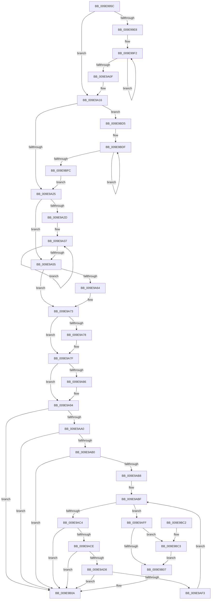

# SepGetTokenAccessInformationBufferSize

- RVA: `0x009E995C`–`0x009E9C05` (길이 `681` bytes)
- VA: `0x00000001409E995C`
- 실행 섹션: `PAGE`
- PDB 이름 있음: `예`; PDB Function 태그: `아니요`
- unwind 정보 RVA: `0x000A5288`
- 디코드: `180`개 명령, `681/681` bytes 표시
- 미해석 바이트: `0` (있으면 어셈블리에 `.byte`로 보존)

> 이 문서는 커널 이미지의 기계어와 PDB 기호를 분석해 생성했습니다. 4번과 5번은 함수 원형과 자료형을 바이너리 사용 방식에서 추정한 C 해석이며 원본 소스 복구 결과는 아닙니다.

## 1. Dependencies

- 직접 호출 지점: **3**; 고유 호출 대상: **3**
- 직접 호출자로 확인된 함수: **2**
- RIP 상대 이미지 참조: **0**

### Outgoing calls
- `0x009E9981` → [SepTokenPrivilegeCount](../../text/43/SepTokenPrivilegeCount_function_00432EC0.md) (function, `0x00432EC0`)
- `0x009E9AEA` → [AuthzBasepGetInternalSecurityAttributeValueCopyoutBufferSize](../../text/46/AuthzBasepGetInternalSecurityAttributeValueCopyoutBufferSize_function_00469B40.md) (function, `0x00469B40`)
- `0x009E9BCB` → [AuthzBasepCopyoutInternalSecurityAttributes](AuthzBasepCopyoutInternalSecurityAttributes_function_009EA280.md) (function, `0x009EA280`)

### Direct callers
- [SeQueryInformationToken](../8B/SeQueryInformationToken_function_008B5090.md) at `0x008B57AD`
- [NtQueryInformationToken](../AE/NtQueryInformationToken_function_00AECDD0.md) at `0x00AEEC19`

### Static image references
- 디코드된 RIP-relative 메모리 참조가 없습니다.

## 2. Other-region calls and transfers

- 다른 실행 섹션으로 향하는 call: **2**
  - `0x009E9981` → [SepTokenPrivilegeCount](../../text/43/SepTokenPrivilegeCount_function_00432EC0.md) (`PAGE` → `.text`)
  - `0x009E9AEA` → [AuthzBasepGetInternalSecurityAttributeValueCopyoutBufferSize](../../text/46/AuthzBasepGetInternalSecurityAttributeValueCopyoutBufferSize_function_00469B40.md) (`PAGE` → `.text`)
- 별도 외부 분기/꼬리 이동을 확인하지 못했습니다.

## 3. Assembly (complete function range)

```asm
009E995C  48 89 5C 24 18                  mov qword ptr [rsp + 0x18], rbx
009E9961  4C 89 4C 24 20                  mov qword ptr [rsp + 0x20], r9
009E9966  55                              push rbp
009E9967  56                              push rsi
009E9968  57                              push rdi
009E9969  41 54                           push r12
009E996B  41 55                           push r13
009E996D  41 56                           push r14
009E996F  41 57                           push r15
009E9971  48 83 EC 40                     sub rsp, 0x40
009E9975  49 8B D8                        mov rbx, r8
009E9978  40 8A FA                        mov dil, dl
009E997B  4C 8B D9                        mov r11, rcx
009E997E  45 33 E4                        xor r12d, r12d
009E9981  E8 3A 95 A4 FF                  call 0x140432ec0
009E9986  45 8B 8B 80 00 00 00            mov r9d, dword ptr [r11 + 0x80]
009E998D  85 C0                           test eax, eax
009E998F  89 44 24 24                     mov dword ptr [rsp + 0x24], eax
009E9993  41 8B E9                        mov ebp, r9d
009E9996  41 BF F8 FF FF FF               mov r15d, 0xfffffff8
009E999C  44 8D 14 40                     lea r10d, [rax + rax*2]
009E99A0  46 8D 14 95 10 00 00 00         lea r10d, [r10*4 + 0x10]
009E99A8  41 8D 4A F4                     lea ecx, [r10 - 0xc]
009E99AC  41 0F 44 CA                     cmove ecx, r10d
009E99B0  45 8B 93 20 03 00 00            mov r10d, dword ptr [r11 + 0x320]
009E99B7  C1 E5 04                        shl ebp, 4
009E99BA  45 8B F2                        mov r14d, r10d
009E99BD  41 C1 E6 04                     shl r14d, 4
009E99C1  89 4C 24 34                     mov dword ptr [rsp + 0x34], ecx
009E99C5  41 8B 4B 7C                     mov ecx, dword ptr [r11 + 0x7c]
009E99C9  8B C1                           mov eax, ecx
009E99CB  89 6C 24 2C                     mov dword ptr [rsp + 0x2c], ebp
009E99CF  C1 E0 04                        shl eax, 4
009E99D2  89 44 24 28                     mov dword ptr [rsp + 0x28], eax
009E99D6  8B F0                           mov esi, eax
009E99D8  44 89 74 24 30                  mov dword ptr [rsp + 0x30], r14d
009E99DD  89 84 24 80 00 00 00            mov dword ptr [rsp + 0x80], eax
009E99E4  85 C9                           test ecx, ecx
009E99E6  74 2E                           je 0x1409e9a16
009E99E8  49 8B 93 98 00 00 00            mov rdx, qword ptr [r11 + 0x98]
009E99EF  44 8B C1                        mov r8d, ecx
009E99F2  48 8B 02                        mov rax, qword ptr [rdx]
009E99F5  48 8D 52 10                     lea rdx, [rdx + 0x10]
009E99F9  0F B6 48 01                     movzx ecx, byte ptr [rax + 1]
009E99FD  8D 0C 8D 0F 00 00 00            lea ecx, [rcx*4 + 0xf]
009E9A04  41 23 CF                        and ecx, r15d
009E9A07  03 F1                           add esi, ecx
009E9A09  49 83 E8 01                     sub r8, 1
009E9A0D  75 E3                           jne 0x1409e99f2
009E9A0F  89 B4 24 80 00 00 00            mov dword ptr [rsp + 0x80], esi
009E9A16  89 6C 24 20                     mov dword ptr [rsp + 0x20], ebp
009E9A1A  8B F5                           mov esi, ebp
009E9A1C  45 85 C9                        test r9d, r9d
009E9A1F  0F 85 B0 01 00 00               jne 0x1409e9bd5
009E9A25  45 8B EE                        mov r13d, r14d
009E9A28  45 85 D2                        test r10d, r10d
009E9A2B  74 28                           je 0x1409e9a55
009E9A2D  49 8B 93 18 03 00 00            mov rdx, qword ptr [r11 + 0x318]
009E9A34  4D 8B C2                        mov r8, r10
009E9A37  48 8B 02                        mov rax, qword ptr [rdx]
009E9A3A  48 8D 52 10                     lea rdx, [rdx + 0x10]
009E9A3E  0F B6 48 01                     movzx ecx, byte ptr [rax + 1]
009E9A42  8D 0C 8D 0F 00 00 00            lea ecx, [rcx*4 + 0xf]
009E9A49  41 23 CF                        and ecx, r15d
009E9A4C  44 03 E9                        add r13d, ecx
009E9A4F  49 83 E8 01                     sub r8, 1
009E9A53  75 E2                           jne 0x1409e9a37
009E9A55  49 8B 83 10 03 00 00            mov rax, qword ptr [r11 + 0x310]
009E9A5C  45 33 F6                        xor r14d, r14d
009E9A5F  48 85 C0                        test rax, rax
009E9A62  74 0F                           je 0x1409e9a73
009E9A64  0F B6 40 01                     movzx eax, byte ptr [rax + 1]
009E9A68  44 8D 34 85 0F 00 00 00         lea r14d, [rax*4 + 0xf]
009E9A70  45 23 F7                        and r14d, r15d
009E9A73  40 84 FF                        test dil, dil
009E9A76  75 07                           jne 0x1409e9a7f
009E9A78  49 8B 9B 50 04 00 00            mov rbx, qword ptr [r11 + 0x450]
009E9A7F  33 ED                           xor ebp, ebp
009E9A81  48 85 DB                        test rbx, rbx
009E9A84  74 0E                           je 0x1409e9a94
009E9A86  0F B6 43 01                     movzx eax, byte ptr [rbx + 1]
009E9A8A  8D 2C 85 0F 00 00 00            lea ebp, [rax*4 + 0xf]
009E9A91  41 23 EF                        and ebp, r15d
009E9A94  49 8B B3 08 03 00 00            mov rsi, qword ptr [r11 + 0x308]
009E9A9B  48 85 F6                        test rsi, rsi
009E9A9E  74 6A                           je 0x1409e9b0a
009E9AA0  8B 06                           mov eax, dword ptr [rsi]
009E9AA2  48 6B D8 70                     imul rbx, rax, 0x70
009E9AA6  B8 FF FF FF FF                  mov eax, 0xffffffff
009E9AAB  48 3B D8                        cmp rbx, rax
009E9AAE  77 5A                           ja 0x1409e9b0a
009E9AB0  83 C3 30                        add ebx, 0x30
009E9AB3  83 FB 30                        cmp ebx, 0x30
009E9AB6  72 52                           jb 0x1409e9b0a
009E9AB8  4C 8D 7E 08                     lea r15, [rsi + 8]
009E9ABC  49 8B 3F                        mov rdi, qword ptr [r15]
009E9ABF  49 3B FF                        cmp rdi, r15
009E9AC2  74 3B                           je 0x1409e9aff
009E9AC4  8D 4B 01                        lea ecx, [rbx + 1]
009E9AC7  83 E1 FE                        and ecx, 0xfffffffe
009E9ACA  3B CB                           cmp ecx, ebx
009E9ACC  72 3C                           jb 0x1409e9b0a
009E9ACE  0F B7 57 20                     movzx edx, word ptr [rdi + 0x20]
009E9AD2  03 D1                           add edx, ecx
009E9AD4  3B D1                           cmp edx, ecx
009E9AD6  72 32                           jb 0x1409e9b0a
009E9AD8  89 94 24 88 00 00 00            mov dword ptr [rsp + 0x88], edx
009E9ADF  48 8B CF                        mov rcx, rdi
009E9AE2  48 8D 94 24 88 00 00 00         lea rdx, [rsp + 0x88]
009E9AEA  E8 51 00 A8 FF                  call 0x140469b40
009E9AEF  85 C0                           test eax, eax
009E9AF1  78 17                           js 0x1409e9b0a
009E9AF3  48 8B 3F                        mov rdi, qword ptr [rdi]
009E9AF6  8B 9C 24 88 00 00 00            mov ebx, dword ptr [rsp + 0x88]
009E9AFD  EB C0                           jmp 0x1409e9abf
009E9AFF  85 DB                           test ebx, ebx
009E9B01  0F 84 BC 00 00 00               je 0x1409e9bc3
009E9B07  44 8B E3                        mov r12d, ebx
009E9B0A  48 8B 8C 24 98 00 00 00         mov rcx, qword ptr [rsp + 0x98]
009E9B12  8B 44 24 24                     mov eax, dword ptr [rsp + 0x24]
009E9B16  8B 94 24 80 00 00 00            mov edx, dword ptr [rsp + 0x80]
009E9B1D  44 8B 44 24 2C                  mov r8d, dword ptr [rsp + 0x2c]
009E9B22  48 8B 9C 24 90 00 00 00         mov rbx, qword ptr [rsp + 0x90]
009E9B2A  89 01                           mov dword ptr [rcx], eax
009E9B2C  48 8B 84 24 A0 00 00 00         mov rax, qword ptr [rsp + 0xa0]
009E9B34  8B 4C 24 28                     mov ecx, dword ptr [rsp + 0x28]
009E9B38  89 10                           mov dword ptr [rax], edx
009E9B3A  48 8B 84 24 A8 00 00 00         mov rax, qword ptr [rsp + 0xa8]
009E9B42  89 08                           mov dword ptr [rax], ecx
009E9B44  48 8B 84 24 B0 00 00 00         mov rax, qword ptr [rsp + 0xb0]
009E9B4C  8B 4C 24 20                     mov ecx, dword ptr [rsp + 0x20]
009E9B50  89 08                           mov dword ptr [rax], ecx
009E9B52  48 8B 84 24 B8 00 00 00         mov rax, qword ptr [rsp + 0xb8]
009E9B5A  44 89 00                        mov dword ptr [rax], r8d
009E9B5D  48 8B 84 24 C0 00 00 00         mov rax, qword ptr [rsp + 0xc0]
009E9B65  44 8B 44 24 30                  mov r8d, dword ptr [rsp + 0x30]
009E9B6A  44 89 30                        mov dword ptr [rax], r14d
009E9B6D  41 81 C6 88 03 00 00            add r14d, 0x388
009E9B74  48 8B 84 24 C8 00 00 00         mov rax, qword ptr [rsp + 0xc8]
009E9B7C  44 89 28                        mov dword ptr [rax], r13d
009E9B7F  48 8B 84 24 D0 00 00 00         mov rax, qword ptr [rsp + 0xd0]
009E9B87  44 89 00                        mov dword ptr [rax], r8d
009E9B8A  48 8B 84 24 D8 00 00 00         mov rax, qword ptr [rsp + 0xd8]
009E9B92  89 28                           mov dword ptr [rax], ebp
009E9B94  48 8B 84 24 E0 00 00 00         mov rax, qword ptr [rsp + 0xe0]
009E9B9C  44 89 20                        mov dword ptr [rax], r12d
009E9B9F  8B 44 24 34                     mov eax, dword ptr [rsp + 0x34]
009E9BA3  41 03 C4                        add eax, r12d
009E9BA6  03 C5                           add eax, ebp
009E9BA8  41 03 C5                        add eax, r13d
009E9BAB  41 03 C6                        add eax, r14d
009E9BAE  03 C1                           add eax, ecx
009E9BB0  03 C2                           add eax, edx
009E9BB2  48 83 C4 40                     add rsp, 0x40
009E9BB6  41 5F                           pop r15
009E9BB8  41 5E                           pop r14
009E9BBA  41 5D                           pop r13
009E9BBC  41 5C                           pop r12
009E9BBE  5F                              pop rdi
009E9BBF  5E                              pop rsi
009E9BC0  5D                              pop rbp
009E9BC1  C3                              ret
009E9BC2  CC                              int3
009E9BC3  45 33 C0                        xor r8d, r8d
009E9BC6  33 D2                           xor edx, edx
009E9BC8  48 8B CE                        mov rcx, rsi
009E9BCB  E8 B0 06 00 00                  call 0x1409ea280
009E9BD0  E9 32 FF FF FF                  jmp 0x1409e9b07
009E9BD5  49 8B 93 A0 00 00 00            mov rdx, qword ptr [r11 + 0xa0]
009E9BDC  4D 8B C1                        mov r8, r9
009E9BDF  48 8B 02                        mov rax, qword ptr [rdx]
009E9BE2  48 8D 52 10                     lea rdx, [rdx + 0x10]
009E9BE6  0F B6 48 01                     movzx ecx, byte ptr [rax + 1]
009E9BEA  8D 0C 8D 0F 00 00 00            lea ecx, [rcx*4 + 0xf]
009E9BF1  41 23 CF                        and ecx, r15d
009E9BF4  03 F1                           add esi, ecx
009E9BF6  49 83 E8 01                     sub r8, 1
009E9BFA  75 E3                           jne 0x1409e9bdf
009E9BFC  89 74 24 20                     mov dword ptr [rsp + 0x20], esi
009E9C00  E9 20 FE FF FF                  jmp 0x1409e9a25
```

## 4. C-style interpretation (structured pseudocode)

```c
__int64 __fastcall SepGetTokenAccessInformationBufferSize(__int64 a1, unsigned __int8 a2, __int64 a3, __int64 a4, __int64 a5, __int64 a6, __int64 a7, __int64 a8, __int64 a9, __int64 a10, __int64 a11, __int64 a12, __int64 a13)
{
    __int64 result;
    __int64 v_r12;
    __int64 v_r13;
    __int64 v_r14;
    __int64 v_rbp;
    __int64 v_rbx;
    __int64 v_rsi;
    __int64 v_rsp;
    unsigned int v_stack_m44;
    unsigned int v_stack_m48;
    unsigned int v_stack_m4C;
    unsigned int v_stack_m50;
    unsigned int v_stack_m54;
    unsigned int v_stack_m58;
    unsigned int v_stack_p10;
    unsigned __int64 v_stack_p18;
    unsigned __int64 v_stack_p20;
    unsigned int v_stack_p8;

    v_stack_p18 = v_rbx;
    v_stack_p20 = a4;
    v_rsp = (v_rsp) - (64);
    v_r12 = 0;
    result = SepTokenPrivilegeCount(a1, a2, a3, a4);
    v_stack_m54 = (unsigned int)(result);
    a1 = result + result * 2 * 4 + 16 - 12;
    if ((unsigned int)(result) == 0) { a1 = (unsigned int)(result + result * 2 * 4 + 16); }
    v_rbp = (unsigned int)(((unsigned int)((unsigned int)((unsigned int)(*(unsigned int *)(a1 + 128))))) << (4));
    v_r14 = (unsigned int)(((unsigned int)((unsigned int)((unsigned int)(*(unsigned int *)(a1 + 800))))) << (4));
    v_stack_m44 = (unsigned int)(a1);
    v_stack_m4C = (unsigned int)(v_rbp);
    result = (unsigned int)(((unsigned int)((unsigned int)((unsigned int)(*(unsigned int *)(a1 + 124))))) << (4));
    v_stack_m50 = (unsigned int)(result);
    v_stack_m48 = (unsigned int)(v_r14);
    v_stack_p8 = (unsigned int)(result);
    if ((unsigned int)((unsigned int)(*(unsigned int *)(a1 + 124))) == 0) goto loc_009E9A16;
loc_009E99F2:
    a1 = (unsigned int)((*(unsigned __int8 *)(*(unsigned __int64 *)(*(unsigned __int64 *)(a1 + 152)) + 1) * 4 + 15) & ((unsigned int)((unsigned int)(0xFFFFFFF8ULL))));
    v_rsi = (unsigned int)(((unsigned int)((unsigned int)(result))) + ((unsigned int)(a1)));
    a3 = ((unsigned int)((unsigned int)((unsigned int)(*(unsigned int *)(a1 + 124))))) - (1);
    if (condition_is_not_equal) goto loc_009E99F2;
    v_stack_p8 = (unsigned int)(v_rsi);
loc_009E9A16:
    v_stack_m58 = (unsigned int)(v_rbp);
    if ((unsigned int)((unsigned int)(*(unsigned int *)(a1 + 128))) != 0) goto loc_009E9BD5;
loc_009E9A25:
    if ((unsigned int)((unsigned int)(*(unsigned int *)(a1 + 800))) == 0) goto loc_009E9A55;
loc_009E9A37:
    a1 = (unsigned int)((*(unsigned __int8 *)(*(unsigned __int64 *)(*(unsigned __int64 *)(a1 + 792)) + 1) * 4 + 15) & ((unsigned int)((unsigned int)(0xFFFFFFF8ULL))));
    v_r13 = (unsigned int)(((unsigned int)((unsigned int)(v_r14))) + ((unsigned int)(a1)));
    a3 = ((unsigned int)(*(unsigned int *)(a1 + 800))) - (1);
    if (condition_is_not_equal) goto loc_009E9A37;
loc_009E9A55:
    v_r14 = 0;
    result = *(unsigned __int64 *)(a1 + 784);
    if (*(unsigned __int64 *)(a1 + 784) != 0) {
        result = *(unsigned __int8 *)(*(unsigned __int64 *)(a1 + 784) + 1);
        v_r14 = result * 4 + 15;
        v_r14 = (unsigned int)((v_r14) & ((unsigned int)((unsigned int)(0xFFFFFFF8ULL))));
    }
    v_rbx = a3;
    if (a2 == 0) {
        v_rbx = *(unsigned __int64 *)(a1 + 1104);
    }
    v_rbp = 0;
    if (v_rbx != 0) {
        result = *(unsigned __int8 *)(v_rbx + 1);
        v_rbp = result * 4 + 15;
        v_rbp = (unsigned int)((v_rbp) & ((unsigned int)((unsigned int)(0xFFFFFFF8ULL))));
    }
    if (*(unsigned __int64 *)(a1 + 776) == 0) goto loc_009E9B0A;
    v_rbx = (v_rbx) * ((unsigned int)(*(unsigned int *)(*(unsigned __int64 *)(a1 + 776))));
    if (v_rbx > ((unsigned int)(0xFFFFFFFFULL))) goto loc_009E9B0A;
    v_rbx = (unsigned int)((v_rbx) + (48));
    if (((unsigned int)(v_rbx)) < 48) goto loc_009E9B0A;
loc_009E9ABF:
    if ((*(unsigned __int64 *)(*(unsigned __int64 *)(a1 + 776) + 8)) == (*(unsigned __int64 *)(a1 + 776) + 8)) goto loc_009E9AFF;
    a1 = (unsigned int)((v_rbx + 1) & (0xFFFFFFFEULL));
    if (((unsigned int)(a1)) < ((unsigned int)(v_rbx))) goto loc_009E9B0A;
    a2 = (unsigned int)((*(unsigned __int16 *)(*(unsigned __int64 *)(*(unsigned __int64 *)(a1 + 776) + 8) + 32)) + ((unsigned int)(a1)));
    if (a2 < ((unsigned int)(a1))) goto loc_009E9B0A;
    v_stack_p10 = a2;
    result = AuthzBasepGetInternalSecurityAttributeValueCopyoutBufferSize(*(unsigned __int64 *)(*(unsigned __int64 *)(a1 + 776) + 8), v_stack_p10, a3, (unsigned int)(*(unsigned int *)(a1 + 128)));
    if (sign_flag) goto loc_009E9B0A;
    goto loc_009E9ABF;
loc_009E9AFF:
    if ((unsigned int)((unsigned int)(v_stack_p10)) == 0) goto loc_009E9BC3;
loc_009E9B07:
loc_009E9B0A:
    *(unsigned int *)(v_stack_p20) = (unsigned int)((unsigned int)(v_stack_m54));
    *(unsigned int *)(a5) = (unsigned int)((unsigned int)(v_stack_p8));
    *(unsigned int *)(a6) = (unsigned int)((unsigned int)(v_stack_m50));
    *(unsigned int *)(a7) = (unsigned int)((unsigned int)(v_stack_m58));
    *(unsigned int *)(a8) = (unsigned int)((unsigned int)(v_stack_m4C));
    *(unsigned int *)(a9) = (unsigned int)(v_r14);
    v_r14 = (unsigned int)((v_r14) + (904));
    *(unsigned int *)(a10) = (unsigned int)(v_r13);
    *(unsigned int *)(a11) = (unsigned int)((unsigned int)(v_stack_m48));
    *(unsigned int *)(a12) = (unsigned int)(v_rbp);
    *(unsigned int *)(a13) = (unsigned int)((unsigned int)((unsigned int)((unsigned int)(v_stack_p10))));
    result = (unsigned int)(((unsigned int)(v_stack_m44)) + ((unsigned int)((unsigned int)((unsigned int)((unsigned int)(v_stack_p10))))));
    result = (unsigned int)((result) + ((unsigned int)(v_rbp)));
    result = (unsigned int)((result) + ((unsigned int)(v_r13)));
    result = (unsigned int)((result) + ((unsigned int)(v_r14)));
    result = (unsigned int)((result) + ((unsigned int)((unsigned int)(v_stack_m58))));
    result = (unsigned int)((result) + ((unsigned int)((unsigned int)(v_stack_p8))));
    v_rsp = (v_rsp) + (64);
    return result;
loc_009E9BC3:
    a3 = 0;
    a2 = 0;
    result = AuthzBasepCopyoutInternalSecurityAttributes(*(unsigned __int64 *)(a1 + 776), a2, a3, (unsigned int)(*(unsigned int *)(a1 + 128)));
    goto loc_009E9B07;
loc_009E9BD5:
loc_009E9BDF:
    a1 = (unsigned int)((*(unsigned __int8 *)(*(unsigned __int64 *)(*(unsigned __int64 *)(a1 + 160)) + 1) * 4 + 15) & ((unsigned int)(*(unsigned __int64 *)(a1 + 776) + 8)));
    v_rsi = (unsigned int)((*(unsigned __int64 *)(a1 + 776)) + ((unsigned int)(a1)));
    a3 = ((unsigned int)(*(unsigned int *)(a1 + 128))) - (1);
    if (condition_is_not_equal) goto loc_009E9BDF;
    v_stack_p20 = (unsigned int)(v_rsi);
    goto loc_009E9A25;
}
```

## 5. (Beta) C Style

```c
int64_t SepGetTokenAccessInformationBufferSize(int64_t Arg1, uint8_t Arg2, int64_t Arg3, int64_t Arg4, void *Arg5, void *Arg6, void *Arg7, void *Arg8, void *Arg9, void *Arg10, void *Arg11, void *Arg12, void *Arg13)
{
    uint8_t *arg5 = (uint8_t *)Arg5;
    uint8_t *arg6 = (uint8_t *)Arg6;
    uint8_t *arg7 = (uint8_t *)Arg7;
    uint8_t *arg8 = (uint8_t *)Arg8;
    uint8_t *arg9 = (uint8_t *)Arg9;
    uint8_t *arg10 = (uint8_t *)Arg10;
    uint8_t *arg11 = (uint8_t *)Arg11;
    uint8_t *arg12 = (uint8_t *)Arg12;
    uint8_t *arg13 = (uint8_t *)Arg13;

    int64_t result;
    int64_t local_r12;
    int64_t local_r13;
    int64_t local_r14;
    int64_t local_rbp;
    int64_t local_rbx;
    int64_t local_rsi;
    int64_t local_rsp;
    uint32_t v_stack_m44;
    uint32_t v_stack_m48;
    uint32_t v_stack_m4C;
    uint32_t v_stack_m50;
    uint32_t v_stack_m54;
    uint32_t v_stack_m58;
    uint32_t v_stack_p10;
    uint64_t v_stack_p18;
    uint64_t v_stack_p20;
    uint32_t v_stack_p8;

    v_stack_p18 = local_rbx;
    v_stack_p20 = Arg4;
    local_rsp = (local_rsp) - (64);
    local_r12 = 0;
    result = SepTokenPrivilegeCount(Arg1, Arg2, Arg3, Arg4);
    v_stack_m54 = (uint32_t)(result);
    Arg1 = result + result * 2 * 4 + 16 - 12;
    if ((uint32_t)(result) == 0) { Arg1 = (uint32_t)(result + result * 2 * 4 + 16); }
    local_rbp = (uint32_t)(((uint32_t)((uint32_t)((uint32_t)(*(uint32_t *)(Arg1 + 0x80))))) << (4));
    local_r14 = (uint32_t)(((uint32_t)((uint32_t)((uint32_t)(*(uint32_t *)(Arg1 + 0x320))))) << (4));
    v_stack_m44 = (uint32_t)(Arg1);
    v_stack_m4C = (uint32_t)(local_rbp);
    result = (uint32_t)(((uint32_t)((uint32_t)((uint32_t)(*(uint32_t *)(Arg1 + 0x7C))))) << (4));
    v_stack_m50 = (uint32_t)(result);
    v_stack_m48 = (uint32_t)(local_r14);
    v_stack_p8 = (uint32_t)(result);
    if ((uint32_t)((uint32_t)(*(uint32_t *)(Arg1 + 0x7C))) == 0) goto loc_009E9A16;
loc_009E99F2:
    Arg1 = (uint32_t)((*(uint8_t *)(*(uint64_t *)(*(uint64_t *)(Arg1 + 0x98)) + 0x1) * 4 + 15) & ((uint32_t)((uint32_t)(0xFFFFFFF8ULL))));
    local_rsi = (uint32_t)(((uint32_t)((uint32_t)(result))) + ((uint32_t)(Arg1)));
    Arg3 = ((uint32_t)((uint32_t)((uint32_t)(*(uint32_t *)(Arg1 + 0x7C))))) - (1);
    if (condition_is_not_equal) goto loc_009E99F2;
    v_stack_p8 = (uint32_t)(local_rsi);
loc_009E9A16:
    v_stack_m58 = (uint32_t)(local_rbp);
    if ((uint32_t)((uint32_t)(*(uint32_t *)(Arg1 + 0x80))) != 0) goto loc_009E9BD5;
loc_009E9A25:
    if ((uint32_t)((uint32_t)(*(uint32_t *)(Arg1 + 0x320))) == 0) goto loc_009E9A55;
loc_009E9A37:
    Arg1 = (uint32_t)((*(uint8_t *)(*(uint64_t *)(*(uint64_t *)(Arg1 + 0x318)) + 0x1) * 4 + 15) & ((uint32_t)((uint32_t)(0xFFFFFFF8ULL))));
    local_r13 = (uint32_t)(((uint32_t)((uint32_t)(local_r14))) + ((uint32_t)(Arg1)));
    Arg3 = ((uint32_t)(*(uint32_t *)(Arg1 + 0x320))) - (1);
    if (condition_is_not_equal) goto loc_009E9A37;
loc_009E9A55:
    local_r14 = 0;
    result = *(uint64_t *)(Arg1 + 0x310);
    if (*(uint64_t *)(Arg1 + 0x310) != 0) {
        result = *(uint8_t *)(*(uint64_t *)(Arg1 + 0x310) + 0x1);
        local_r14 = result * 4 + 15;
        local_r14 = (uint32_t)((local_r14) & ((uint32_t)((uint32_t)(0xFFFFFFF8ULL))));
    }
    local_rbx = Arg3;
    if (Arg2 == 0) {
        local_rbx = *(uint64_t *)(Arg1 + 0x450);
    }
    local_rbp = 0;
    if (local_rbx != 0) {
        result = *(uint8_t *)(local_rbx + 0x1);
        local_rbp = result * 4 + 15;
        local_rbp = (uint32_t)((local_rbp) & ((uint32_t)((uint32_t)(0xFFFFFFF8ULL))));
    }
    if (*(uint64_t *)(Arg1 + 0x308) == 0) goto loc_009E9B0A;
    local_rbx = (local_rbx) * ((uint32_t)(*(uint32_t *)(*(uint64_t *)(Arg1 + 0x308))));
    if (local_rbx > ((uint32_t)(0xFFFFFFFFULL))) goto loc_009E9B0A;
    local_rbx = (uint32_t)((local_rbx) + (48));
    if (((uint32_t)(local_rbx)) < 48) goto loc_009E9B0A;
loc_009E9ABF:
    if ((*(uint64_t *)(*(uint64_t *)(Arg1 + 0x308) + 0x8)) == (*(uint64_t *)(Arg1 + 0x308) + 8)) goto loc_009E9AFF;
    Arg1 = (uint32_t)((local_rbx + 1) & (0xFFFFFFFEULL));
    if (((uint32_t)(Arg1)) < ((uint32_t)(local_rbx))) goto loc_009E9B0A;
    Arg2 = (uint32_t)((*(uint16_t *)(*(uint64_t *)(*(uint64_t *)(Arg1 + 0x308) + 0x8) + 0x20)) + ((uint32_t)(Arg1)));
    if (Arg2 < ((uint32_t)(Arg1))) goto loc_009E9B0A;
    v_stack_p10 = Arg2;
    result = AuthzBasepGetInternalSecurityAttributeValueCopyoutBufferSize(*(uint64_t *)(*(uint64_t *)(Arg1 + 0x308) + 0x8), v_stack_p10, Arg3, (uint32_t)(*(uint32_t *)(Arg1 + 0x80)));
    if (sign_flag) goto loc_009E9B0A;
    goto loc_009E9ABF;
loc_009E9AFF:
    if ((uint32_t)((uint32_t)(v_stack_p10)) == 0) goto loc_009E9BC3;
loc_009E9B07:
loc_009E9B0A:
    *(uint32_t *)(v_stack_p20) = (uint32_t)((uint32_t)(v_stack_m54));
    *(uint32_t *)(arg5) = (uint32_t)((uint32_t)(v_stack_p8));
    *(uint32_t *)(arg6) = (uint32_t)((uint32_t)(v_stack_m50));
    *(uint32_t *)(arg7) = (uint32_t)((uint32_t)(v_stack_m58));
    *(uint32_t *)(arg8) = (uint32_t)((uint32_t)(v_stack_m4C));
    *(uint32_t *)(arg9) = (uint32_t)(local_r14);
    local_r14 = (uint32_t)((local_r14) + (904));
    *(uint32_t *)(arg10) = (uint32_t)(local_r13);
    *(uint32_t *)(arg11) = (uint32_t)((uint32_t)(v_stack_m48));
    *(uint32_t *)(arg12) = (uint32_t)(local_rbp);
    *(uint32_t *)(arg13) = (uint32_t)((uint32_t)((uint32_t)((uint32_t)(v_stack_p10))));
    result = (uint32_t)(((uint32_t)(v_stack_m44)) + ((uint32_t)((uint32_t)((uint32_t)((uint32_t)(v_stack_p10))))));
    result = (uint32_t)((result) + ((uint32_t)(local_rbp)));
    result = (uint32_t)((result) + ((uint32_t)(local_r13)));
    result = (uint32_t)((result) + ((uint32_t)(local_r14)));
    result = (uint32_t)((result) + ((uint32_t)((uint32_t)(v_stack_m58))));
    result = (uint32_t)((result) + ((uint32_t)((uint32_t)(v_stack_p8))));
    local_rsp = (local_rsp) + (64);
    return result;
loc_009E9BC3:
    Arg3 = 0;
    Arg2 = 0;
    result = AuthzBasepCopyoutInternalSecurityAttributes(*(uint64_t *)(Arg1 + 0x308), Arg2, Arg3, (uint32_t)(*(uint32_t *)(Arg1 + 0x80)));
    goto loc_009E9B07;
loc_009E9BD5:
loc_009E9BDF:
    Arg1 = (uint32_t)((*(uint8_t *)(*(uint64_t *)(*(uint64_t *)(Arg1 + 0xA0)) + 0x1) * 4 + 15) & ((uint32_t)(*(uint64_t *)(Arg1 + 0x308) + 8)));
    local_rsi = (uint32_t)((*(uint64_t *)(Arg1 + 0x308)) + ((uint32_t)(Arg1)));
    Arg3 = ((uint32_t)(*(uint32_t *)(Arg1 + 0x80))) - (1);
    if (condition_is_not_equal) goto loc_009E9BDF;
    v_stack_p20 = (uint32_t)(local_rsi);
    goto loc_009E9A25;
}
```

### 관측된 메모리 오프셋

구조체 형식이 확인되지 않은 접근은 인자 기준의 오프셋으로만 기록했습니다.

| 기준 인자 | 오프셋 표현 | 폭 (bit) | 접근 |
|---|---:|---:|---|
| `Arg5` | `+ 0x0` | `32` | `W` |
| `Arg6` | `+ 0x0` | `32` | `W` |
| `Arg7` | `+ 0x0` | `32` | `W` |
| `Arg8` | `+ 0x0` | `32` | `W` |
| `Arg9` | `+ 0x0` | `32` | `W` |
| `Arg10` | `+ 0x0` | `32` | `W` |
| `Arg11` | `+ 0x0` | `32` | `W` |
| `Arg12` | `+ 0x0` | `32` | `W` |
| `Arg13` | `+ 0x0` | `32` | `W` |

## 6. Execution-region graph

[열기: 2D/3D 그래프와 함수 탐색 컨트롤 패널](../../../control-panel.html?section=page&rva=0x009E995C&view=graph)

- 2D 그래프는 위에서 아래로 흐르고, 3D 그래프는 빈 공간을 드래그해 회전합니다. Shift+드래그는 이동, 휠은 확대·축소, 함수 노드 선택은 대상 보고서 이동입니다.

### Static fallback


