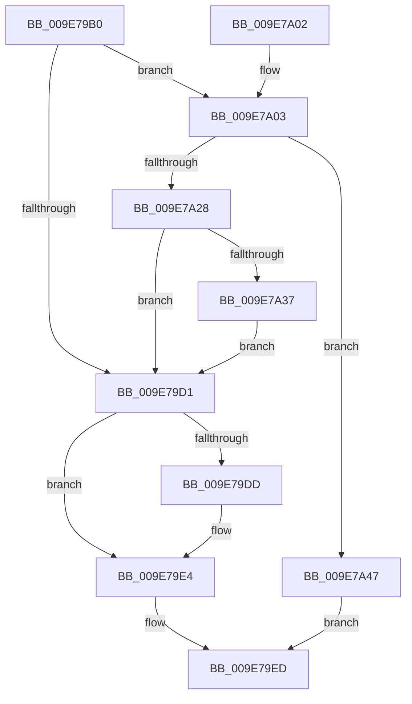

# SepSetTokenTrust

- RVA: `0x009E79B0`–`0x009E7A4E` (길이 `158` bytes)
- VA: `0x00000001409E79B0`
- 실행 섹션: `PAGE`
- PDB 이름 있음: `예`; PDB Function 태그: `아니요`
- unwind 정보 RVA: `0x000A4BC8`
- 디코드: `44`개 명령, `158/158` bytes 표시
- 미해석 바이트: `0` (있으면 어셈블리에 `.byte`로 보존)

> 이 문서는 커널 이미지의 기계어와 PDB 기호를 분석해 생성했습니다. 4번과 5번은 함수 원형과 자료형을 바이너리 사용 방식에서 추정한 C 해석이며 원본 소스 복구 결과는 아닙니다.

## 1. Dependencies

- 직접 호출 지점: **3**; 고유 호출 대상: **3**
- 직접 호출자로 확인된 함수: **4**
- RIP 상대 이미지 참조: **0**

### Outgoing calls
- `0x009E79DF` → [ExFreePoolWithTag](../../poolcode/B8/ExFreePoolWithTag_function_00B82870.md) (function, `0x00B82870`)
- `0x009E7A1B` → [ExAllocatePool2](../../poolcode/B8/ExAllocatePool2_function_00B820F0.md) (function, `0x00B820F0`)
- `0x009E7A40` → [memcpy](../../text/6C/memcpy_function_006C6840.md) (function, `0x006C6840`)

### Direct callers
- [SepSetTrustLevelForProcessToken](../../text/40/SepSetTrustLevelForProcessToken_function_00400604.md) at `0x0040064B`
- [SepCreateTokenEx](../../text/4E/SepCreateTokenEx_function_004E9CD0.md) at `0x004EA7BD`
- [SepDuplicateToken](../8B/SepDuplicateToken_function_008B87EC.md) at `0x008B8F0A`
- [SepFilterToken](../9C/SepFilterToken_function_009C6B80.md) at `0x009C7668`

### Static image references
- 디코드된 RIP-relative 메모리 참조가 없습니다.

## 2. Other-region calls and transfers

- 다른 실행 섹션으로 향하는 call: **3**
  - `0x009E79DF` → [ExFreePoolWithTag](../../poolcode/B8/ExFreePoolWithTag_function_00B82870.md) (`PAGE` → `POOLCODE`)
  - `0x009E7A1B` → [ExAllocatePool2](../../poolcode/B8/ExAllocatePool2_function_00B820F0.md) (`PAGE` → `POOLCODE`)
  - `0x009E7A40` → [memcpy](../../text/6C/memcpy_function_006C6840.md) (`PAGE` → `.text`)
- 별도 외부 분기/꼬리 이동을 확인하지 못했습니다.

## 3. Assembly (complete function range)

```asm
009E79B0  48 89 5C 24 08                  mov qword ptr [rsp + 8], rbx
009E79B5  48 89 6C 24 10                  mov qword ptr [rsp + 0x10], rbp
009E79BA  48 89 74 24 18                  mov qword ptr [rsp + 0x18], rsi
009E79BF  57                              push rdi
009E79C0  48 83 EC 20                     sub rsp, 0x20
009E79C4  33 FF                           xor edi, edi
009E79C6  48 8B F2                        mov rsi, rdx
009E79C9  48 8B D9                        mov rbx, rcx
009E79CC  48 85 D2                        test rdx, rdx
009E79CF  75 32                           jne 0x1409e7a03
009E79D1  48 8B 8B 50 04 00 00            mov rcx, qword ptr [rbx + 0x450]
009E79D8  48 85 C9                        test rcx, rcx
009E79DB  74 07                           je 0x1409e79e4
009E79DD  33 D2                           xor edx, edx
009E79DF  E8 8C AE 19 00                  call 0x140b82870
009E79E4  48 89 BB 50 04 00 00            mov qword ptr [rbx + 0x450], rdi
009E79EB  33 C0                           xor eax, eax
009E79ED  48 8B 5C 24 30                  mov rbx, qword ptr [rsp + 0x30]
009E79F2  48 8B 6C 24 38                  mov rbp, qword ptr [rsp + 0x38]
009E79F7  48 8B 74 24 40                  mov rsi, qword ptr [rsp + 0x40]
009E79FC  48 83 C4 20                     add rsp, 0x20
009E7A00  5F                              pop rdi
009E7A01  C3                              ret
009E7A02  CC                              int3
009E7A03  0F B6 42 01                     movzx eax, byte ptr [rdx + 1]
009E7A07  B9 00 01 00 00                  mov ecx, 0x100
009E7A0C  41 B8 53 65 53 69               mov r8d, 0x69536553
009E7A12  8D 2C 85 08 00 00 00            lea ebp, [rax*4 + 8]
009E7A19  8B D5                           mov edx, ebp
009E7A1B  E8 D0 A6 19 00                  call 0x140b820f0
009E7A20  48 8B F8                        mov rdi, rax
009E7A23  48 85 C0                        test rax, rax
009E7A26  74 1F                           je 0x1409e7a47
009E7A28  0F B6 4E 01                     movzx ecx, byte ptr [rsi + 1]
009E7A2C  8D 0C 8D 08 00 00 00            lea ecx, [rcx*4 + 8]
009E7A33  3B CD                           cmp ecx, ebp
009E7A35  77 9A                           ja 0x1409e79d1
009E7A37  44 8B C1                        mov r8d, ecx
009E7A3A  48 8B D6                        mov rdx, rsi
009E7A3D  48 8B C8                        mov rcx, rax
009E7A40  E8 FB ED CD FF                  call 0x1406c6840
009E7A45  EB 8A                           jmp 0x1409e79d1
009E7A47  B8 9A 00 00 C0                  mov eax, 0xc000009a
009E7A4C  EB 9F                           jmp 0x1409e79ed
```

## 4. C-style interpretation (structured pseudocode)

```c
__int64 __fastcall SepSetTokenTrust(__int64 a1, __int64 a2)
{
    __int64 result;
    __int64 v_rdi;
    __int64 v_rsp;
    unsigned __int64 v_stack_p10;
    unsigned __int64 v_stack_p18;
    unsigned __int64 v_stack_p8;

    v_stack_p8 = v_rbx;
    v_stack_p10 = v_rbp;
    v_stack_p18 = v_rsi;
    v_rsp = (v_rsp) - (32);
    v_rdi = 0;
    if (a2 != 0) goto loc_009E7A03;
loc_009E79D1:
    if (*(unsigned __int64 *)(a1 + 1104) != 0) {
        a2 = 0;
        result = ExFreePoolWithTag(*(unsigned __int64 *)(a1 + 1104), a2, a3, a4);
    }
    *(unsigned __int64 *)(a1 + 1104) = 0;
    result = 0;
loc_009E79ED:
    v_rsp = (v_rsp) + (32);
    return result;
loc_009E7A03:
    result = ExAllocatePool2(256, (unsigned int)((unsigned int)(*(unsigned __int8 *)(a2 + 1) * 4 + 8)), (unsigned int)(0x69536553ULL), a4);
    if (result == 0) goto loc_009E7A47;
    if (((unsigned int)(*(unsigned __int8 *)(v_stack_p18 + 1) * 4 + 8)) > ((unsigned int)(*(unsigned __int8 *)(a2 + 1) * 4 + 8))) goto loc_009E79D1;
    result = memcpy(result, v_stack_p18, (unsigned int)((unsigned int)(*(unsigned __int8 *)(v_stack_p18 + 1) * 4 + 8)), a4);
    goto loc_009E79D1;
loc_009E7A47:
    goto loc_009E79ED;
}
```

## 5. (Beta) C Style

```c
int64_t SepSetTokenTrust(void *Arg1, void *Arg2)
{
    uint8_t *arg1 = (uint8_t *)Arg1;
    uint8_t *arg2 = (uint8_t *)Arg2;

    int64_t result;
    int64_t local_rdi;
    int64_t local_rsp;
    uint64_t v_stack_p10;
    uint64_t v_stack_p18;
    uint64_t v_stack_p8;

    v_stack_p8 = local_rbx;
    v_stack_p10 = local_rbp;
    v_stack_p18 = local_rsi;
    local_rsp = (local_rsp) - (32);
    local_rdi = 0;
    if (Arg2 != NULL) goto loc_009E7A03;
loc_009E79D1:
    if (*(uint64_t *)(arg1 + 0x450) != 0) {
        Arg2 = 0;
        result = ExFreePoolWithTag(*(uint64_t *)(arg1 + 0x450), Arg2, a3, a4);
    }
    *(uint64_t *)(arg1 + 0x450) = 0;
    result = 0;
loc_009E79ED:
    local_rsp = (local_rsp) + (32);
    return result;
loc_009E7A03:
    result = ExAllocatePool2(256, (uint32_t)((uint32_t)(*(uint8_t *)(arg2 + 0x1) * 4 + 8)), (uint32_t)(0x69536553ULL), a4);
    if (result == 0) goto loc_009E7A47;
    if (((uint32_t)(*(uint8_t *)(v_stack_p18 + 0x1) * 4 + 8)) > ((uint32_t)(*(uint8_t *)(arg2 + 0x1) * 4 + 8))) goto loc_009E79D1;
    result = memcpy(result, v_stack_p18, (uint32_t)((uint32_t)(*(uint8_t *)(v_stack_p18 + 0x1) * 4 + 8)), a4);
    goto loc_009E79D1;
loc_009E7A47:
    goto loc_009E79ED;
}
```

### 관측된 메모리 오프셋

구조체 형식이 확인되지 않은 접근은 인자 기준의 오프셋으로만 기록했습니다.

| 기준 인자 | 오프셋 표현 | 폭 (bit) | 접근 |
|---|---:|---:|---|
| `Arg1` | `+ 0x450` | `64` | `R` |
| `Arg1` | `+ 0x450` | `64` | `W` |
| `Arg2` | `+ 0x1` | `8` | `R` |

## 6. Execution-region graph

[열기: 2D/3D 그래프와 함수 탐색 컨트롤 패널](../../../control-panel.html?section=page&rva=0x009E79B0&view=graph)

- 2D 그래프는 위에서 아래로 흐르고, 3D 그래프는 빈 공간을 드래그해 회전합니다. Shift+드래그는 이동, 휠은 확대·축소, 함수 노드 선택은 대상 보고서 이동입니다.

### Static fallback


