# sub_009E57A9

- RVA: `0x009E57A9`–`0x009E5A16` (길이 `621` bytes)
- VA: `0x00000001409E57A9`
- 실행 섹션: `PAGE`
- PDB 이름 있음: `아니요`; PDB Function 태그: `아니요`
- unwind 정보 RVA: `0x000A41F0`
- 디코드: `138`개 명령, `621/621` bytes 표시
- 미해석 바이트: `0` (있으면 어셈블리에 `.byte`로 보존)

> 이 문서는 커널 이미지의 기계어와 PDB 기호를 분석해 생성했습니다. 4번과 5번은 함수 원형과 자료형을 바이너리 사용 방식에서 추정한 C 해석이며 원본 소스 복구 결과는 아닙니다.

## 1. Dependencies

- 직접 호출 지점: **2**; 고유 호출 대상: **2**
- 직접 호출자로 확인된 함수: **0**
- RIP 상대 이미지 참조: **0**

### Outgoing calls
- `0x009E581C` → [MiVadPageTableChargeLevel](../../text/41/MiVadPageTableChargeLevel_function_0041F500.md) (function, `0x0041F500`)
- `0x009E5827` → [MiVadPureReserve](../../text/2C/MiVadPureReserve_function_002C34C0.md) (function, `0x002C34C0`)

### Direct callers
- 이 함수 시작 RVA로 연결되는 직접 call은 확인되지 않았습니다. 간접 호출은 완전히 역산할 수 없습니다.

### Static image references
- 디코드된 RIP-relative 메모리 참조가 없습니다.

## 2. Other-region calls and transfers

- 다른 실행 섹션으로 향하는 call: **2**
  - `0x009E581C` → [MiVadPageTableChargeLevel](../../text/41/MiVadPageTableChargeLevel_function_0041F500.md) (`PAGE` → `.text`)
  - `0x009E5827` → [MiVadPureReserve](../../text/2C/MiVadPureReserve_function_002C34C0.md) (`PAGE` → `.text`)
- call이 아닌 외부 분기/꼬리 이동: **11**
  - `0x009E5878` → [sub_009E5C69 + 0x74](Unknown_function_009E5C69.md) (`tail-transfer`)
  - `0x009E58AF` → [sub_009E5A2C + 0xC4](Unknown_function_009E5A2C.md) (`tail-transfer`)
  - `0x009E58BD` → [sub_009E5A2C + 0xBC](Unknown_function_009E5A2C.md) (`tail-transfer`)
  - `0x009E58ED` → [sub_009E5A2C + 0x161](Unknown_function_009E5A2C.md) (`tail-transfer`)
  - `0x009E58FB` → [sub_009E5A2C + 0x12F](Unknown_function_009E5A2C.md) (`tail-transfer`)
  - `0x009E5933` → [sub_009E5A2C + 0x3](Unknown_function_009E5A2C.md) (`tail-transfer`)
  - `0x009E593C` → [sub_009E5A2C + 0x13B](Unknown_function_009E5A2C.md) (`tail-transfer`)
  - `0x009E594F` → [sub_009E5A2C](Unknown_function_009E5A2C.md) (`tail-transfer`)
  - `0x009E5974` → [sub_009E5C69 + 0x13](Unknown_function_009E5C69.md) (`tail-transfer`)
  - `0x009E59DA` → [sub_009E5C69](Unknown_function_009E5C69.md) (`tail-transfer`)
  - `0x009E5A14` → [sub_009E5A16 + 0x8](Unknown_function_009E5A16.md) (`tail-transfer`)

## 3. Assembly (complete function range)

```asm
009E57A9  48 89 AC 24 D0 00 00 00         mov qword ptr [rsp + 0xd0], rbp
009E57B1  49 8B C2                        mov rax, r10
009E57B4  83 E0 01                        and eax, 1
009E57B7  4C 89 A4 24 D8 00 00 00         mov qword ptr [rsp + 0xd8], r12
009E57BF  4C 89 AC 24 E8 00 00 00         mov qword ptr [rsp + 0xe8], r13
009E57C7  49 8B CA                        mov rcx, r10
009E57CA  48 83 E1 FE                     and rcx, 0xfffffffffffffffe
009E57CE  4C 89 BC 24 A0 00 00 00         mov qword ptr [rsp + 0xa0], r15
009E57D6  48 8B D1                        mov rdx, rcx
009E57D9  45 33 FF                        xor r15d, r15d
009E57DC  48 85 C0                        test rax, rax
009E57DF  48 8B C7                        mov rax, rdi
009E57E2  49 0F 44 CA                     cmove rcx, r10
009E57E6  49 0F 44 D7                     cmove rdx, r15
009E57EA  48 89 4C 24 58                  mov qword ptr [rsp + 0x58], rcx
009E57EF  83 E0 01                        and eax, 1
009E57F2  48 89 54 24 78                  mov qword ptr [rsp + 0x78], rdx
009E57F7  48 8B CF                        mov rcx, rdi
009E57FA  48 83 E1 FE                     and rcx, 0xfffffffffffffffe
009E57FE  48 8B D1                        mov rdx, rcx
009E5801  48 85 C0                        test rax, rax
009E5804  48 0F 44 CF                     cmove rcx, rdi
009E5808  49 0F 44 D7                     cmove rdx, r15
009E580C  48 89 4C 24 60                  mov qword ptr [rsp + 0x60], rcx
009E5811  48 8B CE                        mov rcx, rsi
009E5814  48 89 94 24 80 00 00 00         mov qword ptr [rsp + 0x80], rdx
009E581C  E8 DF 9C A3 FF                  call 0x14041f500
009E5821  48 8B CE                        mov rcx, rsi
009E5824  44 8B D0                        mov r10d, eax
009E5827  E8 94 DC 8D FF                  call 0x1402c34c0
009E582C  4D 8B 8E 10 04 00 00            mov r9, qword ptr [r14 + 0x410]
009E5833  41 8B CF                        mov ecx, r15d
009E5836  49 81 C1 00 03 00 00            add r9, 0x300
009E583D  48 C1 EB 15                     shr rbx, 0x15
009E5841  49 C1 EB 15                     shr r11, 0x15
009E5845  45 8B E7                        mov r12d, r15d
009E5848  4C 89 7C 24 30                  mov qword ptr [rsp + 0x30], r15
009E584D  41 B8 FF 03 00 00               mov r8d, 0x3ff
009E5853  4C 8B BC 24 00 01 00 00         mov r15, qword ptr [rsp + 0x100]
009E585B  8B E8                           mov ebp, eax
009E585D  4C 89 4C 24 70                  mov qword ptr [rsp + 0x70], r9
009E5862  8B FB                           mov edi, ebx
009E5864  41 8B F3                        mov esi, r11d
009E5867  4C 89 44 24 48                  mov qword ptr [rsp + 0x48], r8
009E586C  4D 8D 6F 01                     lea r13, [r15 + 1]
009E5870  4C 89 6C 24 68                  mov qword ptr [rsp + 0x68], r13
009E5875  45 85 D2                        test r10d, r10d
009E5878  0F 8F 5F 04 00 00               jg 0x1409e5cdd
009E587E  48 C7 44 24 38 FF FF FF FF      mov qword ptr [rsp + 0x38], 0xffffffffffffffff
009E5887  48 89 4C 24 28                  mov qword ptr [rsp + 0x28], rcx
009E588C  4C 63 D1                        movsxd r10, ecx
009E588F  8D 04 C9                        lea eax, [rcx + rcx*8]
009E5892  4C 89 54 24 40                  mov qword ptr [rsp + 0x40], r10
009E5897  89 44 24 20                     mov dword ptr [rsp + 0x20], eax
009E589B  41 80 3F 00                     cmp byte ptr [r15], 0
009E589F  48 89 BC 24 88 00 00 00         mov qword ptr [rsp + 0x88], rdi
009E58A7  48 89 B4 24 90 00 00 00         mov qword ptr [rsp + 0x90], rsi
009E58AF  0F 85 3B 02 00 00               jne 0x1409e5af0
009E58B5  48 FF C7                        inc rdi
009E58B8  41 80 7D 00 00                  cmp byte ptr [r13], 0
009E58BD  0F 84 25 02 00 00               je 0x1409e5ae8
009E58C3  4C 8B 54 24 60                  mov r10, qword ptr [rsp + 0x60]
009E58C8  4C 63 C0                        movsxd r8, eax
009E58CB  4D 85 D2                        test r10, r10
009E58CE  74 23                           je 0x1409e58f3
009E58D0  41 0F B6 52 20                  movzx edx, byte ptr [r10 + 0x20]
009E58D5  49 8B C8                        mov rcx, r8
009E58D8  41 8B 42 18                     mov eax, dword ptr [r10 + 0x18]
009E58DC  48 C1 E2 17                     shl rdx, 0x17
009E58E0  48 C1 E8 09                     shr rax, 9
009E58E4  48 0B D0                        or rdx, rax
009E58E7  48 D3 FA                        sar rdx, cl
009E58EA  48 3B D6                        cmp rdx, rsi
009E58ED  0F 84 9A 02 00 00               je 0x1409e5b8d
009E58F3  4C 8B 54 24 40                  mov r10, qword ptr [rsp + 0x40]
009E58F8  48 3B FE                        cmp rdi, rsi
009E58FB  0F 8F 5A 02 00 00               jg 0x1409e5b5b
009E5901  85 ED                           test ebp, ebp
009E5903  75 0C                           jne 0x1409e5911
009E5905  48 8B C6                        mov rax, rsi
009E5908  49 FF C4                        inc r12
009E590B  48 2B C7                        sub rax, rdi
009E590E  4C 03 E0                        add r12, rax
009E5911  4C 8B AC 24 E0 00 00 00         mov r13, qword ptr [rsp + 0xe0]
009E5919  41 BE 24 00 00 00               mov r14d, 0x24
009E591F  4D 2B F2                        sub r14, r10
009E5922  48 89 7C 24 50                  mov qword ptr [rsp + 0x50], rdi
009E5927  49 C1 E6 04                     shl r14, 4
009E592B  48 8B DF                        mov rbx, rdi
009E592E  4D 03 F1                        add r14, r9
009E5931  85 ED                           test ebp, ebp
009E5933  0F 84 F6 00 00 00               je 0x1409e5a2f
009E5939  48 3B DF                        cmp rbx, rdi
009E593C  0F 84 25 02 00 00               je 0x1409e5b67
009E5942  49 8B 46 08                     mov rax, qword ptr [r14 + 8]
009E5946  48 0F A3 18                     bt qword ptr [rax], rbx
009E594A  0F 92 C0                        setb al
009E594D  84 C0                           test al, al
009E594F  0F 85 D7 00 00 00               jne 0x1409e5a2c
009E5955  48 FF C3                        inc rbx
009E5958  48 3B DE                        cmp rbx, rsi
009E595B  7E D4                           jle 0x1409e5931
009E595D  4C 8B B4 24 E0 00 00 00         mov r14, qword ptr [rsp + 0xe0]
009E5965  48 8B 54 24 28                  mov rdx, qword ptr [rsp + 0x28]
009E596A  49 8D 9E 00 04 00 00            lea rbx, [r14 + 0x400]
009E5971  48 85 D2                        test rdx, rdx
009E5974  0F 85 02 03 00 00               jne 0x1409e5c7c
009E597A  8B 44 24 20                     mov eax, dword ptr [rsp + 0x20]
009E597E  4C 8B 54 24 40                  mov r10, qword ptr [rsp + 0x40]
009E5983  83 C0 09                        add eax, 9
009E5986  4C 8B BC 24 00 01 00 00         mov r15, qword ptr [rsp + 0x100]
009E598E  49 FF C2                        inc r10
009E5991  4C 8B 6C 24 68                  mov r13, qword ptr [rsp + 0x68]
009E5996  48 8B BC 24 88 00 00 00         mov rdi, qword ptr [rsp + 0x88]
009E599E  48 8B B4 24 90 00 00 00         mov rsi, qword ptr [rsp + 0x90]
009E59A6  41 D0 2F                        shr byte ptr [r15], 1
009E59A9  41 D0 6D 00                     shr byte ptr [r13], 1
009E59AD  48 C1 7C 24 48 09               sar qword ptr [rsp + 0x48], 9
009E59B3  4C 8B 4C 24 70                  mov r9, qword ptr [rsp + 0x70]
009E59B8  48 C1 FF 09                     sar rdi, 9
009E59BC  48 C1 FE 09                     sar rsi, 9
009E59C0  89 44 24 20                     mov dword ptr [rsp + 0x20], eax
009E59C4  4C 89 54 24 40                  mov qword ptr [rsp + 0x40], r10
009E59C9  83 F8 1B                        cmp eax, 0x1b
009E59CC  0F 8C C9 FE FF FF               jl 0x1409e589b
009E59D2  48 8B 44 24 30                  mov rax, qword ptr [rsp + 0x30]
009E59D7  48 85 C0                        test rax, rax
009E59DA  0F 85 89 02 00 00               jne 0x1409e5c69
009E59E0  4D 85 E4                        test r12, r12
009E59E3  74 07                           je 0x1409e59ec
009E59E5  4D 29 A1 F0 00 00 00            sub qword ptr [r9 + 0xf0], r12
009E59EC  48 8B 54 24 30                  mov rdx, qword ptr [rsp + 0x30]
009E59F1  4C 8B BC 24 A0 00 00 00         mov r15, qword ptr [rsp + 0xa0]
009E59F9  49 03 D4                        add rdx, r12
009E59FC  4C 8B A4 24 D8 00 00 00         mov r12, qword ptr [rsp + 0xd8]
009E5A04  4C 8B AC 24 E8 00 00 00         mov r13, qword ptr [rsp + 0xe8]
009E5A0C  48 8B AC 24 D0 00 00 00         mov rbp, qword ptr [rsp + 0xd0]
009E5A14  74 08                           je 0x1409e5a1e
```

## 4. C-style interpretation (structured pseudocode)

```c
__int64 __fastcall sub_009E57A9(__int64 a1, __int64 a2, __int64 a3, __int64 a4, __int64 a5, __int64 a6, __int64 a7, __int64 a8, __int64 a9, __int64 a10, __int64 a11, __int64 a12, __int64 a13, __int64 a14, __int64 a15, __int64 a16, __int64 a17, __int64 a18, __int64 a19, __int64 a20, __int64 a21, __int64 a22, __int64 a23, __int64 a24, __int64 a25, __int64 a26, __int64 a27, __int64 a28, __int64 a29, __int64 a30, __int64 a31, __int64 a32)
{
    __int64 result;
    __int64 v_r10;
    __int64 v_r11;
    __int64 v_r12;
    __int64 v_r14;
    __int64 v_r15;
    __int64 v_rbx;
    __int64 v_rdi;
    __int64 v_rsi;
    unsigned int v_stack_p20;
    unsigned __int64 v_stack_p28;
    unsigned __int64 v_stack_p30;
    unsigned __int64 v_stack_p38;
    unsigned __int64 v_stack_p40;
    unsigned __int64 v_stack_p48;
    unsigned __int64 v_stack_p50;
    unsigned __int64 v_stack_p58;
    unsigned __int64 v_stack_p60;
    unsigned __int64 v_stack_p68;
    unsigned __int64 v_stack_p70;
    unsigned __int64 v_stack_p78;
    unsigned __int64 v_stack_p80;
    unsigned __int64 v_stack_p88;
    unsigned __int64 v_stack_p90;
    unsigned __int64 v_stack_pA0;
    unsigned __int64 v_stack_pD0;
    unsigned __int64 v_stack_pD8;
    unsigned __int64 v_stack_pE8;

    v_stack_pD0 = v_rbp;
    result = (unsigned int)((v_r10) & (1));
    v_stack_pD8 = v_r12;
    v_stack_pE8 = v_r13;
    a1 = (v_r10) & (-2);
    v_stack_pA0 = v_r15;
    v_r15 = 0;
    if (result == 0) {
        a1 = v_r10;
        a1 = 0;
    }
    v_stack_p58 = a1;
    result = (unsigned int)((v_rdi) & (1));
    v_stack_p78 = a1;
    a1 = (v_rdi) & (-2);
    if (result == 0) {
        a1 = v_rdi;
        a1 = 0;
    }
    v_stack_p60 = a1;
    v_stack_p80 = a1;
    result = MiVadPageTableChargeLevel(v_rsi, a1, a3, a4);
    result = MiVadPureReserve(v_rsi, a1, a3, a4);
    a4 = (*(unsigned __int64 *)(v_r14 + 1040)) + (768);
    v_rbx = (v_rbx) >> (21);
    v_r11 = (v_r11) >> (21);
    v_stack_p30 = 0;
    v_stack_p70 = a4;
    v_stack_p48 = (unsigned int)(0x3FFULL);
    v_stack_p68 = a32 + 1;
    v_stack_p38 = -1;
    v_stack_p28 = 0;
    v_stack_p40 = (int)(0);
    v_stack_p20 = (unsigned int)(0 + 0 * 8);
loc_009E589B:
    v_stack_p88 = (unsigned int)((unsigned int)(v_rbx));
    v_stack_p90 = (unsigned int)((unsigned int)(v_r11));
    v_rdi = ((unsigned int)((unsigned int)(v_rbx))) + 1;
    if (a12 == 0) goto loc_009E58F3;
    a2 = (*(unsigned __int8 *)(a12 + 32)) << (23);
    result = ((unsigned int)(*(unsigned int *)(a12 + 24))) >> (9);
    a2 = (a2) | (result);
    a2 = (a2) >> ((unsigned __int8)((int)((unsigned int)(0 + 0 * 8))));
loc_009E58F3:
    v_r12 = 0;
    if ((unsigned int)((unsigned int)((unsigned int)(result))) == 0) {
        result = (unsigned int)((unsigned int)(v_r11));
        v_r12 = (0) + 1;
        result = (result) - (v_rdi);
        v_r12 = (v_r12) + (result);
    }
    v_r14 = (36) - (a8);
    v_stack_p50 = v_rdi;
    v_r14 = (v_r14) << (4);
    v_r14 = (v_r14) + (a4);
loc_009E5931:
    result = (v_rdi < v_rdi) ? 1 : 0;
    v_rbx = (v_rdi) + 1;
    if (v_rbx <= ((unsigned int)((unsigned int)(v_r11)))) goto loc_009E5931;
    result = (unsigned int)(((unsigned int)(v_stack_p20)) + (9));
    v_r10 = (a8) + 1;
    v_rdi = (a17) >> (9);
    v_rsi = (a18) >> (9);
    v_stack_p20 = (unsigned int)(result);
    v_stack_p40 = v_r10;
    if (((unsigned int)(result)) < 27) goto loc_009E589B;
    if (v_r12 != 0) {
    }
    a2 = (a6) + (v_r12);
}
```

## 5. (Beta) C Style

```c
int64_t sub_009E57A9(int64_t Arg1, int64_t Arg2, int64_t Arg3, int64_t Arg4, int64_t Arg5, int64_t Arg6, uint64_t Arg7, int64_t Arg8, int64_t Arg9, uint64_t Arg10, uint64_t Arg11, int64_t Arg12, void *Arg13, void *Arg14, uint64_t Arg15, uint64_t Arg16, int64_t Arg17, int64_t Arg18, uint64_t Arg19, int64_t Arg20, uint64_t Arg21, uint64_t Arg22, uint64_t Arg23, uint64_t Arg24, uint64_t Arg25, int64_t Arg26, int64_t Arg27, void *Arg28, int64_t Arg29, uint64_t Arg30, uint64_t Arg31, void *Arg32)
{
    uint8_t *arg13 = (uint8_t *)Arg13;
    uint8_t *arg14 = (uint8_t *)Arg14;
    uint8_t *arg28 = (uint8_t *)Arg28;
    uint8_t *arg32 = (uint8_t *)Arg32;

    int64_t result;
    int64_t local_r10;
    int64_t local_r11;
    int64_t local_r12;
    int64_t local_r14;
    int64_t local_r15;
    int64_t local_rbx;
    int64_t local_rdi;
    int64_t local_rsi;
    uint32_t v_stack_p20;
    uint64_t v_stack_p28;
    uint64_t v_stack_p30;
    uint64_t v_stack_p38;
    uint64_t v_stack_p40;
    uint64_t v_stack_p48;
    uint64_t v_stack_p50;
    uint64_t v_stack_p58;
    uint64_t v_stack_p60;
    uint64_t v_stack_p68;
    uint64_t v_stack_p70;
    uint64_t v_stack_p78;
    uint64_t v_stack_p80;
    uint64_t v_stack_p88;
    uint64_t v_stack_p90;
    uint64_t v_stack_pA0;
    uint64_t v_stack_pD0;
    uint64_t v_stack_pD8;
    uint64_t v_stack_pE8;

    v_stack_pD0 = local_rbp;
    result = (uint32_t)((local_r10) & (1));
    v_stack_pD8 = local_r12;
    v_stack_pE8 = local_r13;
    Arg1 = (local_r10) & (-2);
    v_stack_pA0 = local_r15;
    local_r15 = 0;
    if (result == 0) {
        Arg1 = local_r10;
        Arg1 = 0;
    }
    v_stack_p58 = Arg1;
    result = (uint32_t)((local_rdi) & (1));
    v_stack_p78 = Arg1;
    Arg1 = (local_rdi) & (-2);
    if (result == 0) {
        Arg1 = local_rdi;
        Arg1 = 0;
    }
    v_stack_p60 = Arg1;
    v_stack_p80 = Arg1;
    result = MiVadPageTableChargeLevel(local_rsi, Arg1, Arg3, Arg4);
    result = MiVadPureReserve(local_rsi, Arg1, Arg3, Arg4);
    Arg4 = (*(uint64_t *)(local_r14 + 0x410)) + (768);
    local_rbx = (local_rbx) >> (21);
    local_r11 = (local_r11) >> (21);
    v_stack_p30 = 0;
    v_stack_p70 = Arg4;
    v_stack_p48 = (uint32_t)(0x3FFULL);
    v_stack_p68 = Arg32 + 1;
    v_stack_p38 = -1;
    v_stack_p28 = 0;
    v_stack_p40 = (int32_t)(0);
    v_stack_p20 = (uint32_t)(0 + 0 * 8);
loc_009E589B:
    v_stack_p88 = (uint32_t)((uint32_t)(local_rbx));
    v_stack_p90 = (uint32_t)((uint32_t)(local_r11));
    local_rdi = ((uint32_t)((uint32_t)(local_rbx))) + 1;
    if (Arg12 == 0) goto loc_009E58F3;
    Arg2 = (*(uint8_t *)(Arg12 + 0x20)) << (23);
    result = ((uint32_t)(*(uint32_t *)(Arg12 + 0x18))) >> (9);
    Arg2 = (Arg2) | (result);
    Arg2 = (Arg2) >> ((uint8_t)((int32_t)((uint32_t)(0 + 0 * 8))));
loc_009E58F3:
    local_r12 = 0;
    if ((uint32_t)((uint32_t)((uint32_t)(result))) == 0) {
        result = (uint32_t)((uint32_t)(local_r11));
        local_r12 = (0) + 1;
        result = (result) - (local_rdi);
        local_r12 = (local_r12) + (result);
    }
    local_r14 = (36) - (Arg8);
    v_stack_p50 = local_rdi;
    local_r14 = (local_r14) << (4);
    local_r14 = (local_r14) + (Arg4);
loc_009E5931:
    result = (local_rdi < local_rdi) ? 1 : 0;
    local_rbx = (local_rdi) + 1;
    if (local_rbx <= ((uint32_t)((uint32_t)(local_r11)))) goto loc_009E5931;
    result = (uint32_t)(((uint32_t)(v_stack_p20)) + (9));
    local_r10 = (Arg8) + 1;
    local_rdi = (Arg17) >> (9);
    local_rsi = (Arg18) >> (9);
    v_stack_p20 = (uint32_t)(result);
    v_stack_p40 = local_r10;
    if (((uint32_t)(result)) < 27) goto loc_009E589B;
    if (local_r12 != 0) {
    }
    Arg2 = (Arg6) + (local_r12);
}
```

### 관측된 메모리 오프셋

구조체 형식이 확인되지 않은 접근은 인자 기준의 오프셋으로만 기록했습니다.

| 기준 인자 | 오프셋 표현 | 폭 (bit) | 접근 |
|---|---:|---:|---|
| `Arg13` | `+ 0x0` | `8` | `R/W` |
| `Arg14` | `+ 0xF0` | `64` | `R/W` |
| `Arg28` | `+ 0x400` | `64` | `R` |
| `Arg32` | `+ 0x0` | `8` | `R` |
| `Arg32` | `+ 0x0` | `8` | `R/W` |
| `Arg32` | `+ 0x1` | `64` | `R` |

## 6. Execution-region graph

[열기: 2D/3D 그래프와 함수 탐색 컨트롤 패널](../../../control-panel.html?section=page&rva=0x009E57A9&view=graph)

- 2D 그래프는 위에서 아래로 흐르고, 3D 그래프는 빈 공간을 드래그해 회전합니다. Shift+드래그는 이동, 휠은 확대·축소, 함수 노드 선택은 대상 보고서 이동입니다.

### Static fallback

```mermaid
flowchart TD
  bb_009E57A9[BB_009E57A9]
  bb_009E587E[BB_009E587E]
  bb_009E589B[BB_009E589B]
  bb_009E58B5[BB_009E58B5]
  bb_009E58C3[BB_009E58C3]
  bb_009E58D0[BB_009E58D0]
  bb_009E58F3[BB_009E58F3]
  bb_009E5901[BB_009E5901]
  bb_009E5905[BB_009E5905]
  bb_009E5911[BB_009E5911]
  bb_009E5931[BB_009E5931]
  bb_009E5939[BB_009E5939]
  bb_009E5942[BB_009E5942]
  bb_009E5955[BB_009E5955]
  bb_009E595D[BB_009E595D]
  bb_009E597A[BB_009E597A]
  bb_009E59D2[BB_009E59D2]
  bb_009E59E0[BB_009E59E0]
  bb_009E59E5[BB_009E59E5]
  bb_009E59EC[BB_009E59EC]
  bb_009E57A9 -->|fallthrough| bb_009E587E
  bb_009E587E -->|flow| bb_009E589B
  bb_009E589B -->|fallthrough| bb_009E58B5
  bb_009E58B5 -->|fallthrough| bb_009E58C3
  bb_009E58C3 -->|branch| bb_009E58F3
  bb_009E58C3 -->|fallthrough| bb_009E58D0
  bb_009E58D0 -->|fallthrough| bb_009E58F3
  bb_009E58F3 -->|fallthrough| bb_009E5901
  bb_009E5901 -->|branch| bb_009E5911
  bb_009E5901 -->|fallthrough| bb_009E5905
  bb_009E5905 -->|flow| bb_009E5911
  bb_009E5911 -->|flow| bb_009E5931
  bb_009E5931 -->|fallthrough| bb_009E5939
  bb_009E5939 -->|fallthrough| bb_009E5942
  bb_009E5942 -->|fallthrough| bb_009E5955
  bb_009E5955 -->|branch| bb_009E5931
  bb_009E5955 -->|fallthrough| bb_009E595D
  bb_009E595D -->|fallthrough| bb_009E597A
  bb_009E597A -->|branch| bb_009E589B
  bb_009E597A -->|fallthrough| bb_009E59D2
  bb_009E59D2 -->|fallthrough| bb_009E59E0
  bb_009E59E0 -->|branch| bb_009E59EC
  bb_009E59E0 -->|fallthrough| bb_009E59E5
  bb_009E59E5 -->|flow| bb_009E59EC
```


