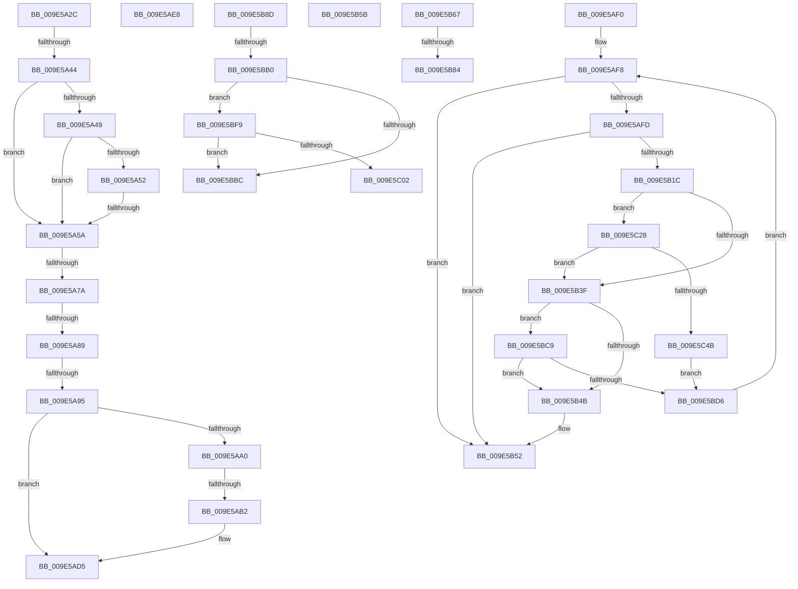

# sub_009E5A2C

- RVA: `0x009E5A2C`–`0x009E5C4D` (길이 `545` bytes)
- VA: `0x00000001409E5A2C`
- 실행 섹션: `PAGE`
- PDB 이름 있음: `아니요`; PDB Function 태그: `아니요`
- unwind 정보 RVA: `0x000A4224`
- 디코드: `128`개 명령, `545/545` bytes 표시
- 미해석 바이트: `0` (있으면 어셈블리에 `.byte`로 보존)

> 이 문서는 커널 이미지의 기계어와 PDB 기호를 분석해 생성했습니다. 4번과 5번은 함수 원형과 자료형을 바이너리 사용 방식에서 추정한 C 해석이며 원본 소스 복구 결과는 아닙니다.

## 1. Dependencies

- 직접 호출 지점: **10**; 고유 호출 대상: **8**
- 직접 호출자로 확인된 함수: **0**
- RIP 상대 이미지 참조: **0**

### Outgoing calls
- `0x009E5A37` → [Feature_Servicing_AutoBoostEtwEventingFixes__private_IsEnabledPreCheckWithReporting](../../text/22/Feature_Servicing_AutoBoostEtwEventingFixes__private_IsEnabledPreCheckWithReporting_function_00222FE0.md) (function, `0x00222FE0`)
- `0x009E5A6D` → [RtlAreBitsClearEx](../../text/41/RtlAreBitsClearEx_function_0041DBF0.md) (function, `0x0041DBF0`)
- `0x009E5AC6` → [HalAdjustResourceList](../../text/48/HalAdjustResourceList_function_0048FDC0.md) (function, `0x0048FDC0`)
- `0x009E5B42` → [MiVadDeleted](../../text/43/MiVadDeleted_function_00431350.md) (function, `0x00431350`)
- `0x009E5B72` → [MiBitmapRangeZeroEx](../../text/45/MiBitmapRangeZeroEx_function_004516D8.md) (function, `0x004516D8`)
- `0x009E5BB3` → [MiVadDeleted](../../text/43/MiVadDeleted_function_00431350.md) (function, `0x00431350`)
- `0x009E5BC9` → [MiVadPureReserve](../../text/2C/MiVadPureReserve_function_002C34C0.md) (function, `0x002C34C0`)
- `0x009E5BE7` → [MiGetPreviousVad](../../text/29/MiGetPreviousVad_function_00297268.md) (function, `0x00297268`)
- `0x009E5BF9` → [MiVadPureReserve](../../text/2C/MiVadPureReserve_function_002C34C0.md) (function, `0x002C34C0`)
- `0x009E5C16` → [MiGetNextVad](../../text/29/MiGetNextVad_function_00297224.md) (function, `0x00297224`)

### Direct callers
- 이 함수 시작 RVA로 연결되는 직접 call은 확인되지 않았습니다. 간접 호출은 완전히 역산할 수 없습니다.

### Static image references
- 디코드된 RIP-relative 메모리 참조가 없습니다.

## 2. Other-region calls and transfers

- 다른 실행 섹션으로 향하는 call: **10**
  - `0x009E5A37` → [Feature_Servicing_AutoBoostEtwEventingFixes__private_IsEnabledPreCheckWithReporting](../../text/22/Feature_Servicing_AutoBoostEtwEventingFixes__private_IsEnabledPreCheckWithReporting_function_00222FE0.md) (`PAGE` → `.text`)
  - `0x009E5A6D` → [RtlAreBitsClearEx](../../text/41/RtlAreBitsClearEx_function_0041DBF0.md) (`PAGE` → `.text`)
  - `0x009E5AC6` → [HalAdjustResourceList](../../text/48/HalAdjustResourceList_function_0048FDC0.md) (`PAGE` → `.text`)
  - `0x009E5B42` → [MiVadDeleted](../../text/43/MiVadDeleted_function_00431350.md) (`PAGE` → `.text`)
  - `0x009E5B72` → [MiBitmapRangeZeroEx](../../text/45/MiBitmapRangeZeroEx_function_004516D8.md) (`PAGE` → `.text`)
  - `0x009E5BB3` → [MiVadDeleted](../../text/43/MiVadDeleted_function_00431350.md) (`PAGE` → `.text`)
  - `0x009E5BC9` → [MiVadPureReserve](../../text/2C/MiVadPureReserve_function_002C34C0.md) (`PAGE` → `.text`)
  - `0x009E5BE7` → [MiGetPreviousVad](../../text/29/MiGetPreviousVad_function_00297268.md) (`PAGE` → `.text`)
  - `0x009E5BF9` → [MiVadPureReserve](../../text/2C/MiVadPureReserve_function_002C34C0.md) (`PAGE` → `.text`)
  - `0x009E5C16` → [MiGetNextVad](../../text/29/MiGetNextVad_function_00297224.md) (`PAGE` → `.text`)
- call이 아닌 외부 분기/꼬리 이동: **15**
  - `0x009E5A3E` → [sub_009E57A9 + 0x1AC](Unknown_function_009E57A9.md) (`tail-transfer`)
  - `0x009E5A54` → [sub_009E57A9 + 0x1AC](Unknown_function_009E57A9.md) (`tail-transfer`)
  - `0x009E5A74` → [sub_009E57A9 + 0x1AC](Unknown_function_009E57A9.md) (`tail-transfer`)
  - `0x009E5A83` → [sub_009E5C69 + 0xBB](Unknown_function_009E5C69.md) (`tail-transfer`)
  - `0x009E5A8F` → [sub_009E5C69 + 0xD2](Unknown_function_009E5C69.md) (`tail-transfer`)
  - `0x009E5AAC` → [sub_009E5C69 + 0xDC](Unknown_function_009E5C69.md) (`tail-transfer`)
  - `0x009E5AE3` → [sub_009E57A9 + 0x1AC](Unknown_function_009E57A9.md) (`tail-transfer`)
  - `0x009E5AEB` → [sub_009E57A9 + 0x14F](Unknown_function_009E57A9.md) (`tail-transfer`)
  - `0x009E5B56` → [sub_009E57A9 + 0x10F](Unknown_function_009E57A9.md) (`tail-transfer`)
  - `0x009E5B62` → [sub_009E57A9 + 0x229](Unknown_function_009E57A9.md) (`tail-transfer`)
  - `0x009E5B7E` → [sub_009E57A9 + 0x199](Unknown_function_009E57A9.md) (`tail-transfer`)
  - `0x009E5B88` → [sub_009E57A9 + 0x1AC](Unknown_function_009E57A9.md) (`tail-transfer`)
  - `0x009E5BAA` → [sub_009E5C69 + 0x4C](Unknown_function_009E5C69.md) (`tail-transfer`)
  - `0x009E5BC4` → [sub_009E57A9 + 0x14A](Unknown_function_009E57A9.md) (`tail-transfer`)
  - `0x009E5C23` → [sub_009E57A9 + 0x122](Unknown_function_009E57A9.md) (`tail-transfer`)

## 3. Assembly (complete function range)

```asm
009E5A2C  49 FF C4                        inc r12
009E5A2F  49 8B 46 08                     mov rax, qword ptr [r14 + 8]
009E5A33  48 0F B3 18                     btr qword ptr [rax], rbx
009E5A37  E8 A4 D5 83 FF                  call 0x140222fe0
009E5A3C  85 C0                           test eax, eax
009E5A3E  0F 85 11 FF FF FF               jne 0x1409e5955
009E5A44  48 3B DE                        cmp rbx, rsi
009E5A47  74 11                           je 0x1409e5a5a
009E5A49  0F B6 C3                        movzx eax, bl
009E5A4C  24 07                           and al, 7
009E5A4E  3C 07                           cmp al, 7
009E5A50  74 08                           je 0x1409e5a5a
009E5A52  85 ED                           test ebp, ebp
009E5A54  0F 84 FB FE FF FF               je 0x1409e5955
009E5A5A  4C 8B FB                        mov r15, rbx
009E5A5D  41 B8 08 00 00 00               mov r8d, 8
009E5A63  49 83 E7 F8                     and r15, 0xfffffffffffffff8
009E5A67  49 8B CE                        mov rcx, r14
009E5A6A  49 8B D7                        mov rdx, r15
009E5A6D  E8 7E 81 A3 FF                  call 0x14041dbf0
009E5A72  84 C0                           test al, al
009E5A74  0F 84 DB FE FF FF               je 0x1409e5955
009E5A7A  41 8B 85 FC 05 00 00            mov eax, dword ptr [r13 + 0x5fc]
009E5A81  A8 01                           test al, 1
009E5A83  0F 84 9B 02 00 00               je 0x1409e5d24
009E5A89  48 83 7C 24 40 00               cmp qword ptr [rsp + 0x40], 0
009E5A8F  0F 85 A6 02 00 00               jne 0x1409e5d3b
009E5A95  4C 8B 54 24 38                  mov r10, qword ptr [rsp + 0x38]
009E5A9A  49 83 FA FF                     cmp r10, -1
009E5A9E  74 35                           je 0x1409e5ad5
009E5AA0  48 8B 54 24 28                  mov rdx, qword ptr [rsp + 0x28]
009E5AA5  49 8D 04 D2                     lea rax, [r10 + rdx*8]
009E5AA9  49 3B C7                        cmp rax, r15
009E5AAC  0F 84 93 02 00 00               je 0x1409e5d45
009E5AB2  49 C1 E2 15                     shl r10, 0x15
009E5AB6  49 8D 8D 00 04 00 00            lea rcx, [r13 + 0x400]
009E5ABD  4C 8B C2                        mov r8, rdx
009E5AC0  45 33 C9                        xor r9d, r9d
009E5AC3  49 8B D2                        mov rdx, r10
009E5AC6  E8 F5 A2 AA FF                  call 0x14048fdc0
009E5ACB  48 8B 44 24 28                  mov rax, qword ptr [rsp + 0x28]
009E5AD0  48 01 44 24 30                  add qword ptr [rsp + 0x30], rax
009E5AD5  48 C7 44 24 28 01 00 00 00      mov qword ptr [rsp + 0x28], 1
009E5ADE  4C 89 7C 24 38                  mov qword ptr [rsp + 0x38], r15
009E5AE3  E9 6D FE FF FF                  jmp 0x1409e5955
009E5AE8  48 FF CE                        dec rsi
009E5AEB  E9 08 FE FF FF                  jmp 0x1409e58f8
009E5AF0  4C 8B 5C 24 58                  mov r11, qword ptr [rsp + 0x58]
009E5AF5  4C 63 C0                        movsxd r8, eax
009E5AF8  4D 85 DB                        test r11, r11
009E5AFB  74 55                           je 0x1409e5b52
009E5AFD  41 0F B6 53 21                  movzx edx, byte ptr [r11 + 0x21]
009E5B02  49 8B C8                        mov rcx, r8
009E5B05  41 8B 43 1C                     mov eax, dword ptr [r11 + 0x1c]
009E5B09  48 C1 E2 17                     shl rdx, 0x17
009E5B0D  48 C1 E8 09                     shr rax, 9
009E5B11  48 0B D0                        or rdx, rax
009E5B14  48 D3 FA                        sar rdx, cl
009E5B17  48 3B D7                        cmp rdx, rdi
009E5B1A  75 36                           jne 0x1409e5b52
009E5B1C  41 8B 53 34                     mov edx, dword ptr [r11 + 0x34]
009E5B20  48 B8 FD FF FF FF 07 00 00 00   movabs rax, 0x7fffffffd
009E5B2A  41 0F B6 4B 22                  movzx ecx, byte ptr [r11 + 0x22]
009E5B2F  48 C1 E1 20                     shl rcx, 0x20
009E5B33  48 0B CA                        or rcx, rdx
009E5B36  48 3B C8                        cmp rcx, rax
009E5B39  0F 83 E9 00 00 00               jae 0x1409e5c28
009E5B3F  49 8B CB                        mov rcx, r11
009E5B42  E8 09 B8 A4 FF                  call 0x140431350
009E5B47  85 C0                           test eax, eax
009E5B49  74 7E                           je 0x1409e5bc9
009E5B4B  48 FF C7                        inc rdi
009E5B4E  41 C6 07 00                     mov byte ptr [r15], 0
009E5B52  8B 44 24 20                     mov eax, dword ptr [rsp + 0x20]
009E5B56  E9 5D FD FF FF                  jmp 0x1409e58b8
009E5B5B  49 8D 9E 00 04 00 00            lea rbx, [r14 + 0x400]
009E5B62  E9 6B FE FF FF                  jmp 0x1409e59d2
009E5B67  4C 8D 44 24 50                  lea r8, [rsp + 0x50]
009E5B6C  48 8B D3                        mov rdx, rbx
009E5B6F  49 8B CE                        mov rcx, r14
009E5B72  E8 61 BB A6 FF                  call 0x1404516d8
009E5B77  48 8B 7C 24 50                  mov rdi, qword ptr [rsp + 0x50]
009E5B7C  85 C0                           test eax, eax
009E5B7E  0F 84 BE FD FF FF               je 0x1409e5942
009E5B84  48 8D 5F FF                     lea rbx, [rdi - 1]
009E5B88  E9 C8 FD FF FF                  jmp 0x1409e5955
009E5B8D  41 8B 52 34                     mov edx, dword ptr [r10 + 0x34]
009E5B91  48 B8 FD FF FF FF 07 00 00 00   movabs rax, 0x7fffffffd
009E5B9B  41 0F B6 4A 22                  movzx ecx, byte ptr [r10 + 0x22]
009E5BA0  48 C1 E1 20                     shl rcx, 0x20
009E5BA4  48 0B CA                        or rcx, rdx
009E5BA7  48 3B C8                        cmp rcx, rax
009E5BAA  0F 83 05 01 00 00               jae 0x1409e5cb5
009E5BB0  49 8B CA                        mov rcx, r10
009E5BB3  E8 98 B7 A4 FF                  call 0x140431350
009E5BB8  85 C0                           test eax, eax
009E5BBA  74 3D                           je 0x1409e5bf9
009E5BBC  48 FF CE                        dec rsi
009E5BBF  41 C6 45 00 00                  mov byte ptr [r13], 0
009E5BC4  E9 2A FD FF FF                  jmp 0x1409e58f3
009E5BC9  E8 F2 D8 8D FF                  call 0x1402c34c0
009E5BCE  85 C0                           test eax, eax
009E5BD0  0F 84 75 FF FF FF               je 0x1409e5b4b
009E5BD6  4C 3B 5C 24 78                  cmp r11, qword ptr [rsp + 0x78]
009E5BDB  4C 0F 44 9C 24 F8 00 00 00      cmove r11, qword ptr [rsp + 0xf8]
009E5BE4  49 8B CB                        mov rcx, r11
009E5BE7  E8 7C 16 8B FF                  call 0x140297268
009E5BEC  4C 8B D8                        mov r11, rax
009E5BEF  48 89 44 24 58                  mov qword ptr [rsp + 0x58], rax
009E5BF4  E9 FF FE FF FF                  jmp 0x1409e5af8
009E5BF9  E8 C2 D8 8D FF                  call 0x1402c34c0
009E5BFE  85 C0                           test eax, eax
009E5C00  74 BA                           je 0x1409e5bbc
009E5C02  4C 3B 94 24 80 00 00 00         cmp r10, qword ptr [rsp + 0x80]
009E5C0A  4C 0F 44 94 24 F8 00 00 00      cmove r10, qword ptr [rsp + 0xf8]
009E5C13  49 8B CA                        mov rcx, r10
009E5C16  E8 09 16 8B FF                  call 0x140297224
009E5C1B  4C 8B D0                        mov r10, rax
009E5C1E  48 89 44 24 60                  mov qword ptr [rsp + 0x60], rax
009E5C23  E9 A3 FC FF FF                  jmp 0x1409e58cb
009E5C28  41 8B 4B 34                     mov ecx, dword ptr [r11 + 0x34]
009E5C2C  48 B8 FE FF FF FF 07 00 00 00   movabs rax, 0x7fffffffe
009E5C36  41 0F B6 53 22                  movzx edx, byte ptr [r11 + 0x22]
009E5C3B  48 C1 E2 20                     shl rdx, 0x20
009E5C3F  48 0B D1                        or rdx, rcx
009E5C42  48 3B D0                        cmp rdx, rax
009E5C45  0F 84 F4 FE FF FF               je 0x1409e5b3f
009E5C4B  EB 89                           jmp 0x1409e5bd6
```

## 4. C-style interpretation (structured pseudocode)

```c
__int64 __fastcall sub_009E5A2C(__int64 a1, __int64 a2, __int64 a3, int a4, __int64 a5, __int64 a6, __int64 a7, __int64 a8)
{
    __int64 result;
    __int64 v_r10;
    __int64 v_r12;
    __int64 v_r15;
    unsigned int v_stack_p20;
    unsigned __int64 v_stack_p28;
    unsigned __int64 v_stack_p38;
    unsigned __int64 v_stack_p50;
    unsigned __int64 v_stack_p58;
    unsigned __int64 v_stack_p60;
    unsigned __int64 v_stack_p78;
    unsigned __int64 v_stack_p80;
    unsigned __int64 v_stack_pF8;

    v_r12 = (v_r12) + 1;
    result = Feature_Servicing_AutoBoostEtwEventingFixes__private_IsEnabledPreCheckWithReporting(a1, a2, a3, a4);
    if (v_rbx == v_rsi) goto loc_009E5A5A;
    result = (unsigned __int8)(((unsigned __int8)(v_rbx)) & (7));
    if (((unsigned __int8)(result)) == 7) goto loc_009E5A5A;
loc_009E5A5A:
    v_r15 = (v_rbx) & (-8);
    result = RtlAreBitsClearEx(v_r14, v_r15, 8, a4);
    if (a7 == -1) goto loc_009E5AD5;
    v_r10 = (a7) << (21);
    a4 = 0;
    result = HalAdjustResourceList(v_r13 + 1024, v_r10, a5, a4);
loc_009E5AD5:
    v_stack_p28 = 1;
    v_stack_p38 = v_r15;
}
```

## 5. (Beta) C Style

```c
int64_t sub_009E5A2C(int64_t Arg1, int64_t Arg2, int64_t Arg3, int32_t Arg4, int64_t Arg5, int64_t Arg6, int64_t Arg7, int64_t Arg8)
{
    int64_t result;
    int64_t local_r10;
    int64_t local_r12;
    int64_t local_r15;
    uint32_t v_stack_p20;
    uint64_t v_stack_p28;
    uint64_t v_stack_p38;
    uint64_t v_stack_p50;
    uint64_t v_stack_p58;
    uint64_t v_stack_p60;
    uint64_t v_stack_p78;
    uint64_t v_stack_p80;
    uint64_t v_stack_pF8;

    local_r12 = (local_r12) + 1;
    result = Feature_Servicing_AutoBoostEtwEventingFixes__private_IsEnabledPreCheckWithReporting(Arg1, Arg2, Arg3, Arg4);
    if (local_rbx == local_rsi) goto loc_009E5A5A;
    result = (uint8_t)(((uint8_t)(local_rbx)) & (7));
    if (((uint8_t)(result)) == 7) goto loc_009E5A5A;
loc_009E5A5A:
    local_r15 = (local_rbx) & (-8);
    result = RtlAreBitsClearEx(local_r14, local_r15, 8, Arg4);
    if (Arg7 == -1) goto loc_009E5AD5;
    local_r10 = (Arg7) << (21);
    Arg4 = 0;
    result = HalAdjustResourceList(local_r13 + 1024, local_r10, Arg5, Arg4);
loc_009E5AD5:
    v_stack_p28 = 1;
    v_stack_p38 = local_r15;
}
```

## 6. Execution-region graph

[열기: 2D/3D 그래프와 함수 탐색 컨트롤 패널](../../../control-panel.html?section=page&rva=0x009E5A2C&view=graph)

- 2D 그래프는 위에서 아래로 흐르고, 3D 그래프는 빈 공간을 드래그해 회전합니다. Shift+드래그는 이동, 휠은 확대·축소, 함수 노드 선택은 대상 보고서 이동입니다.

### Static fallback


