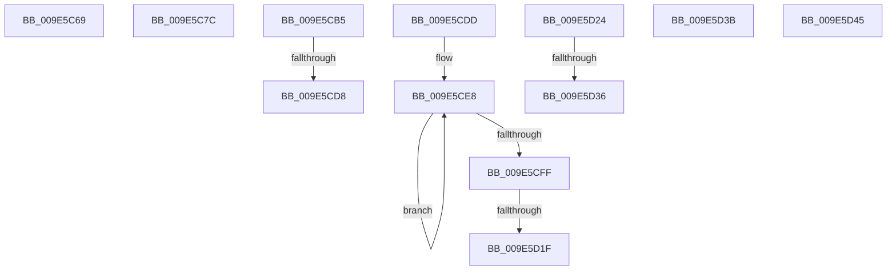

# sub_009E5C69

- RVA: `0x009E5C69`–`0x009E5D52` (길이 `233` bytes)
- VA: `0x00000001409E5C69`
- 실행 섹션: `PAGE`
- PDB 이름 있음: `아니요`; PDB Function 태그: `아니요`
- unwind 정보 RVA: `0x000A4254`
- 디코드: `53`개 명령, `233/233` bytes 표시
- 미해석 바이트: `0` (있으면 어셈블리에 `.byte`로 보존)

> 이 문서는 커널 이미지의 기계어와 PDB 기호를 분석해 생성했습니다. 4번과 5번은 함수 원형과 자료형을 바이너리 사용 방식에서 추정한 C 해석이며 원본 소스 복구 결과는 아닙니다.

## 1. Dependencies

- 직접 호출 지점: **2**; 고유 호출 대상: **2**
- 직접 호출자로 확인된 함수: **0**
- RIP 상대 이미지 참조: **0**

### Outgoing calls
- `0x009E5C72` → [MiUpdateChargedWsles](../../text/4F/MiUpdateChargedWsles_function_004F6EA0.md) (function, `0x004F6EA0`)
- `0x009E5C91` → [HalAdjustResourceList](../../text/48/HalAdjustResourceList_function_0048FDC0.md) (function, `0x0048FDC0`)

### Direct callers
- 이 함수 시작 RVA로 연결되는 직접 call은 확인되지 않았습니다. 간접 호출은 완전히 역산할 수 없습니다.

### Static image references
- 디코드된 RIP-relative 메모리 참조가 없습니다.

## 2. Other-region calls and transfers

- 다른 실행 섹션으로 향하는 call: **2**
  - `0x009E5C72` → [MiUpdateChargedWsles](../../text/4F/MiUpdateChargedWsles_function_004F6EA0.md) (`PAGE` → `.text`)
  - `0x009E5C91` → [HalAdjustResourceList](../../text/48/HalAdjustResourceList_function_0048FDC0.md) (`PAGE` → `.text`)
- call이 아닌 외부 분기/꼬리 이동: **10**
  - `0x009E5C77` → [sub_009E57A9 + 0x237](Unknown_function_009E57A9.md) (`tail-transfer`)
  - `0x009E5CB0` → [sub_009E57A9 + 0x1D1](Unknown_function_009E57A9.md) (`tail-transfer`)
  - `0x009E5CD2` → [sub_009E5A2C + 0x184](Unknown_function_009E5A2C.md) (`tail-transfer`)
  - `0x009E5CD8` → [sub_009E5A2C + 0x1D6](Unknown_function_009E5A2C.md) (`tail-transfer`)
  - `0x009E5D19` → [sub_009E57A9 + 0x243](Unknown_function_009E57A9.md) (`tail-transfer`)
  - `0x009E5D1F` → [sub_009E57A9 + 0xE3](Unknown_function_009E57A9.md) (`tail-transfer`)
  - `0x009E5D30` → [sub_009E5A2C + 0x5D](Unknown_function_009E5A2C.md) (`tail-transfer`)
  - `0x009E5D36` → [sub_009E57A9 + 0x1AC](Unknown_function_009E57A9.md) (`tail-transfer`)
  - `0x009E5D40` → [sub_009E57A9 + 0x1AC](Unknown_function_009E57A9.md) (`tail-transfer`)
  - `0x009E5D4D` → [sub_009E57A9 + 0x1AC](Unknown_function_009E57A9.md) (`tail-transfer`)

## 3. Assembly (complete function range)

```asm
009E5C69  48 8B D0                        mov rdx, rax
009E5C6C  48 8B CB                        mov rcx, rbx
009E5C6F  48 F7 DA                        neg rdx
009E5C72  E8 29 12 B1 FF                  call 0x1404f6ea0
009E5C77  E9 64 FD FF FF                  jmp 0x1409e59e0
009E5C7C  48 8B 44 24 38                  mov rax, qword ptr [rsp + 0x38]
009E5C81  4C 8B C2                        mov r8, rdx
009E5C84  48 C1 E0 15                     shl rax, 0x15
009E5C88  45 33 C9                        xor r9d, r9d
009E5C8B  48 8B D0                        mov rdx, rax
009E5C8E  48 8B CB                        mov rcx, rbx
009E5C91  E8 2A A1 AA FF                  call 0x14048fdc0
009E5C96  48 8B 44 24 28                  mov rax, qword ptr [rsp + 0x28]
009E5C9B  48 01 44 24 30                  add qword ptr [rsp + 0x30], rax
009E5CA0  33 C0                           xor eax, eax
009E5CA2  48 C7 44 24 38 FF FF FF FF      mov qword ptr [rsp + 0x38], 0xffffffffffffffff
009E5CAB  48 89 44 24 28                  mov qword ptr [rsp + 0x28], rax
009E5CB0  E9 C5 FC FF FF                  jmp 0x1409e597a
009E5CB5  41 8B 4A 34                     mov ecx, dword ptr [r10 + 0x34]
009E5CB9  48 B8 FE FF FF FF 07 00 00 00   movabs rax, 0x7fffffffe
009E5CC3  41 0F B6 52 22                  movzx edx, byte ptr [r10 + 0x22]
009E5CC8  48 C1 E2 20                     shl rdx, 0x20
009E5CCC  48 0B D1                        or rdx, rcx
009E5CCF  48 3B D0                        cmp rdx, rax
009E5CD2  0F 84 D8 FE FF FF               je 0x1409e5bb0
009E5CD8  E9 25 FF FF FF                  jmp 0x1409e5c02
009E5CDD  41 0F B6 45 00                  movzx eax, byte ptr [r13]
009E5CE2  49 8B D2                        mov rdx, r10
009E5CE5  41 8B CA                        mov ecx, r10d
009E5CE8  41 D0 2F                        shr byte ptr [r15], 1
009E5CEB  48 C1 FF 09                     sar rdi, 9
009E5CEF  48 C1 FE 09                     sar rsi, 9
009E5CF3  D0 E8                           shr al, 1
009E5CF5  49 C1 F8 09                     sar r8, 9
009E5CF9  48 83 EA 01                     sub rdx, 1
009E5CFD  75 E9                           jne 0x1409e5ce8
009E5CFF  41 88 45 00                     mov byte ptr [r13], al
009E5D03  48 C7 44 24 38 FF FF FF FF      mov qword ptr [rsp + 0x38], 0xffffffffffffffff
009E5D0C  48 89 54 24 28                  mov qword ptr [rsp + 0x28], rdx
009E5D11  4C 89 44 24 48                  mov qword ptr [rsp + 0x48], r8
009E5D16  83 F9 03                        cmp ecx, 3
009E5D19  0F 8D CD FC FF FF               jge 0x1409e59ec
009E5D1F  E9 68 FB FF FF                  jmp 0x1409e588c
009E5D24  48 8B 44 24 48                  mov rax, qword ptr [rsp + 0x48]
009E5D29  48 83 E0 F8                     and rax, 0xfffffffffffffff8
009E5D2D  4C 3B F8                        cmp r15, rax
009E5D30  0F 85 53 FD FF FF               jne 0x1409e5a89
009E5D36  E9 1A FC FF FF                  jmp 0x1409e5955
009E5D3B  48 FF 44 24 30                  inc qword ptr [rsp + 0x30]
009E5D40  E9 10 FC FF FF                  jmp 0x1409e5955
009E5D45  48 FF C2                        inc rdx
009E5D48  48 89 54 24 28                  mov qword ptr [rsp + 0x28], rdx
009E5D4D  E9 03 FC FF FF                  jmp 0x1409e5955
```

## 4. C-style interpretation (structured pseudocode)

```c
__int64 __fastcall sub_009E5C69(__int64 a1, __int64 a2, __int64 a3, int a4)
{
    __int64 result;
    unsigned __int64 v_stack_p28;
    unsigned __int64 v_stack_p30;
    unsigned __int64 v_stack_p38;
    unsigned __int64 v_stack_p48;

    a2 = -(result);
    result = MiUpdateChargedWsles(v_rbx, a2, a3, a4);
}
```

## 5. (Beta) C Style

```c
int64_t sub_009E5C69(int64_t Arg1, int64_t Arg2, int64_t Arg3, int32_t Arg4)
{
    int64_t result;
    uint64_t v_stack_p28;
    uint64_t v_stack_p30;
    uint64_t v_stack_p38;
    uint64_t v_stack_p48;

    Arg2 = -(result);
    result = MiUpdateChargedWsles(local_rbx, Arg2, Arg3, Arg4);
}
```

## 6. Execution-region graph

[열기: 2D/3D 그래프와 함수 탐색 컨트롤 패널](../../../control-panel.html?section=page&rva=0x009E5C69&view=graph)

- 2D 그래프는 위에서 아래로 흐르고, 3D 그래프는 빈 공간을 드래그해 회전합니다. Shift+드래그는 이동, 휠은 확대·축소, 함수 노드 선택은 대상 보고서 이동입니다.

### Static fallback


