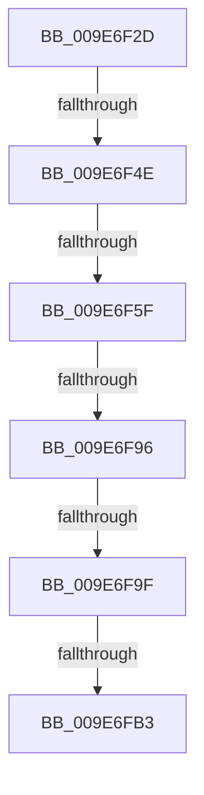

# sub_009E6F2D

- RVA: `0x009E6F2D`–`0x009E6FE5` (길이 `184` bytes)
- VA: `0x00000001409E6F2D`
- 실행 섹션: `PAGE`
- PDB 이름 있음: `아니요`; PDB Function 태그: `아니요`
- unwind 정보 RVA: `0x000A4938`
- 디코드: `44`개 명령, `184/184` bytes 표시
- 미해석 바이트: `0` (있으면 어셈블리에 `.byte`로 보존)

> 이 문서는 커널 이미지의 기계어와 PDB 기호를 분석해 생성했습니다. 4번과 5번은 함수 원형과 자료형을 바이너리 사용 방식에서 추정한 C 해석이며 원본 소스 복구 결과는 아닙니다.

## 1. Dependencies

- 직접 호출 지점: **3**; 고유 호출 대상: **3**
- 직접 호출자로 확인된 함수: **0**
- RIP 상대 이미지 참조: **0**

### Outgoing calls
- `0x009E6F51` → [SeQueryTokenTrustLink](../../text/47/SeQueryTokenTrustLink_function_0047168C.md) (function, `0x0047168C`)
- `0x009E6F83` → [PspLockThreadSecurityExclusive](../../text/4E/PspLockThreadSecurityExclusive_function_004E96E0.md) (function, `0x004E96E0`)
- `0x009E6FCC` → [PspUnlockThreadSecurityExclusive](../../text/4E/PspUnlockThreadSecurityExclusive_function_004E97C0.md) (function, `0x004E97C0`)

### Direct callers
- 이 함수 시작 RVA로 연결되는 직접 call은 확인되지 않았습니다. 간접 호출은 완전히 역산할 수 없습니다.

### Static image references
- 디코드된 RIP-relative 메모리 참조가 없습니다.

## 2. Other-region calls and transfers

- 다른 실행 섹션으로 향하는 call: **3**
  - `0x009E6F51` → [SeQueryTokenTrustLink](../../text/47/SeQueryTokenTrustLink_function_0047168C.md) (`PAGE` → `.text`)
  - `0x009E6F83` → [PspLockThreadSecurityExclusive](../../text/4E/PspLockThreadSecurityExclusive_function_004E96E0.md) (`PAGE` → `.text`)
  - `0x009E6FCC` → [PspUnlockThreadSecurityExclusive](../../text/4E/PspUnlockThreadSecurityExclusive_function_004E97C0.md) (`PAGE` → `.text`)
- call이 아닌 외부 분기/꼬리 이동: **6**
  - `0x009E6F48` → [sub_009E6FF2 + 0x1D](Unknown_function_009E6FF2.md) (`tail-transfer`)
  - `0x009E6F59` → [sub_009E6FF2 + 0x25](Unknown_function_009E6FF2.md) (`tail-transfer`)
  - `0x009E6F90` → [sub_009E6FF2 + 0x3D](Unknown_function_009E6FF2.md) (`tail-transfer`)
  - `0x009E6F9D` → [sub_009E6FF2 + 0xD](Unknown_function_009E6FF2.md) (`tail-transfer`)
  - `0x009E6FB1` → [sub_009E6FF2](Unknown_function_009E6FF2.md) (`tail-transfer`)
  - `0x009E6FE3` → [sub_009E7046](Unknown_function_009E7046.md) (`tail-transfer`)

## 3. Assembly (complete function range)

```asm
009E6F2D  48 89 7C 24 50                  mov qword ptr [rsp + 0x50], rdi
009E6F32  48 8B F1                        mov rsi, rcx
009E6F35  4C 89 64 24 58                  mov qword ptr [rsp + 0x58], r12
009E6F3A  44 8B E5                        mov r12d, ebp
009E6F3D  4C 89 74 24 60                  mov qword ptr [rsp + 0x60], r14
009E6F42  4C 8B F2                        mov r14, rdx
009E6F45  48 85 DB                        test rbx, rbx
009E6F48  0F 84 C1 00 00 00               je 0x1409e700f
009E6F4E  48 8B CB                        mov rcx, rbx
009E6F51  E8 36 A7 A8 FF                  call 0x14047168c
009E6F56  48 85 C0                        test rax, rax
009E6F59  0F 85 B8 00 00 00               jne 0x1409e7017
009E6F5F  41 8B 7E 0C                     mov edi, dword ptr [r14 + 0xc]
009E6F63  41 0F B6 46 09                  movzx eax, byte ptr [r14 + 9]
009E6F68  83 E7 03                        and edi, 3
009E6F6B  F6 D8                           neg al
009E6F6D  48 1B C9                        sbb rcx, rcx
009E6F70  48 83 E3 F8                     and rbx, 0xfffffffffffffff8
009E6F74  83 E1 04                        and ecx, 4
009E6F77  48 0B F9                        or rdi, rcx
009E6F7A  48 0B FB                        or rdi, rbx
009E6F7D  49 8B D7                        mov rdx, r15
009E6F80  48 8B CE                        mov rcx, rsi
009E6F83  E8 58 27 B0 FF                  call 0x1404e96e0
009E6F88  8B 86 A0 05 00 00               mov eax, dword ptr [rsi + 0x5a0]
009E6F8E  A8 08                           test al, 8
009E6F90  0F 85 99 00 00 00               jne 0x1409e702f
009E6F96  48 8B DD                        mov rbx, rbp
009E6F99  49 83 3E 00                     cmp qword ptr [r14], 0
009E6F9D  74 60                           je 0x1409e6fff
009E6F9F  48 89 BE 38 05 00 00            mov qword ptr [rsi + 0x538], rdi
009E6FA6  4C 89 A6 48 06 00 00            mov qword ptr [rsi + 0x648], r12
009E6FAD  45 38 6E 08                     cmp byte ptr [r14 + 8], r13b
009E6FB1  74 3F                           je 0x1409e6ff2
009E6FB3  F0 81 8E A0 05 00 00 00 01 00 00  lock or dword ptr [rsi + 0x5a0], 0x100
009E6FBE  F0 83 8E A0 05 00 00 08         lock or dword ptr [rsi + 0x5a0], 8
009E6FC6  49 8B D7                        mov rdx, r15
009E6FC9  48 8B CE                        mov rcx, rsi
009E6FCC  E8 EF 27 B0 FF                  call 0x1404e97c0
009E6FD1  4C 8B 74 24 60                  mov r14, qword ptr [rsp + 0x60]
009E6FD6  4C 8B 64 24 58                  mov r12, qword ptr [rsp + 0x58]
009E6FDB  48 8B 7C 24 50                  mov rdi, qword ptr [rsp + 0x50]
009E6FE0  48 85 ED                        test rbp, rbp
009E6FE3  75 61                           jne 0x1409e7046
```

## 4. C-style interpretation (structured pseudocode)

```c
__int64 __fastcall sub_009E6F2D(__int64 a1, __int64 a2, __int64 a3, __int64 a4, __int64 a5, __int64 a6, __int64 a7, __int64 a8, __int64 a9, __int64 a10, __int64 a11, __int64 a12)
{
    __int64 result;
    __int64 v_rbx;
    __int64 v_rdi;
    unsigned __int64 v_stack_p50;
    unsigned __int64 v_stack_p58;
    unsigned __int64 v_stack_p60;

    v_stack_p50 = v_rdi;
    v_stack_p58 = v_r12;
    v_stack_p60 = v_r14;
    result = SeQueryTokenTrustLink(v_rbx, a2, a3, a4);
    v_rdi = (unsigned int)(((unsigned int)(*(unsigned int *)(a2 + 12))) & (3));
    result = (unsigned __int8)(-(*(unsigned __int8 *)(a2 + 9)));
    v_rbx = (v_rbx) & (-8);
    a1 = (unsigned int)((v_rbx) & (4));
    v_rdi = (v_rdi) | (a1);
    v_rdi = (v_rdi) | (v_rbx);
    result = PspLockThreadSecurityExclusive(a1, v_r15, a3, a4);
    *(unsigned __int64 *)(a1 + 1336) = v_rdi;
    *(unsigned __int64 *)(a1 + 1608) = (unsigned int)((unsigned int)(v_rbp));
    result = PspUnlockThreadSecurityExclusive(a1, v_r15, a3, a4);
}
```

## 5. (Beta) C Style

```c
int64_t sub_009E6F2D(void *Arg1, void *Arg2, int64_t Arg3, int64_t Arg4, uint64_t Arg5, uint64_t Arg6, uint64_t Arg7, uint64_t Arg8, uint64_t Arg9, int64_t Arg10, int64_t Arg11, int64_t Arg12)
{
    uint8_t *arg1 = (uint8_t *)Arg1;
    uint8_t *arg2 = (uint8_t *)Arg2;

    int64_t result;
    int64_t local_rbx;
    int64_t local_rdi;
    uint64_t v_stack_p50;
    uint64_t v_stack_p58;
    uint64_t v_stack_p60;

    v_stack_p50 = local_rdi;
    v_stack_p58 = local_r12;
    v_stack_p60 = local_r14;
    result = SeQueryTokenTrustLink(local_rbx, Arg2, Arg3, Arg4);
    local_rdi = (uint32_t)(((uint32_t)(*(uint32_t *)(arg2 + 0xC))) & (3));
    result = (uint8_t)(-(*(uint8_t *)(arg2 + 0x9)));
    local_rbx = (local_rbx) & (-8);
    Arg1 = (uint32_t)((local_rbx) & (4));
    local_rdi = (local_rdi) | (Arg1);
    local_rdi = (local_rdi) | (local_rbx);
    result = PspLockThreadSecurityExclusive(Arg1, local_r15, Arg3, Arg4);
    *(uint64_t *)(arg1 + 0x538) = local_rdi;
    *(uint64_t *)(arg1 + 0x648) = (uint32_t)((uint32_t)(local_rbp));
    result = PspUnlockThreadSecurityExclusive(Arg1, local_r15, Arg3, Arg4);
}
```

### 관측된 메모리 오프셋

구조체 형식이 확인되지 않은 접근은 인자 기준의 오프셋으로만 기록했습니다.

| 기준 인자 | 오프셋 표현 | 폭 (bit) | 접근 |
|---|---:|---:|---|
| `Arg1` | `+ 0x538` | `64` | `W` |
| `Arg1` | `+ 0x5A0` | `32` | `R` |
| `Arg1` | `+ 0x5A0` | `32` | `R/W` |
| `Arg1` | `+ 0x648` | `64` | `W` |
| `Arg2` | `+ 0x0` | `64` | `R` |
| `Arg2` | `+ 0x8` | `8` | `R` |
| `Arg2` | `+ 0x9` | `8` | `R` |
| `Arg2` | `+ 0xC` | `32` | `R` |

## 6. Execution-region graph

[열기: 2D/3D 그래프와 함수 탐색 컨트롤 패널](../../../control-panel.html?section=page&rva=0x009E6F2D&view=graph)

- 2D 그래프는 위에서 아래로 흐르고, 3D 그래프는 빈 공간을 드래그해 회전합니다. Shift+드래그는 이동, 휠은 확대·축소, 함수 노드 선택은 대상 보고서 이동입니다.

### Static fallback


