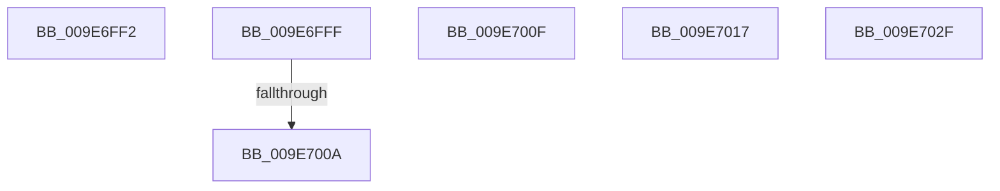

# sub_009E6FF2

- RVA: `0x009E6FF2`–`0x009E7046` (길이 `84` bytes)
- VA: `0x00000001409E6FF2`
- 실행 섹션: `PAGE`
- PDB 이름 있음: `아니요`; PDB Function 태그: `아니요`
- unwind 정보 RVA: `0x000A4968`
- 디코드: `18`개 명령, `84/84` bytes 표시
- 미해석 바이트: `0` (있으면 어셈블리에 `.byte`로 보존)

> 이 문서는 커널 이미지의 기계어와 PDB 기호를 분석해 생성했습니다. 4번과 5번은 함수 원형과 자료형을 바이너리 사용 방식에서 추정한 C 해석이며 원본 소스 복구 결과는 아닙니다.

## 1. Dependencies

- 직접 호출 지점: **2**; 고유 호출 대상: **2**
- 직접 호출자로 확인된 함수: **0**
- RIP 상대 이미지 참조: **0**

### Outgoing calls
- `0x009E7017` → [SeQueryTokenTrustLink](../../text/47/SeQueryTokenTrustLink_function_0047168C.md) (function, `0x0047168C`)
- `0x009E7022` → [ObfReferenceObject](../../text/20/ObfReferenceObject_function_0020FA20.md) (function, `0x0020FA20`)

### Direct callers
- 이 함수 시작 RVA로 연결되는 직접 call은 확인되지 않았습니다. 간접 호출은 완전히 역산할 수 없습니다.

### Static image references
- 디코드된 RIP-relative 메모리 참조가 없습니다.

## 2. Other-region calls and transfers

- 다른 실행 섹션으로 향하는 call: **2**
  - `0x009E7017` → [SeQueryTokenTrustLink](../../text/47/SeQueryTokenTrustLink_function_0047168C.md) (`PAGE` → `.text`)
  - `0x009E7022` → [ObfReferenceObject](../../text/20/ObfReferenceObject_function_0020FA20.md) (`PAGE` → `.text`)
- call이 아닌 외부 분기/꼬리 이동: **6**
  - `0x009E6FFD` → [sub_009E6F2D + 0x91](Unknown_function_009E6F2D.md) (`tail-transfer`)
  - `0x009E7008` → [sub_009E6F2D + 0x99](Unknown_function_009E6F2D.md) (`tail-transfer`)
  - `0x009E700D` → [sub_009E6F2D + 0x99](Unknown_function_009E6F2D.md) (`tail-transfer`)
  - `0x009E7012` → [sub_009E6F2D + 0x50](Unknown_function_009E6F2D.md) (`tail-transfer`)
  - `0x009E702A` → [sub_009E6F2D + 0x32](Unknown_function_009E6F2D.md) (`tail-transfer`)
  - `0x009E7041` → [sub_009E6F2D + 0x6C](Unknown_function_009E6F2D.md) (`tail-transfer`)

## 3. Assembly (complete function range)

```asm
009E6FF2  F0 81 A6 A0 05 00 00 FF FE FF FF  lock and dword ptr [rsi + 0x5a0], 0xfffffeff
009E6FFD  EB BF                           jmp 0x1409e6fbe
009E6FFF  F0 0F BA B6 A0 05 00 00 03      lock btr dword ptr [rsi + 0x5a0], 3
009E7008  73 BC                           jae 0x1409e6fc6
009E700A  41 B5 01                        mov r13b, 1
009E700D  EB B7                           jmp 0x1409e6fc6
009E700F  48 8B FD                        mov rdi, rbp
009E7012  E9 66 FF FF FF                  jmp 0x1409e6f7d
009E7017  E8 70 A6 A8 FF                  call 0x14047168c
009E701C  48 8B C8                        mov rcx, rax
009E701F  48 8B D8                        mov rbx, rax
009E7022  E8 F9 89 82 FF                  call 0x14020fa20
009E7027  4D 8B 26                        mov r12, qword ptr [r14]
009E702A  E9 30 FF FF FF                  jmp 0x1409e6f5f
009E702F  48 8B AE 38 05 00 00            mov rbp, qword ptr [rsi + 0x538]
009E7036  48 8B 9E 48 06 00 00            mov rbx, qword ptr [rsi + 0x648]
009E703D  48 83 E5 F8                     and rbp, 0xfffffffffffffff8
009E7041  E9 53 FF FF FF                  jmp 0x1409e6f99
```

## 4. C-style interpretation (structured pseudocode)

```c
__int64 __fastcall sub_009E6FF2(void)
{
}
```

## 5. (Beta) C Style

```c
void sub_009E6FF2(void)
{
}
```

## 6. Execution-region graph

[열기: 2D/3D 그래프와 함수 탐색 컨트롤 패널](../../../control-panel.html?section=page&rva=0x009E6FF2&view=graph)

- 2D 그래프는 위에서 아래로 흐르고, 3D 그래프는 빈 공간을 드래그해 회전합니다. Shift+드래그는 이동, 휠은 확대·축소, 함수 노드 선택은 대상 보고서 이동입니다.

### Static fallback


