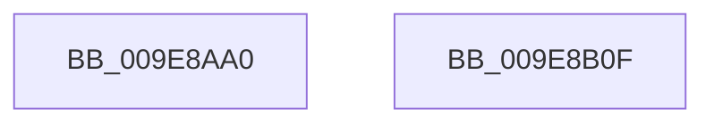

# sub_009E8AA0

- RVA: `0x009E8AA0`–`0x009E8B10` (길이 `112` bytes)
- VA: `0x00000001409E8AA0`
- 실행 섹션: `PAGE`
- PDB 이름 있음: `아니요`; PDB Function 태그: `아니요`
- unwind 정보 RVA: `0x00071750`
- 디코드: `29`개 명령, `112/112` bytes 표시
- 미해석 바이트: `0` (있으면 어셈블리에 `.byte`로 보존)

> 이 문서는 커널 이미지의 기계어와 PDB 기호를 분석해 생성했습니다. 4번과 5번은 함수 원형과 자료형을 바이너리 사용 방식에서 추정한 C 해석이며 원본 소스 복구 결과는 아닙니다.

## 1. Dependencies

- 직접 호출 지점: **0**; 고유 호출 대상: **0**
- 직접 호출자로 확인된 함수: **0**
- RIP 상대 이미지 참조: **0**

### Outgoing calls
- 직접 디코드된 call 명령이 없습니다.

### Direct callers
- 이 함수 시작 RVA로 연결되는 직접 call은 확인되지 않았습니다. 간접 호출은 완전히 역산할 수 없습니다.

### Static image references
- 디코드된 RIP-relative 메모리 참조가 없습니다.

## 2. Other-region calls and transfers

- 다른 실행 섹션으로 향하는 call: **0**
- 별도 외부 분기/꼬리 이동을 확인하지 못했습니다.

## 3. Assembly (complete function range)

```asm
009E8AA0  48 89 5C 24 08                  mov qword ptr [rsp + 8], rbx
009E8AA5  44 8B 54 24 38                  mov r10d, dword ptr [rsp + 0x38]
009E8AAA  4C 8B DA                        mov r11, rdx
009E8AAD  48 8B D9                        mov rbx, rcx
009E8AB0  48 B8 89 88 88 88 88 88 88 88   movabs rax, 0x8888888888888889
009E8ABA  49 F7 E0                        mul r8
009E8ABD  83 E3 03                        and ebx, 3
009E8AC0  48 C1 EA 03                     shr rdx, 3
009E8AC4  0F B6 C2                        movzx eax, dl
009E8AC7  44 6B C8 0F                     imul r9d, eax, 0xf
009E8ACB  48 B8 AB AA AA AA AA AA AA AA   movabs rax, 0xaaaaaaaaaaaaaaab
009E8AD5  49 F7 E3                        mul r11
009E8AD8  45 2A C1                        sub r8b, r9b
009E8ADB  48 D1 EA                        shr rdx, 1
009E8ADE  48 03 D3                        add rdx, rbx
009E8AE1  41 8D 48 01                     lea ecx, [r8 + 1]
009E8AE5  41 D3 EA                        shr r10d, cl
009E8AE8  49 8D 4B 01                     lea rcx, [r11 + 1]
009E8AEC  48 03 CA                        add rcx, rdx
009E8AEF  48 8B 54 24 30                  mov rdx, qword ptr [rsp + 0x30]
009E8AF4  83 E1 03                        and ecx, 3
009E8AF7  0F B7 04 4A                     movzx eax, word ptr [rdx + rcx*2]
009E8AFB  33 44 24 38                     xor eax, dword ptr [rsp + 0x38]
009E8AFF  0F B7 0C 5A                     movzx ecx, word ptr [rdx + rbx*2]
009E8B03  48 8B 5C 24 08                  mov rbx, qword ptr [rsp + 8]
009E8B08  0F AF C1                        imul eax, ecx
009E8B0B  41 33 C2                        xor eax, r10d
009E8B0E  C3                              ret
009E8B0F  CC                              int3
```

## 4. C-style interpretation (structured pseudocode)

```c
__int64 __fastcall sub_009E8AA0(__int64 a1, __int64 a2, __int64 a3, __int64 a4, __int64 a5, __int64 a6, unsigned int a7)
{
    __int64 result;
    __int64 v_r10;
    __int64 v_rbx;
    unsigned __int64 v_stack_p8;

    v_stack_p8 = v_rbx;
    v_rbx = (unsigned int)((a1) & (3));
    a2 = (a2) >> (3);
    a4 = (unsigned int)((a4) * ((unsigned int)((unsigned __int8)(a2))));
    a3 = (unsigned __int8)((a3) - ((unsigned __int8)(a4)));
    a2 = (a2) >> (1);
    a2 = (a2) + (v_rbx);
    v_r10 = (unsigned int)(((unsigned int)(a7)) >> ((unsigned __int8)(a3 + 1)));
    a1 = (a2 + 1) + (a2);
    a1 = (unsigned int)((a1) & (3));
    result = (unsigned int)((*(unsigned __int16 *)(a6 + a1 * 2)) ^ (a7));
    result = (unsigned int)((result) * ((unsigned int)(*(unsigned __int16 *)(a6 + v_rbx * 2))));
    result = (unsigned int)((result) ^ ((unsigned int)(v_r10)));
    return result;
}
```

## 5. (Beta) C Style

```c
int64_t sub_009E8AA0(int64_t Arg1, int64_t Arg2, int64_t Arg3, int64_t Arg4, uint64_t Arg5, void *Arg6, uint32_t Arg7)
{
    uint8_t *arg6 = (uint8_t *)Arg6;

    int64_t result;
    int64_t local_r10;
    int64_t local_rbx;
    uint64_t v_stack_p8;

    v_stack_p8 = local_rbx;
    local_rbx = (uint32_t)((Arg1) & (3));
    Arg2 = (Arg2) >> (3);
    Arg4 = (uint32_t)((Arg4) * ((uint32_t)((uint8_t)(Arg2))));
    Arg3 = (uint8_t)((Arg3) - ((uint8_t)(Arg4)));
    Arg2 = (Arg2) >> (1);
    Arg2 = (Arg2) + (local_rbx);
    local_r10 = (uint32_t)(((uint32_t)(Arg7)) >> ((uint8_t)(Arg3 + 1)));
    Arg1 = (Arg2 + 1) + (Arg2);
    Arg1 = (uint32_t)((Arg1) & (3));
    result = (uint32_t)((*(uint16_t *)(arg6 + Arg1 * 2)) ^ (Arg7));
    result = (uint32_t)((result) * ((uint32_t)(*(uint16_t *)(arg6 + local_rbx * 2))));
    result = (uint32_t)((result) ^ ((uint32_t)(local_r10)));
    return result;
}
```

### 관측된 메모리 오프셋

구조체 형식이 확인되지 않은 접근은 인자 기준의 오프셋으로만 기록했습니다.

| 기준 인자 | 오프셋 표현 | 폭 (bit) | 접근 |
|---|---:|---:|---|
| `Arg6` | `+ 0x0 + rbx*2` | `16` | `R` |
| `Arg6` | `+ 0x0 + rcx*2` | `16` | `R` |

## 6. Execution-region graph

[열기: 2D/3D 그래프와 함수 탐색 컨트롤 패널](../../../control-panel.html?section=page&rva=0x009E8AA0&view=graph)

- 2D 그래프는 위에서 아래로 흐르고, 3D 그래프는 빈 공간을 드래그해 회전합니다. Shift+드래그는 이동, 휠은 확대·축소, 함수 노드 선택은 대상 보고서 이동입니다.

### Static fallback


