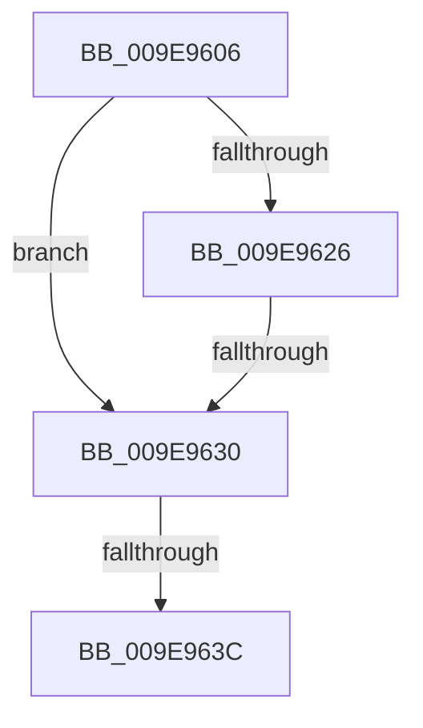

# sub_009E9606

- RVA: `0x009E9606`–`0x009E966F` (길이 `105` bytes)
- VA: `0x00000001409E9606`
- 실행 섹션: `PAGE`
- PDB 이름 있음: `아니요`; PDB Function 태그: `아니요`
- unwind 정보 RVA: `0x000A5080`
- 디코드: `27`개 명령, `105/105` bytes 표시
- 미해석 바이트: `0` (있으면 어셈블리에 `.byte`로 보존)

> 이 문서는 커널 이미지의 기계어와 PDB 기호를 분석해 생성했습니다. 4번과 5번은 함수 원형과 자료형을 바이너리 사용 방식에서 추정한 C 해석이며 원본 소스 복구 결과는 아닙니다.

## 1. Dependencies

- 직접 호출 지점: **1**; 고유 호출 대상: **1**
- 직접 호출자로 확인된 함수: **0**
- RIP 상대 이미지 참조: **0**

### Outgoing calls
- `0x009E9655` → [MmUnmapViewInSystemCache](../../text/29/MmUnmapViewInSystemCache_function_00293B70.md) (function, `0x00293B70`)

### Direct callers
- 이 함수 시작 RVA로 연결되는 직접 call은 확인되지 않았습니다. 간접 호출은 완전히 역산할 수 없습니다.

### Static image references
- 디코드된 RIP-relative 메모리 참조가 없습니다.

## 2. Other-region calls and transfers

- 다른 실행 섹션으로 향하는 call: **1**
  - `0x009E9655` → [MmUnmapViewInSystemCache](../../text/29/MmUnmapViewInSystemCache_function_00293B70.md) (`PAGE` → `.text`)
- call이 아닌 외부 분기/꼬리 이동: **3**
  - `0x009E962E` → [sub_009E967D](Unknown_function_009E967D.md) (`tail-transfer`)
  - `0x009E963A` → [sub_009E967D + 0x7](Unknown_function_009E967D.md) (`tail-transfer`)
  - `0x009E966D` → [sub_009E966F + 0x7](Unknown_function_009E966F.md) (`tail-transfer`)

## 3. Assembly (complete function range)

```asm
009E9606  48 89 5C 24 50                  mov qword ptr [rsp + 0x50], rbx
009E960B  48 8B F9                        mov rdi, rcx
009E960E  48 89 6C 24 58                  mov qword ptr [rsp + 0x58], rbp
009E9613  41 8B D8                        mov ebx, r8d
009E9616  48 89 74 24 60                  mov qword ptr [rsp + 0x60], rsi
009E961B  48 8B EA                        mov rbp, rdx
009E961E  33 F6                           xor esi, esi
009E9620  41 F6 C0 01                     test r8b, 1
009E9624  74 0A                           je 0x1409e9630
009E9626  8B 82 98 00 00 00               mov eax, dword ptr [rdx + 0x98]
009E962C  A8 40                           test al, 0x40
009E962E  75 4D                           jne 0x1409e967d
009E9630  8B 82 98 00 00 00               mov eax, dword ptr [rdx + 0x98]
009E9636  0F BA E0 15                     bt eax, 0x15
009E963A  72 48                           jb 0x1409e9684
009E963C  48 8B 95 B0 00 00 00            mov rdx, qword ptr [rbp + 0xb0]
009E9643  44 8B C6                        mov r8d, esi
009E9646  48 8B 0F                        mov rcx, qword ptr [rdi]
009E9649  41 83 C8 02                     or r8d, 2
009E964D  0F BA E3 01                     bt ebx, 1
009E9651  44 0F 43 C6                     cmovae r8d, esi
009E9655  E8 16 A5 8A FF                  call 0x140293b70
009E965A  48 8B 74 24 60                  mov rsi, qword ptr [rsp + 0x60]
009E965F  0F BA E3 01                     bt ebx, 1
009E9663  48 8B 5C 24 50                  mov rbx, qword ptr [rsp + 0x50]
009E9668  48 8B 6C 24 58                  mov rbp, qword ptr [rsp + 0x58]
009E966D  72 07                           jb 0x1409e9676
```

## 4. C-style interpretation (structured pseudocode)

```c
__int64 __fastcall sub_009E9606(__int64 a1, __int64 a2, int a3, __int64 a4, __int64 a5, __int64 a6, __int64 a7, __int64 a8, __int64 a9, __int64 a10, __int64 a11, __int64 a12)
{
    __int64 result;
    __int64 v_rsi;
    unsigned __int64 v_stack_p50;
    unsigned __int64 v_stack_p58;
    unsigned __int64 v_stack_p60;

    v_stack_p50 = v_rbx;
    v_stack_p58 = v_rbp;
    v_stack_p60 = v_rsi;
    v_rsi = 0;
    if ((((unsigned __int8)(a3)) & (1)) == 0) goto loc_009E9630;
loc_009E9630:
    a3 = (unsigned int)((0) | (2));
    if (condition_is_above_or_equal) { a3 = 0; }
    result = MmUnmapViewInSystemCache(*(unsigned __int64 *)(a1), *(unsigned __int64 *)(a2 + 176), a3, a4);
}
```

## 5. (Beta) C Style

```c
int64_t sub_009E9606(void *Arg1, void *Arg2, int32_t Arg3, int64_t Arg4, uint64_t Arg5, uint64_t Arg6, uint64_t Arg7, uint64_t Arg8, uint64_t Arg9, int64_t Arg10, int64_t Arg11, int64_t Arg12)
{
    uint8_t *arg1 = (uint8_t *)Arg1;
    uint8_t *arg2 = (uint8_t *)Arg2;

    int64_t result;
    int64_t local_rsi;
    uint64_t v_stack_p50;
    uint64_t v_stack_p58;
    uint64_t v_stack_p60;

    v_stack_p50 = local_rbx;
    v_stack_p58 = local_rbp;
    v_stack_p60 = local_rsi;
    local_rsi = 0;
    if ((((uint8_t)(Arg3)) & (1)) == 0) goto loc_009E9630;
loc_009E9630:
    Arg3 = (uint32_t)((0) | (2));
    if (condition_is_above_or_equal) { Arg3 = 0; }
    result = MmUnmapViewInSystemCache(*(uint64_t *)(arg1), *(uint64_t *)(arg2 + 0xB0), Arg3, Arg4);
}
```

### 관측된 메모리 오프셋

구조체 형식이 확인되지 않은 접근은 인자 기준의 오프셋으로만 기록했습니다.

| 기준 인자 | 오프셋 표현 | 폭 (bit) | 접근 |
|---|---:|---:|---|
| `Arg1` | `+ 0x0` | `64` | `R` |
| `Arg2` | `+ 0x98` | `32` | `R` |
| `Arg2` | `+ 0xB0` | `64` | `R` |

## 6. Execution-region graph

[열기: 2D/3D 그래프와 함수 탐색 컨트롤 패널](../../../control-panel.html?section=page&rva=0x009E9606&view=graph)

- 2D 그래프는 위에서 아래로 흐르고, 3D 그래프는 빈 공간을 드래그해 회전합니다. Shift+드래그는 이동, 휠은 확대·축소, 함수 노드 선택은 대상 보고서 이동입니다.

### Static fallback


