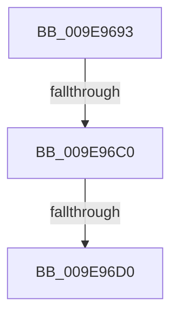

# sub_009E9693

- RVA: `0x009E9693`–`0x009E96D3` (길이 `64` bytes)
- VA: `0x00000001409E9693`
- 실행 섹션: `PAGE`
- PDB 이름 있음: `아니요`; PDB Function 태그: `아니요`
- unwind 정보 RVA: `0x000A50CC`
- 디코드: `13`개 명령, `64/64` bytes 표시
- 미해석 바이트: `0` (있으면 어셈블리에 `.byte`로 보존)

> 이 문서는 커널 이미지의 기계어와 PDB 기호를 분석해 생성했습니다. 4번과 5번은 함수 원형과 자료형을 바이너리 사용 방식에서 추정한 C 해석이며 원본 소스 복구 결과는 아닙니다.

## 1. Dependencies

- 직접 호출 지점: **1**; 고유 호출 대상: **1**
- 직접 호출자로 확인된 함수: **0**
- RIP 상대 이미지 참조: **0**

### Outgoing calls
- `0x009E96C3` → [PfCheckDeprioritizeImage](PfCheckDeprioritizeImage_function_009E97A8.md) (function, `0x009E97A8`)

### Direct callers
- 이 함수 시작 RVA로 연결되는 직접 call은 확인되지 않았습니다. 간접 호출은 완전히 역산할 수 없습니다.

### Static image references
- 디코드된 RIP-relative 메모리 참조가 없습니다.

## 2. Other-region calls and transfers

- 다른 실행 섹션으로 향하는 call: **0**
- call이 아닌 외부 분기/꼬리 이동: **2**
  - `0x009E96BA` → [sub_009E9762](Unknown_function_009E9762.md) (`tail-transfer`)
  - `0x009E96CA` → [sub_009E9762 + 0xD](Unknown_function_009E9762.md) (`tail-transfer`)

## 3. Assembly (complete function range)

```asm
009E9693  4C 89 74 24 28                  mov qword ptr [rsp + 0x28], r14
009E9698  4C 89 7C 24 20                  mov qword ptr [rsp + 0x20], r15
009E969D  4C 8D BA 08 02 00 00            lea r15, [rdx + 0x208]
009E96A4  41 8B 0F                        mov ecx, dword ptr [r15]
009E96A7  4C 8B B0 B8 00 00 00            mov r14, qword ptr [rax + 0xb8]
009E96AE  4C 89 64 24 38                  mov qword ptr [rsp + 0x38], r12
009E96B3  41 39 8E 84 03 00 00            cmp dword ptr [r14 + 0x384], ecx
009E96BA  0F 84 A2 00 00 00               je 0x1409e9762
009E96C0  4D 8B E7                        mov r12, r15
009E96C3  E8 E0 00 00 00                  call 0x1409e97a8
009E96C8  85 C0                           test eax, eax
009E96CA  0F 84 9F 00 00 00               je 0x1409e976f
009E96D0  48 8B CD                        mov rcx, rbp
```

## 4. C-style interpretation (structured pseudocode)

```c
__int64 __fastcall sub_009E9693(__int64 a1, __int64 a2)
{
    __int64 result;
    unsigned __int64 v_stack_p20;
    unsigned __int64 v_stack_p28;
    unsigned __int64 v_stack_p38;

    v_stack_p28 = v_r14;
    v_stack_p20 = v_r15;
    v_stack_p38 = v_r12;
    result = PfCheckDeprioritizeImage((unsigned int)(*(unsigned int *)(a2 + 520)), a2, a3, a4);
    return result;
}
```

## 5. (Beta) C Style

```c
int64_t sub_009E9693(int64_t Arg1, void *Arg2)
{
    uint8_t *arg2 = (uint8_t *)Arg2;

    int64_t result;
    uint64_t v_stack_p20;
    uint64_t v_stack_p28;
    uint64_t v_stack_p38;

    v_stack_p28 = local_r14;
    v_stack_p20 = local_r15;
    v_stack_p38 = local_r12;
    result = PfCheckDeprioritizeImage((uint32_t)(*(uint32_t *)(arg2 + 0x208)), Arg2, a3, a4);
    return result;
}
```

### 관측된 메모리 오프셋

구조체 형식이 확인되지 않은 접근은 인자 기준의 오프셋으로만 기록했습니다.

| 기준 인자 | 오프셋 표현 | 폭 (bit) | 접근 |
|---|---:|---:|---|
| `Arg2` | `+ 0x0` | `32` | `R` |
| `Arg2` | `+ 0x208` | `64` | `R` |

## 6. Execution-region graph

[열기: 2D/3D 그래프와 함수 탐색 컨트롤 패널](../../../control-panel.html?section=page&rva=0x009E9693&view=graph)

- 2D 그래프는 위에서 아래로 흐르고, 3D 그래프는 빈 공간을 드래그해 회전합니다. Shift+드래그는 이동, 휠은 확대·축소, 함수 노드 선택은 대상 보고서 이동입니다.

### Static fallback


