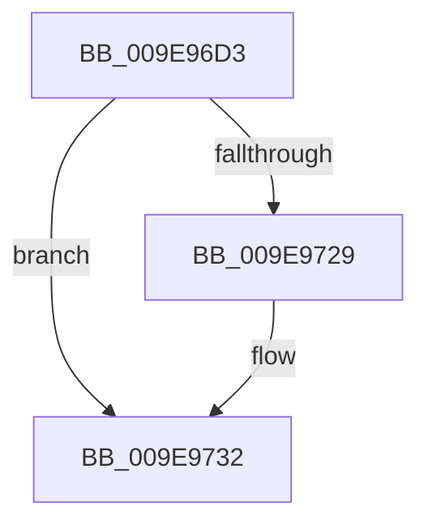

# sub_009E96D3

- RVA: `0x009E96D3`–`0x009E9749` (길이 `118` bytes)
- VA: `0x00000001409E96D3`
- 실행 섹션: `PAGE`
- PDB 이름 있음: `아니요`; PDB Function 태그: `아니요`
- unwind 정보 RVA: `0x000A50E8`
- 디코드: `30`개 명령, `118/118` bytes 표시
- 미해석 바이트: `0` (있으면 어셈블리에 `.byte`로 보존)

> 이 문서는 커널 이미지의 기계어와 PDB 기호를 분석해 생성했습니다. 4번과 5번은 함수 원형과 자료형을 바이너리 사용 방식에서 추정한 C 해석이며 원본 소스 복구 결과는 아닙니다.

## 1. Dependencies

- 직접 호출 지점: **3**; 고유 호출 대상: **3**
- 직접 호출자로 확인된 함수: **0**
- RIP 상대 이미지 참조: **0**

### Outgoing calls
- `0x009E96D8` → [CcReferenceSharedCacheMapFileObject](../../text/23/CcReferenceSharedCacheMapFileObject_function_002379BC.md) (function, `0x002379BC`)
- `0x009E96EE` → [ObFastDereferenceObjectDeferDelete](../../text/23/ObFastDereferenceObjectDeferDelete_function_002378C0.md) (function, `0x002378C0`)
- `0x009E973B` → [PfCheckDeprioritizeFile](../88/PfCheckDeprioritizeFile_function_00887F6C.md) (function, `0x00887F6C`)

### Direct callers
- 이 함수 시작 RVA로 연결되는 직접 call은 확인되지 않았습니다. 간접 호출은 완전히 역산할 수 없습니다.

### Static image references
- 디코드된 RIP-relative 메모리 참조가 없습니다.

## 2. Other-region calls and transfers

- 다른 실행 섹션으로 향하는 call: **2**
  - `0x009E96D8` → [CcReferenceSharedCacheMapFileObject](../../text/23/CcReferenceSharedCacheMapFileObject_function_002379BC.md) (`PAGE` → `.text`)
  - `0x009E96EE` → [ObFastDereferenceObjectDeferDelete](../../text/23/ObFastDereferenceObjectDeferDelete_function_002378C0.md) (`PAGE` → `.text`)
- call이 아닌 외부 분기/꼬리 이동: **1**
  - `0x009E9747` → [sub_009E9762 + 0xD](Unknown_function_009E9762.md) (`tail-transfer`)

## 3. Assembly (complete function range)

```asm
009E96D3  4C 89 6C 24 30                  mov qword ptr [rsp + 0x30], r13
009E96D8  E8 DF E2 84 FF                  call 0x1402379bc
009E96DD  48 8D 4D 60                     lea rcx, [rbp + 0x60]
009E96E1  41 B8 43 63 53 63               mov r8d, 0x63536343
009E96E7  48 8B D0                        mov rdx, rax
009E96EA  4C 8B 68 18                     mov r13, qword ptr [rax + 0x18]
009E96EE  E8 CD E1 84 FF                  call 0x1402378c0
009E96F3  48 8B 4D 08                     mov rcx, qword ptr [rbp + 8]
009E96F7  48 8B C6                        mov rax, rsi
009E96FA  4C 8B 4F 10                     mov r9, qword ptr [rdi + 0x10]
009E96FE  48 F7 C1 FF 0F 00 00            test rcx, 0xfff
009E9705  0F 95 C0                        setne al
009E9708  49 C1 F9 0C                     sar r9, 0xc
009E970C  49 83 E1 C0                     and r9, 0xffffffffffffffc0
009E9710  48 C1 F9 0C                     sar rcx, 0xc
009E9714  49 83 C1 40                     add r9, 0x40
009E9718  48 8D 14 08                     lea rdx, [rax + rcx]
009E971C  49 3B D1                        cmp rdx, r9
009E971F  4C 0F 42 CA                     cmovb r9, rdx
009E9723  49 83 F9 01                     cmp r9, 1
009E9727  77 09                           ja 0x1409e9732
009E9729  41 B9 01 00 00 00               mov r9d, 1
009E972F  4D 8B FC                        mov r15, r12
009E9732  41 8B 17                        mov edx, dword ptr [r15]
009E9735  4D 8B C5                        mov r8, r13
009E9738  49 8B CE                        mov rcx, r14
009E973B  E8 2C E8 E9 FF                  call 0x140887f6c
009E9740  4C 8B 6C 24 30                  mov r13, qword ptr [rsp + 0x30]
009E9745  85 C0                           test eax, eax
009E9747  74 26                           je 0x1409e976f
```

## 4. C-style interpretation (structured pseudocode)

```c
__int64 __fastcall sub_009E96D3(__int64 a1, __int64 a2, __int64 a3, __int64 a4, __int64 a5, __int64 a6)
{
    __int64 result;
    __int64 v_r15;
    unsigned __int64 v_stack_p30;

    v_stack_p30 = v_r13;
    result = CcReferenceSharedCacheMapFileObject(a1, a2, a3, a4);
    result = ObFastDereferenceObjectDeferDelete(v_rbp + 96, result, (unsigned int)(0x63536343ULL), a4);
    result = (((*(unsigned __int64 *)(v_rbp + 8)) & (0xFFFULL)) != 0) ? 1 : 0;
    a4 = (*(unsigned __int64 *)(v_rdi + 16)) >> (12);
    a4 = (a4) & (-64);
    a1 = (*(unsigned __int64 *)(v_rbp + 8)) >> (12);
    a4 = (a4) + (64);
    if ((result + a1 * 1) < a4) { a4 = result + a1 * 1; }
    if (a4 <= 1) {
        a4 = 1;
        v_r15 = v_r12;
    }
    result = PfCheckDeprioritizeFile(v_r14, (unsigned int)(*(unsigned int *)(v_r15)), *(unsigned __int64 *)(result + 24), a4);
}
```

## 5. (Beta) C Style

```c
int64_t sub_009E96D3(int64_t Arg1, int64_t Arg2, int64_t Arg3, int64_t Arg4, uint64_t Arg5, int64_t Arg6)
{
    int64_t result;
    int64_t local_r15;
    uint64_t v_stack_p30;

    v_stack_p30 = local_r13;
    result = CcReferenceSharedCacheMapFileObject(Arg1, Arg2, Arg3, Arg4);
    result = ObFastDereferenceObjectDeferDelete(local_rbp + 96, result, (uint32_t)(0x63536343ULL), Arg4);
    result = (((*(uint64_t *)(local_rbp + 0x8)) & (0xFFFULL)) != 0) ? 1 : 0;
    Arg4 = (*(uint64_t *)(local_rdi + 0x10)) >> (12);
    Arg4 = (Arg4) & (-64);
    Arg1 = (*(uint64_t *)(local_rbp + 0x8)) >> (12);
    Arg4 = (Arg4) + (64);
    if ((result + Arg1 * 1) < Arg4) { Arg4 = result + Arg1 * 1; }
    if (Arg4 <= 1) {
        Arg4 = 1;
        local_r15 = local_r12;
    }
    result = PfCheckDeprioritizeFile(local_r14, (uint32_t)(*(uint32_t *)(local_r15)), *(uint64_t *)(result + 0x18), Arg4);
}
```

## 6. Execution-region graph

[열기: 2D/3D 그래프와 함수 탐색 컨트롤 패널](../../../control-panel.html?section=page&rva=0x009E96D3&view=graph)

- 2D 그래프는 위에서 아래로 흐르고, 3D 그래프는 빈 공간을 드래그해 회전합니다. Shift+드래그는 이동, 휠은 확대·축소, 함수 노드 선택은 대상 보고서 이동입니다.

### Static fallback


