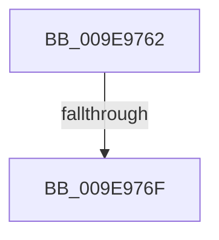

# sub_009E9762

- RVA: `0x009E9762`–`0x009E9793` (길이 `49` bytes)
- VA: `0x00000001409E9762`
- 실행 섹션: `PAGE`
- PDB 이름 있음: `아니요`; PDB Function 태그: `아니요`
- unwind 정보 RVA: `0x000A510C`
- 디코드: `10`개 명령, `49/49` bytes 표시
- 미해석 바이트: `0` (있으면 어셈블리에 `.byte`로 보존)

> 이 문서는 커널 이미지의 기계어와 PDB 기호를 분석해 생성했습니다. 4번과 5번은 함수 원형과 자료형을 바이너리 사용 방식에서 추정한 C 해석이며 원본 소스 복구 결과는 아닙니다.

## 1. Dependencies

- 직접 호출 지점: **1**; 고유 호출 대상: **1**
- 직접 호출자로 확인된 함수: **0**
- RIP 상대 이미지 참조: **0**

### Outgoing calls
- `0x009E977A` → [CcUpdateSharedCacheMapFlag](../../text/45/CcUpdateSharedCacheMapFlag_function_0045EC14.md) (function, `0x0045EC14`)

### Direct callers
- 이 함수 시작 RVA로 연결되는 직접 call은 확인되지 않았습니다. 간접 호출은 완전히 역산할 수 없습니다.

### Static image references
- 디코드된 RIP-relative 메모리 참조가 없습니다.

## 2. Other-region calls and transfers

- 다른 실행 섹션으로 향하는 call: **1**
  - `0x009E977A` → [CcUpdateSharedCacheMapFlag](../../text/45/CcUpdateSharedCacheMapFlag_function_0045EC14.md) (`PAGE` → `.text`)
- call이 아닌 외부 분기/꼬리 이동: **2**
  - `0x009E976D` → [sub_009E9793](Unknown_function_009E9793.md) (`tail-transfer`)
  - `0x009E978E` → [sub_009E9606 + 0x36](Unknown_function_009E9606.md) (`tail-transfer`)

## 3. Assembly (complete function range)

```asm
009E9762  41 F7 86 F4 01 00 00 00 40 00 00  test dword ptr [r14 + 0x1f4], 0x4000
009E976D  75 24                           jne 0x1409e9793
009E976F  45 33 C0                        xor r8d, r8d
009E9772  BA 00 00 20 00                  mov edx, 0x200000
009E9777  48 8B CD                        mov rcx, rbp
009E977A  E8 95 54 A7 FF                  call 0x14045ec14
009E977F  4C 8B 64 24 38                  mov r12, qword ptr [rsp + 0x38]
009E9784  4C 8B 74 24 28                  mov r14, qword ptr [rsp + 0x28]
009E9789  4C 8B 7C 24 20                  mov r15, qword ptr [rsp + 0x20]
009E978E  E9 A9 FE FF FF                  jmp 0x1409e963c
```

## 4. C-style interpretation (structured pseudocode)

```c
__int64 __fastcall sub_009E9762(__int64 a1, __int64 a2, int a3, __int64 a4, __int64 a5, __int64 a6, __int64 a7)
{
    __int64 result;
    unsigned __int64 v_stack_p20;

    a3 = 0;
    result = CcUpdateSharedCacheMapFlag(v_rbp, (unsigned int)(0x200000ULL), a3, a4);
}
```

## 5. (Beta) C Style

```c
int64_t sub_009E9762(int64_t Arg1, int64_t Arg2, int32_t Arg3, int64_t Arg4, int64_t Arg5, uint64_t Arg6, int64_t Arg7)
{
    int64_t result;
    uint64_t v_stack_p20;

    Arg3 = 0;
    result = CcUpdateSharedCacheMapFlag(local_rbp, (uint32_t)(0x200000ULL), Arg3, Arg4);
}
```

## 6. Execution-region graph

[열기: 2D/3D 그래프와 함수 탐색 컨트롤 패널](../../../control-panel.html?section=page&rva=0x009E9762&view=graph)

- 2D 그래프는 위에서 아래로 흐르고, 3D 그래프는 빈 공간을 드래그해 회전합니다. Shift+드래그는 이동, 휠은 확대·축소, 함수 노드 선택은 대상 보고서 이동입니다.

### Static fallback


