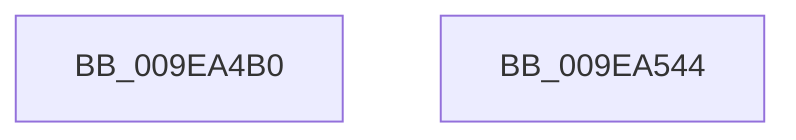

# sub_009EA4B0

- RVA: `0x009EA4B0`–`0x009EA545` (길이 `149` bytes)
- VA: `0x00000001409EA4B0`
- 실행 섹션: `PAGE`
- PDB 이름 있음: `아니요`; PDB Function 태그: `아니요`
- unwind 정보 RVA: `0x00069588`
- 디코드: `39`개 명령, `149/149` bytes 표시
- 미해석 바이트: `0` (있으면 어셈블리에 `.byte`로 보존)

> 이 문서는 커널 이미지의 기계어와 PDB 기호를 분석해 생성했습니다. 4번과 5번은 함수 원형과 자료형을 바이너리 사용 방식에서 추정한 C 해석이며 원본 소스 복구 결과는 아닙니다.

## 1. Dependencies

- 직접 호출 지점: **0**; 고유 호출 대상: **0**
- 직접 호출자로 확인된 함수: **0**
- RIP 상대 이미지 참조: **0**

### Outgoing calls
- 직접 디코드된 call 명령이 없습니다.

### Direct callers
- 이 함수 시작 RVA로 연결되는 직접 call은 확인되지 않았습니다. 간접 호출은 완전히 역산할 수 없습니다.

### Static image references
- 디코드된 RIP-relative 메모리 참조가 없습니다.

## 2. Other-region calls and transfers

- 다른 실행 섹션으로 향하는 call: **0**
- 별도 외부 분기/꼬리 이동을 확인하지 못했습니다.

## 3. Assembly (complete function range)

```asm
009EA4B0  48 89 5C 24 08                  mov qword ptr [rsp + 8], rbx
009EA4B5  48 89 74 24 10                  mov qword ptr [rsp + 0x10], rsi
009EA4BA  48 89 7C 24 18                  mov qword ptr [rsp + 0x18], rdi
009EA4BF  44 8B 54 24 38                  mov r10d, dword ptr [rsp + 0x38]
009EA4C4  48 8B F9                        mov rdi, rcx
009EA4C7  4C 8B DA                        mov r11, rdx
009EA4CA  49 8B F0                        mov rsi, r8
009EA4CD  4C 8B 44 24 30                  mov r8, qword ptr [rsp + 0x30]
009EA4D2  41 0F B6 CB                     movzx ecx, r11b
009EA4D6  83 E7 03                        and edi, 3
009EA4D9  48 B8 89 88 88 88 88 88 88 88   movabs rax, 0x8888888888888889
009EA4E3  48 F7 E2                        mul rdx
009EA4E6  41 F7 D2                        not r10d
009EA4E9  48 B8 AB AA AA AA AA AA AA AA   movabs rax, 0xaaaaaaaaaaaaaaab
009EA4F3  48 C1 EA 03                     shr rdx, 3
009EA4F7  41 8B DA                        mov ebx, r10d
009EA4FA  4C 6B CA 0F                     imul r9, rdx, 0xf
009EA4FE  48 F7 E6                        mul rsi
009EA501  41 2A C9                        sub cl, r9b
009EA504  45 2A CB                        sub r9b, r11b
009EA507  FE C1                           inc cl
009EA509  D3 EB                           shr ebx, cl
009EA50B  41 8D 49 1F                     lea ecx, [r9 + 0x1f]
009EA50F  41 D3 E2                        shl r10d, cl
009EA512  41 0F B7 0C 78                  movzx ecx, word ptr [r8 + rdi*2]
009EA517  41 0B DA                        or ebx, r10d
009EA51A  03 D9                           add ebx, ecx
009EA51C  48 D1 EA                        shr rdx, 1
009EA51F  48 8D 4E 01                     lea rcx, [rsi + 1]
009EA523  48 03 D7                        add rdx, rdi
009EA526  48 8B 74 24 10                  mov rsi, qword ptr [rsp + 0x10]
009EA52B  48 03 CA                        add rcx, rdx
009EA52E  48 8B 7C 24 18                  mov rdi, qword ptr [rsp + 0x18]
009EA533  83 E1 03                        and ecx, 3
009EA536  41 0F B7 04 48                  movzx eax, word ptr [r8 + rcx*2]
009EA53B  0F AF C3                        imul eax, ebx
009EA53E  48 8B 5C 24 08                  mov rbx, qword ptr [rsp + 8]
009EA543  C3                              ret
009EA544  CC                              int3
```

## 4. C-style interpretation (structured pseudocode)

```c
__int64 __fastcall sub_009EA4B0(__int64 a1, __int64 a2, __int64 a3, __int64 a4, __int64 a5, __int64 a6, unsigned int a7)
{
    __int64 result;
    __int64 v_r10;
    __int64 v_rbx;
    __int64 v_rdi;
    unsigned __int64 v_stack_p10;
    unsigned __int64 v_stack_p18;
    unsigned __int64 v_stack_p8;

    v_stack_p8 = v_rbx;
    v_stack_p10 = v_rsi;
    v_stack_p18 = v_rdi;
    v_rdi = (unsigned int)((a1) & (3));
    v_r10 = (unsigned int)(~((unsigned int)(a7)));
    a2 = (a2) >> (3);
    a4 = (a4) * (a2);
    a1 = (unsigned __int8)(((unsigned __int8)(a2)) - ((unsigned __int8)(a4)));
    a4 = (unsigned __int8)((a4) - ((unsigned __int8)(a2)));
    a1 = (unsigned __int8)((a1) + 1);
    v_rbx = (unsigned int)(((unsigned int)((unsigned int)(v_r10))) >> ((unsigned __int8)(a1)));
    v_r10 = (unsigned int)((v_r10) << ((unsigned __int8)(a4 + 31)));
    v_rbx = (unsigned int)((v_rbx) | ((unsigned int)(v_r10)));
    v_rbx = (unsigned int)((v_rbx) + ((unsigned int)(*(unsigned __int16 *)(a6 + v_rdi * 2))));
    a2 = (a2) >> (1);
    a2 = (a2) + (v_rdi);
    a1 = (a3 + 1) + (a2);
    a1 = (unsigned int)((a1) & (3));
    result = (unsigned int)((*(unsigned __int16 *)(a6 + a1 * 2)) * ((unsigned int)(v_rbx)));
    return result;
}
```

## 5. (Beta) C Style

```c
int64_t sub_009EA4B0(int64_t Arg1, int64_t Arg2, int64_t Arg3, void *Arg4, uint64_t Arg5, void *Arg6, uint32_t Arg7)
{
    uint8_t *arg4 = (uint8_t *)Arg4;
    uint8_t *arg6 = (uint8_t *)Arg6;

    int64_t result;
    int64_t local_r10;
    int64_t local_rbx;
    int64_t local_rdi;
    uint64_t v_stack_p10;
    uint64_t v_stack_p18;
    uint64_t v_stack_p8;

    v_stack_p8 = local_rbx;
    v_stack_p10 = local_rsi;
    v_stack_p18 = local_rdi;
    local_rdi = (uint32_t)((Arg1) & (3));
    local_r10 = (uint32_t)(~((uint32_t)(Arg7)));
    Arg2 = (Arg2) >> (3);
    Arg4 = (Arg4) * (Arg2);
    Arg1 = (uint8_t)(((uint8_t)(Arg2)) - ((uint8_t)(Arg4)));
    Arg4 = (uint8_t)((Arg4) - ((uint8_t)(Arg2)));
    Arg1 = (uint8_t)((Arg1) + 1);
    local_rbx = (uint32_t)(((uint32_t)((uint32_t)(local_r10))) >> ((uint8_t)(Arg1)));
    local_r10 = (uint32_t)((local_r10) << ((uint8_t)(Arg4 + 31)));
    local_rbx = (uint32_t)((local_rbx) | ((uint32_t)(local_r10)));
    local_rbx = (uint32_t)((local_rbx) + ((uint32_t)(*(uint16_t *)(arg6 + local_rdi * 2))));
    Arg2 = (Arg2) >> (1);
    Arg2 = (Arg2) + (local_rdi);
    Arg1 = (Arg3 + 1) + (Arg2);
    Arg1 = (uint32_t)((Arg1) & (3));
    result = (uint32_t)((*(uint16_t *)(arg6 + Arg1 * 2)) * ((uint32_t)(local_rbx)));
    return result;
}
```

### 관측된 메모리 오프셋

구조체 형식이 확인되지 않은 접근은 인자 기준의 오프셋으로만 기록했습니다.

| 기준 인자 | 오프셋 표현 | 폭 (bit) | 접근 |
|---|---:|---:|---|
| `Arg4` | `+ 0x1F` | `32` | `R` |
| `Arg6` | `+ 0x0 + rcx*2` | `16` | `R` |
| `Arg6` | `+ 0x0 + rdi*2` | `16` | `R` |

## 6. Execution-region graph

[열기: 2D/3D 그래프와 함수 탐색 컨트롤 패널](../../../control-panel.html?section=page&rva=0x009EA4B0&view=graph)

- 2D 그래프는 위에서 아래로 흐르고, 3D 그래프는 빈 공간을 드래그해 회전합니다. Shift+드래그는 이동, 휠은 확대·축소, 함수 노드 선택은 대상 보고서 이동입니다.

### Static fallback


