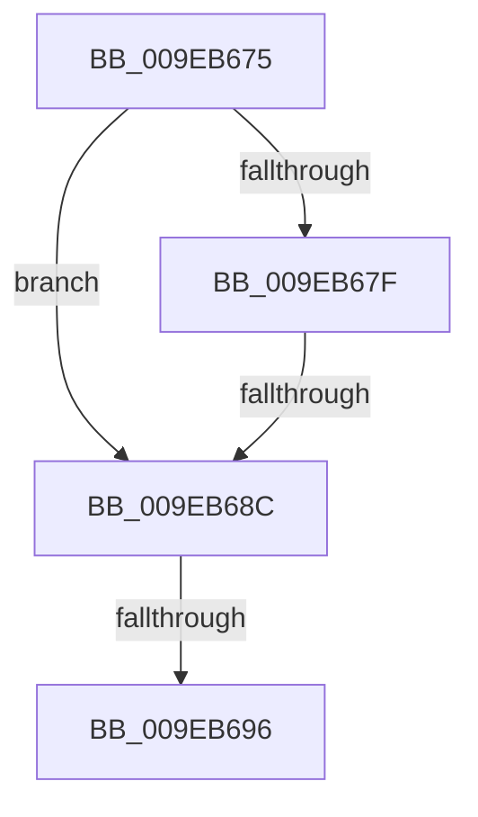

# sub_009EB675

- RVA: `0x009EB675`–`0x009EB6AB` (길이 `54` bytes)
- VA: `0x00000001409EB675`
- 실행 섹션: `PAGE`
- PDB 이름 있음: `아니요`; PDB Function 태그: `아니요`
- unwind 정보 RVA: `0x000A5560`
- 디코드: `15`개 명령, `54/54` bytes 표시
- 미해석 바이트: `0` (있으면 어셈블리에 `.byte`로 보존)

> 이 문서는 커널 이미지의 기계어와 PDB 기호를 분석해 생성했습니다. 4번과 5번은 함수 원형과 자료형을 바이너리 사용 방식에서 추정한 C 해석이며 원본 소스 복구 결과는 아닙니다.

## 1. Dependencies

- 직접 호출 지점: **0**; 고유 호출 대상: **0**
- 직접 호출자로 확인된 함수: **0**
- RIP 상대 이미지 참조: **0**

### Outgoing calls
- 직접 디코드된 call 명령이 없습니다.

### Direct callers
- 이 함수 시작 RVA로 연결되는 직접 call은 확인되지 않았습니다. 간접 호출은 완전히 역산할 수 없습니다.

### Static image references
- 디코드된 RIP-relative 메모리 참조가 없습니다.

## 2. Other-region calls and transfers

- 다른 실행 섹션으로 향하는 call: **0**
- call이 아닌 외부 분기/꼬리 이동: **3**
  - `0x009EB68A` → [sub_009EB6B7](Unknown_function_009EB6B7.md) (`tail-transfer`)
  - `0x009EB694` → [sub_009EB6AB](Unknown_function_009EB6AB.md) (`tail-transfer`)
  - `0x009EB6A9` → [IopCheckTopDeviceHint + 0x60](IopCheckTopDeviceHint_function_009EB5F0.md) (`tail-transfer`)

## 3. Assembly (complete function range)

```asm
009EB675  4C 89 7C 24 30                  mov qword ptr [rsp + 0x30], r15
009EB67A  48 85 C0                        test rax, rax
009EB67D  74 0D                           je 0x1409eb68c
009EB67F  48 8B 58 08                     mov rbx, qword ptr [rax + 8]
009EB683  48 8D 48 08                     lea rcx, [rax + 8]
009EB687  48 3B D9                        cmp rbx, rcx
009EB68A  75 2B                           jne 0x1409eb6b7
009EB68C  8B 87 98 00 00 00               mov eax, dword ptr [rdi + 0x98]
009EB692  A8 10                           test al, 0x10
009EB694  74 15                           je 0x1409eb6ab
009EB696  4C 8B 7C 24 30                  mov r15, qword ptr [rsp + 0x30]
009EB69B  83 E0 EF                        and eax, 0xffffffef
009EB69E  89 87 98 00 00 00               mov dword ptr [rdi + 0x98], eax
009EB6A4  B8 68 03 00 C0                  mov eax, 0xc0000368
009EB6A9  EB A5                           jmp 0x1409eb650
```

## 4. C-style interpretation (structured pseudocode)

```c
__int64 __fastcall sub_009EB675(__int64 a1, __int64 a2, __int64 a3, __int64 a4, __int64 a5, __int64 a6)
{
    __int64 result;
    unsigned __int64 v_stack_p30;

    v_stack_p30 = v_r15;
    if (result == 0) goto loc_009EB68C;
loc_009EB68C:
    result = (unsigned int)(((unsigned int)(*(unsigned int *)(v_rdi + 152))) & (0xFFFFFFEFULL));
    *(unsigned int *)(v_rdi + 152) = (unsigned int)(result);
}
```

## 5. (Beta) C Style

```c
int64_t sub_009EB675(int64_t Arg1, int64_t Arg2, int64_t Arg3, int64_t Arg4, uint64_t Arg5, int64_t Arg6)
{
    int64_t result;
    uint64_t v_stack_p30;

    v_stack_p30 = local_r15;
    if (result == 0) goto loc_009EB68C;
loc_009EB68C:
    result = (uint32_t)(((uint32_t)(*(uint32_t *)(local_rdi + 0x98))) & (0xFFFFFFEFULL));
    *(uint32_t *)(local_rdi + 0x98) = (uint32_t)(result);
}
```

## 6. Execution-region graph

[열기: 2D/3D 그래프와 함수 탐색 컨트롤 패널](../../../control-panel.html?section=page&rva=0x009EB675&view=graph)

- 2D 그래프는 위에서 아래로 흐르고, 3D 그래프는 빈 공간을 드래그해 회전합니다. Shift+드래그는 이동, 휠은 확대·축소, 함수 노드 선택은 대상 보고서 이동입니다.

### Static fallback


